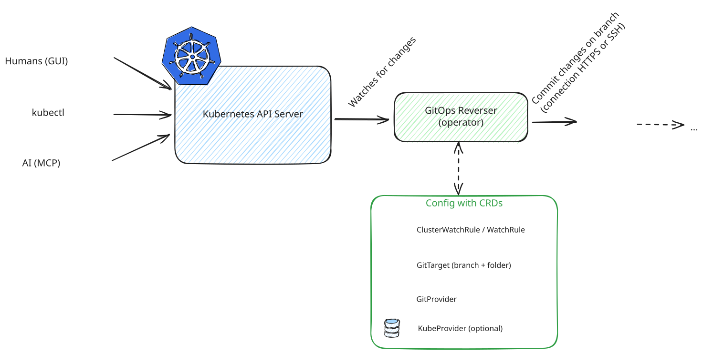
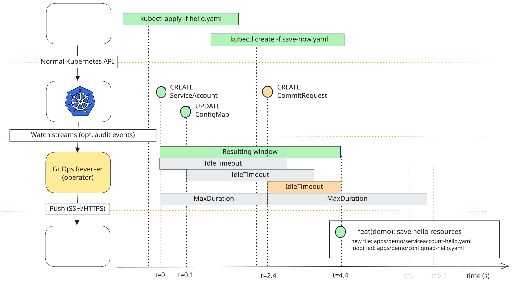

<!-- Badges lead this file on purpose; the H1 follows them. -->
<!-- markdownlint-disable-next-line MD041 -->
[](https://github.com/ConfigButler/gitops-reverser/actions/workflows/ci.yml)
[](https://scorecard.dev/viewer/?uri=github.com/ConfigButler/gitops-reverser)
[](https://www.bestpractices.dev/projects/13468)
[](https://github.com/ConfigButler/gitops-reverser/releases)
[](https://codecov.io/gh/ConfigButler/gitops-reverser)
[](https://www.apache.org/licenses/LICENSE-2.0)

[](https://github.com/ConfigButler/gitops-reverser/pkgs/container/gitops-reverser)
[](https://artifacthub.io/packages/search?repo=gitops-reverser)
[](https://github.com/ConfigButler/gitops-reverser/issues)

# GitOps Reverser

GitOps Reverser is a Kubernetes operator that turns cluster activity into clean YAML commits.

GitOps keeps the desired state of a cluster in Git, so every change has to arrive as a commit. That
requires everyone who makes a change to know Git, YAML, and the layout of your repo. With
GitOps Reverser they use the Kubernetes API instead: `kubectl`, a GUI, a CI job, or an AI agent over
MCP. It commits the result within seconds, and Flux or Argo CD keeps deploying from the repo.
The operator is **deterministic**, with **no AI at runtime**.

[Quick start](docs/quickstart.md) · [Documentation](docs/README.md)

<div align="center">
  
</div>

Inspect an [example commit](https://github.com/ConfigButler/example-audit/commit/800a51e5a8edcccbc85c94d5fef7ef7cc8381b7b).
Its named Kubernetes actor comes from optional [audit attribution](docs/attribution-setup-guide.md);
the default uses a configured Git identity.

## Why GitOps Reverser

Use it to:

- **Let people change the cluster without learning Git.** A GUI, a CI job, or an MCP agent works
  through the Kubernetes API, under its RBAC and admission control, and the change still lands in
  Git with the rest of your history.
- **Bring an existing cluster into Git.** A new target commits the selected resources already in the
  cluster, then follows their changes.
- **Keep Git in step with live edits.** A `kubectl` fix made during an incident becomes a commit
  instead of drift.

What sets it apart:

- **Your files keep their shape.** An update edits the existing YAML document in place: key order,
  comments, and untouched documents in multi-document files survive. In a supported Kustomize
  layout it edits the source manifest, not the rendered output. See [what it can write](#what-it-can-write).
- **Authors are established, never asserted.** With [audit attribution](docs/attribution-setup-guide.md),
  a commit names the identity the API server authenticated, and no field lets anyone type a name in.
  It needs kube-apiserver flags, so managed control planes that hide them cannot use it. See
  [attribution](docs/spec/attribution.md#authorship-is-established-never-asserted).
- **A commit can say why.** Changes are grouped into commit windows, and a `CommitRequest` lets the
  person making a change explain **why** it was necessary. See [commit windows](#commit-windows).

## How it works



1. **Watch** the Kubernetes API for the types each `GitTarget` claims, the single source of object
   state.
2. **Sanitize** the change, stripping `status`, `managedFields`, and runtime metadata, and compare it
   against what Git already holds.
3. **Write** stable YAML to the target folder and push, grouping a burst of changes into one commit.

A `GitTarget` names a folder on a Git branch, and a `WatchRule` or `ClusterWatchRule` says what to
capture into it. A few more custom resources hold the repo, its credentials, and the source
cluster. By default it watches its own cluster, and one operator can serve several source clusters,
repos, branches, and folders. See [Configuration](docs/configuration.md).

### What it can write

| Your source in Git | What you can do |
|---|---|
| Plain Kubernetes manifests | Capture resources and update their existing YAML documents |
| Supported Kustomize layouts | Update source manifests or image/replica declarations; add and remove resources |
| A Flux `HelmRelease` or Argo CD `Application` | Capture the declaration, including chart versions and inline values |
| Helm templates or standalone `values.yaml` | No writeback from rendered workloads |

Local Kustomize bases and overlays work, with the base kept read-only. Generators, components, and
remote bases are unsupported; such a folder is refused with `Stalled=True` before anything is
written. See the [supported subset](docs/configuration.md#kustomize-support-in-the-target-path).

Watch the resources that express your intent, such as a `HelmRelease` rather than the workloads it
renders: the operator cannot tell authored resources from generated ones. See
[choosing what to capture](docs/installing-apps-as-krm.md#the-design-decision-capture-intent-not-the-rendered-output).

### Commit windows

Changes for the same target and author share a commit window, and each window becomes one commit.
When a window closes is yours to tune: its timers are set per `GitTarget`, and a `CommitRequest` can
bring its own timers along with the commit message.



The picture shows the [commit-window example](docs/demo/commit-window.md) running on top of the
[quick start](#quick-start).

### Bi-directional GitOps with Flux and Argo CD

GitOps Reverser writes commits; Flux or Argo CD deploys them. Others can push to the same branch:
the operator replays its writes on top of their commits, so history stays linear with no merge
commits. If both touch the same resource, the API wins
([API-first publication](docs/api-first-publication.md)).

- [Bi-directional GitOps with Flux](docs/bi-directional-flux.md)
- [Bi-directional GitOps with Argo CD](docs/bi-directional-argocd.md)

## Quick start

Follow the [installation walkthrough](docs/quickstart.md) to capture ConfigMaps from a demo namespace
into a disposable repo. You need a Kubernetes cluster, `kubectl`, Helm 3, and Git write access.
The walkthrough includes cert-manager setup; Redis and audit delivery are optional.

The demo captures a live change:

```bash
kubectl create configmap test-config --from-literal=key=value -n gitops-reverser-quickstart-demo
```

Inspect the commit under `live-cluster/` in your repo. Then edit the ConfigMap and inspect the
next diff. The walkthrough includes status checks, troubleshooting, and cleanup.

## Features

- **Mirror only the objects you label.** A rule's `objectSelector` lets the API server choose which
  objects of a type are mirrored; an object that loses its label leaves the mirror like a deleted
  one. See [selecting objects by label](docs/configuration.md#selecting-objects-by-label-rulesobjectselector).
- **Secrets never reach Git in plaintext.** Resources classified as sensitive are encrypted with
  SOPS and age before commit, or the write is rejected. The operator creates the encryption
  configuration and can generate a missing age key. See [SOPS and age](docs/sops-age-guide.md).
- **Inspect a repo before you point at it.** `manifest-analyzer --mode scan-repo` classifies
  every candidate folder under a repo root, read-only and with no cluster. See
  [`cmd/manifest-analyzer/`](cmd/manifest-analyzer/).
- **The operational basics.** [SSH-signed commits](docs/commit-signing.md) and
  [custom commit message templates](docs/commit-messages.md). Conditions follow the kstatus
  convention, so `kubectl wait` works on every resource
  ([status conditions](docs/spec/status-conditions-guide.md)). Metrics are on a standard
  `/metrics` endpoint, with an optional `ServiceMonitor` and
  [example queries](docs/interpreting-metrics.md).

## Adopting it

### Try it with your existing repo

Start with a [scratch branch](docs/configuration.md#seeing-what-a-target-will-do-before-it-does-it)
containing your existing manifests, with nothing deploying that branch. Select a small resource
scope and one destination folder. Inspect the initial commits before making a live edit, then check
which source files changed.

The operator pushes directly to the configured branch. If Flux or Argo CD deploys the folder you
write, read
[bi-directional GitOps with Flux and Argo CD](#bi-directional-gitops-with-flux-and-argo-cd) first.

### Limits before 1.0

It is pre-1.0: the CRDs are `v1alpha3`, so the configuration surface can change between releases;
[`docs/UPGRADING.md`](docs/UPGRADING.md) carries each migration.

- **Access:** the chart defaults to cluster-wide read access, including Secrets. Review
  [RBAC](docs/rbac.md) to restrict watched types and understand the remaining credential permissions.
- **History:** batching can collapse intermediate edits. Unpublished work is held in memory and can
  be lost on restart; recovery captures current state. Git history is not a complete event log.
- **Deletes:** the default mirrors observed delete events but retains documents absent from a
  reconnect snapshot. Choose a [deletion policy](docs/configuration.md#deletion-policy-specprunemode)
  that fits your repo.
- **Availability:** it runs one replica, with no standby failover: the chart rejects
  `replicaCount > 1` rather than let two instances write the same repo.
- **Versions:** the test suites run against Kubernetes `1.37`, at the API level with `envtest`
  and end-to-end on `k3s`. Other versions may work but are not in the matrix.

The road to 1.0 is in [docs/TODO.md](docs/TODO.md), and longer-range directions in
[docs/future/](docs/future/).

## Rather have it managed?

ConfigButler can run a small, secure, public-facing Kubernetes API for you: we operate GitOps
Reverser and authorize your end users, and our engineers work with your team to get you started.
You keep a clean, self-owned Git repo where your users express their intent.

## Documentation and feedback

- [Configuration](docs/configuration.md): resource selection, Git destinations, and commit behavior
- [Helm chart](charts/gitops-reverser/README.md): installation options and upgrades
- [Architecture](docs/architecture.md#ground-rules): the design principles and how the pieces fit
- [Documentation index](docs/README.md): setup guides and operational details
- [Reverse GitOps](https://reversegitops.dev/): the manifesto for the broader pattern

Trying it with a real repo? [Open an issue](https://github.com/ConfigButler/gitops-reverser/issues)
with the layout you tried, the diff you expected, and what happened, or reach out on
[LinkedIn](https://www.linkedin.com/in/simonkoudijs/). Install attempts, Git output shape, and CRD
ergonomics are the most useful reports at this stage. Contributions are welcome; see
[CONTRIBUTING.md](CONTRIBUTING.md).

Licensed under Apache 2.0.
