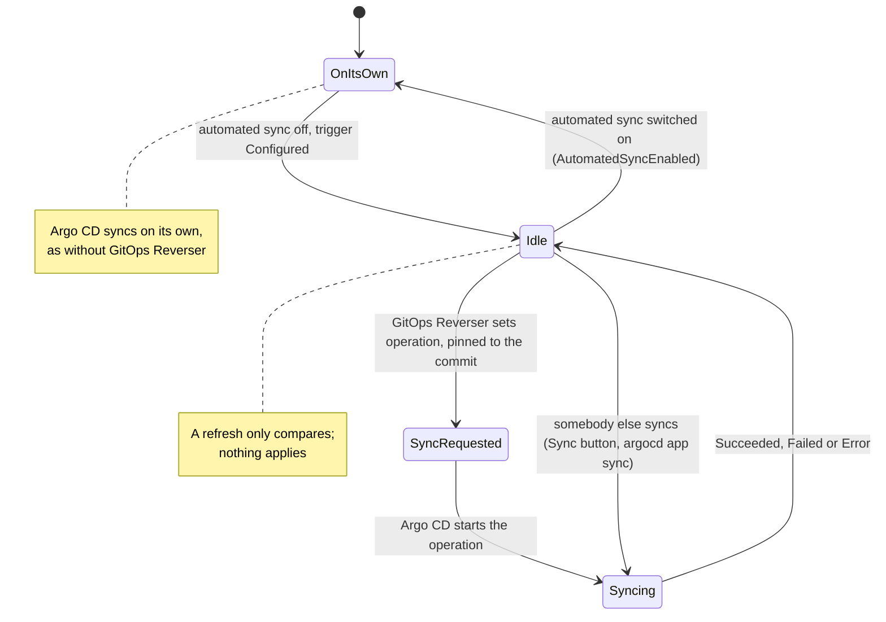
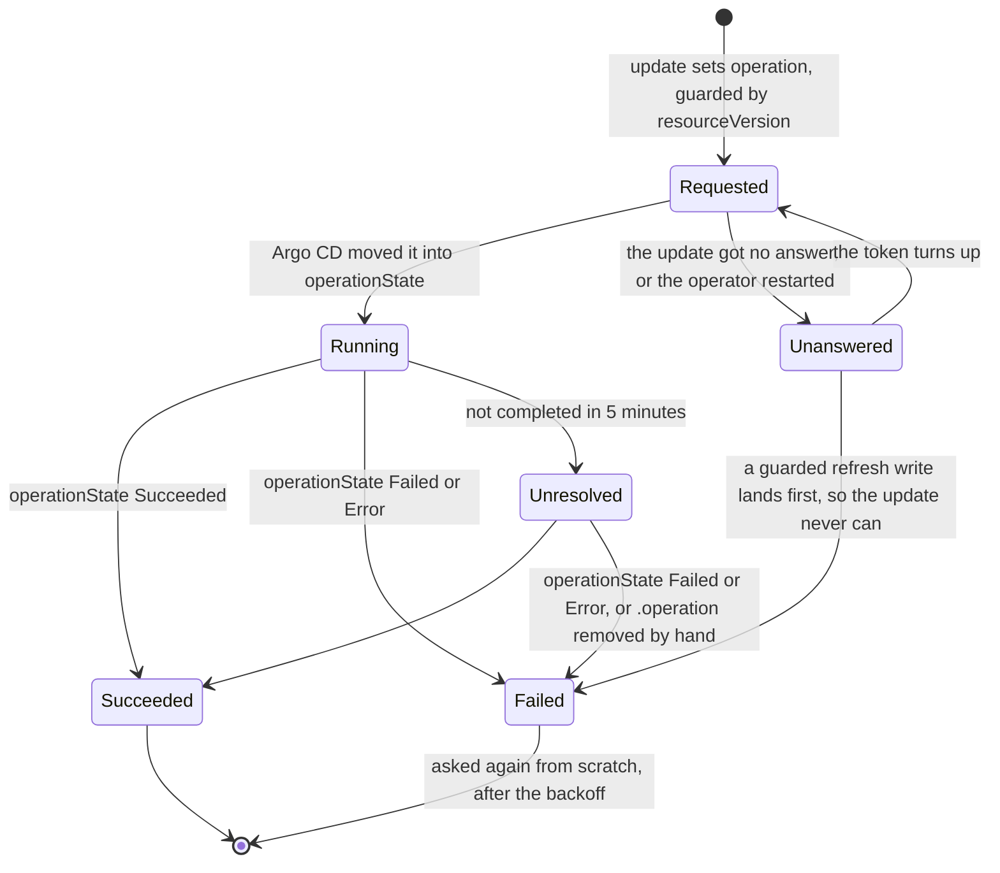

# Bi-directional GitOps with Argo CD

This page is for a folder that GitOps Reverser writes and an Argo CD `Application` syncs.
`Application`s that sync other folders need nothing from it, and keep automated sync, self-heal and
everything else exactly as they are. [Bi-directional GitOps](bi-directional.md) explains the model;
this page is the complete Argo CD setup: what to change, what to declare, how to check it works,
and which tests prove each part.

The `Application` runs with automated sync **off**, and every sync it runs is one GitOps Reverser
started, pinned to a commit it checked. Argo CD still renders, applies, prunes, runs hooks and
reports health; it no longer decides when.

## What changes

| Before | With GitOps Reverser |
| --- | --- |
| `spec.syncPolicy.automated` syncs every new commit | Automated sync is off: `automated.enabled: false`, or no `automated` block |
| A sync starts when Argo CD's refresh finds a new commit | A sync starts when GitOps Reverser sets the `Application`'s `operation`, pinned to a commit |
| `selfHeal` reverts live drift | Nothing reverts live drift by itself; GitOps Reverser publishes it to Git |
| The Git host's push webhook goes to Argo CD | It also goes to GitOps Reverser's receiver; Argo CD's may stay |
| Nothing ties a folder to its `Application` | An `ArgoCDTrigger` holds it, and the `GitTarget` names the trigger in `spec.applyTriggerRef` |

Argo CD's timed refresh and its `/api/webhook` can stay as they are. With automated sync off, a
refresh only **compares**: it reports `Synced` or `OutOfSync`, and applies nothing.

## Why automated sync must be off

Automated sync applies every new commit it finds, and each push GitOps Reverser makes is a new
commit. Two to three minutes after each push (Argo CD's `timeout.reconciliation`, 120s plus
jitter), or seconds after it when Argo CD's webhook is wired, the whole `Application` is synced over
whatever is pending at that moment ([why that matters](bi-directional.md#why-the-applier-cannot-decide-for-itself)).
`selfHeal: false` only skips a commit already synced; it does not stop the next one. With
`selfHeal: true`, a live edit is reverted within a second, before it can reach Git at all. The
[support-boundary record](design/support-boundary/argocd-bi-directional.md) has Argo CD's code paths
for each of these, and for the settings that look like a fix and are not.

An `Application` with automated sync on makes its trigger report `Configured=False` with
`AutomatedSyncEnabled`, and GitOps Reverser never syncs it.

**A catch-up is about ownership.** With automated sync off, Argo CD applies nothing on its own.
GitOps Reverser's own commits hold values it read from the cluster, so they are already live, and
after the next refresh the `Application` reports them `Synced`: an API edit asks for no sync. An
object the API creates is different. Argo CD prunes only objects that carry its tracking annotation,
and only a sync stamps it, so an object created through the API in the folder would survive the
deletion of its file in Git. An `Application` therefore gets a `CatchUp` exactly as a Flux
`Kustomization` does: to adopt an object the API created, and to converge, once when the operator
starts and once when a `GitTarget` first names the trigger ([one sync](#one-sync)).

## Requirements

| Requirement | Why | When it is not met |
| --- | --- | --- |
| Argo CD 3.1 or later | `spec.syncPolicy.automated.enabled` exists from 3.1.0, and is the only way to switch automated sync off and keep `prune` | Before 3.1 the API server drops `enabled`, the block reads as on, and the trigger reports `AutomatedSyncEnabled`. Remove the `automated` block instead, and accept that a file deleted in Git leaves its object running |
| Automated sync off | GitOps Reverser starts every sync, after a flush | `AutomatedSyncEnabled`; the `Application` is never synced by GitOps Reverser |
| A single Git source, `spec.source`, on the `GitProvider`'s repository | A sync is pinned to one commit of one repository | `UnsupportedSource` for `spec.sources` or `spec.sourceHydrator`; `SourceMismatch` for another repository |
| `targetRevision` is the `GitTarget`'s branch (`main` or `refs/heads/main`) | The tip GitOps Reverser checks is the tip of that branch | `SourceMismatch` for `HEAD`, an empty `targetRevision`, a tag or a commit |
| The source renders the folder GitOps Reverser writes: `directory.recurse: true` for a plain directory, or a kustomization at the path | GitOps Reverser writes `<path>/<namespace>/<group>/<plural>/<name>.yaml` | A non-recursive directory sees no files, and the sync applies nothing |
| Resource tracking by `annotation`, Argo CD's default | GitOps Reverser strips `argocd.argoproj.io/tracking-id`; it cannot strip `app.kubernetes.io/instance`, a label people set on purpose | With `label` or `annotation+label`, the tracking label reaches Git on every object |
| `get` and `update` on the `Application`, for the identity of the `KubeProvider` that reaches it | A sync is an update of the `Application` | `Forbidden` |
| Nothing but GitOps Reverser syncs the `Application` while GitOps Reverser runs | See [what not to do](#what-not-to-do) | Not checked: an unchecked sync can revert live edits |

## A complete example

One folder, `apps/checkout` on branch `main` of `github.com/acme/platform`, published by GitOps
Reverser and synced by the `Application` `argocd/checkout`. Every object below is checked by a unit
test against the code that validates and drives the applier (see
[what the tests prove](#what-the-tests-prove)), so this example cannot drift from what is accepted.

The Argo CD side. The `Application` follows exactly the branch the `GitTarget` writes, and its
automated sync is switched off while keeping `prune` for the syncs GitOps Reverser starts:

```yaml
apiVersion: argoproj.io/v1alpha1
kind: Application
metadata:
  name: checkout
  namespace: argocd
spec:
  project: default
  source:
    repoURL: https://github.com/acme/platform
    targetRevision: main
    path: apps/checkout
    directory:
      recurse: true
  destination:
    server: https://kubernetes.default.svc
    namespace: checkout
  syncPolicy:
    automated:
      enabled: false
      prune: true
    syncOptions:
      - ServerSideApply=true
```

The GitOps Reverser side. The `GitProvider` points at the same repository (any URL form of it) and
names the `GitReceiver` the Git host's push webhook calls; an `ArgoCDTrigger` holds the `Application`, in the
cluster the chart's `local` `KubeProvider` names (the operator's own, through `spec.inCluster`), and
the `GitTarget` names the trigger. The `Application` is in `argocd` and the trigger in `team-a`, so the provider
lets `team-a`'s triggers reach another namespace (`allowCrossNamespace.appliers`); with the Helm
chart, set `kubeProvider.allowCrossNamespace.appliers: true` instead of declaring it. A
`KubeProvider` with `inCluster` that you declare yourself is honored only once it is listed in
`--in-cluster-kube-providers`, which the chart does for its own:

```yaml
apiVersion: configbutler.ai/v1alpha3
kind: KubeProvider
metadata:
  name: local
  namespace: gitops-reverser
spec:
  inCluster: {}
  accessFrom:
    names: [team-a]
  allowCrossNamespace:
    appliers: true
---
apiVersion: v1
kind: Secret
metadata:
  name: platform-receiver
  namespace: team-a
stringData:
  token: replace-with-a-long-random-string
---
apiVersion: configbutler.ai/v1alpha3
kind: GitReceiver
metadata:
  name: platform
  namespace: team-a
spec:
  type: github
  secretRef:
    name: platform-receiver
---
apiVersion: configbutler.ai/v1alpha3
kind: GitProvider
metadata:
  name: platform
  namespace: team-a
spec:
  url: git@github.com:acme/platform.git
  allowedBranches: ["main"]
  secretRef:
    name: platform-git
  gitReceiverRef:
    name: platform
---
apiVersion: configbutler.ai/v1alpha3
kind: GitBranch
metadata:
  name: platform-main
  namespace: team-a
spec:
  gitProviderRef:
    name: platform
  branch: main
---
apiVersion: configbutler.ai/v1alpha3
kind: GitTarget
metadata:
  name: checkout
  namespace: team-a
spec:
  gitBranchRef:
    name: platform-main
  kubeProviderRef:
    name: local
    namespace: gitops-reverser
  path: apps/checkout
  applyTriggerRef:
    kind: ArgoCDTrigger
    name: checkout
  onRefusal: Reapply
---
apiVersion: configbutler.ai/v1alpha3
kind: ArgoCDTrigger
metadata:
  name: checkout
  namespace: team-a
spec:
  kubeProviderRef:
    name: local
    namespace: gitops-reverser
  applicationRef:
    namespace: argocd
    name: checkout
```

Point the Git host's push webhook at GitOps Reverser's receiver
([the steps](bi-directional.md#telling-gitops-reverser-that-somebody-else-pushed)), so a Git-side
push is synced in seconds, after any pending edits are replayed onto it.

## The `Application`

The `GitTarget`'s `ApplyTriggerReady` is `True` only when the `Application` syncs the branch the
`GitTarget` writes, from a single source, with automated sync off. The trigger checks these when it
reconciles, for every `GitTarget` naming it, and acts only for one that matches. All of them are
checked again before every sync, so an `Application` changed after the check is still never synced
against them.

| Rule | Reported when broken |
| --- | --- |
| `spec.source.repoURL` is the `GitProvider`'s repository. The forms compare as one repository: `https://` and `ssh://`, `git@host:org/repo` (SCP style), a trailing `.git` or `/`, letter case, and the default port | `SourceMismatch`: `the applier of ArgoCDTrigger checkout applies <url>, not <url>`, on the `GitTarget`, and on the trigger when no `GitTarget` naming it matches |
| `spec.source.targetRevision` is the `spec.branch` of the `GitTarget`'s `GitBranch`, as the name or as `refs/heads/<name>`. `HEAD` (and an empty `targetRevision`), a tag and a commit never follow the branch | `SourceMismatch`: `the applier of ArgoCDTrigger checkout applies branch "HEAD", not main`, on the same objects |
| A single `spec.source`: no `spec.sources`, no `spec.sourceHydrator` | trigger `UnsupportedSource`: `syncs only a single-source Application` |
| Automated sync is off: `spec.syncPolicy.automated` is absent, or has `enabled: false`. This is Argo CD's own rule; an `automated` block with no `enabled` is on | trigger `AutomatedSyncEnabled` |

**Prune.** A sync GitOps Reverser starts prunes when `spec.syncPolicy.automated.prune` is `true`,
read from the `automated` block that `enabled: false` switches off, exactly as automated sync reads
it. Without an `automated` block, its syncs do not prune: a file removed from Git leaves its object
running. `selfHeal` means nothing with automated sync off. `syncOptions` and `retry` apply as they
would to an automated sync.

**Objects another applier owns.** An object whose `argocd.argoproj.io/tracking-id` names another
`Application`, or whose `kustomize.toolkit.fluxcd.io/name` and `kustomize.toolkit.fluxcd.io/namespace`
labels name a Flux `Kustomization`, is not mirrored into the folder: a live change to it is not
mirrored, and a resync neither writes it nor removes its document. Two appliers applying one object
fight each other. See [objects another applier owns](bi-directional.md#objects-another-applier-owns).

## The `ArgoCDTrigger`

```yaml
apiVersion: configbutler.ai/v1alpha3
kind: ArgoCDTrigger
metadata:
  name: checkout
  namespace: team-a            # the GitTargets naming it are in this namespace
spec:
  kubeProviderRef:             # the cluster the Application lives in; required
    name: management           # namespace omitted: the trigger's own
  applicationRef:
    namespace: argocd          # default: the trigger's namespace
    name: checkout
```

`kubeProviderRef` names the cluster that holds the `Application`: the operator's own cluster for an
`inCluster` provider such as the chart's `local`, or a management cluster for a hub Argo CD that
deploys to other clusters. The provider must admit the trigger's namespace: its own, or one its
`accessFrom` admits. The `GitTarget`'s own `spec.kubeProviderRef` stays the cluster it mirrors. An
`Application` in another namespace than the trigger's, such as `argocd`, needs
`allowCrossNamespace.appliers: true` on that `KubeProvider`; without it the trigger reports
`ApplierNamespaceNotAllowed`. That is a delegation, not owner consent: every namespace the provider
admits may then sync any `Application` in reach of its identity whose source is the repository its
`GitProvider` names, and nothing proves it owns the `Application` or may write to the repository. See
[what a namespace may reach outside itself](configuration.md#what-a-namespace-may-reach-outside-itself-specallowcrossnamespace).
Both references are immutable: delete and recreate the trigger to hold another `Application`. The
trigger writes nothing to the `Application` until it syncs it, so deleting it, or no longer naming
it, needs no hand-back: switch automated sync on afterwards if the `Application` should sync on its
own again.

### What state the `Application` is in



A trigger acts only while an eligible `GitTarget` references it: one in the trigger's namespace that
names it, is admitted by its `KubeProvider`s, and writes the repository and branch the
`Application` syncs. A trigger nothing eligible references starts no sync and is not in line for
the `Application`; one no `GitTarget` names also reads nothing in the `Application`'s cluster. An
`Application` has nothing to hold, so there is nothing to hand back either.

The trigger reports `Configured`, and its `Ready` includes it:

| Reason | Means | Readiness |
| --- | --- | --- |
| `Succeeded` | An eligible `GitTarget` names the trigger, and the `Application` exists, syncs a single source, has automated sync off, and may be updated | ready |
| `NotReferenced` (`Unknown`) | No `GitTarget` names the trigger. Nothing is read or written | ready: `Ready=True`, `NotReferenced` |
| `NotBound` (`Unknown`) | No `GitTarget` naming the trigger is eligible yet, and one cannot be judged yet | progressing |
| `SourceMismatch`, `NamespaceNotAuthorized` or `NotBound` (`False`) | Every `GitTarget` naming the trigger is refused: it writes another repository or branch, or is not admitted. The message lists each | stalled |
| `ApplierNotFound` | No such `Application` in the applier's cluster, or Argo CD is not installed there | progressing: `Application`s are often created after the trigger |
| `UnsupportedSource` | The `Application` has several sources, a source hydrator, or no source | stalled |
| `AutomatedSyncEnabled` | Automated sync is on | stalled |
| `Forbidden` | The applier cluster's identity may not update the `Application` | stalled |
| `NamespaceNotAuthorized` | The `kubeProviderRef` names a provider in another namespace whose `accessFrom` does not admit the trigger's namespace | stalled |
| `KubeProviderNotFound` | The `kubeProviderRef` names a provider that does not exist | progressing |
| `AuditRouteConflict` | The provider carries an audit route another namespace holds, so it is not used | stalled |
| `ApplierNamespaceNotAllowed` | The `Application` is in another namespace than the trigger's, and the `KubeProvider` does not set `allowCrossNamespace.appliers` | stalled |
| `HeldByAnotherTrigger` | Another `ArgoCDTrigger` in line for the same `Application` in the same cluster, one an eligible `GitTarget` references, was created first and holds it; this one starts no sync, and takes over once that one is deleted or no longer referenced | stalled: delete one of the two |

A sync that has not completed within 5 minutes also makes the trigger `Ready=False` with
`OperationUnresolved`, a progressing state that clears when the sync completes.

The `GitTarget` reports `ApplyTriggerReady`: `True` when the trigger is `Ready` and its
`Application` syncs this repository and branch, `SourceMismatch` when it syncs another,
`ApplyTriggerNotFound` when the trigger does not exist, `Unknown` (`NotReferenced`) until the
trigger has seen that the `GitTarget` names it, and otherwise the trigger's own `Ready` reason.

## Permissions

GitOps Reverser looks the `Application` up in the cluster of the trigger's `kubeProviderRef`,
with the identity of that `KubeProvider`. That identity needs:

| API group | Resource | Verbs |
| --- | --- | --- |
| `argoproj.io` | `applications` | `get`, `update` |
| `authorization.k8s.io` | `selfsubjectaccessreviews` | `create`, to check the one above |

A sync is started by an `update` of the `Application`, the way Argo CD's own automated sync starts
one. For the operator's own cluster, install the chart with `applierAccess.argocd: true`, or apply
[`config/rbac/argocd-applier-role.yaml`](../config/rbac/argocd-applier-role.yaml) and its binding.
For a remote cluster, grant the same to the identity in the `KubeProvider`'s kubeconfig. A `Role`
in the `Application`'s namespace is enough. Argo CD's own RBAC does not apply: GitOps Reverser
writes the `Application` through the Kubernetes API, as `kubectl` would, not through `argocd-server`.

## One sync

All four [reasons](bi-directional.md#when-gitops-reverser-asks-for-an-apply) reach an
`Application`, `CatchUp` included, as they reach a Flux `Kustomization`. Every request starts a sync;
the branch worker decides beforehand which ones are needed. A `CatchUp` that only converges asks
nothing when the `Application`'s last successful sync applied the tip. A `CatchUp` that adopts syncs
even then, because that sync is what stamps the tracking annotation on the objects the API created.
An `Application` a `GitTarget` names for the first time converges once that `GitTarget`'s initial
snapshots are published, so a commit already on the branch reaches it without waiting for the next
push.

**A request sets the `Application`'s `operation` to the sync automated sync would start**, with
these differences:

- `sync.revision` is **pinned to the commit GitOps Reverser checked**, so the sync applies exactly
  that commit, not whatever the branch holds by then.
- `initiatedBy` is `{username: gitops-reverser, automated: true}`. Argo CD's UI and history show the
  sync as GitOps Reverser's, and [sync windows](#sync-windows-that-block-automated-syncs) treat it
  as an automated sync.
- `info` carries the request's reason, and a token that tells this sync's result from any other.
- A `retry` with `refresh: true` is copied without it, because Argo CD's refresh-on-retry drops the
  pinned revision and syncs the newest one.

`source`, `prune`, `syncOptions` and `retry` (`limit: 5` when the `Application` sets none) are taken
from the `Application`.



`Unanswered` is not shown in `status.operation`, which stays `Requested`: GitOps Reverser writes the
`Application` itself, asking Argo CD for a refresh, under the `resourceVersion` the lost update was
made from. Once that write lands, the lost update can never land, so the operation is `Failed` and
asked for again. No timing assumption about the API server is made.

**A sync already running is never replaced.** Argo CD refuses a new operation while one is set, and
so does GitOps Reverser: it waits for it to end (at most 5 minutes), then decides again from what
the `Application` is then. The update carries the `resourceVersion` it read, so a sync somebody
starts in between makes it fail instead of being overwritten. A failed sync waiting for Argo CD's
retry still counts as running: Argo CD keeps its `operation` set until it completed.

**Hooks run on every sync**, as they would on an automated one: every `ForeignCommit` asks every
applier on the branch, whether or not the push touched its folder, and a `CatchUp` syncs after an API
create in the folder and when a `GitTarget` first names the trigger.

**The apply window.** Until 10 seconds after the sync's operation completes, however long that
takes, Argo CD's own write to an object nobody edited is the sync landing, and is not mirrored. An
API edit to a field the `Application` sets, one made after the flush included, can be reverted on
the cluster by the sync. GitOps Reverser recognizes that write by Argo CD's field manager
(`argocd-controller`, for a client-side and a server-side apply alike, or
`argocd-application-controller` for a `Replace=true` sync), withholds it from Git, and asks for a
`Repair` sync pinned to the tip that holds the edit, but only when Argo CD's entry is as new as the
edit or newer: undoing an edit can leave an older entry of Argo CD's as the newest, and that undo
is mirrored. When Argo CD and another manager wrote in the same second, the write is mirrored and
counted as `ambiguous`.

A request that fails, and a sync that ends `Failed` or `Error`, is decided again from scratch, after
that `Application`'s own backoff. A sync still running after 5 minutes is `Unresolved`: GitOps
Reverser keeps following it, records an `ApplyUnresolved` Event, and asks the `Application` nothing
more until it completes. Removing `.operation` by hand, the usual way out of a stuck hook, leaves
the operation state `Running` for good, since Argo CD processes an operation only while
`.operation` is set: once `Unresolved`, such a sync of GitOps Reverser's is `Failed` and asked again,
and a request that finds one somebody else started, unchanged for its whole wait, syncs over it.

**Reverting refused edits.** With `onRefusal: Reapply`, the target's `Application` alone is asked to
sync the tip.

## What not to do

Each of these applies Git to the cluster without the check that nothing live is missing from it, or
makes GitOps Reverser mirror something that is not an edit. None is refused by the API; most are
invisible until an edit is lost.

### Syncing by hand, from CI, or by rollback

A sync somebody else starts applies the commit they chose, over whatever is pending at that moment,
and GitOps Reverser publishes the revert as Argo CD's commit. The same holds for `argocd app sync`
in a CI pipeline that runs on push: the push webhook into GitOps Reverser replaces it. A sync in
progress also holds GitOps Reverser's next request, for up to 5 minutes.

`argocd app rollback` applies an older commit over everything since, API edits included, and GitOps
Reverser then publishes the result as a new commit. To undo a change, revert it in Git instead.

A manual sync is the right tool only [while GitOps Reverser is down](#while-gitops-reverser-is-down).

### Sync windows that block automated syncs

GitOps Reverser's syncs carry `automated: true`, so an `AppProject` sync window treats them as
automated syncs: an active `deny` window blocks them, and so does an `allow` window outside its
schedule; `manualSync: true` on the window does not let them through. A blocked sync stays
`Running` (`Sync operation blocked by sync window`) and runs when the window opens, still pinned to
the commit it was asked for, so it reverts any newer API edits outside any apply window. Keep sync
windows off the `AppProject`s of `Application`s that a `GitTarget` names.

### Watching the objects your hooks create

[Hooks](https://argo-cd.readthedocs.io/en/stable/user-guide/resource_hooks/) run on every sync. Argo
CD's default delete policy, `BeforeHookCreation`, deletes a hook's object and creates it again on
each sync, and a hook named with `generateName` is a new object every time. A `WatchRule` covering a
hook's kind (usually `Job`) in the namespace it runs in therefore commits on every sync, and with
the default `spec.prune.mode` can remove the hook's own manifest from Git. Keep hook kinds out of
the folder's `WatchRule`s.

### Switching automated sync back on

The moment `enabled` turns true, Argo CD syncs every new commit on its own again, GitOps Reverser's
included. GitOps Reverser stops syncing the `Application` and reports `AutomatedSyncEnabled`, but it
cannot stop Argo CD. Delete the trigger, or point the `GitTarget` at another, before switching it on.

### Generating the `Application` from an `ApplicationSet`

The `ApplicationSet` controller writes its template back over any change to the `Application`s it
generates, so the template must carry `automated: {enabled: false}`. This setup is not covered by
tests.

### Relying on `Replace=true`

A `Replace=true` sync writes as `argocd-application-controller`. GitOps Reverser counts that as
Argo CD's in the apply window, but no test measures it yet. The default apply, client-side or
`ServerSideApply=true`, writes as `argocd-controller` and is what the end-to-end tests cover.

## Checking that it works

```bash
# The Application is found, has automated sync off, and may be updated; and it syncs this target's branch.
kubectl get argocdtrigger checkout -n team-a
kubectl get gittarget checkout -n team-a \
  -o jsonpath='{.status.conditions[?(@.type=="ApplyTriggerReady")]}{"\n"}'

# What GitOps Reverser last asked for, why, and where that sync stands.
kubectl get argocdtrigger checkout -n team-a -o jsonpath='{.status.operation}{"\n"}'

# The last sync: who started it, which commit, and how it ended. A request asks, it never reports.
kubectl get application checkout -n argocd \
  -o jsonpath='{.status.operationState.operation.initiatedBy}{" "}{.status.operationState.syncResult.revision}{" "}{.status.operationState.phase}{"\n"}'
# {"automated":true,"username":"gitops-reverser"} 4f2c1ab9... Succeeded
```

`gitopsreverser_apply_requests_total{applier_kind="application",reason,outcome}` counts the
requests; [interpreting metrics](interpreting-metrics.md#apply-requests-and-the-push-receiver) reads
it.

## Troubleshooting

| Symptom | Cause | Fix |
| --- | --- | --- |
| Trigger `Configured=False`, `AutomatedSyncEnabled` | `spec.syncPolicy.automated` is present without `enabled: false` | Set `automated.enabled: false` (keep `prune`), or remove the block |
| Trigger `Configured=False`, `ApplierNotFound` | No `Application` with that namespace and name in the trigger's cluster, or Argo CD is not installed there | Create it, or recreate the trigger with the right `applicationRef`; an omitted namespace is the trigger's |
| `ApplyTriggerReady=False`, `SourceMismatch`, or trigger `UnsupportedSource` | The message names the broken [`Application` rule](#the-application) | Fix the `Application`; a sync that was waiting is asked for afterward |
| Trigger `Configured=False`, `ApplierNamespaceNotAllowed` | The `Application` is in another namespace than the trigger, such as `argocd` | Set `allowCrossNamespace.appliers: true` on the trigger's `KubeProvider` (Helm: `kubeProvider.allowCrossNamespace.appliers`), or move the trigger and `GitTarget` to the `Application`'s namespace |
| Trigger `Configured=Unknown`, `NotBound` | A `GitTarget` names the trigger, but cannot be judged yet: its `GitProvider` or `KubeProvider` does not exist | Create the missing object; the message names it |
| Trigger `Configured=False`, `Forbidden` | The identity lacks one of the [permissions](#permissions) | Grant it, or set `applierAccess.argocd: true` |
| A Warning `ApplyRequestFailed` Event | A request could not be delivered, such as a sync somebody else started that did not end within 5 minutes | GitOps Reverser keeps asking after its backoff, at most every five minutes |
| A Warning `ApplyFailed` Event | The sync ended `Failed` or `Error`; the message carries Argo CD's | Fix what the message names; GitOps Reverser asks again after its backoff |
| A Warning `ApplyUnresolved` Event, trigger `OperationUnresolved` | The sync has not completed in 5 minutes: hooks, waves, or Argo CD's own retries | Nothing is asked of the `Application` until it completes; look at its operation state |
| A file deleted in Git leaves its object running | The `Application` has no `automated.prune: true` | Add `automated: {enabled: false, prune: true}` |
| The last sync stays `Running`: `Sync operation blocked by sync window` | A sync window blocks automated syncs | Remove the window from the `AppProject`; see [sync windows](#sync-windows-that-block-automated-syncs) |
| A commit appears on every sync, adding or removing a `Job` | A `WatchRule` covers the objects a hook creates | Keep hook kinds out of the `WatchRule`s; see [hooks](#watching-the-objects-your-hooks-create) |
| An object in the folder is never mirrored, and the log says `Not mirroring an object another applier owns` | Another `Application` or a Flux `Kustomization` applies it; `apply_ownership_conflicts_total` counts it | Let one applier own it: take it out of the other applier's source, or stop watching it from this `GitTarget` |

## While GitOps Reverser is down

GitOps Reverser becomes the only path to a deployment. While it is down, a Git-side push reaches the
cluster through a manual sync (`argocd app sync`, or the UI), which is safe then because nothing is
publishing. When it starts again, its first look at the remote asks for no `ForeignCommit`. A
`CatchUp` that converges is pending instead, and is asked only once every initial snapshot of the
`GitTarget`s naming the trigger is published: a sync before that could revert edits made while the
operator was down, before its watches caught them. An `Application` whose last successful sync
applied the tip is asked nothing.

## What the tests prove

| Covered | Where |
| --- | --- |
| The [complete example](#a-complete-example) decodes strictly, reports `Configured=True`, binds the `GitTarget`, and its request sets a sync pinned to the commit | [`argocd_guide_test.go`](../internal/applier/argocd_guide_test.go) |
| The operation is the one automated sync builds, but for the pinned revision, the initiator and a pinned retry; a running sync is waited for and never replaced; a sync started between the read and the update makes it fail; an unanswered update is settled by a guarded write; every `Configured` reason; when a sync counts as finished | [`argocd_test.go`](../internal/applier/argocd_test.go) |
| An `Application` converges once a `GitTarget` first names its trigger, is asked on a `ForeignCommit` and a `Refusal`, and adopts an API create even at the tip; Argo CD's late write over a newer edit is withheld, by its own field managers | [`apply_trigger_test.go`](../internal/git/apply_trigger_test.go), [`apply_catchup_test.go`](../internal/git/apply_catchup_test.go), [`apply_window_test.go`](../internal/git/apply_window_test.go) |
| An object another applier owns, read from its tracking annotation, is neither mirrored nor swept | [`apply_ownership_test.go`](../internal/git/apply_ownership_test.go) |
| A trigger nothing names reads nothing and is `Ready`; the binding over several `GitTarget`s; `ApplierNamespaceNotAllowed`; a sync whose `.operation` was removed while it ran ends | [`applytrigger_rule_test.go`](../internal/controller/applytrigger_rule_test.go), [`argocd_test.go`](../internal/applier/argocd_test.go) |
| Two API edits seconds apart keep the later value, with no further commit | [Bi-directional (Argo CD)](../test/e2e/argocd_bi_directional_e2e_test.go) |
| A Git-side push is synced by a `ForeignCommit` request, pinned to that commit | Bi-directional (Argo CD) |
| A refused edit with `onRefusal: Reapply` is reverted by an Argo CD sync | Bi-directional (Argo CD) |
| An `Application` with automated sync on is `AutomatedSyncEnabled` and is never synced | Bi-directional (Argo CD) |
| Argo CD's bookkeeping never reaches Git, asserted as zero commits during a sync | Bi-directional (Argo CD) |
| An API create, and a delete and create with the same content, are adopted, so a Git-side delete prunes them; an edit made during an apply is in Git at once and back on the cluster after the `Repair`; a Git-side push is applied while edits keep arriving, and every edit is kept; a Git-side push survives a resync forced before its apply, and a Git-side addition survives one under `prune.mode: Always`; an API edit asks for no apply; another applier's object is neither mirrored nor adopted; a save made across a Git-side change resolves from the push | [Bi-directional applier echoes (Argo CD)](../test/e2e/bi_directional_echoes_e2e_test.go) |
| A Git-side push made while the previous one is being applied stays in Git and on the cluster | [Bi-directional push race (Argo CD)](../test/e2e/bi_directional_push_race_e2e_test.go) |
| After a restart, an API edit and an API create made while the operator was down end in Git and on the cluster, nothing reverts the edit, a Git-side push made meanwhile is applied, and the create is adopted | [Bi-directional restart (Argo CD)](../test/e2e/bi_directional_restart_e2e_test.go) |

`task test-e2e-bi-directional` runs the Argo CD specs. Not covered end to end yet: a hub Argo CD in
another cluster, `Forbidden` against cluster RBAC, and a `Replace=true` sync's field manager, which
is read from Argo CD's source rather than measured.
