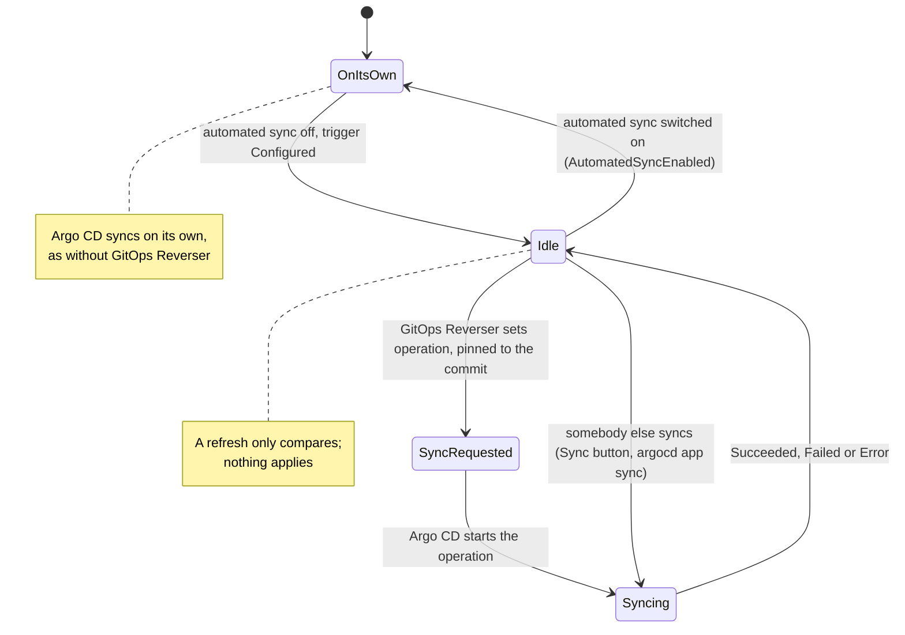
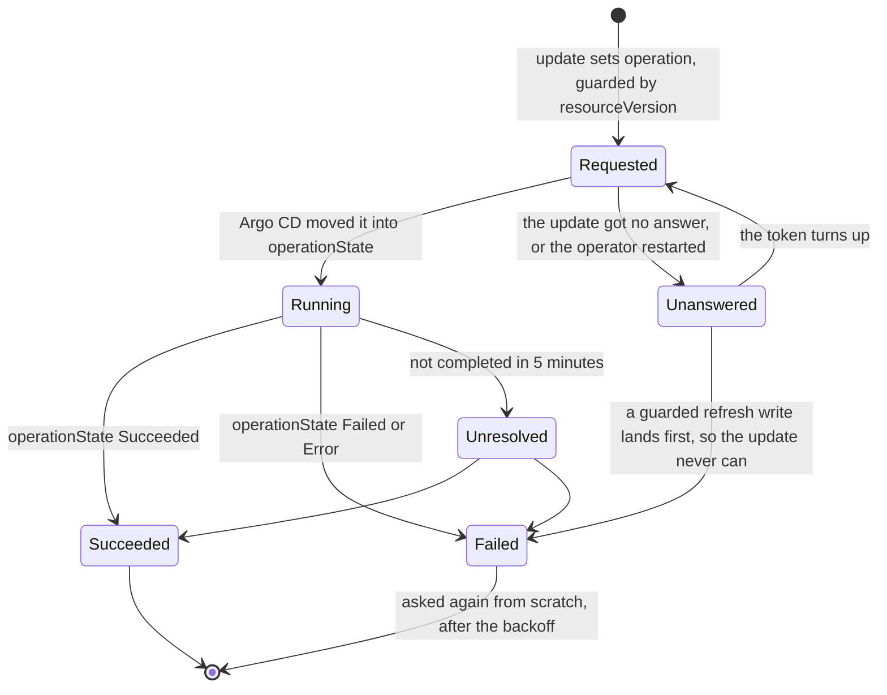

# Bi-directional GitOps with Argo CD

This page is for a folder that GitOps Reverser writes and an Argo CD `Application` syncs.
`Application`s that sync other folders need nothing from it, and keep automated sync, self-heal and
everything else exactly as they are. [Bi-directional GitOps](bi-directional.md) explains the model;
this page is the complete Argo CD setup: what to change, what to declare, how to check it works,
and which tests prove each part.

The `Application` runs with automated sync **off**, and every sync it runs is one GitOps Reverser
started, pinned to a commit it checked. Argo CD still renders, applies, prunes, runs hooks and
reports health; it no longer decides when.

## What changes

| Before | With GitOps Reverser |
| --- | --- |
| `spec.syncPolicy.automated` syncs every new commit | Automated sync is off: `automated.enabled: false`, or no `automated` block |
| A sync starts when Argo CD's refresh finds a new commit | A sync starts when GitOps Reverser sets the `Application`'s `operation`, pinned to a commit |
| `selfHeal` reverts live drift | Nothing reverts live drift by itself; GitOps Reverser publishes it to Git |
| The Git host's push webhook goes to Argo CD | It also goes to GitOps Reverser's receiver; Argo CD's may stay |
| Nothing ties a folder to its `Application` | An `ArgoCDTrigger` holds it, and the `GitTarget` names the trigger in `spec.applyTriggerRef` |

Argo CD's timed refresh and its `/api/webhook` can stay as they are. With automated sync off, a
refresh only **compares**: it reports `Synced` or `OutOfSync`, and applies nothing.

## Why automated sync must be off

Automated sync applies every new commit it finds, and each push GitOps Reverser makes is a new
commit. Two to three minutes after each push (Argo CD's `timeout.reconciliation`, 120s plus
jitter), or seconds after it when Argo CD's webhook is wired, the whole `Application` is synced over
whatever is pending at that moment ([why that matters](bi-directional.md#why-the-applier-cannot-decide-for-itself)).
`selfHeal: false` only skips a commit already synced; it does not stop the next one. With
`selfHeal: true`, a live edit is reverted within a second, before it can reach Git at all. The
[support-boundary record](design/support-boundary/argocd-bi-directional.md) has Argo CD's code paths
for each of these, and for the settings that look like a fix and are not.

An `Application` with automated sync on makes its trigger report `Configured=False` with
`AutomatedSyncEnabled`, and GitOps Reverser never syncs it.

**There is no catch-up.** With automated sync off, Argo CD applies nothing on its own, so nothing it
holds goes stale. GitOps Reverser's own commits are already live, and after the next refresh the
`Application` reports them `Synced`. So an `ArgoCDTrigger` has no `quietPeriod`.

## Requirements

| Requirement | Why | When it is not met |
| --- | --- | --- |
| Argo CD 3.1 or later | `spec.syncPolicy.automated.enabled` exists from 3.1.0, and is the only way to switch automated sync off and keep `prune` | Before 3.1 the API server drops `enabled`, the block reads as on, and the trigger reports `AutomatedSyncEnabled`. Remove the `automated` block instead, and accept that a file deleted in Git leaves its object running |
| Automated sync off | GitOps Reverser starts every sync, on a quiet branch | `AutomatedSyncEnabled`; the `Application` is never synced by GitOps Reverser |
| A single Git source, `spec.source`, on the `GitProvider`'s repository | A sync is pinned to one commit of one repository | `UnsupportedSource` for `spec.sources` or `spec.sourceHydrator`; `SourceMismatch` for another repository |
| `targetRevision` is the `GitTarget`'s branch (`main` or `refs/heads/main`) | The tip GitOps Reverser checks is the tip of that branch | `SourceMismatch` for `HEAD`, an empty `targetRevision`, a tag or a commit |
| The source renders the folder GitOps Reverser writes: `directory.recurse: true` for a plain directory, or a kustomization at the path | GitOps Reverser writes `<path>/<namespace>/<group>/<plural>/<name>.yaml` | A non-recursive directory sees no files, and the sync applies nothing |
| Resource tracking by `annotation`, Argo CD's default | GitOps Reverser strips `argocd.argoproj.io/tracking-id`; it cannot strip `app.kubernetes.io/instance`, a label people set on purpose | With `label` or `annotation+label`, the tracking label reaches Git on every object |
| `get` and `update` on the `Application`, for the identity of the `ClusterProvider` that reaches it | A sync is an update of the `Application` | `Forbidden` |
| Nothing but GitOps Reverser syncs the `Application` while GitOps Reverser runs | See [what not to do](#what-not-to-do) | Not checked: an unchecked sync can revert live edits |

## A complete example

One folder, `apps/checkout` on branch `main` of `github.com/acme/platform`, published by GitOps
Reverser and synced by the `Application` `argocd/checkout`. Every object below is checked by a unit
test against the code that validates and drives the applier (see
[what the tests prove](#what-the-tests-prove)), so this example cannot drift from what is accepted.

The Argo CD side. The `Application` follows exactly the branch the `GitTarget` writes, and its
automated sync is switched off while keeping `prune` for the syncs GitOps Reverser starts:

```yaml
apiVersion: argoproj.io/v1alpha1
kind: Application
metadata:
  name: checkout
  namespace: argocd
spec:
  project: default
  source:
    repoURL: https://github.com/acme/platform
    targetRevision: main
    path: apps/checkout
    directory:
      recurse: true
  destination:
    server: https://kubernetes.default.svc
    namespace: checkout
  syncPolicy:
    automated:
      enabled: false
      prune: true
    syncOptions:
      - ServerSideApply=true
```

The GitOps Reverser side. The `GitProvider` points at the same repository (any URL form of it) and
serves a push receiver; an `ArgoCDTrigger` holds the `Application`, in the cluster the `default`
`ClusterProvider` names, and the `GitTarget` names the trigger:

```yaml
apiVersion: v1
kind: Secret
metadata:
  name: platform-receiver
  namespace: team-a
stringData:
  token: replace-with-a-long-random-string
---
apiVersion: configbutler.ai/v1alpha3
kind: GitProvider
metadata:
  name: platform
  namespace: team-a
spec:
  url: git@github.com:acme/platform.git
  allowedBranches: ["main"]
  secretRef:
    name: platform-git
  receiver:
    type: github
    secretRef:
      name: platform-receiver
---
apiVersion: configbutler.ai/v1alpha3
kind: GitTarget
metadata:
  name: checkout
  namespace: team-a
spec:
  gitProviderRef:
    name: platform
  branch: main
  path: apps/checkout
  applyTriggerRef:
    kind: ArgoCDTrigger
    name: checkout
  onRefusal: Reapply
---
apiVersion: configbutler.ai/v1alpha3
kind: ArgoCDTrigger
metadata:
  name: checkout
  namespace: team-a
spec:
  clusterProviderRef:
    name: default
  applicationRef:
    namespace: argocd
    name: checkout
```

Point the Git host's push webhook at GitOps Reverser's receiver
([the steps](bi-directional.md#telling-gitops-reverser-that-somebody-else-pushed)), so a Git-side
push is synced in seconds, after any pending edits are replayed onto it.

## The `Application`

The `GitTarget`'s `ApplyTriggerReady` is `True` only when the `Application` syncs the branch the
`GitTarget` writes, from a single source, with automated sync off. All of these are checked again
before every sync, so an `Application` changed after the check is still never synced against them.

| Rule | Reported when broken |
| --- | --- |
| `spec.source.repoURL` is the `GitProvider`'s repository. The forms compare as one repository: `https://` and `ssh://`, `git@host:org/repo` (SCP style), a trailing `.git` or `/`, letter case, and the default port | `GitTarget` `SourceMismatch`: `the applier of ArgoCDTrigger checkout applies <url>, not <url>` |
| `spec.source.targetRevision` is the `GitTarget`'s `spec.branch`, as the name or as `refs/heads/<name>`. `HEAD` (and an empty `targetRevision`), a tag and a commit never follow the branch | `GitTarget` `SourceMismatch`: `the applier of ArgoCDTrigger checkout applies branch "HEAD", not main` |
| A single `spec.source`: no `spec.sources`, no `spec.sourceHydrator` | trigger `UnsupportedSource`: `syncs only a single-source Application` |
| Automated sync is off: `spec.syncPolicy.automated` is absent, or has `enabled: false`. This is Argo CD's own rule; an `automated` block with no `enabled` is on | trigger `AutomatedSyncEnabled` |

**Prune.** A sync GitOps Reverser starts prunes when `spec.syncPolicy.automated.prune` is `true`,
read from the `automated` block that `enabled: false` switches off, exactly as automated sync reads
it. Without an `automated` block, its syncs do not prune: a file removed from Git leaves its object
running. `selfHeal` means nothing with automated sync off. `syncOptions` and `retry` apply as they
would to an automated sync.

## The `ArgoCDTrigger`

```yaml
apiVersion: configbutler.ai/v1alpha3
kind: ArgoCDTrigger
metadata:
  name: checkout
  namespace: team-a            # the GitTargets naming it are in this namespace
spec:
  clusterProviderRef:          # the cluster the Application lives in; default: "default"
    name: management
  applicationRef:
    namespace: argocd          # default: the trigger's namespace
    name: checkout
```

`clusterProviderRef` names the cluster that holds the `Application`: the operator's own cluster for
`default`, or a management cluster for a hub Argo CD that deploys to other clusters. The
`GitTarget`'s own `spec.clusterProviderRef` stays the cluster it mirrors. Both references are
immutable: delete and recreate the trigger to hold another `Application`. The trigger writes nothing
to the `Application` until it syncs it, so deleting it needs no hand-back: switch automated sync on
afterwards if the `Application` should sync on its own again.

### What state the `Application` is in



A trigger acts only while an eligible `GitTarget` references it: one in the trigger's namespace that
names it, is admitted by its `ClusterProvider`s, and writes the repository and branch the
`Application` syncs. A trigger nothing eligible references starts no sync, reads nothing in the
`Application`'s cluster, and is not in line for it. An `Application` has nothing to hold, so there is
nothing to hand back either.

The trigger reports `Configured`, and its `Ready` includes it:

| Reason | Means | Readiness |
| --- | --- | --- |
| `Succeeded` | An eligible `GitTarget` names the trigger, and the `Application` exists, syncs a single source, has automated sync off, and may be updated | ready |
| `NotReferenced` (`Unknown`) | No `GitTarget` names the trigger. Nothing is read or written | ready: `Ready=True`, `NotReferenced` |
| `NotBound` (`Unknown`) | No `GitTarget` naming the trigger is eligible yet, and one cannot be judged yet | progressing |
| `SourceMismatch`, `NamespaceNotAuthorized` or `NotBound` (`False`) | Every `GitTarget` naming the trigger is refused: it writes another repository or branch, or is not admitted. The message lists each | stalled |
| `ApplierNotFound` | No such `Application` in the applier's cluster, or Argo CD is not installed there | progressing: `Application`s are often created after the trigger |
| `UnsupportedSource` | The `Application` has several sources, a source hydrator, or no source | stalled |
| `AutomatedSyncEnabled` | Automated sync is on | stalled |
| `Forbidden` | The applier cluster's identity may not update the `Application` | stalled |
| `NamespaceNotAuthorized` | The `clusterProviderRef` names a provider whose `accessFrom` does not admit the trigger's namespace | stalled |
| `ClusterProviderNotFound` | The `clusterProviderRef` names a provider that does not exist | progressing |
| `HeldByAnotherTrigger` | An older `ArgoCDTrigger` an eligible `GitTarget` references names the same `Application` in the same cluster and holds it; this one starts no sync, and takes over once that one is deleted or no longer referenced | stalled: delete one of the two |

The `GitTarget` reports `ApplyTriggerReady`: `True` when the trigger is `Ready` and its
`Application` syncs this repository and branch, `SourceMismatch` when it syncs another,
`ApplyTriggerNotFound` when the trigger does not exist, `Unknown` (`NotReferenced`) until the
trigger has seen that the `GitTarget` names it, and otherwise the trigger's own `Ready` reason.

## Permissions

GitOps Reverser looks the `Application` up in the cluster of the trigger's `clusterProviderRef`,
with the identity of that `ClusterProvider`. That identity needs:

| API group | Resource | Verbs |
| --- | --- | --- |
| `argoproj.io` | `applications` | `get`, `update` |
| `authorization.k8s.io` | `selfsubjectaccessreviews` | `create`, to check the one above |

A sync is started by an `update` of the `Application`, the way Argo CD's own automated sync starts
one. For the operator's own cluster, install the chart with `applierAccess.argocd: true`, or apply
[`config/rbac/argocd-applier-role.yaml`](../config/rbac/argocd-applier-role.yaml) and its binding.
For a remote cluster, grant the same to the identity in the `ClusterProvider`'s kubeconfig. A `Role`
in the `Application`'s namespace is enough. Argo CD's own RBAC does not apply: GitOps Reverser
writes the `Application` through the Kubernetes API, as `kubectl` would, not through `argocd-server`.

## One sync

`ForeignCommit`, `Refusal` and `Repair` reach an `Application`
([the reasons](bi-directional.md#when-gitops-reverser-asks-for-an-apply)); `CatchUp` never does.
Every request starts a sync: there is no "already current" for Argo CD.

**A request sets the `Application`'s `operation` to the sync automated sync would start**, with
these differences:

- `sync.revision` is **pinned to the commit GitOps Reverser checked**, so the sync applies exactly
  that commit, not whatever the branch holds by then.
- `initiatedBy` is `{username: gitops-reverser, automated: true}`. Argo CD's UI and history show the
  sync as GitOps Reverser's, and [sync windows](#sync-windows-that-block-automated-syncs) treat it
  as an automated sync.
- `info` carries the request's reason, and a token that tells this sync's result from any other.
- A `retry` with `refresh: true` is copied without it, because Argo CD's refresh-on-retry drops the
  pinned revision and syncs the newest one.

`source`, `prune`, `syncOptions` and `retry` (`limit: 5` when the `Application` sets none) are taken
from the `Application`.



`Unanswered` is not shown in `status.operation`, which stays `Requested`: GitOps Reverser writes the
`Application` itself, asking Argo CD for a refresh, under the `resourceVersion` the lost update was
made from. Once that write lands, the lost update can never land, so the operation is `Failed` and
asked for again. No timing assumption about the API server is made.

**A sync already running is never replaced.** Argo CD refuses a new operation while one is set, and
so does GitOps Reverser: it waits for it to end (at most 5 minutes), then decides again from what
the `Application` is then. The update carries the `resourceVersion` it read, so a sync somebody
starts in between makes it fail instead of being overwritten. A failed sync waiting for Argo CD's
retry still counts as running.

**Hooks run on every sync**, as they would on an automated one: every `ForeignCommit` asks every
applier on the branch, whether or not the push touched its folder.

**The apply window.** Until the sync's operation completes, however long that takes, an API edit to
a field the `Application` sets can be reverted on the cluster by the sync. GitOps Reverser recognizes
that write by Argo CD's field manager (`argocd-controller`, for a client-side and a server-side
apply alike, or `argocd-application-controller` for a `Replace=true` sync), withholds it from Git,
and owes a `Repair` sync pinned to the tip that holds the edit. When Argo CD and another manager
wrote the object in the same second, the write is mirrored and counted as `ambiguous`.

A request that fails, and a sync that ends `Failed` or `Error`, is decided again from scratch, after
that `Application`'s own backoff. A sync still running after 5 minutes is `Unresolved`: GitOps
Reverser keeps following it, records an `ApplyUnresolved` Event, and asks the `Application` nothing
more until it completes.

**Reverting refused edits.** With `onRefusal: Reapply`, the target's `Application` alone is asked to
sync the tip.

## What not to do

Each of these applies Git to the cluster without the check that nothing live is missing from it, or
makes GitOps Reverser mirror something that is not an edit. None is refused by the API; most are
invisible until an edit is lost.

### Syncing by hand, from CI, or by rollback

A sync somebody else starts applies the commit they chose, over whatever is pending at that moment,
and GitOps Reverser publishes the revert as Argo CD's commit. The same holds for `argocd app sync`
in a CI pipeline that runs on push: the push webhook into GitOps Reverser replaces it. A sync in
progress also holds GitOps Reverser's next request, for up to 5 minutes.

`argocd app rollback` applies an older commit over everything since, API edits included, and GitOps
Reverser then publishes the result as a new commit. To undo a change, revert it in Git instead.

A manual sync is the right tool only [while GitOps Reverser is down](#while-gitops-reverser-is-down).

### Sync windows that block automated syncs

GitOps Reverser's syncs carry `automated: true`, so an `AppProject` sync window treats them as
automated syncs: an active `deny` window blocks them, and so does an `allow` window outside its
schedule; `manualSync: true` on the window does not let them through. A blocked sync stays
`Running` (`Sync operation blocked by sync window`) and runs when the window opens, still pinned to
the commit it was asked for, so it reverts any newer API edits outside any apply window. Keep sync
windows off the `AppProject`s of `Application`s that a `GitTarget` names.

### Watching the objects your hooks create

[Hooks](https://argo-cd.readthedocs.io/en/stable/user-guide/resource_hooks/) run on every sync. Argo
CD's default delete policy, `BeforeHookCreation`, deletes a hook's object and creates it again on
each sync, and a hook named with `generateName` is a new object every time. A `WatchRule` covering a
hook's kind (usually `Job`) in the namespace it runs in therefore commits on every sync, and with
the default `spec.prune.mode` can remove the hook's own manifest from Git. Keep hook kinds out of
the folder's `WatchRule`s.

### Switching automated sync back on

The moment `enabled` turns true, Argo CD syncs every new commit on its own again, GitOps Reverser's
included. GitOps Reverser stops syncing the `Application` and reports `AutomatedSyncEnabled`, but it
cannot stop Argo CD. Delete the trigger, or point the `GitTarget` at another, before switching it on.

### Generating the `Application` from an `ApplicationSet`

The `ApplicationSet` controller writes its template back over any change to the `Application`s it
generates, so the template must carry `automated: {enabled: false}`. This setup is not covered by
tests.

### Relying on `Replace=true`

A `Replace=true` sync writes as `argocd-application-controller`. GitOps Reverser counts that as
Argo CD's in the apply window, but no test measures it yet. The default apply, client-side or
`ServerSideApply=true`, writes as `argocd-controller` and is what the end-to-end tests cover.

## Checking that it works

```bash
# The Application is found, has automated sync off, and may be updated; and it syncs this target's branch.
kubectl get argocdtrigger checkout -n team-a
kubectl get gittarget checkout -n team-a \
  -o jsonpath='{.status.conditions[?(@.type=="ApplyTriggerReady")]}{"\n"}'

# What GitOps Reverser last asked for, why, and where that sync stands.
kubectl get argocdtrigger checkout -n team-a -o jsonpath='{.status.operation}{"\n"}'

# The last sync: who started it, which commit, and how it ended. A request asks, it never reports.
kubectl get application checkout -n argocd \
  -o jsonpath='{.status.operationState.operation.initiatedBy}{" "}{.status.operationState.syncResult.revision}{" "}{.status.operationState.phase}{"\n"}'
# {"automated":true,"username":"gitops-reverser"} 4f2c1ab9... Succeeded
```

`gitopsreverser_apply_requests_total{applier_kind="application",reason,outcome}` counts the
requests; [interpreting metrics](interpreting-metrics.md#apply-requests-and-the-push-receiver) reads
it.

## Troubleshooting

| Symptom | Cause | Fix |
| --- | --- | --- |
| Trigger `Configured=False`, `AutomatedSyncEnabled` | `spec.syncPolicy.automated` is present without `enabled: false` | Set `automated.enabled: false` (keep `prune`), or remove the block |
| Trigger `Configured=False`, `ApplierNotFound` | No `Application` with that namespace and name in the trigger's cluster, or Argo CD is not installed there | Create it, or recreate the trigger with the right `applicationRef`; an omitted namespace is the trigger's |
| `ApplyTriggerReady=False`, `SourceMismatch`, or trigger `UnsupportedSource` | The message names the broken [`Application` rule](#the-application) | Fix the `Application`; a request it was holding is delivered afterward |
| Trigger `Configured=False`, `Forbidden` | The identity lacks one of the [permissions](#permissions) | Grant it, or set `applierAccess.argocd: true` |
| A Warning `ApplyRequestFailed` Event | A request could not be delivered, such as a sync somebody else started that did not end within 5 minutes | GitOps Reverser keeps asking on a quiet branch, at most every five minutes |
| A Warning `ApplyFailed` Event | The sync ended `Failed` or `Error`; the message carries Argo CD's | Fix what the message names; GitOps Reverser asks again on a quiet branch |
| A Warning `ApplyUnresolved` Event | The sync has not completed in 5 minutes: hooks, waves, or Argo CD's own retries | Nothing is asked of the `Application` until it completes; look at its operation state |
| A file deleted in Git leaves its object running | The `Application` has no `automated.prune: true` | Add `automated: {enabled: false, prune: true}` |
| The last sync stays `Running`: `Sync operation blocked by sync window` | A sync window blocks automated syncs | Remove the window from the `AppProject`; see [sync windows](#sync-windows-that-block-automated-syncs) |
| A commit appears on every sync, adding or removing a `Job` | A `WatchRule` covers the objects a hook creates | Keep hook kinds out of the `WatchRule`s; see [hooks](#watching-the-objects-your-hooks-create) |

## While GitOps Reverser is down

GitOps Reverser becomes the only path to a deployment. While it is down, a Git-side push reaches the
cluster through a manual sync (`argocd app sync`, or the UI), which is safe then because nothing is
publishing. When it starts again, its first look at the remote owes no `ForeignCommit`: a sync on
startup could revert edits made while it was down, before its watches caught them.

## What the tests prove

| Covered | Where |
| --- | --- |
| The [complete example](#a-complete-example) decodes strictly, reports `Configured=True`, binds the `GitTarget`, and its request sets a sync pinned to the commit | [`argocd_guide_test.go`](../internal/applier/argocd_guide_test.go) |
| The operation is the one automated sync builds, but for the pinned revision, the initiator and a pinned retry; a running sync is waited for and never replaced; a sync started between the read and the update makes it fail; an unanswered update is settled by a guarded write; every `Configured` reason; when a sync counts as finished | [`argocd_test.go`](../internal/applier/argocd_test.go) |
| An `Application` is never owed a `CatchUp`, and is asked on a `ForeignCommit` and a `Refusal`; Argo CD's late write over a newer edit is withheld, by its own field managers | [`apply_trigger_test.go`](../internal/git/apply_trigger_test.go), [`apply_window_test.go`](../internal/git/apply_window_test.go) |
| Two API edits seconds apart keep the later value, with no further commit | [Bi-directional (Argo CD)](../test/e2e/argocd_bi_directional_e2e_test.go) |
| A Git-side push is synced by a `ForeignCommit` request, pinned to that commit | Bi-directional (Argo CD) |
| A refused edit with `onRefusal: Reapply` is reverted by an Argo CD sync | Bi-directional (Argo CD) |
| An `Application` with automated sync on is `AutomatedSyncEnabled` and is never synced | Bi-directional (Argo CD) |
| Argo CD's bookkeeping never reaches Git, asserted as zero commits during a sync | Bi-directional (Argo CD) |

`task test-e2e-bi-directional` runs the Argo CD specs. Not covered end to end yet: a hub Argo CD in
another cluster, `Forbidden` against cluster RBAC, and a `Replace=true` sync's field manager, which
is read from Argo CD's source rather than measured.
