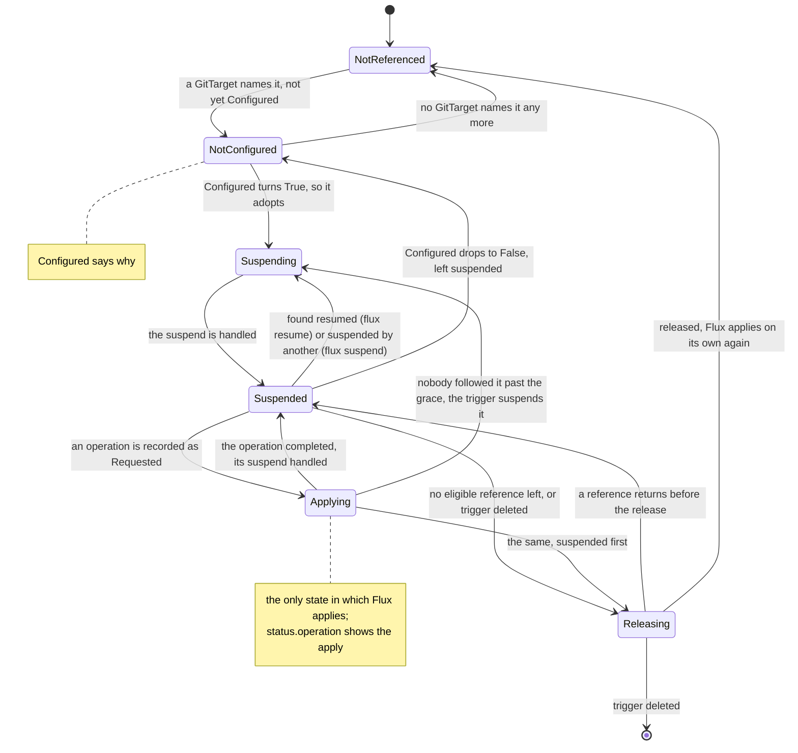
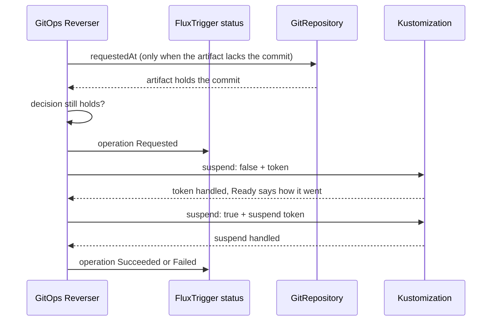

# Bi-directional GitOps with Flux

This page is for a folder that GitOps Reverser writes and a Flux `Kustomization` applies.
`Kustomization`s that apply other folders need nothing from it, and keep working as Flux always
does. [Bi-directional GitOps](bi-directional.md) explains the model; this page is the complete Flux
setup: what to change, what to declare, how to check it works, and which tests prove each part.

A `FluxTrigger` holds the `Kustomization` **suspended** while it is idle. For each apply, GitOps
Reverser resumes it, waits for that one reconcile to end, and suspends it again. Flux still fetches,
renders, applies, prunes and reports health; it never applies on its own.

## What changes

| Before | With GitOps Reverser |
| --- | --- |
| The `Kustomization` applies on its interval, on every new artifact, and on a controller restart | It is suspended, and applies only when GitOps Reverser resumes it for one apply |
| A failed apply is retried after `retryInterval` | It is suspended again after a failure; GitOps Reverser retries on a quiet branch |
| The Git host's push webhook goes to a Flux `Receiver` | It goes to GitOps Reverser's receiver; the Flux `Receiver` for this repository is removed |
| Nothing ties a folder to its `Kustomization` | A `FluxTrigger` holds it, and the `GitTarget` names the trigger in `spec.applyTriggerRef` |
| `flux get ks` shows it ready | It shows it `Suspended`, which is how it is held |

## Why suspended, and not a long interval

A long interval makes Flux apply less often; it does not make Flux wait. A `Kustomization` that is
not suspended still applies when its interval fires, when kustomize-controller restarts, when a
failed apply retries, when its own spec changes, and when its `GitRepository` gets a new artifact
for any reason, including a fetch another consumer asked for. Each of those can land while an edit
is still on its way to Git ([why that matters](bi-directional.md#why-the-applier-cannot-decide-for-itself)).
A suspended `Kustomization` does none of them: a reconcile reads `spec.suspend` first and returns
before it resolves its source.

## A complete example

One folder, `apps/checkout` on branch `main` of `github.com/acme/platform`, published by GitOps
Reverser and applied by the `Kustomization` `flux-system/checkout`. Every object below is checked by
a unit test against the code that validates and drives the applier (see
[what the tests prove](#what-the-tests-prove)), so this example cannot drift from what is accepted.

The Flux side. The `GitRepository` follows exactly the branch the `GitTarget` writes. The
`Kustomization`'s manifest does **not** set `suspend`: the `FluxTrigger` holds that field.

```yaml
apiVersion: source.toolkit.fluxcd.io/v1
kind: GitRepository
metadata:
  name: platform
  namespace: flux-system
spec:
  url: https://github.com/acme/platform
  ref:
    branch: main
  interval: 1h
  secretRef:
    name: platform-git
---
apiVersion: kustomize.toolkit.fluxcd.io/v1
kind: Kustomization
metadata:
  name: checkout
  namespace: flux-system
spec:
  sourceRef:
    kind: GitRepository
    name: platform
  path: ./apps/checkout
  prune: true
  interval: 1h
```

The GitOps Reverser side. The `GitProvider` points at the same repository (any URL form of it) and
serves a push receiver; a `FluxTrigger` holds the `Kustomization`, in the cluster the `default`
`ClusterProvider` names, and the `GitTarget` names the trigger:

```yaml
apiVersion: v1
kind: Secret
metadata:
  name: platform-receiver
  namespace: team-a
stringData:
  token: replace-with-a-long-random-string
---
apiVersion: configbutler.ai/v1alpha3
kind: GitProvider
metadata:
  name: platform
  namespace: team-a
spec:
  url: git@github.com:acme/platform.git
  allowedBranches: ["main"]
  secretRef:
    name: platform-git
  receiver:
    type: github
    secretRef:
      name: platform-receiver
---
apiVersion: configbutler.ai/v1alpha3
kind: GitTarget
metadata:
  name: checkout
  namespace: team-a
spec:
  gitProviderRef:
    name: platform
  branch: main
  path: apps/checkout
  applyTriggerRef:
    kind: FluxTrigger
    name: checkout
  onRefusal: Reapply
---
apiVersion: configbutler.ai/v1alpha3
kind: FluxTrigger
metadata:
  name: checkout
  namespace: team-a
spec:
  clusterProviderRef:
    name: default
  kustomizationRef:
    namespace: flux-system
    name: checkout
  quietPeriod: 30s
```

No Flux `Receiver` for `acme/platform` appears, on purpose: remove yours if you have one, and point
the Git host's push webhook at GitOps Reverser's receiver instead
([the steps](bi-directional.md#telling-gitops-reverser-that-somebody-else-pushed)).

## The `GitRepository`

The `GitTarget`'s `ApplyTriggerReady` is `True` only when the `Kustomization`'s source fetches the
branch the `GitTarget` writes. The trigger checks the rules about the source alone when it
reconciles, and the `GitTarget` checks the repository and branch against the source the trigger
reports. All of them are checked again before every apply.

| Rule | Reported when broken |
| --- | --- |
| `spec.url` is the `GitProvider`'s repository. The forms compare as one repository: `https://` and `ssh://`, `git@host:org/repo` (SCP style), a trailing `.git` or `/`, letter case, and the default port | `GitTarget` `SourceMismatch`: `the applier of FluxTrigger checkout applies <url>, not <url>` |
| `spec.ref.branch` is exactly the `GitTarget`'s `spec.branch` | `GitTarget` `SourceMismatch`: `the applier of FluxTrigger checkout applies branch "release", not main` |
| `spec.ref` pins nothing stronger: no `commit`, `name`, `semver` or `tag`, even alongside the branch. Flux resolves those before the branch, so the artifact would never follow it | trigger `UnsupportedSource`: `pins spec.ref.tag "v1.0.0", so it never follows a branch` |
| `spec.ref.branch` is set | trigger `UnsupportedSource`: `names no spec.ref.branch` |

A suspended `Kustomization` ignores a new artifact, so the source's own `interval` decides when it
fetches, never when anything applies. Keep it longer than an apply takes, `1h` in the example: an
apply reads the artifact again just before it resumes the `Kustomization`, and a fetch of the
source's own between that read and the reconcile makes Flux apply another commit than the one
GitOps Reverser checked. That is logged, counted in `apply_revision_mismatches_total`, and still
covered by the apply window, but it is avoidable. An apply of an *older* revision than the one
checked counts as failed, and GitOps Reverser asks again.

**Shared sources.** Several `Kustomization`s may read one `GitRepository`. The trigger lists its
source's other consumers in `status.source.otherConsumers`: the `Kustomization`s no `FluxTrigger`
holds and the `HelmRelease`s whose chart comes from it, directly or through a `HelmChart` their
`chartRef` names. Each of them applies a new artifact the moment it arrives. The list is
information only and never affects `Ready`: one source for `apps` and `infra` is a normal setup.

- While the list is empty and the trigger holds its own `Kustomization`, `status.source.prefetch` is
  `true`: when GitOps Reverser learns of a push while the branch is busy, it has the source fetch at
  once, so the artifact is ready when the apply is due. A consumer counts as held only while its
  `FluxTrigger` reports `Held=True`, checked again on the cluster just before the fetch.
- Appliers on one branch that share a source apply one at a time.

## The `Kustomization`

- `spec.sourceRef` names a `GitRepository`. An `OCIRepository` or a `Bucket` makes the trigger
  report `UnsupportedSource`: GitOps Reverser writes Git, and can only ask a Git source to fetch.
- **The manifest omits `spec.suspend`.** Whatever applies the `Kustomization` object (a parent
  `Kustomization`, Helm, flux-operator) must leave the field alone, or it resumes the
  `Kustomization` on its next apply. When another field manager applies `spec.suspend`, the trigger
  reports `SuspendOwnedElsewhere`, naming the manager, and holds nothing. A one-off write such as
  `flux resume` is no such owner; see [overriding by hand](#overriding-by-hand).
- `spec.interval` and `spec.retryInterval` decide nothing while it is suspended.
- `spec.wait`, health checks and `spec.timeout` lengthen each apply, and GitOps Reverser follows it,
  with its apply window open, for as long as it runs.
- `spec.dependsOn`: a dependency whose apply failed is suspended with its generation unapplied, so
  its dependents wait until GitOps Reverser's retry of it succeeds.
- It lives in the trigger's namespace unless the trigger's `ClusterProvider` sets
  `allowCrossNamespace.appliers: true`; a trigger naming one elsewhere without it reports
  `ApplierNamespaceNotAllowed`. A `Kustomization` in `flux-system` therefore needs the grant. It is
  a delegation, not owner consent: every namespace the provider's `accessFrom` admits may then
  suspend and apply any `Kustomization` in reach of the provider's identity whose source fetches the
  repository its `GitProvider` names. Nothing proves that the namespace owns the `Kustomization`, or
  may write to that repository: the binding compares URLs. See
  [what a namespace may reach outside itself](configuration.md#what-a-namespace-may-reach-outside-itself-specallowcrossnamespace).
- Several `GitTarget`s may name one `FluxTrigger`, for a `Kustomization` whose `path` covers several
  folders. It is applied once for all of them.
- Two `GitProvider`s may name one repository. The branch counts as quiet only when both of their
  workers are.

## The `FluxTrigger`

```yaml
apiVersion: configbutler.ai/v1alpha3
kind: FluxTrigger
metadata:
  name: checkout
  namespace: team-a            # the GitTargets naming it are in this namespace
spec:
  clusterProviderRef:          # the cluster Flux runs in; default: "default"
    name: default
  kustomizationRef:
    namespace: flux-system     # default: the trigger's namespace
    name: checkout
  quietPeriod: 30s             # default 30s, at most 1h
```

`clusterProviderRef` names the cluster that holds the `Kustomization`: the operator's own cluster
for `default`, or a management cluster where Flux runs. Both references are immutable: delete and
recreate the trigger to hold another `Kustomization`.

`quietPeriod` is how long the branch must stay quiet after GitOps Reverser's own pushes before the
`Kustomization` applies them (`CatchUp`). Every new write restarts it.

### How the trigger holds the `Kustomization`

A trigger acts only while an eligible `GitTarget` references it: one in the trigger's namespace that
names it in `spec.applyTriggerRef`, is admitted by its `ClusterProvider`s, and writes the repository
and branch the `Kustomization`'s `GitRepository` fetches. A trigger nothing eligible references
holds nothing, reads nothing in the `Kustomization`'s cluster, and is `Ready`.



- **Adopting.** Once an eligible `GitTarget` names it and it is `Configured`, the trigger puts its
  finalizer `configbutler.ai/flux-trigger` in place, suspends the `Kustomization` with a server-side
  apply under the field manager `gitops-reverser` and a new `reconcile.fluxcd.io/requestedAt` token,
  and records an `Adopted` Event. The suspend is handled once the `Kustomization` reports that
  token: reconciles of one object never overlap, so by then nothing that was running before is.
- **Several `GitTarget`s.** One eligible `GitTarget` among those naming the trigger is enough. While
  none is, and one cannot be judged yet (its `GitProvider` is missing), the trigger reports
  `NotBound` and waits. Once each is refused, it reports the reason they share (`SourceMismatch`,
  `NamespaceNotAuthorized`), or `NotBound` for mixed ones, with every `GitTarget` and its reason in
  the message.
- **One trigger per `Kustomization`.** When two `FluxTrigger`s an eligible `GitTarget` references
  name the same `Kustomization` in the same cluster, the one holding it keeps it, the one with an
  apply in flight first of all; otherwise the oldest takes it. The other reports
  `HeldByAnotherTrigger`, does nothing, and takes over once the holder lets go. A trigger nothing
  eligible references is not in line, so it keeps no other out.
- **The trigger hands the `Kustomization` back** when no eligible `GitTarget` references it any
  more, and when it is deleted. `Held` reads `Releasing`: it suspends the `Kustomization` once more
  if an apply has it resumed, waits until that is handled, and releases `spec.suspend`, so Flux
  applies it on its own again (a `Released` Event), even one somebody had `flux suspend`ed before.
  Until that is done it stays the holder, so no other trigger acts on the `Kustomization`. One
  whose `spec.suspend` another manager also applies stays suspended, and the Event names that
  manager. With another `FluxTrigger` in line, the `Kustomization` stays suspended for that one. A
  hand-back that has not finished 10 minutes after `Held` turned `Releasing` lets go with a
  `ReleaseFailed` Event saying where the `Kustomization` was left. A reference that returns before
  the release is done holds the `Kustomization` again; one that returns after adopts it anew.
- **Deleting or re-creating a `GitTarget` hands the `Kustomization` back.** Flux then applies the
  Git tip at once, which overwrites live edits not yet in Git, and the trigger adopts the
  `Kustomization` again once the `GitTarget` is back. That is what Flux does without GitOps
  Reverser, and with no `GitTarget` nobody would carry those edits to Git anyway.
- **A trigger whose configuration turns invalid keeps its hold.** It reports `Held=Unknown`
  (`NotConfigured`), and the message says the `Kustomization` is left suspended under GitOps
  Reverser's field manager; deleting the trigger, or its `GitTarget`s, hands it back.

The trigger reports `Configured` and `Held`, and its `Ready` includes both:

| Reason | Means | Readiness |
| --- | --- | --- |
| `Configured`: `Succeeded` | An eligible `GitTarget` names the trigger, and the `Kustomization` exists, applies a `GitRepository` that follows a branch, and may be patched | ready |
| `Configured`: `NotReferenced` (`Unknown`) | No `GitTarget` names the trigger. Nothing is read or written | ready: `Ready=True`, `NotReferenced` |
| `Configured`: `NotBound` (`Unknown`) | No `GitTarget` naming the trigger is eligible yet, and one cannot be judged yet | progressing |
| `Configured`: `SourceMismatch`, `NamespaceNotAuthorized` or `NotBound` (`False`) | Every `GitTarget` naming the trigger is refused: it writes another repository or branch, or is not admitted. The message lists each | stalled |
| `Configured`: `ApplierNotFound` | No such `Kustomization` in the applier's cluster, or Flux is not installed there | progressing: Flux objects are often created after the trigger |
| `Configured`: `UnsupportedSource` | The source is not a `GitRepository`, or breaks one of the [`GitRepository` rules](#the-gitrepository) | stalled |
| `Configured`: `SuspendOwnedElsewhere` | Another field manager applies `spec.suspend` | stalled: remove the field from the manifest it applies |
| `Configured`: `Forbidden` | The applier cluster's identity may not patch the `Kustomization` or its `GitRepository` | stalled |
| `Configured`: `NamespaceNotAuthorized` | The `clusterProviderRef` names a provider whose `accessFrom` does not admit the trigger's namespace | stalled |
| `Configured`: `ClusterProviderNotFound` | The `clusterProviderRef` names a provider that does not exist | progressing |
| `Configured`: `ApplierNamespaceNotAllowed` | The `Kustomization` is in another namespace than the trigger's, and the `ClusterProvider` does not set `allowCrossNamespace.appliers` | stalled |
| `Configured`: `HeldByAnotherTrigger` | Another `FluxTrigger` holds this `Kustomization` | stalled: delete one of the two |
| `Held`: `Suspended` | Suspended under GitOps Reverser, and the last suspend is handled. Nothing applies | ready |
| `Held`: `Applying` | An apply GitOps Reverser started is in flight: `status.operation` shows it | ready |
| `Held`: `Suspending` | Just suspended; waiting for the `Kustomization` to handle it | progressing |
| `Held`: `Releasing` | Handing the `Kustomization` back: suspending it if needed, then releasing `spec.suspend`, within 10 minutes | progressing |
| `Held`: `NotReferenced` | Nothing to hold: no `GitTarget` names the trigger | ready |
| `Held`: `NotConfigured` | The trigger is not `Configured`, so nothing is held, or the `Kustomization` is left suspended as the trigger last held it (the message says which) | follows `Configured` |
| `Ready`: `OperationUnresolved` | An apply has not completed within 5 minutes, or the `Kustomization` was [resumed by hand](#overriding-by-hand) | progressing; it clears when the apply does |

`Ready=True` for a trigger no `GitTarget` names is deliberate: it does all it is asked to, which is
nothing. A Flux health check reads `Ready`, so a `Kustomization` that creates the trigger and waits
for it would otherwise never become ready, and the `Kustomization` that creates the `GitTarget`
after it would never apply.

The `GitTarget` reports `ApplyTriggerReady`: `True` when the trigger is `Ready` and its
`GitRepository` fetches this repository and branch, `SourceMismatch` when it fetches another,
`ApplyTriggerNotFound` when the trigger does not exist, `Unknown` (`NotReferenced`) until the
trigger has seen that the `GitTarget` names it, and otherwise the trigger's own `Ready` reason.

## Permissions

GitOps Reverser looks the `Kustomization` up in the cluster of the trigger's `clusterProviderRef`,
with the identity of that `ClusterProvider`. That identity needs:

| API group | Resource | Verbs |
| --- | --- | --- |
| `kustomize.toolkit.fluxcd.io` | `kustomizations` | `get`, `list`, `patch` |
| `source.toolkit.fluxcd.io` | `gitrepositories` | `get`, `patch` |
| `helm.toolkit.fluxcd.io` | `helmreleases` | `list`, to find the source's other consumers; without it the source is never prefetched |
| `source.toolkit.fluxcd.io` | `helmcharts` | `list`, for the same reason |
| `authorization.k8s.io` | `selfsubjectaccessreviews` | `create`, which every authenticated identity has |

For the operator's own cluster, install the chart with `applierAccess.flux: true`, or apply
[`config/rbac/flux-applier-role.yaml`](../config/rbac/flux-applier-role.yaml) and its binding. For a
remote cluster, grant the same to the identity in the `ClusterProvider`'s kubeconfig. The chart's
grant is cluster-wide for convenience; GitOps Reverser only patches the `Kustomization` and
`GitRepository` a trigger names.

## One apply

All four [reasons](bi-directional.md#when-gitops-reverser-asks-for-an-apply) reach a
`Kustomization`. A `ForeignCommit` or `CatchUp` asks nothing when the `Kustomization` has already
applied the commit; a `Refusal` and a `Repair` always apply, since they ask for an unchanged commit
to be applied again. A `Kustomization` a `GitTarget` names for the first time is owed a `CatchUp`,
so a commit already on the branch reaches it once the branch is quiet. On a quiet branch, GitOps
Reverser:

1. Makes the `GitRepository`'s artifact hold the commit: when it does not, it stamps
   `reconcile.fluxcd.io/requestedAt` on the `GitRepository` and waits for that fetch. The suspended
   `Kustomization` ignores the new artifact.
2. Reads the artifact again and checks that the decision still holds.
3. Records the operation on the trigger's `status.operation` (`Requested`), so a restart finds it.
4. Resumes the `Kustomization`: one server-side apply sets `spec.suspend: false` and a new
   `requestedAt`, guarded by the `uid` and `resourceVersion` it read. The reconcile that write
   enqueues applies (`Running`).
5. Waits for the `Kustomization` to report that token handled, whether the apply succeeded, failed,
   or waited on a dependency.
6. Suspends it again with another token (`Settling`). Once that suspend is handled, nothing
   that started before it is still running, and the operation completes: `Succeeded` for
   `Ready=True`, `Failed` with Flux's reason for `Ready=False`.



**A failed apply is suspended again** like any other, which stops Flux's own `retryInterval` retry.
GitOps Reverser retries on its own backoff (2 seconds doubling to 5 minutes; at least 15 seconds
when the `Kustomization`'s configuration rejects the request), at the tip as it is then. An
`ApplyFailed` Event marks the first failure of a run. A resume no reconcile ran on (somebody ran
`flux suspend` in between) counts as failed too: a handled token alone does not prove Flux applied
anything.

**An apply that takes long is followed, not timed out.** After 5 minutes the operation is
`Unresolved`: the `Kustomization` is suspended at once, which stops whatever would follow but not
the apply already running, and an `ApplyUnresolved` Event is recorded. An operation nobody follows
for a minute (its `GitTarget` deleted mid-apply, for example) is suspended by the trigger, completes
as failed, and records an `OperationUnfollowed` Event. A resumed `Kustomization` is never left with
nothing watching it.

**The apply window.** From the moment an operation is asked for until 10 seconds after it completes,
a write by `kustomize-controller` over a newer API edit is withheld from Git and owes a `Repair`;
the trigger shows `repairOwed` until that apply succeeds. When `kustomize-controller` and another
manager wrote the object in the same second, the write is mirrored and counted as `ambiguous`.

**Reverting refused edits.** With `onRefusal: Reapply`, the target's `Kustomization` is resumed
for one apply of the tip; no new commit is needed. If its `GitRepository` has to fetch to reach the
tip, the consumers GitOps Reverser holds ignore the new artifact, and one in
`status.source.otherConsumers` applies it, as it would for any push.

## Overriding by hand

- **`flux resume ks checkout`** applies the `Kustomization` at once, unchecked. Within a minute the
  trigger suspends it again, records a `ResumedElsewhere` Event, and shows the apply as an
  `Unresolved` operation that completes once nothing it started is running. It does so every time.
- **`flux reconcile ks checkout`** does nothing visible while the `Kustomization` is suspended: Flux
  marks the request handled without applying.
- **`flux suspend ks checkout`** is taken back with a token of GitOps Reverser's.
- To hand the `Kustomization` back to Flux for good, delete the `FluxTrigger`, or stop naming it from
  every `GitTarget`.

## Checking that it works

```bash
# The applier is found, applies a branch, may be patched, and is held; and it applies this branch.
kubectl get fluxtrigger checkout -n team-a
kubectl get gittarget checkout -n team-a \
  -o jsonpath='{.status.conditions[?(@.type=="ApplyTriggerReady")]}{"\n"}'

# The last apply, why, and where it stands; and what else applies the same source.
kubectl get fluxtrigger checkout -n team-a -o jsonpath='{.status.operation}{"\n"}{.status.source}{"\n"}'
# {"appliedRevision":"main@sha1:4f2c1ab9...","commit":"4f2c1ab9...","phase":"Succeeded","reason":"ForeignCommit",...}

# Each apply asked for, each one that could not be asked or did not complete.
kubectl get events -n team-a --field-selector involvedObject.name=checkout,involvedObject.kind=GitTarget

# Flux's own view: suspended, and the last revision it applied.
flux get ks checkout -n flux-system
```

`gitopsreverser_apply_requests_total{reason,outcome}` counts the requests;
[interpreting metrics](interpreting-metrics.md#apply-requests-and-the-push-receiver) reads it.

## Troubleshooting

| Symptom | Cause | Fix |
| --- | --- | --- |
| Trigger `Configured=False`, `ApplierNotFound` | No `Kustomization` with that namespace and name in the trigger's cluster, or Flux is not installed there | Create it, or recreate the trigger with the right `kustomizationRef`; an omitted namespace is the trigger's |
| Trigger `Configured=False`, `SuspendOwnedElsewhere` | The manifest that applies the `Kustomization` sets `spec.suspend` | Remove the field from that manifest |
| `ApplyTriggerReady=False`, `SourceMismatch`, or trigger `UnsupportedSource` | The message names the broken [`GitRepository` rule](#the-gitrepository) | Fix the `GitRepository`; what was owed is applied afterward |
| Trigger `Configured=False`, `Forbidden` | The identity lacks one of the [permissions](#permissions) | Grant it, or set `applierAccess.flux: true` |
| A Warning `ApplyRequestFailed` Event | An apply could not be asked for; the message says why | GitOps Reverser keeps asking on a quiet branch, at most every five minutes |
| A Warning `ApplyFailed` Event | Flux ran the apply and reported it failed | Read the `Kustomization`'s status; GitOps Reverser retries on its backoff |
| A Warning `ApplyUnresolved` Event, trigger `OperationUnresolved` | The apply has not completed in 5 minutes | It is suspended and still followed; look at the `Kustomization`'s status and health checks |
| A Warning `OperationUnfollowed` Event | An apply was left in flight with nothing following it | It was suspended and completed as failed. A recurring one is a bug worth reporting with the operator's logs |
| A Warning `ReleaseFailed` Event | A deleted trigger could not hand its `Kustomization` back | The message says where it was left; `flux resume` it if it should apply on its own |
| A dependent `Kustomization` waits | Its dependency's last apply failed | Fix the dependency's failure; GitOps Reverser's retry unblocks it |
| A Git-side push takes minutes to reach the cluster | No receiver, so the refresh finds it | Configure [the push webhook](bi-directional.md#telling-gitops-reverser-that-somebody-else-pushed) |
| A refused edit is not reverted | The target is suspended, `onRefusal` is not `Reapply`, or the refusal is not eligible | See [reverting a refused edit](configuration.md#reverting-a-refused-edit-speconrefusal) |

## While GitOps Reverser is down

**A `Kustomization` waits suspended while GitOps Reverser is down.** A Git-side push waits until
it is back, or until somebody runs `flux resume`, after which GitOps Reverser suspends the
`Kustomization` again when it starts.

- **A graceful stop suspends what it had resumed.** An upgrade or a node drain stops the operator
  mid-apply; the stop suspends that `Kustomization` before the process exits. The apply already
  running still finishes, and the next process sees it to its end.
- **After a crash, the apply that was running finishes, and the next process suspends it.** Until
  that process starts, the `Kustomization` stays resumed, so Flux may also apply a new artifact on
  its own in between.

An apply that was running when it stopped is not lost. The operation is recorded on the trigger
before the `Kustomization` is resumed, so the next process follows it to its end by its tokens, with
the apply window open. Its first look at the remote owes every `Kustomization` a `CatchUp` and no
`ForeignCommit`: an apply on startup could revert edits made while it was down, before its watches
caught them.

## What the tests prove

| Covered | Where |
| --- | --- |
| The [complete example](#a-complete-example) decodes strictly, reports `Configured=True`, binds the `GitTarget`, and an apply fetches and resumes the `Kustomization`; the manifest omits `spec.suspend` | [`flux_guide_test.go`](../internal/applier/flux_guide_test.go) |
| Every fact of kustomize-controller v1.9.6 the lifecycle relies on, in a fake that applies them | [`fluxsim`](../internal/applier/fluxsim/fluxsim_test.go) |
| An operation is not finished when the revision is attempted; a token handled while suspended is no apply; a resume alone reverts a refusal; a suspend does not stop a running apply; the artifact is rechecked before the resume; a failed apply is suspended and Flux's requeue applies nothing; a shared source applies only the consumer asked | [`flux_lifecycle_test.go`](../internal/applier/flux_lifecycle_test.go), [`flux_consumers_test.go`](../internal/applier/flux_consumers_test.go) |
| Adoption, an external resume suspended again with an Event each time, `SuspendOwnedElsewhere`, the hand-back on deletion, and the source's other consumers | [`fluxtrigger_hold_test.go`](../internal/controller/fluxtrigger_hold_test.go) |
| Every operation checks the target again (incarnation, branch, admission, consent) and the source binding before it resumes, records itself first, and never asks for something weaker | [`dispatcher_test.go`](../internal/applier/dispatcher_test.go) |
| A failed attempt is decided again on a quiet branch; each `Kustomization` keeps its own backoff; a shared one is asked once; appliers sharing a source apply one at a time; a push is prefetched only while the branch is busy | [`apply_attempt_test.go`](../internal/git/apply_attempt_test.go), [`apply_groups_test.go`](../internal/git/apply_groups_test.go) |
| `ApplierNotFound`, then `SourceMismatch` for a source on another branch, from a running cluster; the `Kustomization` is adopted and stays suspended | [Manager Flux Applier](../test/e2e/flux_applier_e2e_test.go) |
| A `ForeignCommit` for a `SourceMismatch` applier never stamps the other branch's source, records `ApplyRequestFailed`, and is applied once the source is fixed | Manager Flux Applier |
| A Gitea push webhook to the operator's receiver gets a Git-side push applied; with no receiver and no API edit, the refresh finds one | Manager Flux Applier |
| A failed apply is suspended again and retried; a `flux resume` is suspended again with a `ResumedElsewhere` Event; deleting the trigger hands the `Kustomization` back | Manager Flux Applier |
| A manager restarted during an apply completes that same operation and leaves the `Kustomization` suspended | [Flux Restart Recovery](../test/e2e/flux_restart_recovery_e2e_test.go) |
| Two API edits seconds apart end at the later value with no extra commit, and Flux catches up by itself | [Bi-directional (Flux)](../test/e2e/flux_bi_directional_e2e_test.go) |
| A Git-side push with an API edit on top lands both, and Flux applies the replayed commit | Bi-directional (Flux) |
| A new `GitRepository` revision from a commit outside the applied folder is enough for the `Kustomization` to apply and revert drift | Bi-directional (Flux) |
| A Git to cluster to Git round trip settles without a commit loop; a SOPS-encrypted Secret round-trips without a reverse commit; a Git revert removes the live object and the committed file | Bi-directional (Flux) |
| A refused edit with `onRefusal: Reapply` is reverted by a resume, with no commit, and settles | [Refusal reapply](../test/e2e/refusal_reapply_e2e_test.go) |

`task test-e2e` runs the Manager specs and Flux Restart Recovery, and
`task test-e2e-bi-directional` the bi-directional corner. Not covered end to end yet: a remote
applier cluster, `Forbidden` against cluster RBAC, and the receiver installed by the Helm chart
rather than the e2e manifests.
