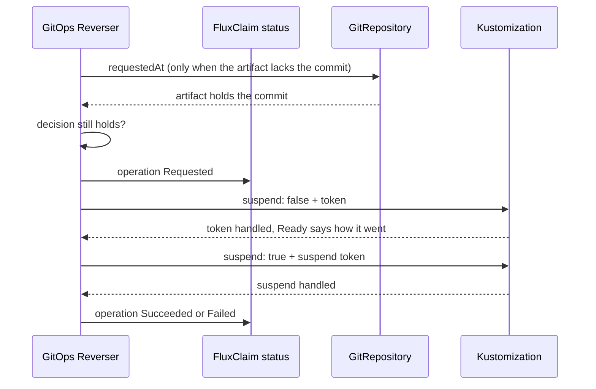

# Bi-directional GitOps with Flux

This page is for a folder that GitOps Reverser writes and a Flux `Kustomization` applies.
`Kustomization`s that apply other folders need nothing from it, and keep working as Flux always
does. [Bi-directional GitOps](bi-directional.md) explains the model; this page is the complete Flux
setup: what to change, what to declare, how to check it works, and which tests prove each part.

A `FluxClaim` holds the `Kustomization` **suspended** while it is idle, for as long as a
`GitTarget` that writes its folder names the applier claim. For each apply, GitOps Reverser resumes it,
waits for that one reconcile to end, and suspends it again. Flux still fetches, renders, applies,
prunes and reports health; it never applies on its own.

## What changes

| Before | With GitOps Reverser |
| --- | --- |
| The `Kustomization` applies on its interval, on every new artifact, and on a controller restart | It is suspended, and applies only when GitOps Reverser resumes it for one apply |
| A failed apply is retried after `retryInterval` | It is suspended again after a failure; GitOps Reverser retries after its own backoff |
| The Git host's push webhook goes to a Flux `Receiver` | It goes to GitOps Reverser's receiver; the Flux `Receiver` for this repository is removed |
| Nothing ties a folder to its `Kustomization` | A `FluxClaim` holds it, and the `GitTarget` names the applier claim in `spec.applierClaimRef` |
| `flux get ks` shows it ready | It shows it `Suspended`, which is how it is held |

## Why suspended, and not a long interval

A long interval makes Flux apply less often; it does not make Flux wait. A `Kustomization` that is
not suspended still applies when its interval fires, when kustomize-controller restarts, when a
failed apply retries, when its own spec changes, and when its `GitRepository` gets a new artifact
for any reason, including a fetch another consumer asked for. Each of those can land while an edit
is still on its way to Git ([why that matters](bi-directional.md#why-the-applier-cannot-decide-for-itself)).
A suspended `Kustomization` does none of them: a reconcile reads `spec.suspend` first and returns
before it resolves its source.

## A complete example

One folder, `apps/checkout` on branch `main` of `github.com/acme/platform`, published by GitOps
Reverser and applied by the `Kustomization` `flux-system/checkout`. Every object below is checked by
a unit test against the code that validates and drives the applier (see
[what the tests prove](#what-the-tests-prove)), so this example cannot drift from what is accepted.

The Flux side. The `GitRepository` follows exactly the branch the `GitTarget` writes. The
`Kustomization`'s manifest does **not** set `suspend`: the `FluxClaim` holds that field.

```yaml
apiVersion: source.toolkit.fluxcd.io/v1
kind: GitRepository
metadata:
  name: platform
  namespace: flux-system
spec:
  url: https://github.com/acme/platform
  ref:
    branch: main
  interval: 1h
  secretRef:
    name: platform-git
---
apiVersion: kustomize.toolkit.fluxcd.io/v1
kind: Kustomization
metadata:
  name: checkout
  namespace: flux-system
spec:
  sourceRef:
    kind: GitRepository
    name: platform
  path: ./apps/checkout
  prune: true
  interval: 1h
```

The GitOps Reverser side. The `GitProvider` points at the same repository (any URL form of it),
which is how the `GitReceiver` the Git host's push webhook calls finds it; a `FluxClaim` holds the
`Kustomization`, in the cluster the chart's `local` `KubeProvider` names (the operator's own,
through `spec.inCluster`), and the `GitTarget` names the applier claim. Nothing may use a provider
without a grant: the `KubeProvider` lets `team-a`'s `GitTarget`s mirror `team-a`
(`allowedGitTargets`), and its applier claims hold a `Kustomization` in `flux-system`
(`allowedApplierClaims`); with the Helm chart, set `kubeProvider.allowedGitTargets` and
`kubeProvider.allowedApplierClaims` instead of declaring it. The `GitProvider` lets `team-a` claim
`main`, and the `GitBranch` lets `team-a`'s `GitTarget`s write it. A `KubeProvider` with
`inCluster` that you declare yourself is honored only once it is listed in
`--in-cluster-kube-providers`, which the chart does for its own:

```yaml
apiVersion: configbutler.ai/v1alpha3
kind: KubeProvider
metadata:
  name: local
  namespace: gitops-reverser
spec:
  inCluster: {}
  allowedGitTargets:
    - consumerNamespaces:
        from: Names
        names: [team-a]
      sourceNamespaces: ["{consumer.namespace}"]
  allowedApplierClaims:
    - consumerNamespaces:
        from: Names
        names: [team-a]
      applierNamespaces: [flux-system]
---
apiVersion: v1
kind: Secret
metadata:
  name: platform-receiver
  namespace: team-a
stringData:
  token: replace-with-a-long-random-string
---
apiVersion: configbutler.ai/v1alpha3
kind: GitReceiver
metadata:
  name: platform
  namespace: team-a
spec:
  type: github
  secretRef:
    name: platform-receiver
---
apiVersion: configbutler.ai/v1alpha3
kind: GitProvider
metadata:
  name: platform
  namespace: team-a
spec:
  url: git@github.com:acme/platform.git
  allowedGitBranches:
    - consumerNamespaces: {from: Same}
      branchPatterns: [main]
  secretRef:
    name: platform-git
---
apiVersion: configbutler.ai/v1alpha3
kind: GitBranch
metadata:
  name: platform-main
  namespace: team-a
spec:
  gitProviderRef:
    name: platform
  branch: main
  allowedGitTargets:
    - consumerNamespaces: {from: Same}
---
apiVersion: configbutler.ai/v1alpha3
kind: GitTarget
metadata:
  name: checkout
  namespace: team-a
spec:
  gitBranchRef:
    name: platform-main
  kubeProviderRef:
    name: local
    namespace: gitops-reverser
  path: apps/checkout
  applierClaimRef:
    kind: FluxClaim
    name: checkout
  onRefusal: Reapply
---
apiVersion: configbutler.ai/v1alpha3
kind: FluxClaim
metadata:
  name: checkout
  namespace: team-a
spec:
  kubeProviderRef:
    name: local
    namespace: gitops-reverser
  kustomizationRef:
    namespace: flux-system
    name: checkout
```

No Flux `Receiver` for `acme/platform` appears, on purpose: remove yours if you have one, and point
the Git host's push webhook at GitOps Reverser's receiver instead
([the steps](bi-directional.md#telling-gitops-reverser-that-somebody-else-pushed)).

## The `GitRepository`

The `GitTarget`'s `ApplierClaimReady` is `True` only when the `Kustomization`'s source fetches the
branch the `GitTarget` writes. The applier claim checks the rules about the source when it reconciles, and
the repository and branch of every `GitTarget` naming it: it holds the `Kustomization` only for one
that matches. The `GitTarget` reports its own match against the source the applier claim publishes. All
of them are checked again before every apply.

| Rule | Reported when broken |
| --- | --- |
| `spec.url` is the `GitProvider`'s repository. The forms compare as one repository: `https://` and `ssh://`, `git@host:org/repo` (SCP style), a trailing `.git` or `/`, letter case, and the default port | `SourceMismatch`: `the applier of FluxClaim checkout applies <url>, not <url>`, on the `GitTarget`, and on the applier claim when no `GitTarget` naming it matches |
| `spec.ref.branch` is exactly the `spec.branch` of the `GitTarget`'s `GitBranch` | `SourceMismatch`: `the applier of FluxClaim checkout applies branch "release", not main`, on the same objects |
| `spec.ref` pins nothing stronger: no `commit`, `name`, `semver` or `tag`, even alongside the branch. Flux resolves those before the branch, so the artifact would never follow it | applier claim `UnsupportedSource`: `pins spec.ref.tag "v1.0.0", so it never follows a branch` |
| `spec.ref.branch` is set | applier claim `UnsupportedSource`: `names no spec.ref.branch` |

A suspended `Kustomization` ignores a new artifact, so the source's own `interval` decides when it
fetches, never when anything applies. Keep it longer than an apply takes, `1h` in the example: an
apply reads the artifact again just before it resumes the `Kustomization`, and a fetch of the
source's own between that read and the reconcile makes Flux apply another commit than the one
GitOps Reverser checked. That is logged, counted in `apply_revision_mismatches_total`, and still
covered by the apply window, but it is avoidable. An apply of an *older* revision than the one
checked counts as failed, and GitOps Reverser asks again.

**Shared sources.** Several `Kustomization`s may read one `GitRepository`. The applier claim lists its
source's other users in `status.source.alsoAppliedBy`: the `Kustomization`s no `FluxClaim`
holds and the `HelmRelease`s whose chart comes from it, directly or through a `HelmChart` their
`chartRef` names. Each of them applies a new artifact the moment it arrives. The list is
information only and never affects `Ready`: one source for `apps` and `infra` is a normal setup.
Appliers on one branch that share a source apply one at a time.

## The `Kustomization`

- `spec.sourceRef` names a `GitRepository`. An `OCIRepository` or a `Bucket` makes the applier claim
  report `UnsupportedSource`: GitOps Reverser writes Git, and can only ask a Git source to fetch.
- **The manifest omits `spec.suspend`.** Whatever applies the `Kustomization` object (a parent
  `Kustomization`, Helm, flux-operator) must leave the field alone, or it resumes the
  `Kustomization` on its next apply. When another field manager applies `spec.suspend`, the applier claim
  reports `SuspendOwnedElsewhere`, naming the manager, and holds nothing. A one-off write such as
  `flux resume` is no such owner; see [overriding by hand](#overriding-by-hand).
- `spec.interval` and `spec.retryInterval` decide nothing while it is suspended.
- `spec.wait`, health checks and `spec.timeout` lengthen each apply, and GitOps Reverser follows it,
  with its apply window open, for as long as it runs.
- `spec.dependsOn`: a dependency whose apply failed is suspended with its generation unapplied, so
  its dependents wait until GitOps Reverser's retry of it succeeds.
- It lives in a namespace the applier claim's `KubeProvider` grants it in `allowedApplierClaims`
  (`applierNamespaces`); an applier claim naming one elsewhere reports
  `ApplierNamespaceNotAllowed`. A `Kustomization` in `flux-system` therefore needs
  `applierNamespaces: [flux-system]`. It is a delegation, not owner consent: every namespace the grant
  admits may then suspend and apply any `Kustomization` in its scope whose source fetches the
  repository its `GitProvider` names. Nothing proves that the namespace owns the `Kustomization`, or
  may write to that repository: the binding compares URLs. See
  [the grants](configuration.md#the-grants).
- Several `GitTarget`s may name one `FluxClaim`, for a `Kustomization` whose `path` covers several
  folders. It is applied once for all of them.
- Two `GitProvider`s may name one repository. Before either branch worker asks, both flush: the
  other worker publishes the writes it decided so far too, and a `GitRepository` they share serves
  one operation at a time.
- **An object another applier owns is not mirrored into the folder.** An object whose
  `kustomize.toolkit.fluxcd.io/name` and `kustomize.toolkit.fluxcd.io/namespace` labels name
  another `Kustomization`, or whose `argocd.argoproj.io/tracking-id` names an Argo CD
  `Application`, is left out: a live change to it is not mirrored, and a resync neither writes it
  nor removes its document. Two appliers applying one object fight each other. See
  [objects another applier owns](bi-directional.md#objects-another-applier-owns).

## The `FluxClaim`

```yaml
apiVersion: configbutler.ai/v1alpha3
kind: FluxClaim
metadata:
  name: checkout
  namespace: team-a            # the GitTargets naming it are in this namespace
spec:
  kubeProviderRef:             # the cluster Flux runs in; required
    name: local
    namespace: gitops-reverser # default: the applier claim's namespace
  kustomizationRef:
    namespace: flux-system     # default: the applier claim's namespace
    name: checkout
```

`kubeProviderRef` names the cluster that holds the `Kustomization`: the operator's own cluster for
an `inCluster` provider such as the chart's `local`, or a management cluster where Flux runs. The
provider's `spec.allowedApplierClaims` must admit the applier claim's namespace, its own included only
by a grant; a denial hands a held `Kustomization` back. Both
references are immutable: delete and recreate the applier claim to hold another `Kustomization`.

### How the applier claim holds the `Kustomization`

An applier claim acts only while an eligible `GitTarget` references it: one in the applier claim's namespace that
names it in `spec.applierClaimRef`, is admitted by its `KubeProvider`s, and writes the repository
and branch the `Kustomization`'s `GitRepository` fetches. An applier claim no `GitTarget` names holds
nothing, reads nothing in the `Kustomization`'s cluster, and is `Ready`. One that only ineligible
`GitTarget`s name holds nothing either, and its `Configured` says why.

```mermaid
stateDiagram-v2
    [*] --> NotReferenced
    NotReferenced --> NotConfigured: a GitTarget names it, not yet Configured
    NotConfigured --> NotReferenced: no GitTarget names it any more
    NotConfigured --> Suspending: Configured turns True, so it adopts
    Suspending --> Suspended: the suspend is handled
    Suspended --> Applying: an operation is recorded as Requested
    Applying --> Suspended: the operation completed, its suspend handled
    Applying --> Suspending: nobody followed it past the grace, the applier claim suspends it
    Suspended --> Suspending: found resumed (flux resume) or suspended by another (flux suspend)
    Suspended --> NotConfigured: the applier's configuration turns invalid, left suspended
    Suspended --> Releasing: no eligible reference left, or applier claim deleted
    Applying --> Releasing: the same, suspended first
    Releasing --> Suspended: a reference returns before the release
    Releasing --> NotReferenced: released, Flux applies on its own again
    Releasing --> NotConfigured: released, while a refused GitTarget still names it
    Releasing --> [*]: applier claim deleted
    Suspended --> Revoking: allowedApplierClaims no longer admit the applier claim
    Applying --> Revoking: the same, suspended first
    Releasing --> Revoking: the same, during a release
    Revoking --> NotConfigured: released; a regrant then adopts it anew

    note right of NotConfigured
        Configured says why
    end note
    note right of Applying
        the only state in which Flux applies;
        status.operation shows the apply
    end note
```



- **Adopting.** Once an eligible `GitTarget` names it and it is `Configured`, the applier claim puts its
  finalizer `configbutler.ai/flux-claim` in place, suspends the `Kustomization` with a server-side
  apply under the field manager `gitops-reverser` and a new `reconcile.fluxcd.io/requestedAt` token,
  and records an `Adopted` Event. The suspend is handled once the `Kustomization` reports that
  token: reconciles of one object never overlap, so by then nothing that was running before is.
- **Several `GitTarget`s.** One eligible `GitTarget` among those naming the applier claim is enough. While
  none is, and one cannot be judged yet (its `GitProvider` is missing), the applier claim reports
  `NotBound` and waits. Once each is refused, it reports the reason they share (`SourceMismatch`,
  `NamespaceNotAuthorized`), or `NotBound` for mixed ones, with every `GitTarget` and its reason in
  the message.
- **One applier claim per `Kustomization`.** An applier claim is in line for its `Kustomization` while an
  eligible `GitTarget` references it, and while it holds the `Kustomization` or is handing it back.
  When two in line name the same `Kustomization` in the same cluster, one holds it: the one with an
  apply in flight, otherwise the one that holds it already, otherwise the oldest. The other reports
  `HeldByAnotherClaim`, does nothing, and takes over once the holder lets go. An applier claim nothing
  eligible references is not in line, so it keeps no other out.
- **The applier claim hands the `Kustomization` back** when no eligible `GitTarget` references it any
  more, and when it is deleted. `InControl` reads `Releasing`: it suspends the `Kustomization` once more
  if an apply has it resumed, waits until that is handled, and releases `spec.suspend`, so Flux
  applies it on its own again (a `Released` Event). A `Kustomization` that somebody suspended
  before the applier claim held it stays suspended. The applier claim records how it stood in
  `status.previousSuspendState` (`Suspended` or `NotSuspended`) before it first suspends it, and
  `kubectl get fluxclaim -o wide` shows it.
  Until that is done it stays the holder, so no other applier claim acts on the `Kustomization`. One
  whose `spec.suspend` another manager also applies stays suspended, and the Event names that
  manager. With another `FluxClaim` in line, the `Kustomization` stays suspended for that one,
  which inherits `status.previousSuspendState`. A
  `KubeProvider` that is gone does not stop the hand-back: it goes on through whatever still
  reaches the cluster, which for an `inCluster` provider is the operator's own. When nothing
  does, or the hand-back has not finished 10 minutes after `InControl` turned `Releasing`, the applier claim
  lets go with a `ReleaseFailed` Event saying where the `Kustomization` was left. A reference that
  returns before the release is done holds the `Kustomization` again; one that returns after adopts
  it anew. When the `KubeProvider`'s `allowedApplierClaims` no longer admit the applier claim, the
  hand-back is the same, but `InControl` reads `Revoking`, and it finishes even if a grant admits the
  applier claim again meanwhile; the applier claim then adopts the `Kustomization` anew.
- **Deleting or re-creating a `GitTarget` hands the `Kustomization` back.** Flux then applies the
  Git tip at once, which overwrites live edits not yet in Git, and the applier claim adopts the
  `Kustomization` again once the `GitTarget` is back. That is what Flux does without GitOps
  Reverser, and with no `GitTarget` nobody would carry those edits to Git anyway.
- **An applier claim whose configuration turns invalid keeps its hold.** It reports `InControl=Unknown`
  (`NotConfigured`), and the message says the `Kustomization` is left suspended under GitOps
  Reverser's field manager; deleting the applier claim, or its `GitTarget`s, hands it back.

The applier claim reports `Configured` and `InControl` (whether GitOps Reverser decides, right now,
when the `Kustomization` applies), and its `Ready` includes both:

| Reason | Means | Readiness |
| --- | --- | --- |
| `Configured`: `Succeeded` | An eligible `GitTarget` names the applier claim, and the `Kustomization` exists, applies a `GitRepository` that follows a branch, and may be patched | ready |
| `Configured`: `NotReferenced` (`Unknown`) | No `GitTarget` names the applier claim. Nothing is read or written | ready: `Ready=True`, `NotReferenced` |
| `Configured`: `NotBound` (`Unknown`) | No `GitTarget` naming the applier claim is eligible yet, and one cannot be judged yet | progressing |
| `Configured`: `SourceMismatch`, `NamespaceNotAuthorized` or `NotBound` (`False`) | Every `GitTarget` naming the applier claim is refused: it writes another repository or branch, or is not admitted. The message lists each | stalled |
| `Configured`: `ApplierNotFound` | No such `Kustomization` in the applier's cluster, or Flux is not installed there | progressing: Flux objects are often created after the applier claim |
| `Configured`: `UnsupportedSource` | The source is not a `GitRepository`, or breaks one of the [`GitRepository` rules](#the-gitrepository) | stalled |
| `Configured`: `SuspendOwnedElsewhere` | Another field manager applies `spec.suspend` | stalled: remove the field from the manifest it applies |
| `Configured`: `Forbidden` | The applier cluster's identity may not patch the `Kustomization` or its `GitRepository` | stalled |
| `Configured`: `NamespaceNotAuthorized` | No grant in the provider's `spec.allowedApplierClaims` admits the applier claim's namespace | stalled |
| `Configured`: `KubeProviderNotFound` | The `kubeProviderRef` names a provider that does not exist | progressing |
| `Configured`: `AuditRouteConflict` | The provider carries an audit route another namespace holds, so it is not used | stalled |
| `Configured`: `ApplierNamespaceNotAllowed` | The `Kustomization`'s namespace is not in the `applierNamespaces` the provider's grants give the applier claim's namespace | stalled |
| `Configured`: `HeldByAnotherClaim` | Another `FluxClaim` holds this `Kustomization` | stalled: delete one of the two |
| `InControl`: `Suspended` | Suspended under GitOps Reverser, and the last suspend is handled. Nothing applies | ready |
| `InControl`: `Applying` | An apply GitOps Reverser started is in flight: `status.operation` shows it | ready |
| `InControl`: `Suspending` | Just suspended; waiting for the `Kustomization` to handle it | progressing |
| `InControl`: `Releasing` | Handing the `Kustomization` back: suspending it if needed, then releasing `spec.suspend`, within 10 minutes | progressing |
| `InControl`: `Revoking` | The same hand-back, because the provider's `allowedApplierClaims` no longer admit the applier claim. It finishes even if a grant returns meanwhile | progressing |
| `InControl`: `NotReferenced` | Nothing to hold: no `GitTarget` names the applier claim | ready |
| `InControl`: `NotConfigured` | The applier claim is not `Configured`, so nothing is held, or the `Kustomization` is left suspended as the applier claim last held it (the message says which) | follows `Configured` |
| `Ready`: `OperationUnresolved` | An apply has not completed within 5 minutes, or the `Kustomization` was [resumed by hand](#overriding-by-hand) | progressing; it clears when the apply does |

`Ready=True` for an applier claim no `GitTarget` names is deliberate: it does all it is asked to, which is
nothing. A Flux health check reads `Ready`, so a `Kustomization` that creates the applier claim and waits
for it would otherwise never become ready, and the `Kustomization` that creates the `GitTarget`
after it would never apply.

The `GitTarget` reports `ApplierClaimReady`: `True` when the applier claim is `Ready` and its
`GitRepository` fetches this repository and branch, `SourceMismatch` when it fetches another,
`ApplierClaimNotFound` when the applier claim does not exist, `Unknown` (`NotReferenced`) until the
applier claim has seen that the `GitTarget` names it, and otherwise the applier claim's own `Ready` reason.

## Permissions

GitOps Reverser looks the `Kustomization` up in the cluster of the applier claim's `kubeProviderRef`,
with the identity of that `KubeProvider`. That identity needs:

| API group | Resource | Verbs |
| --- | --- | --- |
| `kustomize.toolkit.fluxcd.io` | `kustomizations` | `get`, `list`, `patch` |
| `source.toolkit.fluxcd.io` | `gitrepositories` | `get`, `patch` |
| `helm.toolkit.fluxcd.io` | `helmreleases` | `list`, to find what else applies the source; without it `status.source.alsoAppliedBy` stays empty |
| `source.toolkit.fluxcd.io` | `helmcharts` | `list`, for the same reason |
| `authorization.k8s.io` | `selfsubjectaccessreviews` | `create`, which every authenticated identity has |

For the operator's own cluster, install the chart with `applierAccess.flux: true`, or apply
[`config/rbac/flux-applier-role.yaml`](../config/rbac/flux-applier-role.yaml) and its binding. For a
remote cluster, grant the same to the identity in the `KubeProvider`'s kubeconfig. The chart's
grant is cluster-wide for convenience; GitOps Reverser only patches the `Kustomization` and
`GitRepository` an applier claim names.

## One apply

All four [reasons](bi-directional.md#when-gitops-reverser-asks-for-an-apply) reach a
`Kustomization`. A `CatchUp` that only converges asks nothing when the `Kustomization`'s last
successful operation applied the tip. Every other request applies, even of a commit already applied:
a `Refusal` and a `Repair` ask for an unchanged commit to be applied again, and a `CatchUp` that
adopts re-applies it so that Flux stamps its owner labels on the objects the API created, and takes
them into its inventory. A `Kustomization` a `GitTarget` names for the first time converges once that
`GitTarget`'s initial snapshots are published, so a commit already on the branch reaches it. After a
[flush](bi-directional.md#flush-then-apply), GitOps Reverser:

1. Makes the `GitRepository`'s artifact hold the commit: when it does not, it stamps
   `reconcile.fluxcd.io/requestedAt` on the `GitRepository` and waits for that fetch. The suspended
   `Kustomization` ignores the new artifact.
2. Reads the artifact again and checks that the decision still holds.
3. Records the operation on the applier claim's `status.operation` (`Requested`), so a restart finds it.
4. Resumes the `Kustomization`: one server-side apply sets `spec.suspend: false` and a new
   `requestedAt`, guarded by the `uid` and `resourceVersion` it read. The reconcile that write
   enqueues applies (`Running`).
5. Waits for the `Kustomization` to report that token handled, whether the apply succeeded, failed,
   or waited on a dependency.
6. Suspends it again with another token (`Settling`). Once that suspend is handled, nothing
   that started before it is still running, and the operation completes: `Succeeded` for
   `Ready=True`, `Failed` with Flux's reason for `Ready=False`.



**A failed apply is suspended again** like any other, which stops Flux's own `retryInterval` retry.
GitOps Reverser retries on its own backoff (2 seconds doubling to 5 minutes; at least 15 seconds
when the `Kustomization`'s configuration rejects the request), at the tip as it is then. An
`ApplyFailed` Event marks the first failure of a run. A resume no reconcile ran on (somebody ran
`flux suspend` in between) counts as failed too: a handled token alone does not prove Flux applied
anything.

**An apply that takes long is followed, not timed out.** After 5 minutes the operation is
`Unresolved`: the `Kustomization` is suspended at once, which stops whatever would follow but not
the apply already running, and an `ApplyUnresolved` Event is recorded. An operation nobody follows
for a minute (its `GitTarget` deleted mid-apply, for example) is suspended by the applier claim, completes
as failed, and records an `OperationUnfollowed` Event. A resumed `Kustomization` is never left with
nothing watching it.

**The apply window.** From the moment an operation is asked for until 10 seconds after it completes,
a write by `kustomize-controller` alone to an object nobody edited is the apply landing, and is not
mirrored. A write by `kustomize-controller` over a newer API edit, one made after the flush included,
is withheld from Git, and GitOps Reverser asks for a `Repair`; the applier claim shows `repairPending`
until that apply succeeds. Only a `kustomize-controller` entry as new as the edit or newer counts:
undoing an edit can leave an older one as the newest entry, and that undo is mirrored. When
`kustomize-controller` and another manager wrote in the same second, the write is mirrored and
counted as `ambiguous`.

**Reverting refused edits.** With `onRefusal: Reapply`, the target's `Kustomization` is resumed
for one apply of the tip; no new commit is needed. If its `GitRepository` has to fetch to reach the
tip, the `Kustomization`s GitOps Reverser holds ignore the new artifact, and one in
`status.source.alsoAppliedBy` applies it, as it would for any push.

## Overriding by hand

- **`flux resume ks checkout`** applies the `Kustomization` at once, without GitOps Reverser
  checking the commit first. Within a minute the applier claim suspends it again: it records a
  `ClaimedResourceReconciled` Event, counts it in `claimed_resource_reconciled_total`, and shows the
  apply as an `Unresolved` operation that completes once nothing it started is running. It does so
  every time.
- **`flux reconcile ks checkout`** does nothing visible while the `Kustomization` is suspended: Flux
  marks the request handled without applying.
- **`flux suspend ks checkout`** is taken back with a token of GitOps Reverser's.
- To hand the `Kustomization` back to Flux for good, delete the `FluxClaim`, or stop naming it from
  every `GitTarget`.

## Checking that it works

```bash
# The applier is found, applies a branch, may be patched, and is held; and it applies this branch.
kubectl get fluxclaim checkout -n team-a
kubectl get gittarget checkout -n team-a \
  -o jsonpath='{.status.conditions[?(@.type=="ApplierClaimReady")]}{"\n"}'

# The last apply, why, and where it stands; and what else applies the same source.
kubectl get fluxclaim checkout -n team-a -o jsonpath='{.status.operation}{"\n"}{.status.source}{"\n"}'
# {"appliedRevision":"main@sha1:4f2c1ab9...","commit":"4f2c1ab9...","phase":"Succeeded","reason":"ForeignCommit",...}

# Each apply asked for, each one that could not be asked or did not complete.
kubectl get events -n team-a --field-selector involvedObject.name=checkout,involvedObject.kind=GitTarget

# Flux's own view: suspended, and the last revision it applied.
flux get ks checkout -n flux-system
```

`gitopsreverser_apply_requests_total{reason,outcome}` counts the requests;
[interpreting metrics](interpreting-metrics.md#apply-requests-and-the-push-receiver) reads it.

## Troubleshooting

| Symptom | Cause | Fix |
| --- | --- | --- |
| `FluxClaim` `Configured=False`, `ApplierNotFound` | No `Kustomization` with that namespace and name in the applier claim's cluster, or Flux is not installed there | Create it, or recreate the applier claim with the right `kustomizationRef`; an omitted namespace is the applier claim's |
| `FluxClaim` `Configured=False`, `SuspendOwnedElsewhere` | The manifest that applies the `Kustomization` sets `spec.suspend` | Remove the field from that manifest |
| Repeated `ClaimedResourceReconciled` Events, each followed by applier claim `OperationUnresolved` | Something keeps undoing the applier claim's suspension | See [repeated `ClaimedResourceReconciled` Events](#repeated-claimedresourcereconciled-events) |
| `ApplierClaimReady=False`, `SourceMismatch`, or applier claim `UnsupportedSource` | The message names the broken [`GitRepository` rule](#the-gitrepository) | Fix the `GitRepository`; the applier claim then adopts the `Kustomization`, and the apply that was waiting is asked for |
| `FluxClaim` `Configured=False`, `ApplierNamespaceNotAllowed` | The `Kustomization` is in a namespace the grants do not give, such as `flux-system` | Add it to `applierNamespaces` in the `KubeProvider`'s `spec.allowedApplierClaims` (Helm: `kubeProvider.allowedApplierClaims`) |
| `FluxClaim` `Configured=Unknown`, `NotBound` | A `GitTarget` names the applier claim, but cannot be judged yet: its `GitProvider` or `KubeProvider` does not exist | Create the missing object; the message names it |
| `FluxClaim` `Ready=True`, `NotReferenced`, and the `Kustomization` is not suspended | No `GitTarget` names the applier claim, so it holds nothing | Name it in the `GitTarget`'s `spec.applierClaimRef` |
| `FluxClaim` `Configured=False`, `Forbidden` | The identity lacks one of the [permissions](#permissions) | Grant it, or set `applierAccess.flux: true` |
| A Warning `ApplyRequestFailed` Event | An apply could not be asked for; the message says why | GitOps Reverser keeps asking after its backoff, at most every five minutes |
| An object in the folder is never mirrored, and the log says `Not mirroring an object another applier owns` | Another `Kustomization` or an Argo CD `Application` applies it; `apply_ownership_conflicts_total` counts it | Let one applier own it: take it out of the other applier's source, or stop watching it from this `GitTarget` |
| A Warning `ApplyFailed` Event | Flux ran the apply and reported it failed | Read the `Kustomization`'s status; GitOps Reverser retries on its backoff |
| A Warning `ApplyUnresolved` Event, applier claim `OperationUnresolved` | The apply has not completed in 5 minutes | It is suspended and still followed; look at the `Kustomization`'s status and health checks |
| A Warning `OperationUnfollowed` Event | An apply was left in flight with nothing following it | It was suspended and completed as failed. A recurring one is a bug worth reporting with the operator's logs |
| A Warning `ReleaseFailed` Event | An applier claim being deleted, or no longer referenced, could not hand its `Kustomization` back: a write it may not make, a `KubeProvider` gone with no way left to its cluster, or 10 minutes passed | The message says where it was left; `flux resume` it if it should apply on its own |
| A dependent `Kustomization` waits | Its dependency's last apply failed | Fix the dependency's failure; GitOps Reverser's retry unblocks it |
| A Git-side push takes minutes to reach the cluster | No receiver, so the refresh finds it | Configure [the push webhook](bi-directional.md#telling-gitops-reverser-that-somebody-else-pushed) |
| A refused edit is not reverted | The target is suspended, `onRefusal` is not `Reapply`, or the refusal is not eligible | See [reverting a refused edit](configuration.md#reverting-a-refused-edit-speconrefusal) |

### Repeated `ClaimedResourceReconciled` events

Repeated `ClaimedResourceReconciled` Events mean something keeps undoing the applier claim's
suspension. A rising `claimed_resource_reconciled_total` counts these corrections. A person who
runs `flux resume` causes one each time, as [overriding by hand](#overriding-by-hand) describes. If
they keep coming and the applier claim also reports `OperationUnresolved`, look at the controller
that writes the `Kustomization`.

A controller that replaces the whole spec removes `spec.suspend` by leaving it out, for example
`controllerutil.CreateOrUpdate` with a spec it builds from scratch. On each such write, Flux applies
unchecked until GitOps Reverser suspends the `Kustomization` again. Removing a field takes no
ownership of it, so `SuspendOwnedElsewhere` does not report this case.

Change that controller to do one of these:

- Copy `spec.suspend` from the object it read into the spec it writes.
- Use server-side apply, and leave `spec.suspend` out of the fields it manages.

## While GitOps Reverser is down

**A `Kustomization` waits suspended while GitOps Reverser is down.** A Git-side push waits until
it is back, or until somebody runs `flux resume`, after which GitOps Reverser suspends the
`Kustomization` again when it starts.

- **A graceful stop suspends what it had resumed.** An upgrade or a node drain stops the operator
  mid-apply; the stop suspends that `Kustomization` before the process exits. The apply already
  running still finishes, and the next process sees it to its end.
- **After a crash, the apply that was running finishes, and the next process suspends it.** Until
  that process starts, the `Kustomization` stays resumed, so Flux may also apply a new artifact on
  its own in between.

An apply that was running when it stopped is not lost. The operation is recorded on the applier claim
before the `Kustomization` is resumed, so the next process follows it to its end by its tokens, with
the apply window open. After its first look at the remote, a `CatchUp` that converges is pending for
every `Kustomization`, and no `ForeignCommit`. It is asked only once every initial snapshot of the
`GitTarget`s naming the applier claim is published: an apply before that could revert edits made while the
operator was down, before its watches caught them. A `Kustomization` whose last successful operation
applied the tip is asked nothing.

## What the tests prove

| Covered | Where |
| --- | --- |
| The [complete example](#a-complete-example) decodes strictly, reports `Configured=True`, binds the `GitTarget`, and an apply fetches and resumes the `Kustomization`; the manifest omits `spec.suspend` | [`flux_guide_test.go`](../internal/applier/flux_guide_test.go) |
| Every fact of kustomize-controller v1.9.6 the lifecycle relies on, in a fake that applies them | [`fluxsim`](../internal/applier/fluxsim/fluxsim_test.go) |
| An operation is not finished when the revision is attempted; a token handled while suspended is no apply; a resume alone reverts a refusal; a suspend does not stop a running apply; the artifact is rechecked before the resume; a failed apply is suspended and Flux's requeue applies nothing; a shared source applies only the consumer asked | [`flux_lifecycle_test.go`](../internal/applier/flux_lifecycle_test.go), [`flux_applied_by_test.go`](../internal/applier/flux_applied_by_test.go) |
| Adoption, an external resume suspended again with an Event each time, `SuspendOwnedElsewhere`, the hand-back on deletion (a `KubeProvider` gone included), and what else applies the source | [`fluxclaim_hold_test.go`](../internal/controller/fluxclaim_hold_test.go) |
| An applier claim nothing names reads nothing and is `Ready`; the first eligible `GitTarget` adopts and the last releases, suspending an apply in flight first; a reference returning mid-release holds again; the binding over several `GitTarget`s; an older applier claim not in line keeps none out, and a retiring holder stays first until its release is done; `ApplierNamespaceNotAllowed` | [`applierclaim_rule_test.go`](../internal/controller/applierclaim_rule_test.go) |
| Every operation checks the target again (incarnation, branch, admission, consent) and the source binding before it resumes, records itself first, and never asks for something weaker; a stop mid-apply suspends the `Kustomization` | [`dispatcher_test.go`](../internal/applier/dispatcher_test.go) |
| A failed attempt is decided again; each `Kustomization` keeps its own backoff; a shared one is asked once; appliers sharing a source apply one at a time; nothing is sent while no flush can be made; an undo of an edit in the apply window is mirrored, and the applier's own write is not | [`apply_attempt_test.go`](../internal/git/apply_attempt_test.go), [`apply_groups_test.go`](../internal/git/apply_groups_test.go), [`applier_claim_test.go`](../internal/git/applier_claim_test.go), [`apply_window_test.go`](../internal/git/apply_window_test.go) |
| A newly named `Kustomization` converges once; the startup converge asks nothing of one at the tip; an API create is adopted even at the tip; nothing is asked before the initial snapshots are published, or for an empty tip | [`apply_catchup_test.go`](../internal/git/apply_catchup_test.go), [`applier_claim_test.go`](../internal/git/applier_claim_test.go) |
| An object another applier owns is neither mirrored nor swept | [`apply_ownership_test.go`](../internal/git/apply_ownership_test.go) |
| An applier claim nothing names is `Ready` and holds nothing; named from a `GitTarget` on another branch than its source, it is `SourceMismatch` and adopts nothing | [Manager Flux Applier](../test/e2e/flux_applier_e2e_test.go) |
| A `ForeignCommit` for a `SourceMismatch` applier never stamps the other branch's source and records `ApplyRequestFailed`; once the source is fixed the applier claim adopts the `Kustomization` and Flux reaches the tip; dropping the reference hands it back, and naming the applier claim again adopts it anew | Manager Flux Applier |
| A Gitea push webhook to the operator's receiver gets a Git-side push applied; with no receiver and no API edit, the refresh finds one | Manager Flux Applier |
| A failed apply is suspended again and retried; a `flux resume` is suspended again with a `ClaimedResourceReconciled` Event; deleting the applier claim hands the `Kustomization` back | Manager Flux Applier |
| A manager restarted during an apply suspends the `Kustomization` as it stops; the new one completes that same operation and leaves it suspended | [Flux Restart Recovery](../test/e2e/flux_restart_recovery_e2e_test.go) |
| Two API edits seconds apart end at the later value with no extra commit | [Bi-directional (Flux)](../test/e2e/flux_bi_directional_e2e_test.go) |
| A Git-side push with an API edit on top lands both, and Flux applies the replayed commit | Bi-directional (Flux) |
| A new `GitRepository` revision from a commit outside the applied folder is enough for the `Kustomization` to apply and revert drift | Bi-directional (Flux) |
| A Git to cluster to Git round trip settles without a commit loop; a SOPS-encrypted Secret round-trips without a reverse commit; a Git revert removes the live object and the committed file | Bi-directional (Flux) |
| A refused edit with `onRefusal: Reapply` is reverted by a resume, with no commit, and settles | [Manager Refusal Reapply](../test/e2e/refusal_reapply_e2e_test.go) |
| An API create, and a delete and create with the same content, are adopted, so a Git-side delete prunes them; an edit made during an apply is in Git at once and back on the cluster after the `Repair`; a Git-side push is applied while edits keep arriving, and every edit is kept; a Git-side push survives a resync forced before its apply, and a Git-side addition survives one under `prune.mode: Always`; an API edit asks for no apply; another applier's object is neither mirrored nor adopted; a save made across a Git-side change resolves from the push | [Bi-directional applier echoes (Flux)](../test/e2e/bi_directional_echoes_e2e_test.go) |
| A Git-side push made while the previous one is being applied stays in Git and on the cluster | [Bi-directional push race (Flux)](../test/e2e/bi_directional_push_race_e2e_test.go) |
| After a restart, an API edit and an API create made while the operator was down end in Git and on the cluster, nothing reverts the edit, a Git-side push made meanwhile is applied, and the create is adopted | [Bi-directional restart (Flux)](../test/e2e/bi_directional_restart_e2e_test.go) |

`task test-e2e` runs the Manager specs and Flux Restart Recovery, and
`task test-e2e-bi-directional` the bi-directional corner. Not covered end to end yet: a remote
applier cluster, `Forbidden` against cluster RBAC, and the receiver installed by the Helm chart
rather than the e2e manifests.
