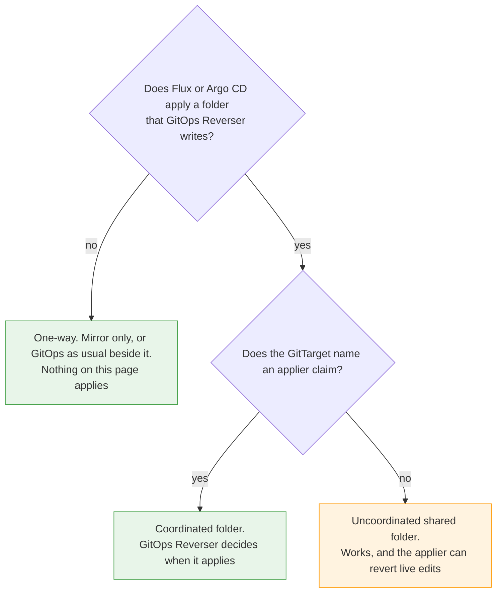
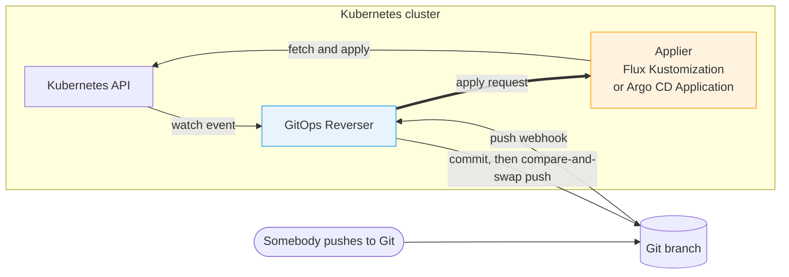
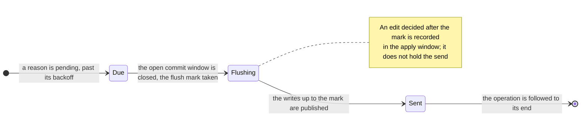
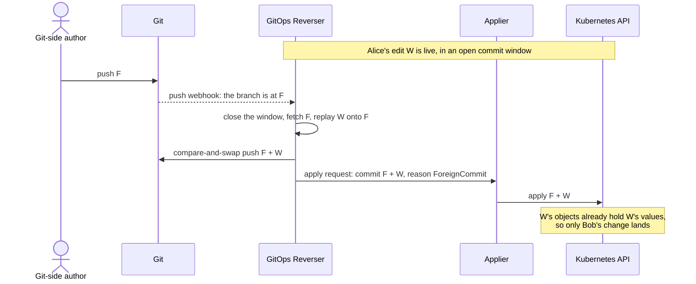
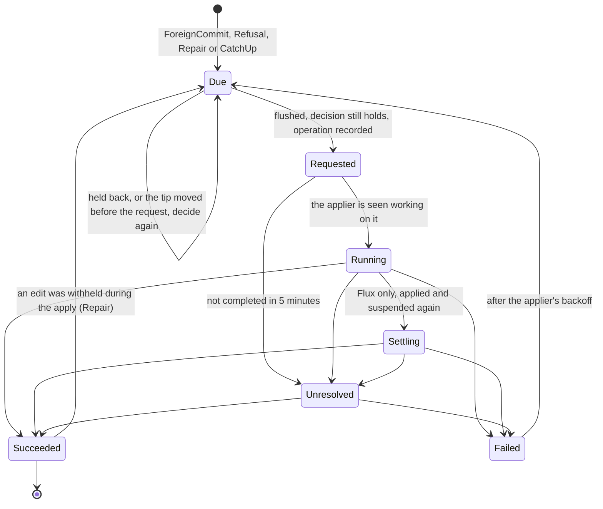

# Bi-directional GitOps

GitOps Reverser writes live cluster state to Git. Flux and Argo CD apply Git to the cluster. This
page covers the one setup where the two meet on the same folder, so that a resource can be changed
from either side: who decides what, which states the system moves through, and what stays exposed.
The complete setups are [bi-directional GitOps with Flux](bi-directional-flux.md) and
[bi-directional GitOps with Argo CD](bi-directional-argocd.md).

## Do you need any of this?

Only when Flux or Argo CD applies a folder that GitOps Reverser also writes. Every other setup is
ordinary GitOps and needs nothing from this page.

| Your setup | What you configure |
| --- | --- |
| GitOps Reverser mirrors a folder that nothing applies: an audit trail, a backup, the start of a repository | A `GitTarget` and its watch rules |
| Flux or Argo CD applies other folders or other repositories, next to GitOps Reverser | Nothing. Flux and Argo CD stay exactly as they are |
| Flux or Argo CD applies a folder that GitOps Reverser writes | An applier claim, as this page describes |



Everything bi-directional is opt-in and off by default: the applier claims, the push receiver,
`onRefusal: Reapply`, the chart's `applierAccess` grants, and the `KubeProvider`'s
`allowCrossNamespace.appliers`, which an applier claim needs to hold an applier outside its own namespace,
such as one in `flux-system` or `argocd`. A `GitTarget` without `spec.applierClaimRef` never reads,
patches or syncs anything of Flux's or Argo CD's, and neither does an applier claim no `GitTarget` names, so
a `Kustomization` keeps its interval and an `Application` keeps automated sync.

Naming an applier claim makes the `GitTarget`'s folder
[coordinated](definitions.md#applying-back). This describes the setup; `ApplierClaimReady`
reports whether the applier claim is ready.

**An uncoordinated shared folder works, and is exposed.** The applier keeps its own schedule,
and that schedule cannot see the edits GitOps Reverser has not pushed yet
([why](#why-the-applier-cannot-decide-for-itself)). An apply at the wrong moment reverts a live edit,
and GitOps Reverser then commits the revert as the applier's change. With Argo CD's
`selfHeal: true`, a live edit is reverted within a second, before it can reach Git at all. If you
run a shared folder this way, keep [controller bookkeeping out of Git](#keep-controller-bookkeeping-out-of-git),
and consider [split ownership](#the-split-ownership-alternative) for the fields both sides change.

## How it works

GitOps Reverser decides when the cluster is applied from Git. Flux or Argo CD keeps fetching,
rendering, applying, pruning and reporting health, and applies when GitOps Reverser asks. Three
things set that up:

1. **An applier claim holds the applier.** A `FluxClaim` holds a Flux `Kustomization`, an
   `ArgoCDClaim` an Argo CD `Application`, and the `GitTarget` names the applier claim in
   `spec.applierClaimRef`. An applier claim acts only while an eligible `GitTarget` names it: one in its
   namespace, admitted by its `KubeProvider`s, that writes the repository and branch the applier
   fetches.
2. **The applier's own applier claims are off.** The `FluxClaim` keeps its `Kustomization` suspended;
   the `ArgoCDClaim` keeps its `Application`'s automated sync off.
3. **The Git host's push webhook reaches GitOps Reverser**, so a Git-side push is applied in
   seconds. See [telling GitOps Reverser that somebody else pushed](#telling-gitops-reverser-that-somebody-else-pushed).



The two appliers get the same contract by different means:

| | Flux | Argo CD |
| --- | --- | --- |
| Held by | A `FluxClaim` | An `ArgoCDClaim` |
| Kept from applying on its own by | `spec.suspend`, which the applier claim owns | `spec.syncPolicy.automated.enabled: false`, which the applier claim owns, unless the `ApplicationSet` that generated the `Application` owns it |
| One apply is | A resume for one reconcile, then a suspend | A sync operation pinned to the commit |
| When it is asked to apply | [The same four reasons](#when-gitops-reverser-asks-for-an-apply), `CatchUp` included | The same four reasons |
| The tool's own push webhook | Removed: GitOps Reverser's receiver replaces it | May stay: with automated sync off it only compares |
| A human override | `flux resume` applies once; it is suspended again within a minute | Sync applies; GitOps Reverser waits for it to end. Automated sync switched on is switched off again within a minute |
| Handing it back | Delete the applier claim, or stop naming it from every `GitTarget`: the `Kustomization` is resumed, or stays suspended if it was before | Delete the applier claim, or stop naming it from every `GitTarget`: automated sync is as it was before, unless an `ApplicationSet` or another field manager owns the switch by then, which keeps their value |
| Complete setup | [Bi-directional GitOps with Flux](bi-directional-flux.md) | [Bi-directional GitOps with Argo CD](bi-directional-argocd.md) |

## Why the applier cannot decide for itself

An apply is safe only when nothing live is missing from the commit it applies. Between an edit and
its push, the edit is live in the cluster and absent from Git: it sits in an open commit window or
in the branch worker's pending writes. An apply at that moment writes Git's older value over it,
GitOps Reverser mirrors that revert faithfully, and the edit is gone.

Only GitOps Reverser can see the pending edits, so every trigger the applier runs by itself is an
apply nobody checked:

- **A Git-host webhook into the applier** fires on every push, GitOps Reverser's own included. Two
  API edits a few seconds apart are enough for the first commit to be applied over the second edit.
- **Argo CD's automated sync** syncs every commit it has not synced yet, and every push GitOps
  Reverser makes is one. Two to three minutes after each push (`timeout.reconciliation`, 120s plus
  jitter), the `Application` is synced over whatever is pending. `selfHeal: false` does not change
  that.
- **Flux's intervals** apply on every reconcile, whatever woke it: on the interval, on a new
  artifact, on a controller restart.

None of these can be filtered from outside. They are switched off, and GitOps Reverser makes the
requests instead.

## Flush, then apply

Every apply GitOps Reverser asks for goes out after a **flush**. When an apply comes due, the branch
worker closes the open commit window, so its edits become a decided write, and takes the **flush
mark**: the last write decided so far. It publishes the writes up to the mark at once, without
waiting for the push cooldown, and asks for the tip that publication produced. Every edit decided
before the apply is therefore in the commit it applies.

An edit decided after the mark does not hold the apply back. It is recorded in the applier's apply
window from the mark on, so an apply that writes over it is withheld from Git and repaired
([the life of an apply](#the-life-of-an-apply)). A user who keeps editing therefore never holds a
Git-side change back for as long as they type.



Three states still hold an apply back, because in them no flush can be made: a commit window a
[`CommitRequest`](configuration.md#commitrequest) holds (a save defines its own commit boundary, and
the apply waits for it), a missing parent branch being recovered, and a checkout a failed write left
dirty. In the last two the branch worker cannot say what is published.

A foreign commit is applied after the same flush. A push webhook closes the open window at once;
without one, the flush's own push is rejected and its fetch finds the commit. Either way the pending
writes are applied onto the foreign commit and pushed, and the applier is asked once, for the commit
that holds both sides. It is never asked for the foreign commit on its own first. The applied commit
holds the API side's values, so applying it reverts nothing:



## When GitOps Reverser asks for an apply

| Reason | When | Which applier |
| --- | --- | --- |
| `ForeignCommit` | The branch gained a commit GitOps Reverser did not push | Every applier declared on the branch |
| `Refusal` | An edit was refused and the target has `onRefusal: Reapply` | The refusing target's applier |
| `Repair` | An apply reverted an API edit made after the flush; Git kept the edit | That applier |
| `CatchUp` | To **adopt**: the API created an object in a folder the applier applies, or a resync added an object to Git. To **converge**: once when the operator starts, and once when a `GitTarget` first names the applier claim | To adopt, that folder's applier; to converge, every applier on the branch at start, and the newly named one |

The same rule holds for a Flux `Kustomization` and an Argo CD `Application`. The two differ only in
how an apply is carried out, never in when one is asked for.

**An API edit asks for no apply.** The cluster already runs the edit, and the object keeps the owner
labels or tracking annotation an earlier apply stamped on it. GitOps Reverser's own pushes leave
nothing pending either.

**A create is adopted.** An applier prunes only what it applied: Flux deletes only objects that
carry its owner labels and are in its inventory, and Argo CD prunes only objects that carry its
tracking annotation. Only an apply stamps them. An object the API created carries neither, even when
its content equals what Git holds, so when Git later deletes its file the applier leaves it running,
and a later resync writes it back into Git. A live create (an `ADDED` event whose newest field
managers are not an applier's) in a folder an applier applies therefore leaves a `CatchUp` pending,
and so does deleting an object and creating it again under the same name. An adopt is never skipped
as already applied, because applying the same commit again is what stamps the object. A burst of
creates is one apply: a pending `CatchUp` is one flag, and one attempt per applier is out at a time.

**A converge asks nothing when it is already done.** The branch worker keeps, for each applier, the
commit its last successful operation applied, and recovers it on restart from the applier claim's
`status.operation`. A converge of that commit asks nothing.

**No apply before every initial snapshot is published.** An applier is asked for nothing, for any
reason, until every resource collection of every `GitTarget` it covers has a settled snapshot
(applied, refused or failed) and the branch worker holds no resync of that `GitTarget` still to
publish. At startup that is the moment the edits made while the operator was down are in Git; for a
`GitTarget` that newly names the applier claim, the moment its folder holds the cluster. An earlier apply
would revert what is not mirrored yet. A `GitTarget` with no collection planned yet (its
`WatchRule` not resolved, or a CRD not discovered) and one whose watch is `Blocked` hold their
applier back the same way. A reason that comes due before stays pending, and so does one while the
remote does not carry the branch, because there is no commit to apply.

**The folder exists before it is applied.** A resync of a `GitTarget` that names an applier claim, into a
folder the branch does not hold yet, commits the folder's bootstrap files (`README.md`,
`.gittargetignore`, and `.sops.yaml` with encryption) even when there is no object to write: Argo CD
retries a sync of a missing path for minutes, and Flux fails it. The bootstrap files are never
deleted, so the folder outlives its last resource.

Several `GitTarget`s may name one applier claim, for a `Kustomization` or `Application` whose path covers
several folders: the applier is asked once for all of them.

## Objects another applier owns

A coordinated folder belongs to its applier. An object that another applier owns
is not mirrored into it: a live change to it is not mirrored, and a resync neither writes it nor
removes its document, even under `prune.mode: Always`. Mirrored, it would be applied by this applier
too, and two appliers applying one object fight each other.

The owner is read from the object before its bookkeeping is stripped: Flux's
`kustomize.toolkit.fluxcd.io/name` and `kustomize.toolkit.fluxcd.io/namespace` labels, or else Argo
CD's `argocd.argoproj.io/tracking-id` annotation. Each excluded object is logged once and counted in
`apply_ownership_conflicts_total`. An object no applier owns, or one the folder's own applier owns,
is mirrored as usual. A folder with no applier claim excludes nothing: mirroring another applier's objects
one way is what such a folder can exist for.

## The life of an apply

An apply is an **operation**, recorded on the applier claim's `status.operation` before the applier is
asked, so a restarted operator finds it and follows it to its end:



`Due` lives only in the branch worker's memory: an apply it means to ask for, and nothing shows it
until it is asked. It is held back by the applier's backoff, by the
[initial-snapshot rule](#when-gitops-reverser-asks-for-an-apply), and by the three states in which
[no flush can be made](#flush-then-apply). Every other state is `status.operation.phase`. While an
operation is in flight (`Requested`, `Running`, `Settling` or `Unresolved`), the applier is asked
nothing else.

- **Just before it asks, GitOps Reverser checks the decision again**: the commit is still the branch
  tip, each `GitTarget` still names this applier claim on this branch, is still admitted by its
  `KubeProvider`s, and, for a `Refusal`, still consents; and the applier claim still holds the applier.
  When any of that changed, it asks nothing and decides again, after a new flush. It never asks for
  something weaker than what it was told.
- **The apply's own writes are not mirrored.** Inside the apply window, a write whose newest field
  managers are the applier's alone, made since the request was sent, to an object nobody edited in
  the window, is the apply landing. It is kept out of Git and counted in
  `apply_echoes_total{outcome="not_mirrored"}`: mirrored, it would carry the applied commit's values
  onto a newer tip and revert a Git-side push. The applier's managers alone with no window open are
  mirrored as an edit and counted as `late`.
- **An edit made after the flush keeps its value in Git.** The apply writes the older commit over it
  on the cluster. GitOps Reverser recognizes that write by the applier's field manager, withholds
  it from Git, and asks for a `Repair`, which applies the tip that holds the edit. Only a write
  proven to be the applier's is withheld: its field manager alone, with an entry as new as the edit
  or newer (in the same second, the edit arrived first). One that ties with another field manager
  is mirrored, and a delete never is withheld. Each such write is
  counted in `apply_window_collisions_total`.
- **A failed operation is decided again from scratch**, after that applier's own backoff (2 seconds
  doubling to 5 minutes), after a flush, at the tip as it is then.
- **An operation still in flight after 5 minutes is `Unresolved`.** It is still followed, nothing
  ends it by timer, and nothing more is asked of that applier until it completes.

A request asks; it never reports that the apply happened. Requests run off the publication path,
and a failed one never fails a publication that succeeded. Read the applier's own status for what
it applied.

## Telling GitOps Reverser that somebody else pushed

GitOps Reverser learns that the branch moved in four ways, and each feeds the same decision:

| Signal | Latency | Configure |
| --- | --- | --- |
| A push webhook from the Git host | Seconds | A `GitReceiver`, which wakes every `GitProvider` whose `spec.url` a delivery names |
| A rejected compare-and-swap push | At the next publication | Nothing: it is how every push works |
| A Flux `GitRepository` that fetched another commit than the one asked for | At the next apply attempt | Nothing: the branch worker then looks at the remote, as for a push webhook |
| The periodic refresh | Within `--git-refresh-interval` (`10m`) plus the 5-minute reconcile tick | Nothing: on by default |

To serve the receiver:

1. Set the chart's `servers.receiver.enabled: true`, which passes `--receiver-bind-address=:9292`
   (`servers.receiver.bindAddress`). The chart adds a `<release>-receiver` `Service`. The listener is
   plain HTTP; expose it to your Git host with an Ingress or Gateway route that terminates TLS, the
   way Flux's `webhook-receiver` is exposed.
2. Create a Secret with the webhook secret under the key `token`. It is the key a Flux `Receiver`
   Secret uses, so an existing one can be copied over.
3. Create a `GitReceiver` in the Secret's namespace, naming the Secret and the host's `type`:
   `github`, `gitlab`, `gitea`, or `generic-hmac` for a relay of your own. No `GitProvider` names
   it: a delivery wakes every provider, in any namespace, whose `spec.url` names the repository the
   delivery reports, so a GitHub App or an organization webhook needs one `GitReceiver`.
4. Read the path from the `GitReceiver`'s `status.webhookPath` and register
   `https://<your route><path>` as a push webhook with the same secret:

   ```bash
   kubectl get gitreceiver platform -n team-a -o jsonpath='{.status.webhookPath}'
   # /git-push/3f9a…c41e
   ```

   The path is derived from the token, as a Flux `Receiver` path is. A wrong path and a wrong
   secret both answer `404`; the operator's log says which. Rotating the token moves the path.
5. Push, and check the `GitBranch`: `status.lastPushNoticeAt` is set once a delivery reached
   it, even if the look it caused could not read the remote. Still absent means the host does not
   reach the receiver, the delivery names the repository by a URL other than the provider's
   `spec.url` (such as an SSH alias), or no branch worker writes the branch because no `GitTarget`
   references the `GitBranch`; the [delivery metric](configuration.md#gitreceiver) tells these apart.

A delivery is only a hint. It wakes the branch worker of each `GitProvider` whose repository and
branch it names, and GitOps Reverser reads the branch's ref advertisement and
decides from what the remote says, so a late delivery, a duplicate, or one for its own push applies
nothing it should not. When it cannot tell whether a commit is its own, it treats it as foreign. The
[configuration reference](configuration.md#gitreceiver) has every field.

**A push never triggers a cluster snapshot.** The cluster still holds the values from before the
push, so a snapshot would publish them over the incoming change.

## When both sides edit the same object

The API side wins. When a push is rejected because somebody else pushed first, the branch worker
fetches the new tip, applies every pending write onto it again, and pushes. A pending write carries
the objects whose plan changed the tree when it was decided, each whole as the watch captured it, so
writing one onto the new tree either changes nothing (the other writer made the same change) or
writes the API side's value over the other writer's. An object that changed nothing was dropped when
the write was decided, so it never overwrites the push. There is no merge: a watch event has no
baseline that says which fields changed on each side.
[API-first publication](api-first-publication.md) has the replay in detail.

### What a write does to the file

The writer edits fields in place within the existing document, so what matters is which fields
change rather than which files:

| In the file | What a write does to it |
| --- | --- |
| A field the live object also carries | Set to the live value |
| A field in Git that the live object does not have | **Removed** |
| Comments, key order, other documents in the file | Preserved |
| An edit that cannot be placed safely | Refused, and the file is left untouched |

In a kustomize layout, the edit is projected back through the build first, and only the fields that
document is responsible for are touched. An edit the projection cannot place is refused.

**The consequence to plan around.** If Alice changes `replicas` through the API while Bob changes
`image` in Git on the same object, Alice's captured object carries her `replicas` and the `image` she
was looking at. Bob's change to that object does not survive, and a field Bob added that the cluster
never had is removed. Separate objects are independent of each other; separate fields of one object
are not.

### The split-ownership alternative

Hand a field to one side instead. Argo CD's `ignoreDifferences` with `RespectIgnoreDifferences=true`
in `syncOptions`, and Flux's `Kustomization.spec.ignore` (kustomize-controller `v1.9.0` and later),
make the applier leave that field alone. The cost is that the field stops being Git-driven on an
existing object: Git seeds it at creation, and later Git edits to it do not reach the object. It
protects no other field from the whole-object replay. The
[source review](facts/gitops-apply-and-field-ignore.md) has the code paths.

## There are no timing guarantees

Committing and pushing takes on the order of a second at best, and the Kubernetes API accepts a
great many changes in a second. Treat a live edit as a change you observe arriving, not a save that
returns a confirmation. Two edits inside one commit window produce one commit holding the later
value, so Git history records the states the worker captured, with gaps between them. When a
specific change has to be confirmed in Git, use a [`CommitRequest`](configuration.md#commitrequest).

## Keep controller bookkeeping out of Git

Argo CD stamps `argocd.argoproj.io/tracking-id` on every non-CRD object it applies, Flux stamps
`kustomize.toolkit.fluxcd.io/` labels and annotations, and a client-side apply writes
`kubectl.kubernetes.io/last-applied-configuration`. None of it is user intent. If it reached Git,
the live object would stop matching the committed file, and every apply would produce a commit.

GitOps Reverser strips all of it before writing, along with `argocd.argoproj.io/installation-id`,
`kro.run/`, `applyset.kubernetes.io/`, and `kcp.io/cluster`; the rules and reasons are in
[`internal/sanitize/types.go`](../internal/sanitize/types.go). Under `argocd.argoproj.io/` only the
exact tracking keys go: `sync-wave`, `sync-options` and `hook` are user intent that belongs in Git.
That is also why the loop settles: an applied commit GitOps Reverser wrote matches the live object,
so the watch event it produces commits nothing.

**Leave Argo CD on its default `annotation` resource tracking for mirrored paths.** The `label` and
`annotation+label` methods stamp `app.kubernetes.io/instance`, the same label Helm and Kustomize set
for application reasons, so GitOps Reverser cannot strip it, and Argo CD's bookkeeping would reach
your commits.

## Choosing `spec.onRefusal`

A refused edit has no legal destination in Git, so nothing is committed for it, and it stays live
until something applies Git over it.

| Policy | Response to a refused edit | Trade |
| --- | --- | --- |
| `Ignore` (default) | Report the refusal | Recovery is left to a human or a later apply |
| `Reapply` | Ask the target's applier to apply the tip, after a flush | The refused edit is reverted; nothing still waiting to be published is |

`Reapply` needs an applier claim. It fires only for an edit to a document the folder already holds,
never for a write that removes one, and a reverted edit does not clear the refusal: the target
returns to `Ready=True` only after a resync covering the refused scope. The eligibility rules are in
[reverting a refused edit](configuration.md#reverting-a-refused-edit-speconrefusal).

## What is still exposed, and what it costs

- **An edit made after the flush, while a requested apply runs,** is reverted on the cluster until
  the `Repair`. It keeps its value in Git. It can happen only during an apply GitOps Reverser asked
  for: after a foreign push, a refusal with `Reapply`, a `Repair`, or a `CatchUp`.
- **A human** running `flux resume` or pressing Sync applies whenever they do. GitOps Reverser
  suspends a resumed `Kustomization` again within a minute.
- **GitOps Reverser becomes the only path to a deployment.** While it is down, the shared folders
  wait: a push reaches the cluster only through a manual sync or `flux resume`. A graceful stop
  suspends a `Kustomization` it had resumed; after a crash, the apply that was running finishes,
  and the next process suspends it. Monitor the operator the way you monitor the applier.
- **An applier claim may hold any applier its `KubeProvider` reaches.** With
  `allowCrossNamespace.appliers`, every namespace the provider admits may hold a `Kustomization` or
  `Application` in another namespace whose source is the repository its `GitProvider` names. That
  is a delegation by the provider's owner: nothing proves the namespace owns the applier, or may
  write to the repository, since the binding compares URLs.
- **Pending writes live in worker memory.** They do not survive a restart; recovery is a resync of
  the cluster as it is then.
- **Round trips to the Git host are the seconds you wait through.** A foreign push costs a fetch, a
  replay and one push. If your workload is mostly Git-side edits with occasional live changes, you
  are using the tool against its grain. The measured numbers are in
  [`git-roundtrip-ledger.golden`](../internal/git/testdata/git-roundtrip-ledger.golden).

## What the tests prove

Each tool guide lists what its unit and end-to-end tests cover:
[Flux](bi-directional-flux.md#what-the-tests-prove) and
[Argo CD](bi-directional-argocd.md#what-the-tests-prove). The bi-directional corner runs against
deployed Flux and Argo CD, each configured as those guides say; `task test-e2e-bi-directional` runs
it, and the [corner specification](spec/e2e-bi-directional-corner.md) describes the setup.

**No spec tests simultaneous writes to one field from both sides**, because the outcome depends on
an arrival order the corner does not control. The replay is covered; a conflict policy is not,
because there is not one.
