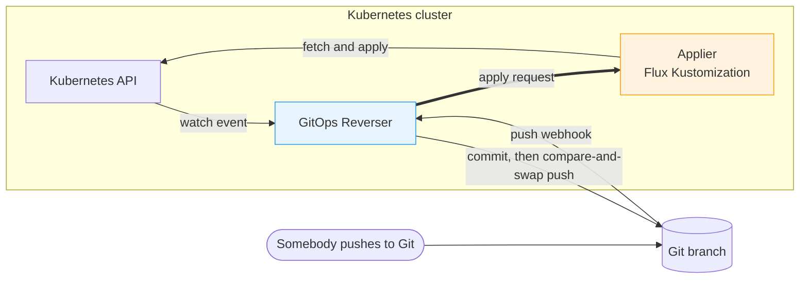
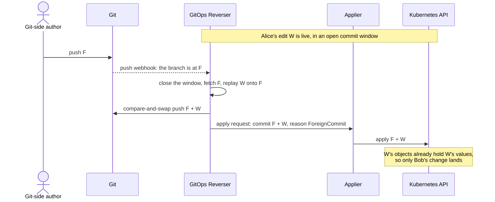
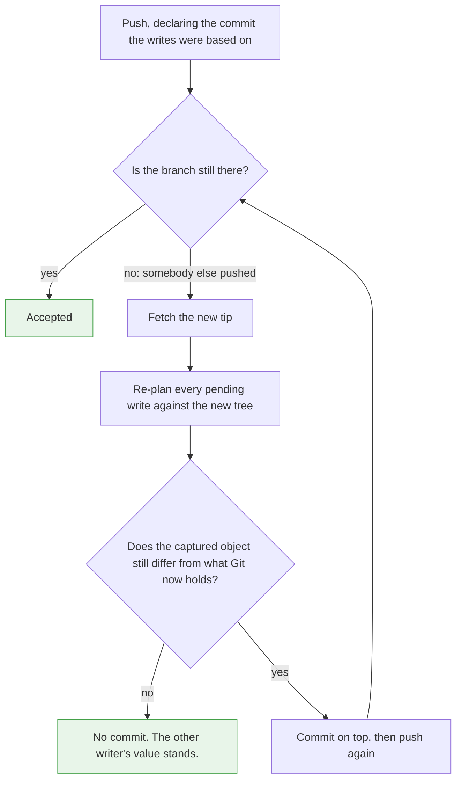

# Bi-directional usage guide

GitOps Reverser publishes live cluster state to Git. Flux or Argo CD applies Git back to the
cluster. Run both and a resource can be changed from either side. This guide covers who decides
what, how to configure each actor, and which parts are proven by tests.

**The short version.** GitOps Reverser decides when the cluster is applied from Git. Flux keeps
doing what it is good at (fetching, rendering, applying, pruning, reporting health), but it applies
when GitOps Reverser asks, not on its own schedule. You configure that in three places:

1. Name each folder's **applier** on its `GitTarget`: the Flux `Kustomization` that applies it. See
   [declaring the applier](#declaring-the-applier).
2. Switch off Flux's own triggers: short intervals and any Git-host webhook into a Flux `Receiver`.
   See [configure Flux](#configure-flux).
3. Point your Git host's push webhook at GitOps Reverser instead. See
   [telling GitOps Reverser that somebody else pushed](#telling-gitops-reverser-that-somebody-else-pushed).

Argo CD cannot be driven this way yet; [configure Argo CD](#configure-argo-cd) says what that costs
in the meantime.

There is no merge and no lock. What remains exposed is small and named in
[what is still exposed](#what-is-still-exposed).



## Who does what

| Actor | Does | Does not |
| --- | --- | --- |
| Kubernetes API | Takes edits from people and controllers | |
| GitOps Reverser | Mirrors every edit into Git, and decides when the applier may apply | Apply anything to the cluster itself |
| Git host | Stores the branch, and tells GitOps Reverser when somebody else pushed | Notify the applier |
| Applier (a Flux `Kustomization`) | Fetches, renders, applies and prunes, when asked | Apply on a short timer or a webhook of its own |
| A human | Can still run `flux reconcile` or press Sync | |

## Why GitOps Reverser owns the trigger

An apply is safe only when nothing live is missing from the commit being applied. Between an edit
and its push, the edit is live in the cluster and absent from Git: it sits in an open commit window
or in the pending writes. An apply at that moment writes Git's older value over it. GitOps Reverser
then mirrors that revert faithfully, as a commit authored by the applier, and the edit is gone.

Only GitOps Reverser can see those pending edits. The applier cannot. So an apply nobody asked
GitOps Reverser about is an apply nobody checked, and every trigger the applier runs by itself is
one of those:

- **A Git-host webhook into the applier** fires on every push, including GitOps Reverser's own. Two
  API edits a few seconds apart are enough to have the first commit applied over the second edit.
- **Argo CD's timed refresh** (`timeout.reconciliation`, 120s plus up to 60s of jitter) resolves
  the branch tip, and automated sync runs whenever that tip is a commit it has not synced. With
  `selfHeal: false` it skips only a commit it already synced. Every push GitOps Reverser makes is a
  new commit, so two to three minutes after each push the whole `Application` is synced over
  whatever is pending at that moment.
- **Flux's intervals** apply on every reconcile, whatever woke it: kustomize-controller corrects
  drift each time. A short `GitRepository` interval turns each of GitOps Reverser's pushes into an
  apply a minute later.

None of these can be filtered from outside. They have to be switched off, and GitOps Reverser has
to make the requests instead.

## When GitOps Reverser requests an apply

Every request waits for a **quiet branch**: no open commit window and no pending writes on the
branch worker. That is the moment nothing live is missing from the tip.

| Reason | When | Which applier |
| --- | --- | --- |
| `ForeignCommit` | The branch gained a commit GitOps Reverser did not push | Every applier declared on the branch |
| `Refusal` | An edit was refused and the target has `onRefusal: Reapply` | The refusing target's applier |
| `CatchUp` | The branch has been quiet for `spec.applier.quietPeriod` after GitOps Reverser's own pushes | Every applier on the branch |

The cluster already holds the values of GitOps Reverser's own commits, because they were read from
it, so applying them changes nothing. Flux is asked to catch up with them anyway, and
[configure Flux](#configure-flux) says why.

A foreign commit that arrives while edits are pending does not wait for their windows to close.
GitOps Reverser closes them, replays the pending writes onto the foreign commit, pushes, and asks
the applier to apply the commit it just pushed:



The applied commit carries the API side's answer, so applying it reverts nothing Alice did. That
is the [contested-cell rule](#what-happens-when-somebody-else-pushed-first) seen from the cluster:
for an object both sides changed, the API value wins.

A request asks; it never reports that the apply happened. Requests are sent off the publication
path, retried on their own, and a failed request never fails a publication that succeeded. Read the
applier's own status to see what it applied.

## Declaring the applier

`spec.applier` names exactly one applier per `GitTarget`:

```yaml
apiVersion: configbutler.ai/v1alpha3
kind: GitTarget
metadata:
  name: checkout
  namespace: team-a
spec:
  gitProviderRef:
    name: platform-repo
  branch: main
  path: apps/checkout
  applier:
    kustomizationRef:
      namespace: flux-system
      name: checkout
  onRefusal: Reapply
```

GitOps Reverser looks the applier up in the **source cluster**, the cluster it applies to, with
the identity the `ClusterProvider` already uses. That identity needs permission to read and patch
the applier; the chart grants it for the operator's own cluster. The applier must apply this
folder's repository and branch, or the target reports `ApplierConfigured=False`. The
[configuration reference](configuration.md#who-applies-this-folder-specapplier) has every field
and reason.

Several `GitTarget`s may name the same `Kustomization`, for example one whose path covers several
folders. Requests to one `Kustomization` are sent once.

## Configure Argo CD

GitOps Reverser cannot drive an Argo CD `Application` yet; `spec.applier` names a Flux
`Kustomization` only, and Argo CD is next. Until then an `Application` keeps its own triggers, with
the exposure [why GitOps Reverser owns the trigger](#why-gitops-reverser-owns-the-trigger)
describes: the timed refresh syncs each of GitOps Reverser's pushes two to three minutes later, over
whatever is pending at that moment.

The configuration that keeps the most of a live edit in the meantime:

```yaml
spec:
  syncPolicy:
    automated:
      selfHeal: false
      prune: true
```

With `selfHeal: true` Argo CD reverts a live edit in about a second, usually before GitOps Reverser
can publish it, and Git records a two-commit flap. `selfHeal: false` only suppresses repeating a
sync of a commit already synced, so a new commit or a manual sync still applies Git over an
unpublished API edit. Use `prune: true` only when a deletion in Git should delete the live object,
and point the Git host's webhook at `https://<argocd-server>/api/webhook` so a Git-side push is
synced in seconds rather than on the timer.

### The split-ownership alternative

`ignoreDifferences` on a field, with `RespectIgnoreDifferences=true` in `syncOptions`, keeps
`selfHeal: true` everywhere else and hands that one field to the API. Its differences alone do not
make the `Application` `OutOfSync`, and the option copies the live value into the apply target, so an
ordinary sync preserves it.

The cost is that the field stops being Git-driven on an existing object: Git seeds it at creation,
but later Git edits to it do not reach the object while the ignore is active. It protects no other
field from GitOps Reverser's whole-object replay.

## Configure Flux

Flux has no refresh-only mode: kustomize-controller applies whenever it reconciles, and
`suspend: true` also blocks the requests GitOps Reverser makes. So the configuration keeps Flux's
timers as a long backstop and removes every short path:

```yaml
# GitRepository: long. GitOps Reverser requests the fetches.
spec:
  interval: 24h
---
# Kustomization: long, and unsuspended.
spec:
  interval: 24h
  retryInterval: 1m
  suspend: false
```

Remove any Git-host webhook into a Flux `Receiver` for this repository. GitOps Reverser's request is
the one `flux reconcile kustomization --with-source` makes: it stamps
`reconcile.fluxcd.io/requestedAt` on the `GitRepository`, and stamps the `Kustomization` too when
the artifact already holds the requested commit.

Flux needs one more request than the cluster's own state suggests. Its timers and a controller restart apply whatever artifact
the `GitRepository` holds, and with a long interval that artifact falls behind GitOps Reverser's own
pushes. Applying a stale artifact would revert published edits, not only pending ones. So after its
own pushes, once the branch has been quiet for `spec.applier.quietPeriod` (`30s` by default),
GitOps Reverser asks the `GitRepository` to fetch, with reason `CatchUp`. The new artifact wakes the
`Kustomization`, which applies values the cluster already holds.

`quietPeriod` is a trade. A short one keeps the artifact current; a long one makes it less likely
that an edit arrives while that catch-up apply is running. Every new edit restarts it.

Flux's equivalent of split ownership is `Kustomization.spec.ignore`, added in kustomize-controller
`v1.9.0`, with the same trade as Argo CD's. The
[source review](facts/gitops-apply-and-field-ignore.md) has the code paths.

When upgrading a chart whose pin is declared in Git, reconcile the owning `Kustomization` first
so it applies the new `HelmRelease` and source configuration, then the `HelmRelease` if needed.

## Telling GitOps Reverser that somebody else pushed

GitOps Reverser learns that the branch moved in three ways, and each feeds the same decision:

| Signal | Latency | Configure |
| --- | --- | --- |
| A push webhook from the Git host | Seconds | `GitProvider.spec.receiver` |
| A rejected compare-and-swap push | At the next publication | Nothing: it is how every push works |
| The periodic refresh | Within `--git-refresh-interval` (10m) plus the 5-minute reconcile tick | Nothing: on by default |

Point the Git host's push webhook at the URL in `GitProvider.status.webhookPath`, served on the
receiver listener. The receiver speaks GitHub's, GitLab's and Gitea's native push payloads, plus a
`generic-hmac` body for a relay you run yourself. See
[receiving push notifications](configuration.md#receiving-push-notifications-specreceiver).

A delivery is only a hint. GitOps Reverser does not trust the commit it names: it reads the
branch's ref advertisement (one request) and decides from what the remote says. So a late delivery
for one of GitOps Reverser's own pushes, a duplicate, or a rollback onto one of its older commits
all come out right. When it cannot tell whether a commit is its own, it treats it as foreign.

Without a receiver everything still works, later: a foreign push is applied once the refresh finds
it.

**A notification that the branch moved never triggers a cluster snapshot.** The cluster still holds
the values from before the push, so a snapshot would publish them over the incoming change. A push
tells GitOps Reverser about Git; it says nothing about the cluster.

Read where the branch is, what proved it, and what was last requested:

```bash
kubectl get gittarget checkout -n team-a \
  -o jsonpath='{.status.remote}{"\n"}{.status.applier}{"\n"}'
# {"commit":"4f2c1ab9...","lastVerifiedAt":"2026-10-20T10:14:02Z","verifiedBy":"Fetch"}
# {"requestedCommit":"4f2c1ab9...","requestedAt":"2026-10-20T10:14:03Z","reason":"ForeignCommit"}
```

## One queue per branch

Every watched event for a given `GitProvider` and branch lands on one queue owned by one branch
worker. Events are applied in arrival order and never overtake each other, and two `GitTarget`
objects on the same provider and branch share that worker, its ordering, and its quiet moments.

1. **Commit.** Events collapse into one local commit per author after
   [`spec.commit.window.idleTimeout`](configuration.md#the-commit-window-speccommitwindow) of silence,
   `5s` by default, or at most `maxDuration` (`1m`) after the first. `0s` gives one commit per event.
2. **Push.** Local commits go to the remote at most once every five seconds, as a
   compare-and-swap. The push declares the commit it expects the branch to be at, and the Git host
   refuses the update if the branch has moved off the commits' base.

A publishing target reads the remote only through the push it was making anyway. An idle target
re-proves where its branch is every
[`--git-refresh-interval`](configuration.md#keeping-an-idle-target-fresh---git-refresh-interval),
at the cost of one ref advertisement, and fetches only when the branch actually moved.

## What happens when somebody else pushed first

Your push is rejected and the worker **replays**: it fetches the new tip, re-plans every pending
write against it, and pushes again. Three attempts, then the writes stay pending for a later try.
Whatever the worker learned along the way, it now knows the branch gained a foreign commit, and the
appliers are asked to apply once the replayed push lands.



Replay re-plans; it does not rebase a diff. Each pending write still carries the object as the
watch captured it, and writing that object onto the new tree has one of two outcomes:

- **No change, so no commit.** The file in Git already says what the captured object says,
  because whoever pushed made the same change.
- **A change, committed on top.** The captured object is written over the other writer's value,
  and the branch ends at the API side's value.

A write with no legal destination is refused instead, and there is no merge: a watch event carries
the object's whole state, with no baseline that would say which fields changed on each side.

### What a write does to the file

The writer edits fields in place within the existing document, so what matters is which fields
change rather than which files. For a plain manifest:

| In the file | What a replay does to it |
| --- | --- |
| A field the live object also carries | Set to the live value |
| A field in Git that the live object does not have | **Removed** |
| Comments, key order, other documents in the file | Preserved |
| An edit that cannot be placed safely | Refused, and the file is left untouched |

In a kustomize layout the live object is the rendered result rather than the contents of any one
file, so the edit is projected back through the build first and only the fields that document is
responsible for are touched. An edit the projection cannot place is refused rather than guessed
at, which is why the last row exists.

**The consequence to plan around.** If Alice changes `replicas` through the API while Bob changes
`image` in Git on the same object, replaying Alice's captured object writes her `replicas` and
also the `image` she was looking at. Bob's change to a different field of the same object does
not survive, and a field Bob added that the cluster never had is removed outright. Separate
objects are independent of each other. Separate fields of one object are not.

## There are no timing guarantees

Committing and pushing takes on the order of a second at best, and the Kubernetes API accepts a
great many changes in a second. Treat live editing as a different way of making changes rather
than a faster `git push`:

- You make a change and then observe that it arrived. You do not save and receive a confirmation.
- Intermediate values may never reach Git. Two edits inside one commit window produce one commit
  holding the later value.
- Git history records the states the worker captured and published. Expect gaps between them.

When a specific change has to be confirmed in Git, use a
[`CommitRequest`](configuration.md#commitrequest). `Pushed=True` with `status.commit` and
`status.branch` names the commit it produced.

### What is still exposed

Owning the trigger removes every apply that could revert an edit for no reason. It cannot reserve
the seconds an apply takes:

- **An edit made while a requested apply runs** is reverted, then mirrored as the applier's
  commit. That happens only after somebody else pushed, after a refusal with `Reapply`, or after a
  `quietPeriod` of silence on a Flux branch. It no longer follows every commit GitOps Reverser
  makes.
- **Flux's backstop timers** still apply on their own, at the tip as the last catch-up left it.
- **A human** running `flux reconcile` or pressing Sync applies whenever they do.

## Why the loop stops

The obvious fear is a feedback loop: GitOps Reverser commits, the applier applies, the apply
produces a watch event, GitOps Reverser commits again. It settles instead, for two reasons.

GitOps Reverser does not ask for its own commits to be applied, except Flux's catch-up. And when a
commit it wrote is applied, the live object already holds those values, because they were read
from that object in the first place. The apply changes nothing, the event it produces carries
content identical to the file already in Git, and no commit is made. In general: **applying a
resource that already matches does not produce a change.** What can break that reasoning is
controller bookkeeping.

## Keep controller bookkeeping out of Git

Argo CD stamps `argocd.argoproj.io/tracking-id` on every non-CRD object it applies, Flux stamps
`kustomize.toolkit.fluxcd.io/` labels and annotations, and a client-side apply writes
`kubectl.kubernetes.io/last-applied-configuration`. None of it is user intent. If it reached Git
the sanitized live object would stop matching the committed file, and every apply would produce a
commit.

GitOps Reverser strips all of it before writing, along with `argocd.argoproj.io/installation-id`,
`kro.run/`, `applyset.kubernetes.io/`, and `kcp.io/cluster`. The rules and the reasoning for each
are in [`internal/sanitize/types.go`](../internal/sanitize/types.go). Under
`argocd.argoproj.io/` only the exact tracking keys go: siblings such as `sync-wave`,
`sync-options`, and `hook` are user intent that belongs in Git.

**Leave Argo CD on its default `annotation` resource tracking for mirrored paths.** The `label`
and `annotation+label` methods stamp `app.kubernetes.io/instance`, which is indistinguishable from
the standard recommended label that Helm and Kustomize set for application reasons. GitOps Reverser
therefore does not strip it, and label tracking would put Argo CD's bookkeeping into your commits.

## When a write is refused or a push fails

A live edit can succeed while its publication does not. The cluster holds the change and Git does
not. Watch push failures and the target's write-acceptance conditions: a successful Kubernetes
edit confirms the API write and nothing beyond it.

Pending writes are held in worker memory. They do not survive a restart, and an edit that failed
before becoming a pending write is gone from GitOps Reverser's side. Recovery is a resync, which
derives state from the cluster as it exists at that moment, so it cannot reproduce an intermediate
value that has since been overwritten.

### Choosing `spec.onRefusal`

A refused edit has no legal destination in Git, so nothing is committed for it and it stays live
until something applies Git over it.

| Policy | Response to a refused edit | Operator's trade |
| --- | --- | --- |
| `Ignore` (default) | Report the refusal | Leave recovery to a human or a later apply |
| `Reapply` | Ask the target's applier to apply the current tip, once the branch is quiet | The refused edit is reverted; nothing else on the branch is |

`Reapply` needs a declared applier, and the request goes to that applier alone: other folders on
the branch are not woken. Waiting for a quiet branch means an allowed edit still in a commit window
is published first, so the apply reverts only what has no home in Git.

Eligibility is narrow: the folder must be accepted, the refused edit must concern a document the
folder already holds, and the write must remove no document, because re-applying would put back an
object somebody deliberately deleted. Invalid or unsupported folders, new objects and removals do
not trigger it. A standing refusal is requested once, not on every recheck, and a suspended target
requests nothing. See
[reverting a refused edit](configuration.md#reverting-a-refused-edit-speconrefusal).

### A restored value does not prove the target recovered

A refusal still reports `GitPathAccepted=False`, `Stalled=True`, and `Ready=False`, under either
policy. The target keeps rechecking, roughly every ten seconds; `Stalled` does not mean the
controller has stopped running.

Re-applying neither clears those conditions nor makes an unrepresentable edit writable. A
successful resync covering the refused scope must establish acceptance again. Treat recovery as two
observations: the live resource has the intended value, and the `GitTarget` returns to
`Ready=True`.

## What it costs

**GitOps Reverser becomes the only fast path to a deployment.** While it is down, a push by a
human reaches the cluster only through a manual sync, `flux reconcile`, or Flux's backstop
interval. Bi-directional editing is already stopped in that state; Git-side deployments now slow
down with it. Monitor the operator the way you monitor the applier.

**Round trips to the Git host are the seconds you wait through.** An uncontended publication talks
to the remote twice, and a foreign push costs a fetch, a replay on a checkout already on disk, and
one push. If your workload is mostly Git-side edits with occasional live changes, you are using the
tool against its grain. The per-operation numbers are measured, in
[`git-roundtrip-ledger.golden`](../internal/git/testdata/git-roundtrip-ledger.golden).

## What the tests prove

The bi-directional corner runs against deployed Flux and Argo CD, each configured as this guide
says. Its timing assertions describe those scenarios; they do not guarantee the ordering of
concurrent writers.

| Covered | Where |
| --- | --- |
| Two API edits to one field seconds apart end at the later value with no further commit, and Flux catches up with both by itself | [Flux](../test/e2e/flux_bi_directional_e2e_test.go) |
| A Git-side push with an API edit on top lands both, and Flux applies the replayed commit without being reconciled by hand | Flux |
| A new `GitRepository` revision is enough for the `Kustomization` to apply and revert drift | Flux |
| A refused edit with `onRefusal: Reapply` is reverted by its `Kustomization`, with no commit, and settles instead of repeating | [Refusal reapply](../test/e2e/refusal_reapply_e2e_test.go) |
| A Git to cluster to Git round trip settles without a commit loop | Flux |
| A SOPS-encrypted Secret round-trips without a reverse commit | Flux |
| A Git revert removes the live object and the committed file | Flux |
| Argo CD bookkeeping never reaches Git, asserted as zero commits during a sync | [Argo CD](../test/e2e/argocd_bi_directional_e2e_test.go) |
| `selfHeal: true` loses the API edit, and the flap is exactly two commits; `selfHeal: false` keeps it | Argo CD |

**No spec tests simultaneous writes to one field from both sides**, because the outcome depends on
arrival order the corner does not control. The replay mechanism is covered; a conflict policy is
not, because there is not one.

Run `task test-e2e-bi-directional` for the corner, which is also a CI job. `task test-e2e` excludes
the corner and includes the refusal spec. `task argocd-ui` opens the installed Argo CD UI. The
[corner specification](spec/e2e-bi-directional-corner.md) describes
the setup.
