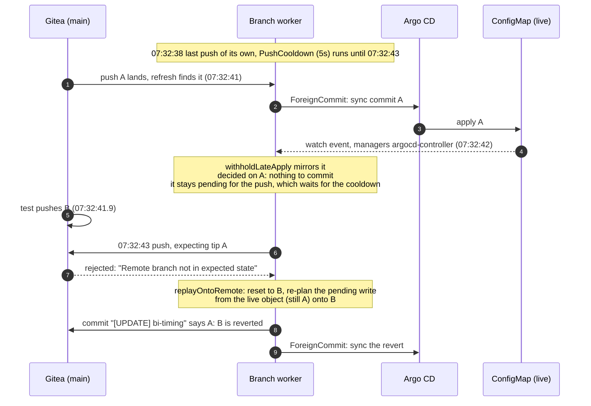
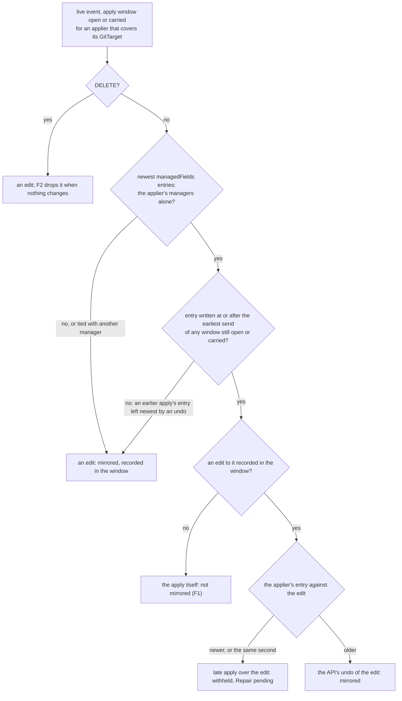
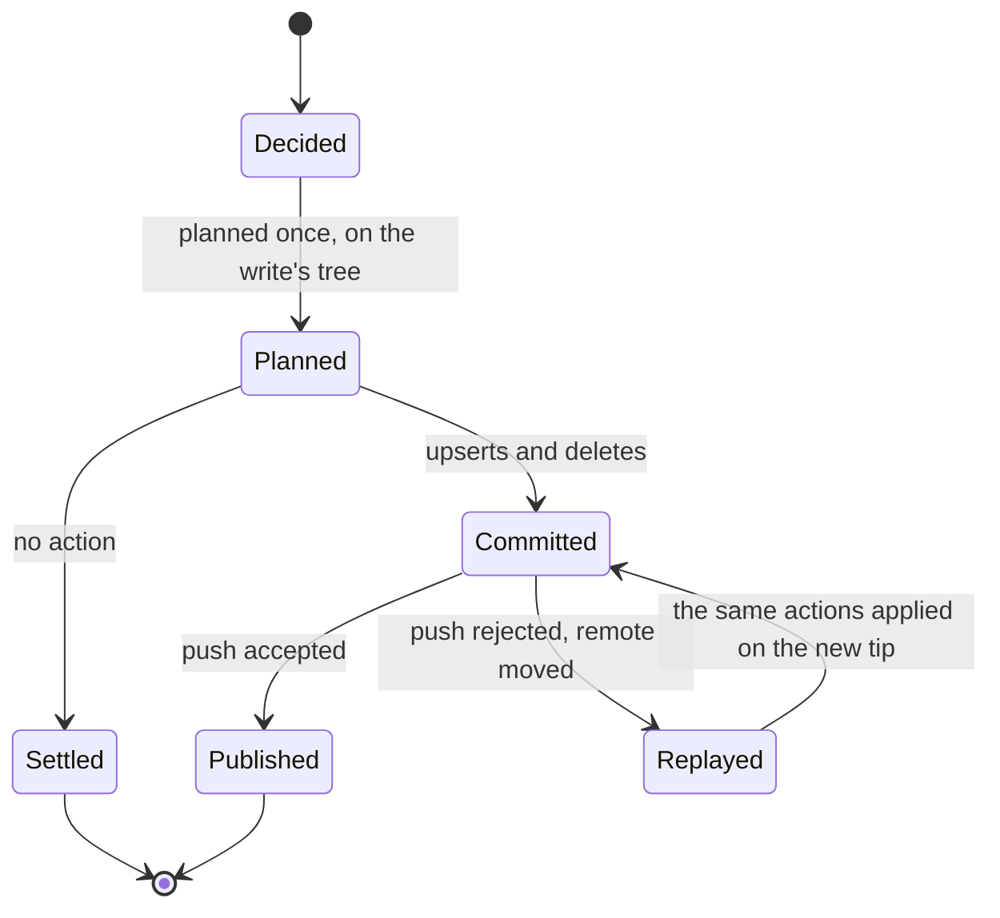
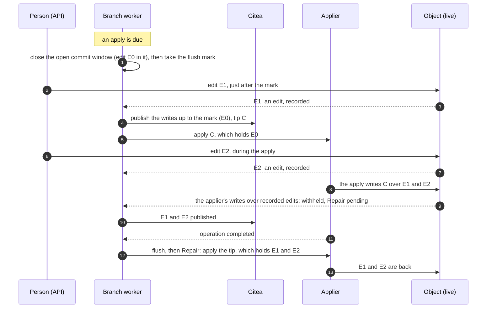
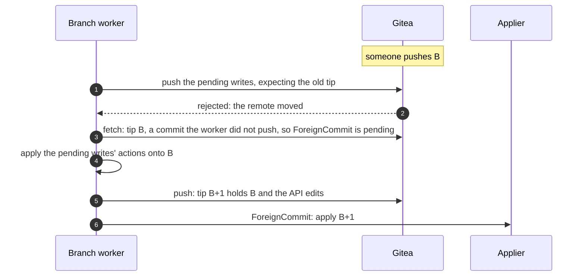
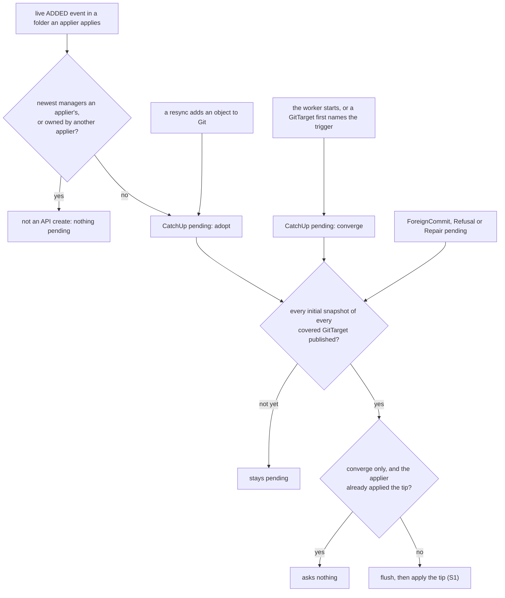

# Applier echoes: the applier's own writes, and applying while editing

> **design**: proposed and built 2026-10-20, on the `design-applier-echoes` branch (PR #425), and
> released as one change. The plan below is kept as it was argued, in the present tense of the code
> it was read from; where the build departs from it, [Decided while
> building](#decided-while-building) says how. Index: [`../INDEX.md`](../INDEX.md). Builds on
> [`apply-trigger.md`](apply-trigger.md) (the apply window, `Repair`, `CatchUp`, and the
> quiet-branch rule this replaces), which now describes the built system,
> [`gittarget-branch-worker-pending-writes.md`](gittarget-branch-worker-pending-writes.md) (decide,
> `advance`, materialize, replay) and
> [`../spec/reconcile-via-watchlist-mark-and-sweep.md`](../spec/reconcile-via-watchlist-mark-and-sweep.md)
> (the resync).

When GitOps Reverser asks Flux or Argo CD to apply a commit, the applier's write to each object
comes back through the watch. Today that write is mirrored like an API edit, and a mirrored write is
re-planned from the live object onto whatever tip the branch has when it is published. An echo of an
older commit, published after a Git-side push, **reverts that push**, in Git and then on the cluster.

The fix rests on two ideas:

- **A write that changes nothing in Git does not exist.** The writer already follows it for a
  whole write; this design follows it for every object.
- **A pending write carries the actions decided on its tree, not a picture of the cluster.** Replay
  applies those actions to a newer tip. It never plans a stale picture again.

| | Change |
| --- | --- |
| **F1** | In the apply window, the applier's own write is not mirrored |
| **F2** | A write is a list of actions decided once, on its tree: an unchanged object is no action, a resync is explicit upserts and deletes, a save keeps its objects |
| **F3** | A resync never decides from a snapshot collected while Git was ahead of the cluster, or across an apply |
| **F4** | An object another applier owns is not mirrored into a folder a trigger applies |
| **S1** | Flush, then apply, instead of waiting for a quiet branch |
| **S2** | `CatchUp` only to adopt objects the API created and to converge, the same for Flux and Argo CD, decided in the branch worker; no apply before every initial snapshot is published; `quietPeriod` goes |

The parts depend on each other: S1 removes a wait that the others make unnecessary, so they are
built and released together.

## Decisions taken

1. **The applier is recognized by its field-manager name, fixed per applier kind.** Kubernetes
   records two different facts about a write, in two different places:

   | | Where it lives | What it says | Who sets it |
   |---|---|---|---|
   | Field manager | `metadata.managedFields`, on the object | a name the client sends with the write | the client |
   | Service account | the API server's audit log only | who authenticated the request | the API server |

   A `managedFields` entry carries a manager name, an operation and a time, and no user:

   ```yaml
   managedFields:
   - manager: kustomize-controller   # the apply
     operation: Apply
     time: "2026-10-20T07:32:42Z"
   - manager: kubectl-edit           # a person's edit
     operation: Update
     time: "2026-10-20T07:33:10Z"
   ```

   F1 reads only these. The names are constants in
   [`apply_window.go`](../../internal/git/apply_window.go): `kustomize-controller`, fixed inside
   Flux; `argocd-controller`, which Argo CD passes to every apply; and
   `argocd-application-controller`, for a `Replace=true` sync that sends no manager, so the API server
   takes the user agent. They do not change when the applier impersonates another account: the audit
   user changes, the manager name does not. So the name is on the object, delivered with every event,
   and needs no configuration and no audit webhook. If a later Flux or Argo CD release renamed its
   manager, the constants would follow.

2. **No service account on the triggers, and no check against the audit author.** The field manager
   decides; nothing else is consulted.

3. **Trust, not defense.** A write under the applier's manager name is the applier's. Whoever can
   write as Flux or Argo CD already controls what is deployed, so the design guards only against
   writers that are not malicious and still look alike: an undo, a same-second tie, a mutating
   webhook inside the apply, a late echo.

4. **Writes to one object from Git and from the API within seconds are rare, so they are defined
   rather than prevented.** Each collision left open is listed with how close the two writes must be,
   what it does, and whether it heals.

5. **Git is applied as fast as it can be.** No wait for a quiet branch: the flush publishes what is
   pending, and the apply goes.

6. **Incoming Git changes are applied after the replay, in one apply with the worker's own writes.**
   Never on their own first.

7. **Flux and Argo CD are kept in line by one rule, decided in the branch worker.** The two appliers
   differ only in how an apply is carried out (resume and suspend a `Kustomization`, sync an
   `Application`), never in when one is asked for. This reverses two decisions in
   [`apply-trigger.md`](apply-trigger.md): that an `Application` is never asked to catch up, and that
   a newly bound `Application` waits for the next push. A sync, hooks included, on an API create or on
   binding is rare, and one rule for both appliers is worth it.

8. **A folder a trigger applies belongs to that trigger's applier** (F4).

9. **A save is the strongest API intent, and is never trimmed.** A `CommitRequest` keeps every object
   it captured, and its outcome is settled by the push, as the
   [CommitRequest contract](../spec/commitrequest-design.md) says. Re-asserting a save over a
   concurrent Git-side change of the same object is the "API wins" rule.

## The race

The regression spec pushes A, waits until the applier made A live, and pushes B at once. Argo CD
fails it, deterministically:



Flux passes the same spec only when its echo lands after the push cooldown.

**The root cause is ordering.** An API edit is a decision in the worker's queue: decided after older
writes, replayed after them, so it wins. A Git-side push is not a decision. It becomes the tree the
queue is replayed onto, so every pending decision lands *after* it, and each is re-planned from its
picture of the cluster: a decision taken from an older picture overwrites what the push changed. A
stale picture reaches a commit in six ways, and each change closes one:

| A stale picture, held as | Closed by |
| --- | --- |
| the applier's own write, mirrored as an edit | F1 |
| an object that changed nothing, kept in a pending write and replayed | F2 |
| a resync's full membership, swept again on a newer tip that added an object | F2 |
| a resync snapshot collected before, or across, the apply that changed what it saw | F3 |
| an edit made around the flush, overwritten by the apply and never repaired | S1 |
| an initial snapshot that has not yet captured edits made while the operator was down | S2 |

## F1: the applier's own write in the apply window is not mirrored

`withholdLateApply` ([`apply_window.go`](../../internal/git/apply_window.go)) judges every live
event in an applier's open apply window. F1 keeps its judgment of edits as built and changes what
happens to the applier's own write when nobody edited the object.



- **The window** is the one built today: from sending an attempt until its operation completed, plus
  10 seconds, and an attempt sent within that grace carries the earlier window's edits and end.
- **The lower bound is the earliest send of every window still open or carried.** A delayed echo of
  attempt A, arriving after attempt B was sent and inside A's grace, is still A's apply.
- **When an edit was recorded, today's comparison decides**, unchanged: an applier entry newer than
  the edit is a late apply over it (withheld, `Repair`); an older one is the API's undo (mirrored).
  The same second is withheld too ([decided while building](#decided-while-building), 7): the edit
  arrived first, so it was written first. F1 changes only the case with no edit recorded, which today
  is mirrored "as ever".
- **Edits are recorded from the flush mark** (S1), not only from the send.

## F2: a write is a list of actions decided once, on its tree

When a write is decided, the writer plans it against the tree it is decided on. F2 makes the result
of that plan, not the picture it was planned from, what the write carries until it is published:

- **An upsert** for each object whose plan changes the tree, with the object's desired content.
- **A delete** for each document the plan removes.
- **Nothing** for an object whose plan changes nothing. It is dropped from the write then.

A write with no action left settles at once. On replay, onto a newer tip after a rejected push, the
write's actions are applied again: an upsert is planned onto the new tree, a delete removes its
document if it is still there. Nothing else is planned again, so nothing that changed nothing, and
nothing a newer tip added, is touched.



How each kind of write follows it:

- **A commit window's write** carries an upsert or a delete per live event that changed the tree.
  Today an unchanged object inside a write that changed something is replayed with it; F2 drops it.
- **A resync** uses its snapshot's full membership once, to decide: which objects to upsert, and
  which managed documents are orphans the sweep removes under the target's `prune.mode`. The write
  then carries those upserts and those deletes, by identity. Replay applies exactly them and never
  runs the sweep again, so a document a newer tip added (a Git-side addition the snapshot could not
  know about) survives the replay. Today a replayed resync folds its whole membership over the new
  tree, so under `prune.mode: Always` it deletes that addition: F2 closes that too.
- **A save** (a write carrying a `CommitRequest`) keeps an upsert for every object it captured,
  unchanged ones included, and its outcome is settled by the push: `AlreadyPresent` when the push
  confirms there was nothing to add, `Committed` when a replay produced a commit. That is today's
  contract, kept on purpose (decision 9). A save cannot carry an echo: it attaches to a person's commit
  window, and with F1 an applier opens none.

Today the "changes nothing" rule exists for whole resync writes only (`PendingWrite.retained`,
[`commit_executor.go`](../../internal/git/commit_executor.go)). F2 makes it per object, for windows
and resyncs, and leaves saves as they are.

## F3: a resync never decides from a snapshot collected while Git was ahead, or across an apply

A resync mirrors a snapshot of live state, collected at one resource version
(`ResyncRequest.Desired`). When Git is ahead of the cluster, a commit pushed and not yet applied, a
snapshot holds the old state of every object that commit changes. A snapshot whose collection
overlaps an apply holds a mix. Either is a stale picture once the apply has run.

- **Git is ahead of the cluster** while an applier on the branch has a `ForeignCommit`, `Repair` or
  `Refusal` pending, a converge it may be asked for (past S2's initial-snapshot barrier), or an
  attempt out.
- **The apply epoch** is a counter on the branch worker, raised at every send of an attempt and at
  every completion of one.
- **When the watch side starts collecting a snapshot**, it reads both from the worker: whether Git is
  ahead, and the epoch. The `ResyncRequest` carries them.
- **A snapshot is used only if** Git was not ahead when its collection started and the epoch is still
  the one it started at when the worker decides it. Otherwise it is discarded, and a fresh one is
  requested for the same `GitTarget` and scope once Git is no longer ahead (the re-anchor
  `RequestRecheckForGitTarget` drives). The new snapshot is collected after the apply, so it never
  overtakes a live event either.
- **The resync's own fetch is checked too.** A resync fetches the remote before it is planned. When
  that fetch finds a commit the worker did not push, the snapshot is discarded and re-requested after
  that commit is applied.
- **A heal resync that would steal a commit window** (today parked while a window is open) is
  discarded and re-requested once the window is idle. No snapshot is ever parked.
- **A `CatchUp` to adopt does not count as Git being ahead**: it applies objects the cluster already
  runs.
- **A branch with no trigger never waits**: nothing applies its commits.
- **A `GitTarget`'s initial snapshots are exempt**: the first snapshot of each collection it
  watches, until one of it settles (applied, refused or failed). They are the startup baseline,
  and S2 asks no applier for anything before they are in Git, so holding them for an apply would
  wait on itself
  ([decided while building](#decided-while-building), 3).
- **A `GitTarget`'s snapshots are held for at most 5 minutes**, from its first discard. Then a fresh
  snapshot is asked for and used, logged and counted (`stale_snapshots_total{outcome="used"}`), and C2's
  policy applies to what the unapplied commit changed
  ([decided while building](#decided-while-building), 2).
- **Per worker.** Whether Git is ahead, and the epoch, are this worker's own: the applies due on a
  sibling writing the same branch are not consulted
  ([decided while building](#decided-while-building), 1).

A resync is reconciliation, not latency-critical, and with S1 Git is ahead of the cluster for seconds
at a time.

## F4: an object another applier owns is not mirrored into a triggered folder

A folder a trigger applies belongs to that trigger's applier. An object another applier applies
(another `Kustomization`, another `Application`), mirrored into the folder, would then be applied by
this applier too, and two appliers applying one object fight each other.

- **The watch side reads the owner from the raw object**, before sanitize strips it: Flux's owner
  labels (`kustomize.toolkit.fluxcd.io/name` and `/namespace`), Argo CD's tracking annotation
  (`argocd.argoproj.io/tracking-id`, which names its `Application`). It stamps the owner on the live
  event and on each snapshot item.
- **The worker compares it with the applier of the event's `GitTarget`'s trigger.** An object owned by
  another applier is excluded on both paths: a live event is not mirrored, and a snapshot item is
  neither upserted nor treated as missing, so the sweep leaves its document alone.
- **Excluded objects are counted and logged**, so the misconfiguration is seen.
- **An object with no owner, or owned by this folder's applier, is mirrored as usual.**
- **A folder with no trigger excludes nothing**: mirroring another applier's objects one way is what
  such a folder can exist for.

## S1: flush, then apply

Today an attempt goes out only on a quiet branch: no open commit window and no pending writes, on
this worker and every sibling writing the same branch. That kept an apply from reverting an edit not
yet published, and it starves: a user who keeps editing holds back a Git-side change for as long as
they type. S1 replaces the wait with a flush:

1. **When an apply is due, the open commit window is closed**, so its edits become a decided write.
2. **Then the worker takes the flush mark**: the last write decided so far, which now includes the
   window's.
3. **From the mark, the applier's next apply window records edits**, before the attempt is sent. An
   edit decided after the mark is therefore one whose overwrite by the apply is withheld (F1), and `Repair`
   puts it back.
4. **The writes up to the mark are published.** Writes decided after it do not hold the send, so
   continuous editing cannot starve an apply.
5. **The apply is sent for the tip that publication produced.** At sending, it checks only that the
   remote is still at that commit.

Every edit is therefore either published before the send, so the apply includes it, or recorded in
the window, so an apply that overwrites it is withheld and repaired.

Two states still hold an apply back, as they do today: a commit window held by a `CommitRequest` is
never closed early (a save defines its own commit boundary, and the apply waits for it), and the
worker does not apply while it recovers a missing parent or its checkout is not clean, the two states
in which it cannot say what is published.



### When incoming Git changes are applied

A Git-side push usually reaches the worker through the flush itself, when its push is rejected:



The applier is asked once, for the tip that holds both sides (`applyInbox.observe` marks the fetch as
foreign; `sendAttempt` puts `ForeignCommit` before every other reason). Applying B on its own first
would revert the pending API edits on the cluster, need a second apply for the `Repair`, and show a
flicker in between: a `Deployment` whose template an edit touched rolls out to B's value and back.
Waiting costs one push. F1 and F2 make sure the actions applied in step 4 are only the API's, never a
stale picture that reverts B.

## S2: `CatchUp` only to adopt and to converge, the same for both appliers

With the flush guarding the cluster, an apply after every push of the worker's own protects nothing.
What is left is ownership: **an applier prunes only what it applied.** Flux deletes only objects that
carry its owner labels and are in its inventory; Argo CD prunes only objects that carry its tracking
annotation. Both are stamped by an apply. An object the API creates in an applied folder has neither,
so when Git later deletes its file, the applier leaves it on the cluster, and a later resync writes
it back into Git.

| The API... | Does the applier need an apply? |
|---|---|
| edited an object the applier applied | no: the cluster runs the edit, and the object keeps its owner labels or tracking annotation |
| deleted an object | no: the object is gone, and the next apply prunes nothing |
| **created an object**, including deleting one and creating it again under the same name | **yes**: the new object carries no owner labels and no tracking annotation, even when its content equals what Git holds |

- **Adopt.** A `CatchUp` is pending for an applier when the worker observes a live create (an
  `ADDED` event) in a folder that applier applies, whose newest managers are not an applier's and
  that no other applier owns (F4). It is pending whether or not the create changed Git: a delete and a
  create of the same object in one commit window change nothing in Git and still leave an object no
  applier owns. An object a resync adds to Git (an existing object a new `WatchRule` starts mirroring)
  counts too.
- **Converge.** A `CatchUp` is pending once when the worker starts, and once when a `GitTarget` first
  names the trigger (per `GitTarget` incarnation, by uid).
- **No apply before every initial snapshot is published.** An applier is asked for nothing, for any
  reason (`ForeignCommit`, `Refusal`, `Repair` or `CatchUp`), until every resource collection of
  every `GitTarget` it covers has completed its initial events and the resync they produced is
  published or settled (a refused or failed initial snapshot counts as settled). At startup that is
  the moment the edits made while the operator was down are in Git; for a `GitTarget` that newly
  names the trigger it is the moment its folder holds the cluster. An earlier apply would destroy
  what is not yet mirrored. A `GitTarget` whose watch is `Blocked` holds its applier's requests
  until it is `Streaming`. A reason that comes due before stays pending.
- **Already applied, from the worker's own record.** The worker follows every operation and keeps,
  per applier, the commit the last one that succeeded applied (`status.operation.appliedRevision`,
  recovered on restart). A converge of that commit asks nothing. **An adopt is never skipped** that
  way: the applier may be at the tip and still not own the new object, and re-applying the same commit
  is what stamps it.
- **An empty tip asks nothing**: when the remote does not carry the branch there is no commit to
  apply, and the source reports the missing branch itself. The reason stays pending until there is
  one.
- **Batched by itself.** A pending `CatchUp` is one flag, and one attempt per applier is out at a
  time, so a burst of creates is one apply. `quietPeriod` goes.



## Collisions this leaves open

Each needs the **same object** written from two sides within seconds. The **interval** is how close
the two writes must be; the **recovery** is how long the wrong state lasts once it happened.

| | Collision | Interval | Effect | Recovery | Seen |
|---|---|---|---|---|---|
| C1 | An API edit to an object while an apply of it runs | the apply | the cluster runs the applied value; Git is right | heals: `Repair`, seconds | `apply_window_collisions_total{withheld}`, `Repair` on the trigger |
| C2 | An API edit or a save, and a Git-side push to the same object, before the edit is published | until the edit's push | the edit's upsert lands on the push: the API wins for every field of that object, including ones only Git changed | does not heal: the repository's "API wins" rule | the commit |
| C3 | An echo that arrives more than 10s after its operation completed, after the worker learned of a newer tip | after the grace | mirrored as an edit, reverting that tip's change to the object | does not heal | `apply_echoes_total{outcome="late"}` |
| C4 | An undo written in the same second as the apply's write to that object, or as the edit it undoes when an apply wrote that object in that second | one second | the undo looks like the apply and is not mirrored, or is withheld and a `Repair` puts the edit back | does not heal | not distinguishable |
| C5 | A prune by the applier, decided after the worker learned of a newer tip that adds the object back | the apply | the delete is mirrored and applied onto the re-add | does not heal | the commit |
| C6 | A mutating webhook or defaulting adds fields during an apply that Git does not hold | none | not mirrored (F1); a later resync mirrors them | not needed: the cluster runs them | the resync's commit |
| C7 | The applier's write and another manager's in the same second, after the worker learned of a newer tip | one second | mirrored as ambiguous; its content can revert that tip's change to the object | does not heal | `apply_window_collisions_total{ambiguous}` |
| C8 | A resync's sweep deletes a document whose object is gone from the cluster, and a Git-side push edits that document before the delete is published | until the delete's push | the delete is applied onto the edit: the cluster's state wins, as `prune.mode` asks | does not heal | the commit |

C2 and C8 are policies, not races. C3, C4, C5 and C7 each need a coincidence on one object around an
apply; C3 and C7 are visible as metrics.

## What it promises

- **P1.** Inside the apply window, an echo of an applied commit never reverts a Git-side push: F1
  keeps the applier's write out, and F2 drops an object that changes nothing. The exceptions are a
  late echo (C3), a prune racing a re-add (C5) and a same-second tie (C7).
- **P2.** A resync never decides from a snapshot collected while Git was ahead of the cluster, or
  across an apply (F3).
- **P3.** A replay applies only the actions its write decided: it never sweeps again, so a document a
  newer tip added survives it (F2).
- **P4.** An API edit is mirrored, except an undo in the same second as an apply of that object (C4),
  and an edit to an object another applier owns (F4).
- **P5.** An API edit an apply overwrote is put back on the cluster by one `Repair`: every edit is
  either published before the apply is sent, or recorded in its window (S1).
- **P6.** An object the API creates in a folder an applier applies, or deletes and creates again, is
  adopted by that applier, Flux and Argo CD alike, so a later Git-side delete prunes it (S2).
- **P7.** No applier is asked for anything before every initial snapshot of the `GitTarget`s it
  covers is published, so edits made while the operator was down are mirrored first (S2).
- **P8.** An object another applier owns is never mirrored into a folder a trigger applies (F4).
- **P9.** A save's outcome is settled by the push, as the CommitRequest contract says (decision 9).

## Showing the applier's work

F1 sees each apply land, object by object: every write it keeps out is the applier answering a
request. One new counter,
`apply_echoes_total{provider_namespace, provider_name, branch, outcome}`, has `not_mirrored` (F1)
and `late` (C3: the applier's managers alone, no window open, mirrored as an edit), and one line is
logged per window, when it closes or is replaced: "Observed the applier's apply", with the commit
and the number of objects kept out. Objects F4 excludes are counted in
`apply_ownership_conflicts_total{provider_namespace, provider_name, branch}`, and the snapshots F3
holds off in `stale_snapshots_total{provider_namespace, provider_name, branch, outcome}`, as
`discarded` or `used` (let through by the 5-minute bound).

## The code plan

Read from the code at `47b171b9`.

### Removed

| Construct | Where | Why it can go |
|---|---|---|
| `branchQuiet` | [`apply_trigger.go`](../../internal/git/apply_trigger.go) | the quiet branch is the wait S1 replaces with the flush |
| `workWaiting` | `apply_trigger.go` | queued work items, here or on a sibling, no longer hold an apply |
| The "nothing pending" half of `decisionHolds` (`busyWriting`, `inflightItems`, `siblingBusy`) | `apply_trigger.go` | `ApplyRequest.Current` checks only that the remote is still at the commit asked for |
| `branchSiblings.othersBusy`, `BranchWorker.siblingBusy`, `publishWriteBusy`, the `busyWriting` atomic, and the `wakeOthers` calls for quietness | [`apply_siblings.go`](../../internal/git/apply_siblings.go), [`branch_worker.go`](../../internal/git/branch_worker.go) | quietness across siblings existed only for the quiet branch; the claims for source groups stay |
| `stashDeferredHeal`, `applyDeferredHeals`, `deferredHeals` | [`resync_flush.go`](../../internal/git/resync_flush.go), `branch_worker.go` | no snapshot is parked anymore (F3) |
| The re-run of the mark-and-sweep on replay | `resync_flush.go` (`applyResyncToWorktree`), [`commit_executor.go`](../../internal/git/commit_executor.go) | a replayed resync applies its decided actions (F2) |
| `ApplierRef.CatchesUp` | [`apply_request.go`](../../internal/git/apply_request.go) | both appliers catch up (S2) |
| `FluxTrigger.spec.quietPeriod`, `EffectiveQuietPeriod` on both trigger types and the `ApplyTrigger` interface, `DefaultApplierQuietPeriod` | [`api/v1alpha3`](../../api/v1alpha3/applytrigger_types.go) | nothing waits for time to pass before a `CatchUp`; the CRDs are regenerated |
| `branchTarget.quietPeriod`, `applierState.quietPeriod`, `quietSince`, the quiet term of `dueAt`, the reset of `quietSince` in `decide` | `apply_trigger.go`, `branch_worker.go`, [`pending_writes_loop.go`](../../internal/git/pending_writes_loop.go) | they only timed the quiet period |
| The `OutcomeCurrent` of a `ForeignCommit` or `CatchUp` for a suspended `Kustomization` already at the commit | [`internal/applier/flux.go`](../../internal/applier/flux.go) | the worker decides from what each applier last applied |
| The `OutcomeCurrent` for an empty commit, with the stamp of the source | `flux.go`, [`internal/applier/argocd.go`](../../internal/applier/argocd.go) | the worker sends nothing for an empty tip |
| `prefetchSources` and the inbox's prefetch, and `FluxTrigger` `status.source.prefetch` | [`apply_groups.go`](../../internal/git/apply_groups.go), `apply_trigger.go`, `api/v1alpha3` | it overlapped the quiet-branch wait, which is gone, and does not shorten the flush ([decided while building](#decided-while-building), 4) |

### Changed

| Construct | Where | After |
|---|---|---|
| `withholdLateApply`, no edit recorded | `apply_window.go` | the applier's write alone is not mirrored, counted `not_mirrored` (F1) |
| `withholdLateApply`, the lower bound | `apply_window.go` | an applier entry older than the earliest send of every window still open or carried is an edit; `applyWindow` keeps that earliest send as it carries edits (F1) |
| `withholdLateApply`, a closed window | `apply_window.go` | the applier's managers alone with no window open: mirrored, counted `late` (C3) |
| The apply window's edit records | `apply_window.go`, `apply_trigger.go` | start at the flush mark: edits decided after the mark are carried into the window the attempt opens (S1) |
| Planning a write (`applyPendingWriteEvents`, `executeEventWrite`) | `commit_executor.go` | produces the write's actions: an upsert or a delete per object that changes the tree; an unchanged object is dropped, except in a save (F2) |
| Planning a resync (`applyResyncToWorktree`) | `resync_flush.go` | decides once, from the snapshot's membership, the upserts and the sweep's deletes by identity; the write carries them (F2) |
| Replay (`replayOntoRemote`, `replayPendingWrites`) | `branch_worker.go` | applies each write's actions on the new tree: an upsert is planned onto it, a delete removes its document if present; no sweep (F2) |
| `PendingWrite.retained`, `settleCommitted` | `commit_executor.go`, `pending_writes_loop.go` | a write with no action left settles; a save is never trimmed and keeps today's push-decided outcome (F2, decision 9) |
| The apply epoch | `branch_worker.go`, `apply_trigger.go` | a counter raised at every send and every completion of an attempt, and a "Git is ahead" flag, both readable by the watch side (F3) |
| `ResyncRequest` | [`types.go`](../../internal/git/types.go), [`internal/watch`](../../internal/watch/target_watch.go) | carries the epoch and the "Git is ahead" flag read when its collection started (F3) |
| `handleResyncRequest` | `resync_flush.go` | a snapshot collected while Git was ahead, across an epoch change, or arriving while Git is ahead, or a heal while a commit window is open, is discarded and re-requested when that ends (F3) |
| The fetch before a resync is planned (`materialize`, `fetchReasonForcedRecheck`) | `pending_writes_loop.go` | a fetch that finds a foreign commit discards the resync and re-requests it after that commit is applied (F3) |
| The watch side's event stamp, and each snapshot item | [`internal/watch/target_watch.go`](../../internal/watch/target_watch.go) | also carries the owning applier, read from Flux's owner labels or Argo CD's tracking annotation on the raw object (F4) |
| `handleLiveEvents`, the resync plan | `branch_worker.go`, `resync_flush.go` | an object owned by an applier other than the folder's is excluded: not mirrored, not upserted, not swept; counted (F4) |
| `writeBusy` | `apply_trigger.go` | only the states in which no flush can be made: a registered `CommitRequest`, a parent recovery, a dirty worktree (S1) |
| `closeWindowForForeignCommit` | `apply_trigger.go` | when any applier has a reason due: closes the open window unless a `CommitRequest` holds it, then takes the flush mark (S1) |
| `serviceAppliers` | `apply_trigger.go` | sends once the writes up to the flush mark are published, and only past the initial-snapshot barrier (S1, S2) |
| `ApplyRequest.Current`, `ApplyStale` | `apply_request.go` | stale only when the tip moved |
| `applyInbox.observe` | `apply_trigger.go` | a push of the worker's own leaves nothing pending; the first observation leaves the startup converge (S2) |
| `handleLiveEvents`, adopt | `branch_worker.go` | an `ADDED` event whose newest managers are not an applier's, owned by no other applier, for a target an applier covers, leaves an adopt pending (S2) |
| `applierState` | `apply_trigger.go` | adds the adopt and converge flags, the commit the last succeeded operation applied, and which covered collections have published their initial snapshot (S2) |
| `syncAppliers` | `apply_trigger.go` | a newly named applier starts with a converge pending, for both kinds, behind its `GitTarget`'s initial snapshot (S2) |

### Stays as built

The apply window itself (opened per attempt, settled on completion, 10s grace, edits carried into
the next window), the withhold of a late apply over a newer edit with its `Repair`, the ambiguous
tie, one attempt in flight per applier and per source group (`claimGroup`, `groupOutElsewhere`,
`publishGroupsOut`), the dispatcher and the following of operations, restart recovery, the Flux
suspend lifecycle, the receiver and `pushHinted`, the `CatchUp` reason (narrowed by S2), the startup
baseline, the save contract and `resolvePushedCommitRequests`, and `inflightItems` for the
queue-depth gauge.

### Documents that change with it

- [`../definitions.md`](../definitions.md): **quiet branch** goes; the flush, **echo**, **adopt** and
  **apply epoch** come in.
- [`apply-trigger.md`](apply-trigger.md): the apply window gains F1 and the flush mark, the
  quiet-branch rule becomes S1, F3 and F4 join, and `CatchUp` is rewritten as S2, with the two
  reversed decisions.
- [`gittarget-branch-worker-pending-writes.md`](gittarget-branch-worker-pending-writes.md): a write
  carries actions; replay applies them (F2).
- [`../spec/reconcile-via-watchlist-mark-and-sweep.md`](../spec/reconcile-via-watchlist-mark-and-sweep.md):
  a resync decides its upserts and deletes once, and a replay never sweeps again (F2).
- [`../interpreting-metrics.md`](../interpreting-metrics.md): `apply_requests_total`'s `stale`
  outcome and its "never `CatchUp` for an `application`", and the three new counters.
- [`../bi-directional.md`](../bi-directional.md) (the quiet branch, the reasons table, the state
  diagram), [`../bi-directional-flux.md`](../bi-directional-flux.md),
  [`../bi-directional-argocd.md`](../bi-directional-argocd.md),
  [`../architecture.md`](../architecture.md), [`../api-first-publication.md`](../api-first-publication.md),
  [`../configuration.md`](../configuration.md) and [`../UPGRADING.md`](../UPGRADING.md): "on a quiet
  branch" becomes "after a flush", `quietPeriod` goes, adopt and converge are described for both
  appliers, and F4's ownership rule is stated where a triggered folder is set up.
- [`config/samples/fluxtrigger.yaml`](../../config/samples/fluxtrigger.yaml), the field comment in
  [`gittarget_types.go`](../../api/v1alpha3/gittarget_types.go), and the comments in
  [`internal/telemetry/apply_requests.go`](../../internal/telemetry/apply_requests.go) and
  [`internal/telemetry/apply_window.go`](../../internal/telemetry/apply_window.go).

## Tests

### New end-to-end scenarios

Each runs for Flux and for Argo CD, in the bi-directional corner, on a folder GitOps Reverser
mirrors and the applier applies.

| # | Scenario | Proves |
| --- | --- | --- |
| E1 | **Push race**: push A, wait until the applier made A live, push B at once; three rounds. B must stay in Git and on the cluster. (`bi_directional_push_race_e2e_test.go`, committed as `Pending`; this change removes that.) | P1 |
| E2 | **Adopt, then prune**: create an object through the API in the folder; wait for the adopt; delete its file in Git. The object must be gone from the cluster and stay gone from Git. | P6 |
| E3 | **Recreate, then prune**: an object the applier applied is deleted and created again through the API with identical content, so Git does not change; wait for the adopt; delete its file in Git. The object must be gone. | P6 |
| E4 | **Negative control for E2**: with adopt disabled, the object survives the delete. Run once to confirm E2 and E3 exercise ownership; not kept. | that E2 and E3 test what they claim |
| E5 | **Edit during an apply**: push to Git so an apply starts, and edit an object the apply changes while it runs. The edit is in Git at once and back on the cluster after one `Repair`; count the commits. | P4, P5, C1 |
| E6 | **Edits do not starve an apply**: edit an object every second while a Git-side push waits. The push is applied within one apply's time, and every edit ends in Git and on the cluster. | S1, P5 |
| E7 | **Resync while Git is ahead**: push to Git and force a heal resync before the apply finishes. The push survives in Git and reaches the cluster. | P2 |
| E8 | **A Git-side addition survives a resync** (`prune.mode: Always`): add a file in Git and force a resync at once. The document stays in Git and its object reaches the cluster. | P2, P3 |
| E9 | **Restart with work made while down**: stop the operator; edit a ConfigMap and a Secret, create a third object through the API, and push an unrelated change to Git; start it. Both edits and the new object are in Git, nothing is reverted on the cluster, the Git-side change is applied, and the new object is adopted, all after the initial snapshots. | P6, P7 |
| E10 | **An API edit asks for no apply**: two quick API edits to an existing object; no apply is requested, and the later value survives. Replaces the Flux spec "asks Flux to apply only on a quiet branch". | S2 |
| E11 | **Another applier's object**: a second `Kustomization` or `Application` applies an object into a namespace the folder mirrors. It is not mirrored, not adopted, and counted. | P8 |
| E12 | **A save across a Git-side change**: open a commit window, save it with a `CommitRequest` while a Git-side push changes the same object. The save resolves from the push, as the CommitRequest contract says. | P9, C2 |
| E13 | **Timing, updated**: the timing spec's "API edit → Flux applied it" becomes "API create → adopted", for both appliers. | the latency of adopt |

### Below end to end

- **A worker-level test without timing luck**, on a real Git server (`startRealGitServer`, since
  `file://` never compares the expected tip): an unchanged object decided inside the push cooldown,
  the remote moves, the push fails and replays; no commit. The same inside a batch with a changed
  object: only the changed object is committed. (F2)
- **A resync replay on a real Git server** with unchanged X, changed Y, and a document Z the remote
  added before the replay, under `prune.mode: Always`: Y is committed, X is untouched, Z survives.
  (F2, P3)
- **A snapshot collected across an apply**, driven deterministically: collection starts during an
  apply, the apply completes, the snapshot arrives with nothing pending. It is discarded and
  re-requested; so is one that started while Git was ahead. (F3)
- **An edit in the open window when an apply comes due, and one decided after the mark**, driven in
  the worker: the first is published before the send, the second is recorded and the apply over it is withheld, and
  `Repair` is pending. (S1)
- **Unit tests of F1**: alone after the earliest send (not mirrored); after a recorded edit (withheld,
  ambiguous or undo, as today); an older entry (an edit); a delayed echo of an earlier attempt inside
  its grace (not mirrored).
- **Unit tests of F4**: an event or snapshot item owned by another applier is excluded and not swept;
  one owned by this folder's applier, or by none, is mirrored; a folder with no trigger excludes
  nothing.
- **Unit tests of S2**: an API `ADDED` event leaves an adopt; an applier's does not; an adopt is sent
  even when the applier is at the tip; no reason is sent before every initial snapshot is published.
- **Rewritten**: the tests of the quiet branch, the busy and sibling gates, `decisionHolds`,
  `CatchesUp`, `quietPeriod`, the parked heals and Flux's `OutcomeCurrent` in
  `apply_trigger_test.go`, `apply_attempt_test.go`, `apply_operation_test.go`,
  `apply_recovery_test.go`, `refusal_reapply_test.go`, `applytrigger_schema_test.go`,
  `flux_guide_test.go` and `helpers_test.go`, and the resync tests that replay a sweep.

## Decided while building

The build departs from the plan above in twelve places, decided on 2026-10-20:

1. **Siblings do not count for F3.** Whether Git is ahead, and the apply epoch, are per worker: an
   apply due on another worker writing the same branch does not hold this worker's resyncs. This
   settles the first question the plan left open.
2. **F3 holds off a `GitTarget`'s resyncs for at most 5 minutes**, from the first snapshot it
   discarded. Then the next snapshot is used, logged and counted
   (`stale_snapshots_total{outcome="used"}`), and C2's policy, API wins, applies to what the
   unapplied commit changed. A resync asked for again forever would leave drift unmirrored for as
   long as an apply fails. This settles the second open question.
3. **A collection's initial snapshot is exempt from F3.** The
   plan counted a pending converge as Git being ahead, while S2's barrier held every apply,
   converge included, until the initial snapshots were published: each waited for the other, at
   startup and when a `GitTarget` first names a trigger. The initial snapshots are the startup
   baseline, so they are decided as they arrive. The exemption is tracked per collection on the
   watch side: a snapshot is initial until a snapshot of its collection settles (applied, refused or
   failed; a discarded or superseded one does not settle), and the barrier is every collection of
   the `GitTarget` settled with no resync of it left to publish. A latch per `GitTarget`, read from
   whether its streams were `Streaming`, counted a `GitTarget` declared before its `WatchRule`'s
   collection was planned as done; its real initial snapshot was then discarded, and never asked
   for again while the converge it waited on could not complete.
4. **The prefetch is removed**, with `FluxTrigger` `status.source.prefetch`. The plan kept it only
   if it still shortened the flush; it does not.
5. **An edit carried from the window before guards only writes made before the next send.** The
   plan carried a window's edits into the next attempt's window unchanged, so the next attempt's own
   apply of an object edited in the earlier window was judged a late apply over the edit, withheld,
   and drew a spurious `Repair`. One attempt is out at a time, so the earlier apply wrote before the
   next one was sent: a carried edit now counts only against an applier entry written before the
   current window's send.
6. **A held `GitTarget` is asked for a fresh snapshot when the 5 minutes run out**, on the applier
   timer, rather than when the next stale snapshot happens to arrive.
7. **The applier's write alone in the same second as a recorded edit is withheld**, not mirrored as
   ambiguous. Events arrive in `resourceVersion` order, so the edit, recorded first, was written
   first, and the applier's write after it is its apply over the edit. Mirrored, it reverted the edit
   in Git and on the cluster, which E6 caught when Flux applied within the second of an edit. The cost
   is C4's: an undo in that second, left with an applier entry of that second as the newest, is
   withheld and the `Repair` puts the edit back. A tie with another manager is still mirrored: it may
   be the edit itself.
8. **A folder an applier applies is created before it is applied.** The plan's converge on first
   naming asked Argo CD to sync a folder nothing had been mirrored into yet; Argo CD retried the
   missing path for minutes, which held every later apply of that `Application`. A resync of a
   `GitTarget` naming a trigger, into a folder the branch does not hold, commits the bootstrap
   files even with no object. Whether the folder exists is read from HEAD's tree; nothing parses
   its content.
9. **A `GitTarget` with no planned collection has not settled its initial snapshots.** It counted as
   settled with nothing to deliver, so a converge went out before its `WatchRule`'s collection was
   planned (a CRD not discovered yet). It now holds its applier, as a `Blocked` watch does.
10. **A Flux source that fetched another commit is a hint to look.** With no receiver, a converge
    decided before a Git-side push kept asking for a commit the `GitRepository` no longer served,
    backing off, until the worker's own push or the refresher found the move. The `RequestFailed`
    now carries the revision the source holds, and the worker looks at the remote as at a push
    notice.
11. **There is no heal resync.** The plan discarded a heal that would close an open window, and
    asked for it again once the window was idle. Nothing produces one: every resync the watch plane
    sends is a replay, which finalizes the window. The `Heal` flag, its discard and its window-idle
    re-request are removed, with the tests that drove a heal by hand.
12. **The flush covers the sibling workers.** The plan removed sibling quietness, and S1 flushed only
    the sending worker. A sibling sharing the trigger then kept its unpublished edit while the apply
    reverted it on the cluster, and mirrored the revert, having sent nothing and holding no apply
    window (found in review). When an apply comes due, the worker asks each sibling to flush up to a
    mark of its own and sends once all have; workers share what they observe of the branch, so the
    attempt is sent for the tip that holds the siblings' writes. A sibling's push is foreign to the
    others, as it was when they found it by a fetch: its appliers may apply another cluster. A
    sibling's edit made while the apply runs stays unprotected, as it was before this change.

## References

- [`apply-trigger.md`](apply-trigger.md): the apply window, `Repair`, `CatchUp`, the flush, and the
  startup baseline.
- [`gittarget-branch-worker-pending-writes.md`](gittarget-branch-worker-pending-writes.md): decide,
  `advance`, materialize, and replay.
- [`../spec/commitrequest-design.md`](../spec/commitrequest-design.md): the save contract F2 keeps.
- [`../spec/reconcile-via-watchlist-mark-and-sweep.md`](../spec/reconcile-via-watchlist-mark-and-sweep.md):
  the resync and its sweep.
- [`internal/git/apply_window.go`](../../internal/git/apply_window.go): `withholdLateApply`.
- [`internal/git/commit_executor.go`](../../internal/git/commit_executor.go): planning a write.
- [`internal/git/resync_flush.go`](../../internal/git/resync_flush.go): the resync.
- [`internal/git/apply_trigger.go`](../../internal/git/apply_trigger.go): the flush and `CatchUp`.
- [`internal/git/apply_epoch.go`](../../internal/git/apply_epoch.go): stale snapshots (F3).
- [`internal/git/apply_ownership.go`](../../internal/git/apply_ownership.go): another applier's
  objects (F4), and adopt.
- [`internal/git/branch_worker.go`](../../internal/git/branch_worker.go): `PushCooldown`,
  `afterFailedPush`, `replayOntoRemote`.
- [`test/e2e/bi_directional_push_race_e2e_test.go`](../../test/e2e/bi_directional_push_race_e2e_test.go):
  scenario E1.
