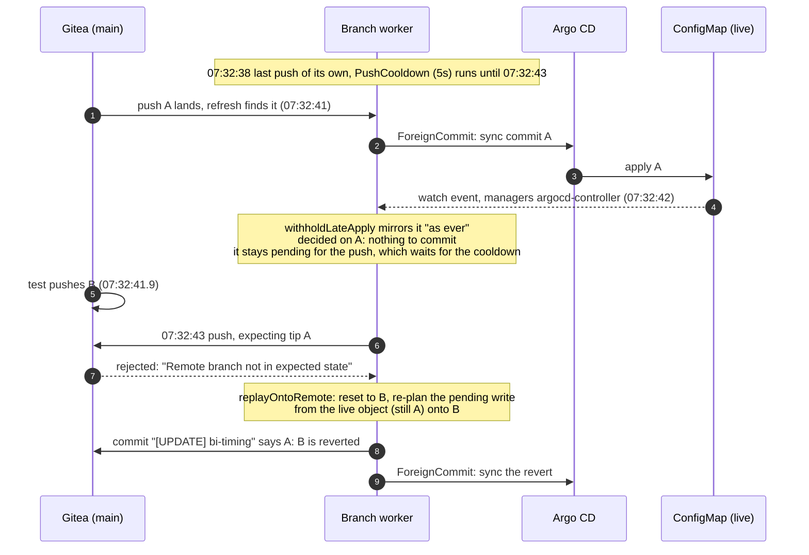
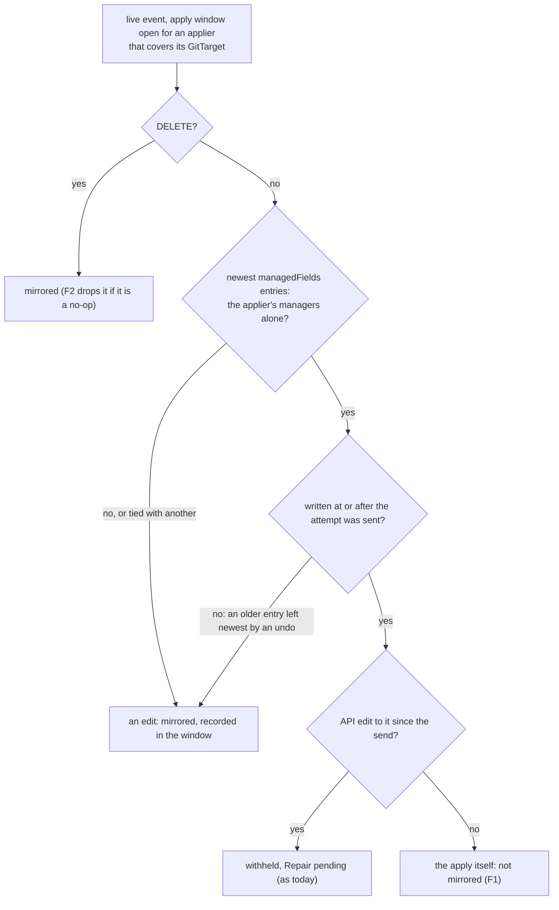
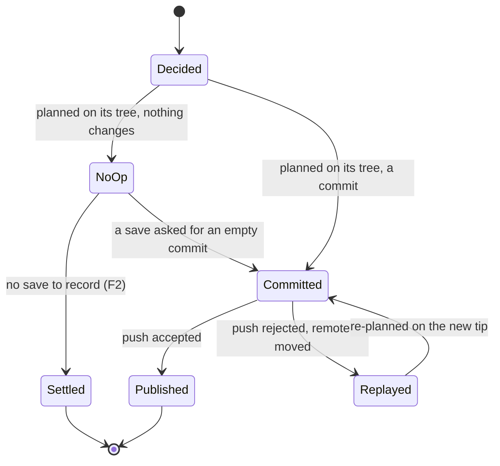
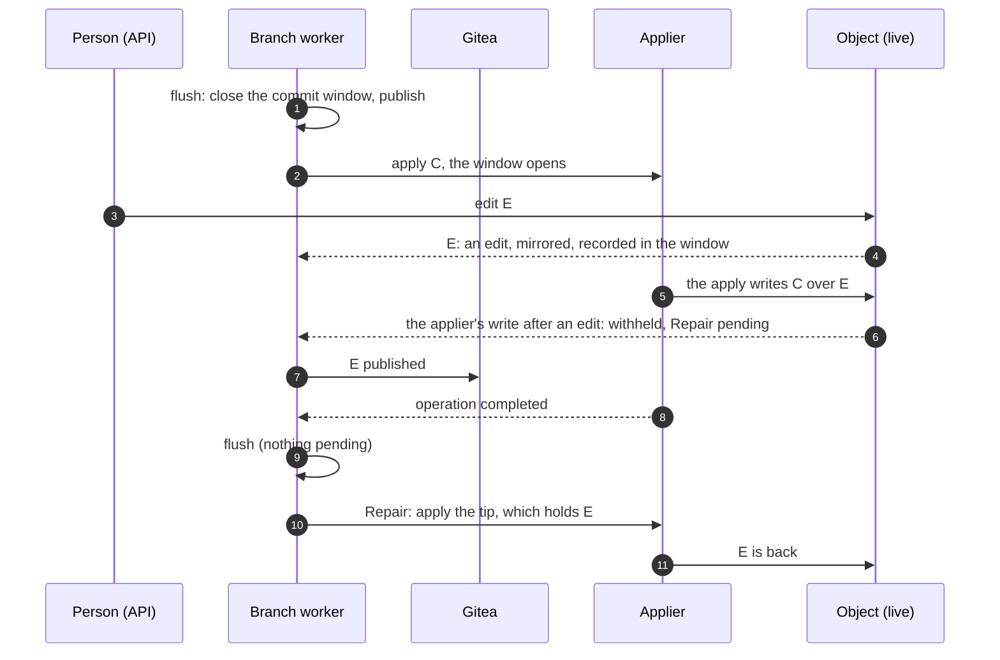
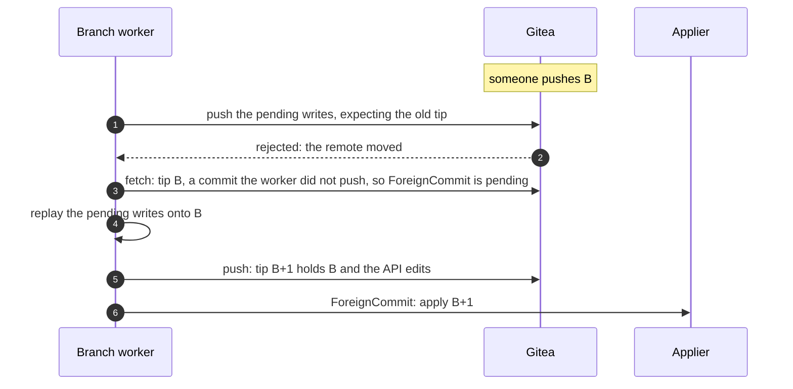
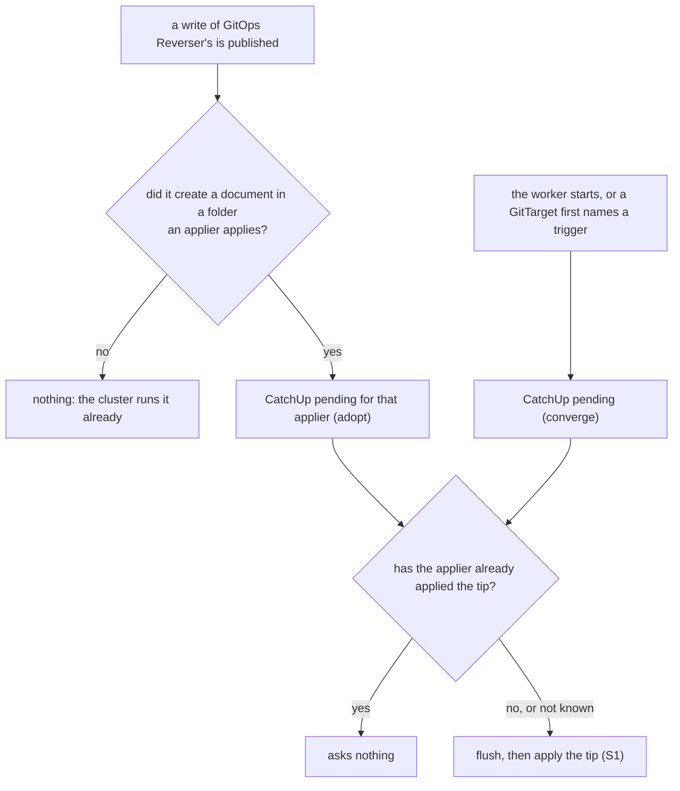

# Applier echoes: the applier's own writes, and applying while editing

> **design**: proposed 2026-10-20 (fifth version: simplified after a review and a discussion the
> same day); not built. Index: [`../INDEX.md`](../INDEX.md). Builds on
> [`apply-trigger.md`](apply-trigger.md) (the apply window, `Repair`, the quiet-branch rule) and
> [`gittarget-branch-worker-pending-writes.md`](gittarget-branch-worker-pending-writes.md) (decide,
> `advance`, materialize, replay). Found by the bi-directional timing spec in PR #424.

When GitOps Reverser asks Flux or Argo CD to apply a commit, the applier's write to each object
comes back through the watch. Today that write is mirrored like an API edit. A mirrored write is
re-planned from the live object onto whatever tip the branch has when it is published, so an echo
of an older commit, published after a Git-side push, **reverts that push**.

The fix is three small changes to code that exists, and one simplification:

| | Change | What it stops |
|---|---|---|
| **F1** | In the apply window, the applier's own write is not mirrored, whether or not an API edit came first | an echo decided after the worker already knows a newer tip |
| **F2** | A write that changes nothing on the tree it was decided on is dropped, never replayed | the race found: a no-op echo replayed onto a newer tip |
| **F3** | A resync waits while Git is ahead of the cluster: while an apply is due or running | a snapshot of the old cluster state written over a commit not yet applied |
| **S1** | Flush, then apply, instead of waiting for a quiet branch | the wait itself; an edit during an apply heals through the existing `Repair` |
| **S2** | `CatchUp` only to adopt and to converge, the same for Flux and Argo CD, decided in the branch worker; `quietPeriod` goes | an apply after every push of ours; the differences between the two appliers |

Nothing else changes. The apply window, its edit records and `Repair` stay as built. No new CRD field
(one goes: `FluxTrigger.spec.quietPeriod`), no new event type, no record per object.

## Decisions taken

Each of these is a simplification, chosen on purpose.

1. **The applier is recognized by its field-manager name, fixed per applier kind.** Kubernetes
   records two different facts about a write, in two different places:

   | | Where it lives | What it says | Who sets it |
   |---|---|---|---|
   | Field manager | `metadata.managedFields`, on the object | a name the client sends with the write | the client |
   | Service account | the API server's audit log only | who authenticated the request | the API server |

   A `managedFields` entry carries a manager name, an operation and a time, and no user:

   ```yaml
   managedFields:
   - manager: kustomize-controller   # the apply
     operation: Apply
     time: "2026-10-20T07:32:42Z"
   - manager: kubectl-edit           # a person's edit
     operation: Update
     time: "2026-10-20T07:33:10Z"
   ```

   F1 reads only these. The names are constants in
   [`apply_window.go`](../../internal/git/apply_window.go) today: `kustomize-controller`, fixed
   inside Flux and not configurable; `argocd-controller`, which Argo CD passes to every apply; and
   `argocd-application-controller`, for a `Replace=true` sync that sends no manager, so the API
   server takes the user agent. They do not change when the applier impersonates another account
   (a `Kustomization`'s `spec.serviceAccountName`, Argo CD's destination impersonation): the audit
   user changes, the manager name does not. That makes the name the better signal: on the object,
   delivered with every event, no configuration, no audit webhook.

   What it costs: if a later Flux or Argo CD release renamed its field manager, the constants would
   follow (the bi-directional e2e corner would show it); and a future applier kind, such as a
   webhook applier, names its own manager on its own trigger kind.

2. **No service account on the triggers, and no check against the audit author.** Earlier versions
   required `spec.serviceAccountRef` on `FluxTrigger` and `ArgoCDTrigger`, and compared each apply's
   audit author with it. Neither ever decided anything: the field manager does. Both are dropped,
   including as a later status on the trigger.

3. **Trust, not defense.** A write under the applier's manager name is the applier's. Whoever can
   write as Flux or Argo CD, or use their manager names, already controls what is deployed, so the
   design guards only against writers that are not malicious and still look alike: an undo, a
   same-second tie, a mutating webhook inside the apply.

4. **Writes to one object from Git and from the API within seconds are rare, so they are defined
   rather than prevented.** Each collision left open is listed below with how close the two writes
   must be, what it does, and whether it heals.

5. **Git is applied as fast as it can be** (S1), and **a resync waits until it has been** (F3): the
   one kind of work that cannot tell the applier's state from intent is the one that waits.

6. **Incoming Git changes are applied after the replay, in one apply with the worker's own writes.**
   When a push of the worker's is rejected because the remote moved, the worker replays its pending
   writes onto the new tip, publishes them, and only then asks the applier for that tip. It never
   applies the incoming change on its own first. See
   [when incoming Git changes are applied](#when-incoming-git-changes-are-applied).

7. **Flux and Argo CD are kept in line the same way, and the branch worker decides it** (S2). A
   `CatchUp` is asked of either applier only to adopt an object GitOps Reverser added, or to converge
   once at startup and when a `GitTarget` first names its trigger. Whether an applier is already at
   the tip is the worker's knowledge, not each client's. This **reverses two earlier decisions**:
   that an Argo CD `Application` is never asked to catch up, and that a newly bound `Application`
   waits for the next push. Both were taken to spare Argo CD's hooks a sync; a sync on a create, or on
   binding, is rare, and two appliers that are kept in line by one rule are worth that.

## What happened

The regression spec `bi_directional_push_race_e2e_test.go` pushes A, waits until the applier made
A live, and pushes B at once. Argo CD fails it in CI and locally, in round 0:



Flux passes the same spec, by timing: its echo arrived more than 5 seconds after the worker's
previous push, so the no-op write was published at once and cleared before B landed. Either applier
loses the race when its echo lands inside the push cooldown.

## The root cause: a stale write is ordered after the push

Why does an API edit made during a resync come out right, while a Git-side push does not? Both
arrive while older decisions are still pending. The difference is where each lands in the order.

- **An API edit is a decision in the queue.** It is decided after the resync's write, and on replay
  the decisions are planned in order
  ([`gittarget-branch-worker-pending-writes.md`](gittarget-branch-worker-pending-writes.md#resume-and-the-three-meanings-of-replay):
  "each decision is judged against the tree the one before it left"). The edit lands last, so it
  wins.
- **A Git-side push is not a decision.** It becomes the tree the queue is replayed onto, so every
  pending decision lands *after* it. Each decision is re-planned as the whole object
  (`desired = event.Object`), and a decision taken from an older picture of the object overwrites
  what the push changed.

That is the whole problem. A pending decision that says nothing, or that says "the object is as the
applier left it", must not be replayed onto a push. F1 and F2 make sure such a decision is never
pending, and F3 keeps resyncs from taking one.

## F1: the applier's own write in the apply window is not mirrored

`withholdLateApply` ([`apply_window.go`](../../internal/git/apply_window.go)) already decides, for
every live event in an open apply window, whether it is the applier's write: the newest
`managedFields` entries are the applier's managers alone (`kustomize-controller`;
`argocd-controller`, or `argocd-application-controller` for a `Replace=true` sync). Today it
withholds such a write only when an API edit came after the attempt was sent, and mirrors it
otherwise, "as ever". F1 changes the second case: the write is the apply itself, and it is not
mirrored either.



- **The window is the one built today**: from sending an attempt until its operation completed,
  plus 10 seconds, because the applier's writes reach the worker through the watch after its status
  says it finished.
- **"Written at or after the attempt was sent"** is new, and it uses what the event already carries
  (`LastFieldManagedAt`). An undo that removes every field its manager owns leaves the applier's
  entry from an *earlier* apply as the newest; that entry predates the send, so the event is an edit.
- **Trust in the manager name is deliberate.** Whoever can write as Flux or Argo CD, or under their
  manager names, already controls what is deployed.
- **Why F1 is needed beside F2:** the worker can learn of a newer tip while an apply runs, from a
  rejected push or a refresh. An echo decided after that is not a no-op on the tree it is decided
  on: it reverts the newer commit. F1 keeps it out whatever tree the worker holds.

## F2: a write that changes nothing is dropped, never replayed

Today a decided write that changes nothing on the tree it was decided on makes no commit, but it
stays pending until the next push (`executeEventWrite` in
[`commit_executor.go`](../../internal/git/commit_executor.go) returns no change; the write keeps its
place in the pending writes). If the push is rejected because the remote moved, the replay re-plans
it onto the new tip, where it is no longer a no-op. That is exactly the race above.

F2: **a write with nothing to commit, and no save to record, settles at once.** A save that asked to
record its message (`whenNothingToCommit: CommitEmpty`, the `AllowEmpty` write of a
`CommitRequest`) keeps today's behavior, because it carries a commit of its own.



F2 needs no knowledge of appliers at all. It also covers, by content alone:

- **a prune** of an object the applied commit removed: a delete of what is not in the tree is a
  no-op;
- **a same-second tie** between an apply and an edit, when the live object still equals the tree;
- **a late echo** that arrives after the window but before the worker learns of a newer tip;
- **every resync item whose live object equals Git**, which is most of a resync.

## F3: a resync waits while Git is ahead of the cluster

A resync mirrors a snapshot of live state. It is not a live event, so F1 cannot see it, and an
existing object cannot be told apart as "left by the applier". When Git is ahead of the cluster, a
commit pushed and not yet applied, the snapshot holds the old state of every object that commit
changed, and the resync writes it: on a fresh tip, those are changes, so F2 does not drop them.

F3: **while an applier on the branch has a `ForeignCommit`, `Repair` or `Refusal` pending, a
`CatchUp` to converge a newly named trigger, or an attempt out, a resync waits.** Those are exactly
the states in which Git can hold something the cluster does not have yet. The applier applies the
tip, the cluster catches up, and then the resync runs against a cluster that matches Git. A resync
is reconciliation, not latency-critical, and Git is ahead of the cluster for seconds at a time (S1
applies Git as fast as it can).

- **A `CatchUp` to adopt does not make a resync wait.** It applies objects the worker itself added
  from the cluster, so the cluster already runs them and a snapshot has nothing to revert.
- **Neither does the `CatchUp` that converges at startup, by an existing decision.** A worker's first
  observation of the branch is a baseline: it leaves a `CatchUp` pending, never a `ForeignCommit`,
  because applying on restart would revert edits made while the operator was down
  ([`apply-trigger.md`](apply-trigger.md)). The first resync runs at once, as today, and the live
  state it mirrors wins.
- **The `CatchUp` that converges a newly named trigger does.** The commits on the branch before the
  `GitTarget` named it were applied by nobody this worker followed, so Git may be ahead of the
  cluster, as after a `ForeignCommit`.
- **Applies to every other resync**: one during an apply, one after an apply while a new push
  waits, and a re-list after an expired watch cursor. It also delays the initial events of a watch
  started during an apply by the apply's seconds.
- **A branch with no trigger does not wait**: nothing applies its commits, and the mirror is the
  only writer of the cluster's picture.

## S1: flush, then apply

Today an attempt goes out only on a quiet branch: no open commit window and no pending writes, on
this worker and on every sibling writing the same branch. That stops an apply from reverting an
edit not yet published, and it starves: a user who keeps editing holds back a Git-side change for
as long as they type, which is why `ForeignCommit` already closes an open window instead of waiting.

S1 makes that the rule for every apply: **close the open commit window, publish the pending writes,
then send the apply** of the tip that produced. Two details keep it from waiting again:

- **The flush publishes what was pending when the apply became due**, and no more. Writes are
  ordered, so the worker marks the last one decided at that moment and sends once the writes up to
  the mark are published. An edit decided after the mark does not hold the send, so continuous
  editing cannot starve an apply.
- **A commit window held by a `CommitRequest` is not closed early.** A save defines its own commit
  boundary, and the worker already never steals a held window. An apply waits for a registered save
  to finish, as it does today; so does an apply while the worker is recovering a missing parent or
  its checkout is not clean, the two states in which it cannot say what is published.

Commit windows run normally while the apply runs. An edit made during an apply, to an object the
apply then writes, is what the apply window already handles:



That is built today, for Flux and Argo CD alike. S1 only removes the wait in front of the apply,
and with it the coordination of quietness across sibling workers. At sending, the attempt checks
only that the remote is still at the commit asked for.

### When incoming Git changes are applied

A Git-side push usually reaches the worker through the flush itself: its push is rejected because
the remote moved. The order from there is built today, and S1 keeps it:



The applier is asked once, for the tip that holds both sides: the incoming change and the API edits
replayed on top of it (`applyInbox.observe` marks the fetch as foreign, and `sendAttempt` puts
`ForeignCommit` before every other reason).

Applying the incoming change on its own first, before the replay is published, is possible and
deliberately not done. It would cost:

- **API edits reverted on the cluster.** The applier would apply B without the pending edits, so every
  object they touch goes back to B's value. The apply window withholds those writes and leaves a
  `Repair` pending: the edits come back, but only after a second apply.
- **Two applies for one change.** One for B, one for the `Repair`, each with its own resume and
  suspend for Flux, and its own sync, hooks included, for Argo CD.
- **A visible flicker** in between: a `Deployment` whose template an edit touched rolls out to B's
  value and back.

Waiting costs one push, about a second, and the one apply that follows carries everything.

What F1 and F2 add here: the replay in step 4 carries only the API edits. Before them, a no-op
echo in the pending writes was replayed as a revert of B, and step 6 then applied that revert. That
is how the race lost B on the cluster as well as in Git.

## S2: `CatchUp` only to adopt and to converge, the same for both appliers

Today, after every push of GitOps Reverser's own, once the branch has been quiet for the trigger's
`quietPeriod`, a Flux `Kustomization` is asked to apply the tip, and so it is once after the worker
starts and once when a `GitTarget` first names its trigger. An Argo CD `Application` is never asked.
The documented reasons are convergence and Flux's inventory: Flux learns of an object only from an
apply of a commit that holds it, and an object it never applied is not pruned when Git later deletes
it.

With the flush guarding the cluster (S1), the quiet period protects nothing, and only the inventory
reason is left. It holds for one kind of API write only:

| The API... | Does the applier need an apply? |
|---|---|
| edited an existing object | no: the cluster runs the edit, and the applier already owns the object |
| deleted an object | no: the object is gone, and the next apply of any reason prunes nothing |
| **created an object** | **yes**: until the applier applies a commit that holds it, a later Git-side delete is not pruned: Flux's inventory does not list it, and Argo CD prunes only what carries its tracking annotation. The object survives, and a later resync writes it back into Git |

The same holds for an object GitOps Reverser adds to Git from a resync, such as an existing object a
new `WatchRule` starts mirroring: the applier has never applied it.

S2, for Flux and Argo CD alike:

- **Adopt.** A `CatchUp` is pending for an applier when a write of GitOps Reverser's, once published,
  created a document in a folder that applier applies.
- **Converge.** A `CatchUp` is pending once when the worker starts (its first observation is a
  baseline, as today) and once when a `GitTarget` first names the trigger.
- **Batched by itself.** A pending `CatchUp` is one flag, and one attempt per applier is out at a
  time, so a burst of creates is one apply. No time is needed for that: `quietPeriod` goes.
- **"Already applied" is the worker's knowledge.** The worker follows every operation and keeps, per
  applier, the commit the last one that succeeded applied (`status.operation.appliedRevision`,
  which a restart recovers). A `CatchUp` of the commit the applier already applied asks nothing. An
  applier the worker has seen apply nothing asks once.
- **An empty tip asks nothing.** When the remote does not carry the branch there is no commit to
  apply; the source reports the missing branch on its own.



The two appliers then differ only in how an apply is carried out (resume and suspend a
`Kustomization`, sync an `Application`), never in when one is asked for.

## Collisions this leaves open

Each needs the **same object** written from two sides within seconds. The **interval** is how close
the two writes must be; the **recovery** is how long the wrong state lasts once it happened.

| | Collision | Interval | Effect | Recovery | Seen |
|---|---|---|---|---|---|
| C1 | An API edit to an object while an apply of it runs | the apply | the cluster runs the applied value; Git is right | heals: the existing `Repair`, seconds | `apply_window_collisions_total{withheld}`, `Repair` on the trigger |
| C2 | An API edit and a Git-side push to the same object, before the edit is published | until the edit's push | the edit is re-planned as the whole object onto the push: the API wins for every field of that object, including ones only Git changed | does not heal; that is the repository's "API wins" rule | the commit |
| C3 | An echo that arrives more than 10s after its operation completed, after the worker learned of a newer tip | after the grace | mirrored as an edit, reverting that tip's change to the object | does not heal | `apply_echoes_total{outcome="late"}` |
| C4 | An undo during an apply, written in the same second as the apply's write | one second | the undo looks like the apply (F1) and is not mirrored | does not heal | not distinguishable |
| C5 | A mutating webhook or defaulting adds fields during an apply that Git does not hold | none | not mirrored (F1); a later resync may mirror them | not needed: the cluster runs them, as today | the resync's commit |

C2 exists today and is a policy, not a race: when both sides change one object before either is
published, the API wins for the whole object. C3 and C4 need a coincidence on one object and are
accepted as rare; C3 is made visible.

## What it promises

- **P1.** An echo of an applied commit never reverts a Git-side push: inside the window F1 keeps it
  out, and on the tree it was decided on F2 drops it.
- **P2.** A resync never writes the cluster's old state over a commit that is about to be applied (F3).
- **P3.** An API edit is mirrored, except an undo in the same second as an apply of that object (C4).
- **P4.** When edits and pushes stop, the cluster runs what Git says after at most one `Repair`.
- **P5.** An object the API creates in a folder an applier applies is adopted by that applier, Flux
  and Argo CD alike, so a later Git-side delete of it is pruned (S2).

What it does not promise: that a Git-side push to an object can never be overwritten. C2 is the
"API wins" rule doing that on purpose, and C3 is a late echo that needs a coincidence.

## The review of 2026-10-20, and what came of it

A review of the third version raised seven points. The fourth version answered them with more
machinery; this one answers them by keeping what is built:

| # | Point | Now |
|---|---|---|
| 1 | An edit still in an open commit window, overwritten by the apply, was never repaired; Argo CD gets no `CatchUp` | the window records an edit when it is dequeued, before its commit window closes, so the apply's later write is withheld and `Repair` is pending, for Argo CD too. Built today. |
| 2 | A per-object record of manager times could miss filtered updates and suppress an edit | no per-object record |
| 3 | A manager name names an applier kind, not one applier | F1 acts only inside the window of an applier that covers the event's `GitTarget`; two appliers applying one object fight each other with or without GitOps Reverser |
| 4 | "First seen live" says nothing about who wrote it | no first-seen rule |
| 5 | Same-applier writes in one second leave its time unchanged | F1 does not compare times between events; it compares the entry with the send |
| 6 | Deletes classified by audit contradicted "attribution never decides" | no audit in any decision; a delete is a no-op or an edit, by content (F2) |
| 7 | The invariants promised more than the cases allowed | narrowed to P1 to P4, with interval and recovery kept apart |

And from the discussion that followed: a full three-way merge on replay (carry each write's change,
not the whole object) would also close C2 and C3, at the cost of changing the replay rule the
pending-writes work settled on. F2 is its smallest useful part. The rest is not needed for P1 to P4.

Dropped from earlier versions, because nothing here needs them: a required
`spec.serviceAccountRef` on the triggers and the check of the audit author against it (decision 2),
and a separate `ApplyObserved` event type.

## Showing the applier's work

Without new types, F1 already sees each apply land, object by object: every write it keeps out is
the applier answering a request. It is counted in one new counter,
`apply_echoes_total{provider_namespace, provider_name, branch, outcome}`, with `not_mirrored` (F1)
and `late` (C3: the applier's managers alone, with no window open, mirrored as an edit), and logged
once per attempt: "Observed the applier's apply of C: N objects".

## The code plan: what is removed, what changes, what stays

Read from the code at `47b171b9`. Every construct the design touches, and what happens to it.

### Removed

| Construct | Where | Why it can go |
|---|---|---|
| `branchQuiet` | [`apply_trigger.go`](../../internal/git/apply_trigger.go) | the quiet branch is the wait S1 removes; the send is gated by the flush instead |
| `workWaiting` | `apply_trigger.go` | queued work items, here or on a sibling, no longer hold an apply |
| The "nothing pending" half of `decisionHolds` (`busyWriting`, `inflightItems`, `siblingBusy`) | `apply_trigger.go` | `ApplyRequest.Current` checks only that the remote is still at the commit asked for |
| `branchSiblings.othersBusy`, `BranchWorker.siblingBusy`, `publishWriteBusy`, and the `busyWriting` atomic | [`apply_siblings.go`](../../internal/git/apply_siblings.go), [`branch_worker.go`](../../internal/git/branch_worker.go) | quietness across siblings exists only for the quiet branch |
| The `wakeOthers` calls that wake a sibling when this worker stops writing | `apply_siblings.go` | nobody waits for a sibling to be quiet any more; the wakes for source groups stay |
| `ApplierRef.CatchesUp` | [`apply_request.go`](../../internal/git/apply_request.go) | both appliers catch up (S2) |
| `FluxTrigger.spec.quietPeriod`, `EffectiveQuietPeriod` on both trigger types and on the `ApplyTrigger` interface, `DefaultApplierQuietPeriod` | [`api/v1alpha3`](../../api/v1alpha3/applytrigger_types.go) | nothing waits for time to pass before a `CatchUp` (S2); the CRDs are regenerated |
| `branchTarget.quietPeriod`, `applierState.quietPeriod`, `quietSince`, the quiet term of `dueAt`, and the reset of `quietSince` in `decide` | `apply_trigger.go`, `branch_worker.go`, [`pending_writes_loop.go`](../../internal/git/pending_writes_loop.go) | they exist only to time the quiet period |
| The `OutcomeCurrent` of a `ForeignCommit` or `CatchUp` for a suspended `Kustomization` already at the commit | [`internal/applier/flux.go`](../../internal/applier/flux.go) | the worker knows what each applier last applied (S2) |
| The `OutcomeCurrent` for an empty commit, and the stamp of the source with it | `flux.go`, [`internal/applier/argocd.go`](../../internal/applier/argocd.go) | the worker sends nothing for an empty tip (S2) |

### Changed

| Construct | Where | Today | After |
|---|---|---|---|
| `withholdLateApply`, `case !editedSince` | [`apply_window.go`](../../internal/git/apply_window.go) | the applier's write alone, nobody edited since the send: mirrored "as ever" | not mirrored, counted `not_mirrored` (F1) |
| `withholdLateApply`, the applier's entry time | `apply_window.go` | compared only with an edit's time | an entry older than the window's `sentAt`, to the second, is an edit: an undo leaving an earlier apply's entry newest (F1) |
| `withholdLateApply`, a closed window | `apply_window.go` | skipped | the applier's managers alone with no window open: mirrored as today, counted `late` (C3) |
| `PendingWrite.retained` | [`commit_executor.go`](../../internal/git/commit_executor.go) | every write is retained except a resync that committed nothing | also not retained: a write that committed nothing, made no empty commit, and carries no `CommitRequest` (F2) |
| `settleCommitted` | [`pending_writes_loop.go`](../../internal/git/pending_writes_loop.go) | removes a resync that committed nothing (`settleResyncApplied`) | removes every write `retained` says is not retained, the same way (F2) |
| `handleResyncRequest`, `stashDeferredHeal`, `applyDeferredHeals`, `deferredHeals` | [`resync_flush.go`](../../internal/git/resync_flush.go) | parks a heal resync while a commit window is open | also parks any resync, heal or not, while an applier has a `ForeignCommit`, `Repair` or `Refusal` pending or an attempt out, and drains when neither holds; renamed for resyncs in general (F3) |
| `writeBusy` | `apply_trigger.go` | an open window, pending writes, deferred heals, a registered `CommitRequest`, a parent recovery, a dirty worktree | only the three states in which no flush can be made: a registered `CommitRequest`, a parent recovery, a dirty worktree (S1) |
| `closeWindowForForeignCommit` | `apply_trigger.go` | closes the open window when a `ForeignCommit` is pending or a push was hinted | closes it when any applier has a reason due, unless a `CommitRequest` holds it; records the flush mark (S1) |
| `serviceAppliers` | `apply_trigger.go` | sends when `branchQuiet` and not `workWaiting` | sends once the writes up to the flush mark are published (S1) |
| `applyInbox.observe` | `apply_trigger.go` | every push of the worker's own leaves a `CatchUp` pending | only the first observation does (converge); a push leaves one only through the adopt rule (S2) |
| The publication of a push | `branch_worker.go` | settles the pushed writes | also leaves a `CatchUp` pending for every applier covering a target whose pushed write created a document (S2) |
| `applierState` | `apply_trigger.go` | pending reasons, the attempt out, retry clock | also the commit its last succeeded operation applied, recovered from `status.operation`; a `CatchUp` of that commit is not sent (S2) |
| `syncAppliers` | `apply_trigger.go` | a newly named applier starts with a `CatchUp` pending where its kind catches up | for both kinds (S2) |
| `ApplyRequest.Current`, `ApplyStale` | [`apply_request.go`](../../internal/git/apply_request.go) | stale when the tip moved or an edit waits to be published | stale only when the tip moved |
| `prefetchSources` and the inbox's prefetch | [`apply_groups.go`](../../internal/git/apply_groups.go), `apply_trigger.go` | fetches the source ahead while the branch is busy | reviewed in the implementation: it overlapped the quiet-branch wait, which is gone; kept only if it still shortens the flush |

### Stays as built

The apply window itself (opened per attempt, settled on completion, 10s grace, edits carried into
the next window), the withhold of a late apply over a newer edit with its `Repair`, the ambiguous
tie, one attempt in flight per applier and per source group (`claimGroup`, `groupOutElsewhere`,
`publishGroupsOut`), the dispatcher and the following of operations, restart recovery, the Flux
suspend lifecycle, the receiver and `pushHinted`, the `CatchUp` reason itself (narrowed by S2), the startup
baseline, `resolvePushedCommitRequests`, and `inflightItems` for the queue-depth gauge.

### Documents that change with it

- [`../definitions.md`](../definitions.md): **quiet branch** goes; the flush and **echo** come in.
- [`apply-trigger.md`](apply-trigger.md#the-apply-window): the apply-window section gains F1, the
  quiet-branch rule becomes S1, and F3 joins it.
- [`gittarget-branch-worker-pending-writes.md`](gittarget-branch-worker-pending-writes.md): F2 in
  the replay rules.
- [`../interpreting-metrics.md`](../interpreting-metrics.md): `apply_requests_total`'s `stale`
  outcome no longer mentions an edit waiting to be published, and `apply_echoes_total` is added.
- [`../bi-directional.md`](../bi-directional.md) ("The quiet branch" and its state diagram),
  [`../bi-directional-flux.md`](../bi-directional-flux.md),
  [`../bi-directional-argocd.md`](../bi-directional-argocd.md),
  [`../architecture.md`](../architecture.md) and
  [`../api-first-publication.md`](../api-first-publication.md): every "on a quiet branch" becomes
  "after a flush".
- The comment in [`internal/telemetry/apply_requests.go`](../../internal/telemetry/apply_requests.go)
  that says a retry is decided on a quiet branch, and the one in
  [`internal/telemetry/apply_window.go`](../../internal/telemetry/apply_window.go) about a long
  `quietPeriod`.
- For S2: [`../configuration.md`](../configuration.md) and
  [`config/samples/fluxtrigger.yaml`](../../config/samples/fluxtrigger.yaml) lose `quietPeriod`;
  [`../bi-directional.md`](../bi-directional.md)'s table of reasons and
  [`../bi-directional-argocd.md`](../bi-directional-argocd.md) ("an `Application` is never asked for
  a `CatchUp`") describe adopt and converge for both appliers;
  [`../interpreting-metrics.md`](../interpreting-metrics.md) drops "never `CatchUp` for an
  `application`"; [`../UPGRADING.md`](../UPGRADING.md) stops naming `quietPeriod`; and the
  `GitTarget` field comment in [`gittarget_types.go`](../../api/v1alpha3/gittarget_types.go) that
  mentions it.

### Tests that change with it

The tests of the quiet branch, the busy and sibling gates and `decisionHolds` in
`apply_trigger_test.go`, `apply_attempt_test.go`, `apply_operation_test.go` and
`apply_recovery_test.go` are rewritten against the flush: a due apply closes the window and sends
once the marked writes are published; an edit after the mark does not hold it; a held
`CommitRequest` does. For S2, the tests of `CatchesUp`, `quietPeriod` and Flux's `OutcomeCurrent`
(`apply_trigger_test.go`, `apply_attempt_test.go`, `refusal_reapply_test.go`,
`applytrigger_schema_test.go`, `flux_guide_test.go`, `helpers_test.go`) are rewritten or removed.
Two e2e specs change meaning, because an API edit to an existing object asks for no apply any more:
the Flux spec "asks Flux to apply only on a quiet branch" (it sets `quietPeriod: 5s`), and the timing
spec's "API edit → Flux applied it", which becomes "API create → Flux adopted it", for both appliers.
The new tests are listed below.

## Tests

- **`bi_directional_push_race_e2e_test.go`** (label `push-race`, both appliers): push A, wait until
  the applier made A live, push B at once; B must stay in the cluster and in Git. Argo CD fails it
  today, deterministically; Flux passes only by timing. Proves P1. It is committed as `Pending`,
  and the change that builds F1 and F2 removes that.
- **A worker-level test without timing luck**, on a real Git server (`startRealGitServer`, since
  `file://` never compares the expected tip): a no-op write decided inside the push cooldown, the
  remote moves, the push fails and replays; no commit. Proves F2.
- **An edit during an apply** (e2e): the edit is in Git at once and back on the cluster after one
  `Repair`; count the commits. Proves C1's recovery and P4.
- **A resync while an apply is due** (e2e): push to Git, force a resync before the apply, and require
  the push to survive. Proves F3 and P2.
- **Adopt, then prune** (e2e, both appliers): create an object through the API in the shared
  folder, wait for the `CatchUp` that adopts it, delete its file from Git, and require the object
  gone from the cluster and from Git. Proves P5, and that an API edit to an existing object asks for
  no apply.
- **Unit tests of F1:** applier alone after the send (not mirrored); after an edit (withheld, as
  today); entry older than the send (an edit); tie (an edit).
- **Unit tests of F2:** a no-op write settles; a save with `CommitEmpty` still commits; a no-op is
  never replayed.

## Decisions still open

1. **F3's scope for siblings**: should a resync also wait for applies due on other workers writing
   the same branch?
2. **How long F3 may hold a resync** when an apply keeps failing: a resync held forever leaves drift
   unmirrored. A bound, after which the resync runs and C2's policy applies, is the likely answer.

## References

- [`apply-trigger.md`](apply-trigger.md): the apply window, `Repair`, the quiet branch, and the
  startup baseline.
- [`gittarget-branch-worker-pending-writes.md`](gittarget-branch-worker-pending-writes.md): decide,
  `advance`, materialize, and replay as re-planning.
- [`internal/git/apply_window.go`](../../internal/git/apply_window.go): `withholdLateApply`.
- [`internal/git/commit_executor.go`](../../internal/git/commit_executor.go): a write with no change.
- [`internal/git/apply_trigger.go`](../../internal/git/apply_trigger.go): the quiet branch.
- [`internal/git/branch_worker.go`](../../internal/git/branch_worker.go): `PushCooldown`,
  `afterFailedPush`, `replayOntoRemote`.
- [`test/e2e/bi_directional_push_race_e2e_test.go`](../../test/e2e/bi_directional_push_race_e2e_test.go):
  the regression spec.
