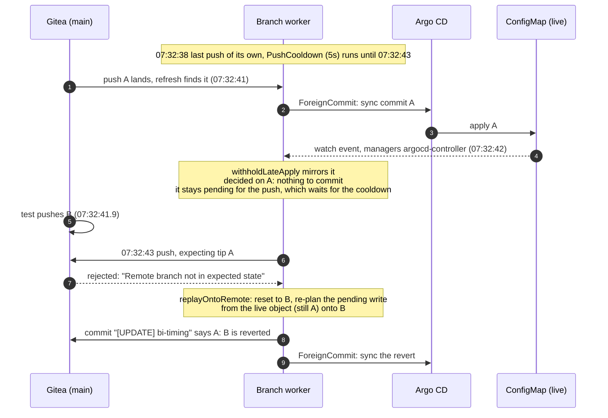
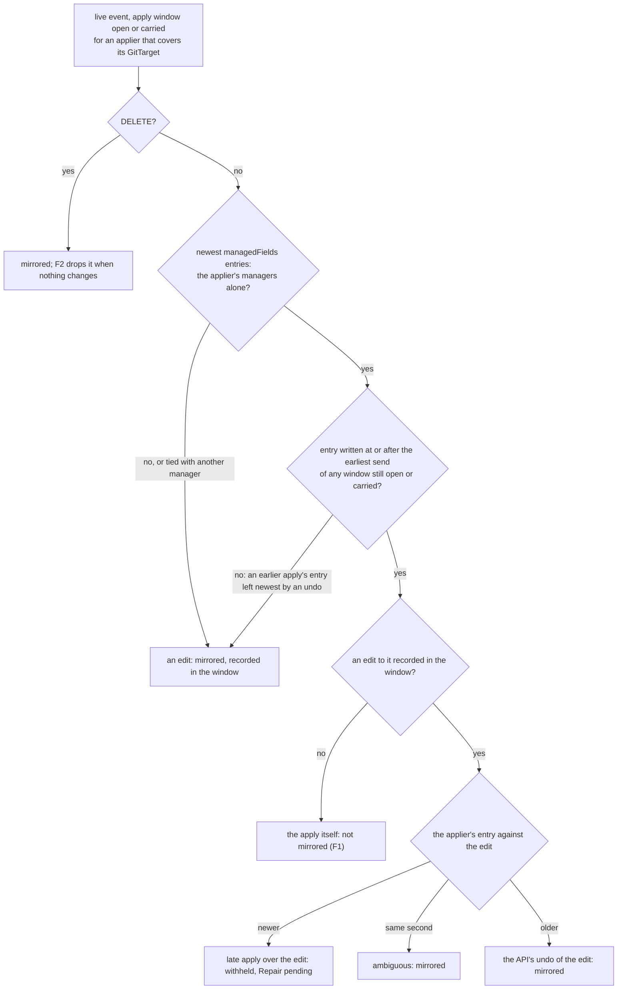
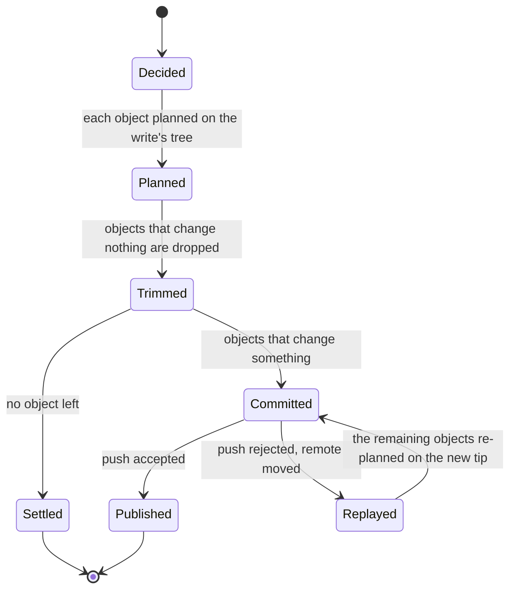
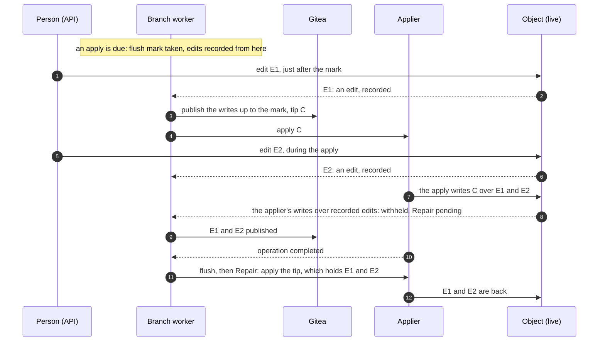
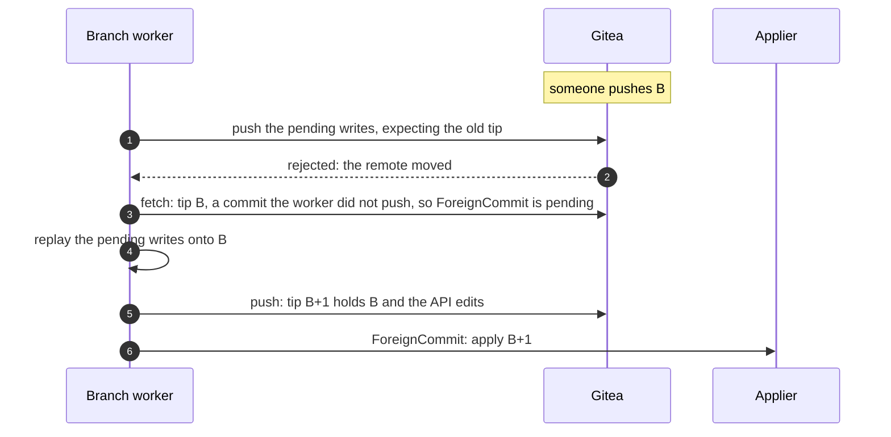
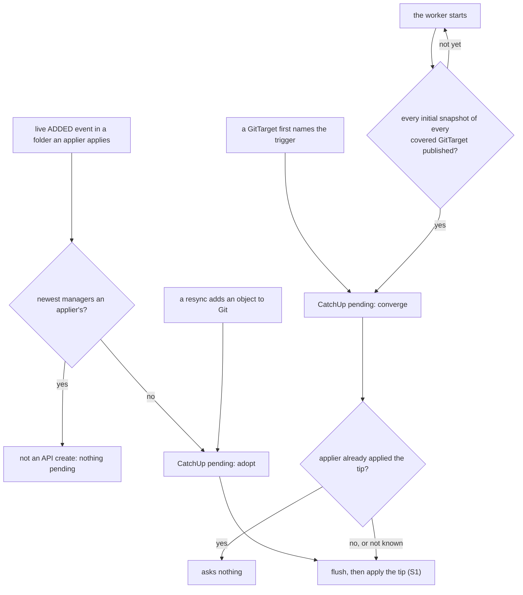

# Applier echoes: the applier's own writes, and applying while editing

> **design**: proposed 2026-10-20; not built, and built as one change. Index:
> [`../INDEX.md`](../INDEX.md). Builds on [`apply-trigger.md`](apply-trigger.md) (the apply window,
> `Repair`, `CatchUp`, the quiet-branch rule) and
> [`gittarget-branch-worker-pending-writes.md`](gittarget-branch-worker-pending-writes.md) (decide,
> `advance`, materialize, replay).

When GitOps Reverser asks Flux or Argo CD to apply a commit, the applier's write to each object
comes back through the watch. Today that write is mirrored like an API edit, and a mirrored write is
re-planned from the live object onto whatever tip the branch has when it is published. An echo of an
older commit, published after a Git-side push, **reverts that push**, in Git and then on the cluster.

The fix rests on one idea the writer already follows: **a write that changes nothing in Git does not
exist.** This design applies it everywhere a stale picture of an object can reach a commit, and
removes the waiting that used to stand in for it:

| | Change |
| --- | --- |
| **F1** | In the apply window, the applier's own write is not mirrored |
| **F2** | An object that changes nothing on the tree it was decided on is dropped from its write, never replayed |
| **F3** | A resync never decides from a snapshot taken while Git was ahead of the cluster; it takes a fresh one |
| **S1** | Flush, then apply, instead of waiting for a quiet branch |
| **S2** | `CatchUp` only to adopt objects the API created and to converge, the same for Flux and Argo CD, decided in the branch worker; `quietPeriod` goes |

The parts depend on each other: S1 removes a wait that F1, F2, F3 and S2 make unnecessary, so they
are built and released together.

## Decisions taken

1. **The applier is recognized by its field-manager name, fixed per applier kind.** Kubernetes
   records two different facts about a write, in two different places:

   | | Where it lives | What it says | Who sets it |
   |---|---|---|---|
   | Field manager | `metadata.managedFields`, on the object | a name the client sends with the write | the client |
   | Service account | the API server's audit log only | who authenticated the request | the API server |

   A `managedFields` entry carries a manager name, an operation and a time, and no user:

   ```yaml
   managedFields:
   - manager: kustomize-controller   # the apply
     operation: Apply
     time: "2026-10-20T07:32:42Z"
   - manager: kubectl-edit           # a person's edit
     operation: Update
     time: "2026-10-20T07:33:10Z"
   ```

   F1 reads only these. The names are constants in
   [`apply_window.go`](../../internal/git/apply_window.go): `kustomize-controller`, fixed inside
   Flux; `argocd-controller`, which Argo CD passes to every apply; and
   `argocd-application-controller`, for a `Replace=true` sync that sends no manager, so the API server
   takes the user agent. They do not change when the applier impersonates another account: the audit
   user changes, the manager name does not. So the name is on the object, delivered with every event,
   and needs no configuration and no audit webhook. If a later Flux or Argo CD release renamed its
   manager, the constants would follow.

2. **No service account on the triggers, and no check against the audit author.** The field manager
   decides; nothing else is consulted.

3. **Trust, not defense.** A write under the applier's manager name is the applier's. Whoever can
   write as Flux or Argo CD already controls what is deployed, so the design guards only against
   writers that are not malicious and still look alike: an undo, a same-second tie, a mutating
   webhook inside the apply, a late echo.

4. **Writes to one object from Git and from the API within seconds are rare, so they are defined
   rather than prevented.** Each collision left open is listed with how close the two writes must be,
   what it does, and whether it heals.

5. **Git is applied as fast as it can be.** No wait for a quiet branch; the flush publishes what is
   pending, and the apply goes.

6. **Incoming Git changes are applied after the replay, in one apply with the worker's own writes.**
   Never on their own first.

7. **Flux and Argo CD are kept in line by one rule, decided in the branch worker.** The two appliers
   differ only in how an apply is carried out (resume and suspend a `Kustomization`, sync an
   `Application`), never in when one is asked for. This reverses two decisions in
   [`apply-trigger.md`](apply-trigger.md): that an `Application` is never asked to catch up, and that
   a newly bound `Application` waits for the next push. A sync, hooks included, on an API create or on
   binding is rare, and one rule for both appliers is worth it.

8. **A folder a trigger applies belongs to that trigger's applier.** An object another applier
   applies is not mirrored into it, and GitOps Reverser warns when one is (S2).

## The race

The regression spec pushes A, waits until the applier made A live, and pushes B at once. Argo CD
fails it, deterministically:



Flux passes the same spec only when its echo lands after the push cooldown.

**The root cause is ordering.** An API edit is a decision in the worker's queue: decided after older
writes, replayed after them, so it wins. A Git-side push is not a decision. It becomes the tree the
queue is replayed onto, so every pending decision lands *after* it, and each is re-planned as the
whole object (`desired = event.Object`): a decision taken from an older picture of the object
overwrites what the push changed. A stale picture reaches a commit in four ways, and each change
closes one:

| A stale picture, held as | Closed by |
| --- | --- |
| the applier's own write, mirrored as an edit | F1 |
| an object that changed nothing, kept in a pending write and replayed | F2 |
| a resync snapshot taken before the apply that would have changed it | F3 |
| an edit made between the flush and the send, overwritten by the apply and never repaired | S1 |

## F1: the applier's own write in the apply window is not mirrored

`withholdLateApply` ([`apply_window.go`](../../internal/git/apply_window.go)) judges every live
event in an applier's open apply window. F1 keeps its judgment of edits as built and changes what
happens to the applier's own write when nobody edited the object.



- **The window** is the one built today: from sending an attempt until its operation completed, plus
  10 seconds, and an attempt sent within that grace carries the earlier window's edits and end.
- **The lower bound is the earliest send of every window still open or carried.** A delayed echo of
  attempt A, arriving after attempt B was sent and inside A's grace, is still A's apply.
- **When an edit was recorded, today's comparison decides**, unchanged: an applier entry newer than
  the edit is a late apply over it (withheld, `Repair`); the same second is ambiguous (mirrored); an
  older one is the API's undo (mirrored). F1 changes only the case with no edit recorded, which today
  is mirrored "as ever".
- **Edits are recorded from the flush mark** (S1), not only from the send, so an edit decided between
  the two is one the apply can be withheld over.

## F2: an object that changes nothing is never replayed

The writer plans each event of a write against the tree the write is decided on. An object whose
plan changes nothing there is dropped from the write at that moment. A write left with no objects
settles at once. Nothing that changed nothing is kept for replay, so nothing can be re-planned onto
a newer tip.

Today the rule exists for whole resync writes only (`PendingWrite.retained`,
[`commit_executor.go`](../../internal/git/commit_executor.go)): a resync that committed nothing
settles. A window write that committed nothing, and every unchanged object inside a write that did
change something, stays pending and is re-planned on replay. F2 makes the rule per object, for every
kind of write.



**A save keeps its record apart from its payload.** A write that carries a `CommitRequest` is the
user's save: its record decides the save's outcome. F2 trims the save's unchanged objects like any
other; the record stays.

- If no object remains, the save resolves as `AlreadyPresent` at once, since Git holds what it saved.
- With `whenNothingToCommit: CommitEmpty`, it still makes its empty commit.
- If objects remain, it commits them and resolves as `Committed`, as today.

A delete is an object too: a delete of what the tree does not hold changes nothing, so a prune echo
of the applied commit is dropped by F2.

## F3: a resync never decides from a snapshot older than the apply

A resync mirrors a snapshot of live state, taken at one resource version (`ResyncRequest.Desired`).
When Git is ahead of the cluster, a commit pushed and not yet applied, that snapshot holds the old
state of every object the commit changed, and those are changes on the tip, so F2 keeps them. A
snapshot is a picture, and a picture taken before the apply is stale once the apply runs. So F3 never
holds on to one:

- **Git is ahead of the cluster** while an applier on the branch has a `ForeignCommit`, `Repair` or
  `Refusal` pending, a `CatchUp` that converges a newly named trigger, or an attempt out.
- **A resync that arrives while Git is ahead is not parked; it is discarded**, and a fresh one is
  requested for the same `GitTarget` and scope once Git is no longer ahead. The watch side takes the
  new snapshot then (the re-anchor `RequestRecheckForGitTarget` already drives), so it is taken after
  the apply and after the live events it would otherwise overtake.
- **The resync's own fetch is checked too.** A resync fetches the remote before it is planned. When
  that fetch finds a commit the worker did not push, the snapshot is discarded and re-requested the
  same way, after the `ForeignCommit` it found is applied.
- **A heal resync that would steal a commit window** (today parked while a window is open) is handled
  the same way: discarded and re-requested once the window is idle, so no parked snapshot survives
  anywhere.
- **A `CatchUp` to adopt does not count as Git being ahead.** It applies objects the cluster already
  runs.
- **The startup converge does not either**, by the existing decision that edits made while the
  operator was down win: the first snapshots run at once (S2 waits for them).
- **A branch with no trigger never waits**: nothing applies its commits.

A resync is reconciliation, not latency-critical, and with S1 Git is ahead of the cluster for seconds
at a time.

## S1: flush, then apply

Today an attempt goes out only on a quiet branch: no open commit window and no pending writes, on
this worker and every sibling writing the same branch. That kept an apply from reverting an edit not
yet published, and it starves: a user who keeps editing holds back a Git-side change for as long as
they type. S1 replaces the wait with a flush:

1. **When an apply is due, the worker takes a flush mark**: the last write decided so far.
2. **From the mark, the applier's next apply window records edits**, before the attempt is sent. An
   edit decided after the mark is therefore one the apply can be withheld over (F1), and `Repair`
   puts it back.
3. **The open commit window is closed and the writes up to the mark are published.** Writes decided
   after the mark do not hold the send, so continuous editing cannot starve an apply.
4. **The apply is sent for the tip that publication produced.** At sending, it checks only that the
   remote is still at that commit.

Two states still hold an apply back, as they do today: a commit window held by a `CommitRequest` is
never closed early (a save defines its own commit boundary), and the worker does not apply while it
recovers a missing parent or its checkout is not clean, the two states in which it cannot say what
is published.



### When incoming Git changes are applied

A Git-side push usually reaches the worker through the flush itself, when its push is rejected:



The applier is asked once, for the tip that holds both sides (`applyInbox.observe` marks the fetch as
foreign; `sendAttempt` puts `ForeignCommit` before every other reason). Applying B on its own first
would revert the pending API edits on the cluster, need a second apply for the `Repair`, and show a
flicker in between: a `Deployment` whose template an edit touched rolls out to B's value and back.
Waiting costs one push. F1 and F2 make sure the replay in step 4 carries only the API edits, never a
stale picture that reverts B.

## S2: `CatchUp` only to adopt and to converge, the same for both appliers

With the flush guarding the cluster, an apply after every push of the worker's own protects nothing.
What is left is ownership: **an applier prunes only what it applied.** Flux deletes only objects that
carry its owner labels and are in its inventory; Argo CD prunes only objects that carry its tracking
annotation. Both are stamped by an apply. An object the API creates in an applied folder has neither,
so when Git later deletes its file, the applier leaves it on the cluster, and a later resync writes
it back into Git.

| The API... | Does the applier need an apply? |
|---|---|
| edited an object the applier applied | no: the cluster runs the edit, and the object keeps its owner labels or tracking annotation |
| deleted an object | no: the object is gone, and the next apply prunes nothing |
| **created an object**, including deleting one and creating it again under the same name | **yes**: the new object carries no owner labels and no tracking annotation, even when its content equals what Git holds |

- **Adopt.** A `CatchUp` is pending for an applier when the worker observes a live create (an
  `ADDED` event) in a folder that applier applies, whose newest managers are not an applier's. It is
  pending whether or not the create changed Git: a delete and a create of the same object in one
  commit window change nothing in Git and still leave an object no applier owns. An object a resync
  adds to Git (an existing object a new `WatchRule` starts mirroring) counts too.
- **Converge.** A `CatchUp` is pending once when a `GitTarget` first names the trigger, and once when
  the worker starts. **The startup converge waits for every initial snapshot**: it is not sent until
  every resource collection of every `GitTarget` the applier covers has completed its initial events
  and the resync they produced is published. Those snapshots mirror the edits made while the operator
  was down; applying Git before they are published would destroy them.
- **Already applied, from the worker's own record.** The worker follows every operation and keeps,
  per applier, the commit the last one that succeeded applied (`status.operation.appliedRevision`,
  recovered on restart). A converge of that commit asks nothing. **An adopt is never skipped** that
  way: the applier may be at the tip and still not own the new object, and re-applying the same commit
  is what stamps it.
- **An empty tip asks nothing**: when the remote does not carry the branch there is no commit to
  apply, and the source reports the missing branch itself.
- **Batched by itself.** A pending `CatchUp` is one flag, and one attempt per applier is out at a
  time, so a burst of creates is one apply. `quietPeriod` goes.
- **Another applier's object is not adopted, and it is warned about.** A create whose newest managers
  are an applier's is not an API create, so it leaves nothing pending. When the watch side sees an
  object in a triggered folder that carries another applier's owner labels or tracking annotation, it
  is counted and logged: two appliers applying one object fight each other, with or without GitOps
  Reverser.



## Collisions this leaves open

Each needs the **same object** written from two sides within seconds. The **interval** is how close
the two writes must be; the **recovery** is how long the wrong state lasts once it happened.

| | Collision | Interval | Effect | Recovery | Seen |
|---|---|---|---|---|---|
| C1 | An API edit to an object while an apply of it runs | the apply | the cluster runs the applied value; Git is right | heals: `Repair`, seconds | `apply_window_collisions_total{withheld}`, `Repair` on the trigger |
| C2 | An API edit and a Git-side push to the same object, before the edit is published | until the edit's push | the edit is re-planned as the whole object onto the push: the API wins for every field of that object, including ones only Git changed | does not heal: the repository's "API wins" rule | the commit |
| C3 | An echo that arrives more than 10s after its operation completed, after the worker learned of a newer tip | after the grace | mirrored as an edit, reverting that tip's change to the object | does not heal | `apply_echoes_total{outcome="late"}` |
| C4 | An undo written in the same second as the apply's write to that object | one second | the undo looks like the apply and is not mirrored | does not heal | not distinguishable |
| C5 | A prune by the applier, decided after the worker learned of a newer tip that adds the object back | the apply | the delete is mirrored and replayed onto the re-add | does not heal | the commit |
| C6 | A mutating webhook or defaulting adds fields during an apply that Git does not hold | none | not mirrored (F1); a later resync mirrors them | not needed: the cluster runs them | the resync's commit |

C2 is a policy, not a race. C3, C4 and C5 each need a coincidence on one object around an apply;
C3 is visible as a metric.

## What it promises

- **P1.** Inside the apply window, an echo of an applied commit never reverts a Git-side push: F1
  keeps the applier's write out, and F2 drops an object that changes nothing. Outside the window, C3
  can.
- **P2.** A resync never decides from a snapshot taken while Git was ahead of the cluster (F3).
- **P3.** An API edit is mirrored, except an undo in the same second as an apply of that object (C4).
- **P4.** An API edit an apply overwrote, including one made between the flush and the send, is put
  back on the cluster by one `Repair`.
- **P5.** An object the API creates in a folder an applier applies, or deletes and creates again, is
  adopted by that applier, Flux and Argo CD alike, so a later Git-side delete prunes it.
- **P6.** After a restart, Git is applied only once every initial snapshot is published, so edits
  made while the operator was down are mirrored first.

## Showing the applier's work

F1 sees each apply land, object by object: every write it keeps out is the applier answering a
request. One new counter,
`apply_echoes_total{provider_namespace, provider_name, branch, outcome}`, has `not_mirrored` (F1)
and `late` (C3: the applier's managers alone, no window open, mirrored as an edit), and one line is
logged per attempt: "Observed the applier's apply of C: N objects". Objects in a triggered folder
that another applier owns are counted in `apply_ownership_conflicts_total{provider_namespace,
provider_name, branch}`.

## The code plan

Read from the code at `47b171b9`.

### Removed

| Construct | Where | Why it can go |
|---|---|---|
| `branchQuiet` | [`apply_trigger.go`](../../internal/git/apply_trigger.go) | the quiet branch is the wait S1 replaces with the flush |
| `workWaiting` | `apply_trigger.go` | queued work items, here or on a sibling, no longer hold an apply |
| The "nothing pending" half of `decisionHolds` (`busyWriting`, `inflightItems`, `siblingBusy`) | `apply_trigger.go` | `ApplyRequest.Current` checks only that the remote is still at the commit asked for |
| `branchSiblings.othersBusy`, `BranchWorker.siblingBusy`, `publishWriteBusy`, the `busyWriting` atomic, and the `wakeOthers` calls for quietness | [`apply_siblings.go`](../../internal/git/apply_siblings.go), [`branch_worker.go`](../../internal/git/branch_worker.go) | quietness across siblings existed only for the quiet branch; the claims for source groups stay |
| `stashDeferredHeal`, `applyDeferredHeals`, `deferredHeals` | [`resync_flush.go`](../../internal/git/resync_flush.go), `branch_worker.go` | no snapshot is parked any more (F3) |
| `ApplierRef.CatchesUp` | [`apply_request.go`](../../internal/git/apply_request.go) | both appliers catch up (S2) |
| `FluxTrigger.spec.quietPeriod`, `EffectiveQuietPeriod` on both trigger types and the `ApplyTrigger` interface, `DefaultApplierQuietPeriod` | [`api/v1alpha3`](../../api/v1alpha3/applytrigger_types.go) | nothing waits for time to pass before a `CatchUp`; the CRDs are regenerated |
| `branchTarget.quietPeriod`, `applierState.quietPeriod`, `quietSince`, the quiet term of `dueAt`, the reset of `quietSince` in `decide` | `apply_trigger.go`, `branch_worker.go`, [`pending_writes_loop.go`](../../internal/git/pending_writes_loop.go) | they only timed the quiet period |
| The `OutcomeCurrent` of a `ForeignCommit` or `CatchUp` for a suspended `Kustomization` already at the commit | [`internal/applier/flux.go`](../../internal/applier/flux.go) | the worker decides from what each applier last applied |
| The `OutcomeCurrent` for an empty commit, with the stamp of the source | `flux.go`, [`internal/applier/argocd.go`](../../internal/applier/argocd.go) | the worker sends nothing for an empty tip |

### Changed

| Construct | Where | After |
|---|---|---|
| `withholdLateApply`, no edit recorded | `apply_window.go` | the applier's write alone is not mirrored, counted `not_mirrored` (F1) |
| `withholdLateApply`, the lower bound | `apply_window.go` | an applier entry older than the earliest send of every window still open or carried is an edit; `applyWindow` keeps that earliest send as it carries edits (F1) |
| `withholdLateApply`, a closed window | `apply_window.go` | the applier's managers alone with no window open: mirrored, counted `late` (C3) |
| The apply window's edit records | `apply_window.go`, `apply_trigger.go` | start at the flush mark: edits decided after the mark are carried into the window the attempt opens (S1) |
| Planning a write | `commit_executor.go` (`applyPendingWriteEvents`, `executeEventWrite`) | reports, per object, whether its plan changed the tree |
| `PendingWrite.retained`, `settleCommitted` | `commit_executor.go`, `pending_writes_loop.go` | objects whose plan changed nothing are dropped from the write; a write with none left settles; a save's record is kept apart from its objects and resolves `AlreadyPresent` when none remain (F2) |
| `handleResyncRequest` | `resync_flush.go` | a resync arriving while Git is ahead of the cluster, or a heal while a commit window is open, is discarded and re-requested when that ends (F3) |
| The fetch before a resync is planned (`materialize`, `fetchReasonForcedRecheck`) | `pending_writes_loop.go` | a fetch that finds a foreign commit discards the resync and re-requests it after that commit is applied (F3) |
| `writeBusy` | `apply_trigger.go` | only the states in which no flush can be made: a registered `CommitRequest`, a parent recovery, a dirty worktree (S1) |
| `closeWindowForForeignCommit` | `apply_trigger.go` | takes the flush mark and closes the open window when any applier has a reason due, unless a `CommitRequest` holds it (S1) |
| `serviceAppliers` | `apply_trigger.go` | sends once the writes up to the flush mark are published (S1) |
| `ApplyRequest.Current`, `ApplyStale` | `apply_request.go` | stale only when the tip moved |
| `applyInbox.observe` | `apply_trigger.go` | a push of the worker's own leaves nothing pending; the first observation leaves the startup converge (S2) |
| `handleLiveEvents` | `branch_worker.go` | an `ADDED` event whose newest managers are not an applier's, for a target an applier covers, leaves an adopt pending (S2) |
| `applierState` | `apply_trigger.go` | adds the adopt and converge flags, the commit the last succeeded operation applied, and, for the startup converge, which covered collections have published their initial snapshot (S2) |
| `syncAppliers` | `apply_trigger.go` | a newly named applier starts with a converge pending, for both kinds (S2) |
| `prefetchSources` and the inbox's prefetch | [`apply_groups.go`](../../internal/git/apply_groups.go), `apply_trigger.go` | it overlapped the quiet-branch wait, which is gone; kept only if it still shortens the flush |
| The watch side's event stamp | [`internal/watch/target_watch.go`](../../internal/watch/target_watch.go) | also reports another applier's owner labels or tracking annotation, read from the raw object before sanitize (S2's warning) |

### Stays as built

The apply window itself (opened per attempt, settled on completion, 10s grace, edits carried into
the next window), the withhold of a late apply over a newer edit with its `Repair`, the ambiguous
tie, one attempt in flight per applier and per source group (`claimGroup`, `groupOutElsewhere`,
`publishGroupsOut`), the dispatcher and the following of operations, restart recovery, the Flux
suspend lifecycle, the receiver and `pushHinted`, the `CatchUp` reason (narrowed by S2), the startup
baseline, `resolvePushedCommitRequests`, and `inflightItems` for the queue-depth gauge.

### Documents that change with it

- [`../definitions.md`](../definitions.md): **quiet branch** goes; the flush, **echo** and **adopt**
  come in.
- [`apply-trigger.md`](apply-trigger.md): the apply window gains F1 and the flush mark, the
  quiet-branch rule becomes S1, F3 joins, and `CatchUp` is rewritten as S2, with the two reversed
  decisions.
- [`gittarget-branch-worker-pending-writes.md`](gittarget-branch-worker-pending-writes.md): F2 in
  the replay rules, and the save record apart from its objects.
- [`../interpreting-metrics.md`](../interpreting-metrics.md): `apply_requests_total`'s `stale`
  outcome and its "never `CatchUp` for an `application`", and the two new counters.
- [`../bi-directional.md`](../bi-directional.md) (the quiet branch, the reasons table, the state
  diagram), [`../bi-directional-flux.md`](../bi-directional-flux.md),
  [`../bi-directional-argocd.md`](../bi-directional-argocd.md),
  [`../architecture.md`](../architecture.md), [`../api-first-publication.md`](../api-first-publication.md),
  [`../configuration.md`](../configuration.md) and [`../UPGRADING.md`](../UPGRADING.md): "on a quiet
  branch" becomes "after a flush", `quietPeriod` goes, and adopt and converge are described for both
  appliers.
- [`config/samples/fluxtrigger.yaml`](../../config/samples/fluxtrigger.yaml), the field comment in
  [`gittarget_types.go`](../../api/v1alpha3/gittarget_types.go), and the comments in
  [`internal/telemetry/apply_requests.go`](../../internal/telemetry/apply_requests.go) and
  [`internal/telemetry/apply_window.go`](../../internal/telemetry/apply_window.go).

## Tests

### New end-to-end scenarios

Each runs for Flux and for Argo CD, in the bi-directional corner, on a folder GitOps Reverser
mirrors and the applier applies.

| # | Scenario | Proves |
| --- | --- | --- |
| E1 | **Push race**: push A, wait until the applier made A live, push B at once; three rounds. B must stay in Git and on the cluster. (`bi_directional_push_race_e2e_test.go`, committed as `Pending`; this change removes that.) | P1 |
| E2 | **Adopt, then prune**: create an object through the API in the folder; wait for the adopt; delete its file in Git. The object must be gone from the cluster and stay gone from Git. | P5 |
| E3 | **Recreate, then prune**: an object the applier applied is deleted and created again through the API with identical content, so Git does not change; wait for the adopt; delete its file in Git. The object must be gone. | P5 |
| E4 | **Not adopted, still pruned**: the same as E2 with the adopt disabled must fail, which proves the scenario exercises ownership: the object survives the delete. Run once to confirm the spec, not kept. | that E2 and E3 test what they claim |
| E5 | **Edit during an apply**: push to Git so an apply starts, and edit an object the apply changes while it runs. The edit is in Git at once and back on the cluster after one `Repair`; count the commits. | P3, P4, C1 |
| E6 | **Edits do not starve an apply**: edit an object every second while a Git-side push waits. The push is applied within one apply's time. | S1 |
| E7 | **Resync while Git is ahead**: push to Git and force a heal resync before the apply finishes. The push survives in Git and reaches the cluster. | P2 |
| E8 | **Restart with edits made while down**: stop the operator; edit a ConfigMap and a Secret through the API, and push an unrelated change to Git; start it. Both edits are in Git and on the cluster, and the Git-side change is applied. | P6 |
| E9 | **An API edit asks for no apply**: two quick API edits to an existing object; no apply is requested, and the later value survives. Replaces the Flux spec "asks Flux to apply only on a quiet branch". | S2 |
| E10 | **Another applier's object**: a second `Kustomization` applies an object into a namespace the folder mirrors. It is warned about and not adopted. | S2's warning |
| E11 | **Timing, updated**: the timing spec's "API edit → Flux applied it" becomes "API create → adopted", for both appliers. | the latency of adopt |

### Below end to end

- **A worker-level test without timing luck**, on a real Git server (`startRealGitServer`, since
  `file://` never compares the expected tip): an unchanged object decided inside the push cooldown,
  the remote moves, the push fails and replays; no commit. Then the same inside a batch with a changed
  object: only the changed object is committed. (F2)
- **An edit between the flush mark and the send**, driven deterministically in the worker: it is
  recorded, the applier's write over it is withheld, and `Repair` is pending. (S1)
- **Unit tests of F1**: alone after the earliest send (not mirrored); after a recorded edit (withheld,
  ambiguous or undo, as today); an older entry (an edit); a delayed echo of an earlier attempt inside
  its grace (not mirrored).
- **Unit tests of F3**: a resync while Git is ahead is discarded and re-requested; a resync whose
  fetch finds a foreign commit is discarded; no snapshot is applied after an apply it predates.
- **Unit tests of S2**: an API `ADDED` event leaves an adopt; an applier's does not; an adopt is sent
  even when the applier is at the tip; the startup converge waits for every initial snapshot.
- **Rewritten**: the tests of the quiet branch, the busy and sibling gates, `decisionHolds`,
  `CatchesUp`, `quietPeriod` and Flux's `OutcomeCurrent` in `apply_trigger_test.go`,
  `apply_attempt_test.go`, `apply_operation_test.go`, `apply_recovery_test.go`,
  `refusal_reapply_test.go`, `applytrigger_schema_test.go`, `flux_guide_test.go` and
  `helpers_test.go`.

## Decisions still open

1. **Siblings and F3**: should a resync also count applies due on the other workers writing the same
   branch as "Git is ahead"?
2. **How long F3 may hold off a resync** when an apply keeps failing: a resync re-requested forever
   leaves drift unmirrored. A bound, after which the resync runs and C2's policy applies, is the
   likely answer.

## References

- [`apply-trigger.md`](apply-trigger.md): the apply window, `Repair`, `CatchUp`, the quiet branch,
  and the startup baseline.
- [`gittarget-branch-worker-pending-writes.md`](gittarget-branch-worker-pending-writes.md): decide,
  `advance`, materialize, and replay as re-planning.
- [`internal/git/apply_window.go`](../../internal/git/apply_window.go): `withholdLateApply`.
- [`internal/git/commit_executor.go`](../../internal/git/commit_executor.go): a write with no change.
- [`internal/git/resync_flush.go`](../../internal/git/resync_flush.go): resyncs and the parked heals.
- [`internal/git/apply_trigger.go`](../../internal/git/apply_trigger.go): the quiet branch and
  `CatchUp`.
- [`internal/git/branch_worker.go`](../../internal/git/branch_worker.go): `PushCooldown`,
  `afterFailedPush`, `replayOntoRemote`.
- [`test/e2e/bi_directional_push_race_e2e_test.go`](../../test/e2e/bi_directional_push_race_e2e_test.go):
  scenario E1.
