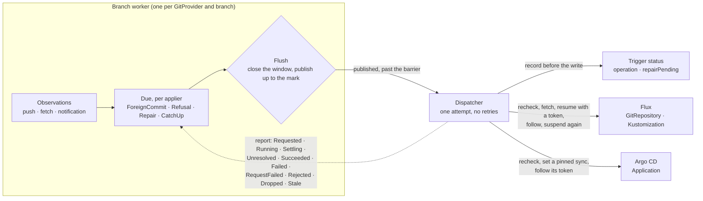

# The apply trigger

> **design**: decided 2026-10-16, extended 2026-10-17, 2026-10-19, 2026-10-20 and 2026-10-23; built:
> the Flux applier (its `Kustomization` held suspended), the Argo CD applier (its automated sync
> held off), the
> trigger kinds that hold them and act only while an eligible `GitTarget` references them, the
> cross-namespace grant for appliers, the push receiver, `onRefusal: Reapply`, the apply window,
> and, since 2026-10-20, flush then apply, the applier's own writes kept out of Git, and `CatchUp`
> as adopt and converge for both appliers. The argument for the 2026-10-20 change is
> [`applier-echoes.md`](applier-echoes.md). The webhook applier is the aim. Index:
> [`../INDEX.md`](../INDEX.md).
> How to use it: [`../bi-directional.md`](../bi-directional.md),
> [`../bi-directional-flux.md`](../bi-directional-flux.md) and
> [`../bi-directional-argocd.md`](../bi-directional-argocd.md).
> Fields: [`../configuration.md`](../configuration.md#who-applies-this-folder-specapplytriggerref).

**GitOps Reverser decides when Git is applied to the cluster, and the applier never applies on its
own.** Flux and Argo CD keep fetching, rendering, applying, pruning and reporting health. A Flux
`Kustomization` is held suspended while it is idle and resumed for each apply; an Argo CD
`Application`'s automated sync is held off. Every apply is one GitOps Reverser started, at a moment
it checked.

This page is why, what we learned building it, and what is still open. "Applier" keeps its meaning
from [`../definitions.md`](../definitions.md): the `Kustomization` or `Application` itself. The
**trigger** (`FluxTrigger`, `ArgoCDTrigger`) is GitOps Reverser's resource that holds one, and a
`GitTarget` names it with `spec.applyTriggerRef`.

## The problem

Two API edits to one field, a few seconds apart, are enough. GitOps Reverser pushes the first
commit. Flux fetches it, the second edit lands, and Flux applies the first commit over it. GitOps
Reverser faithfully mirrors that revert as Flux's commit, Flux applies the second commit, and the
branch ping-pongs until a fetch happens to land on the tip. There was no conflict to decide: both
edits came from the API side. gitops-api hit exactly this in production (two saves, then four
reconciler-authored commits).

The cause is not a bug in either tool. Each apply was correct; it ran at the wrong moment.

## The principle

**An apply is safe only when every live edit is in the commit being applied, or known to the
worker so it can be put back.** Between an edit and its push, the edit is live and absent from Git:
in an open commit window, or in the writes waiting to be pushed. Only the branch worker can see
those. So only it can say when an apply is safe, and every trigger the applier runs by itself fires
without that knowledge.

An apply is started only after a **flush** ([below](#flush-then-apply)): the open commit window is
closed, the writes decided so far are published, and the apply is sent for the tip that
publication produced. An edit decided after that is recorded in the apply window, so an apply that
overwrites it is withheld and repaired. Four reasons make one due:

| Reason | When | Applied by |
| --- | --- | --- |
| `ForeignCommit` | The branch gained a commit GitOps Reverser did not push. The flush replays the pending writes onto it and pushes them first, so the applied commit carries the API side's answer | Every applier on the branch |
| `Refusal` | An edit to a document the folder holds was refused at the write boundary, and the target opted in with `onRefusal: Reapply` and is not suspended. At most one request a minute per target; a refusal inside that minute is carried by a trailing one | The refusing target's applier |
| `Repair` | The apply window withheld a late apply over a newer API edit, so the cluster runs an older value than Git | The applier that wrote it |
| `CatchUp` | Ownership, not safety ([below](#catchup-adopt-and-converge)). An **adopt**: the API created an object in the folder, or a resync added one to Git, and an apply stamps it as the applier's, so a later Git-side delete prunes it. A **converge**: once when the worker starts, and once when a `GitTarget` first names the trigger, unless the applier already applied the tip | The folder's applier for an adopt; for a converge, every applier on the branch at start, and the named one on first naming. Flux and Argo CD alike |

No applier is asked for anything before every initial snapshot of the `GitTarget`s it covers is
published, and a push of GitOps Reverser's own leaves nothing pending: the cluster already runs the
edits it carries.

## What we learned

Each of these changed the design, and each is the reason for a rule the code now follows.

**Filtering webhooks is not enough; every timer is a trigger.** The first ask was to forward only
foreign pushes to the applier. But Argo CD's timed refresh syncs every new tip two to three minutes
after each push, with `selfHeal: false` too, and Flux applies on every interval. Neither can be
filtered from outside, so the applier's own triggers go, and GitOps Reverser makes the requests.

**A long interval is not exclusive control.** The first Flux applier kept the `Kustomization`
unsuspended on a 24h interval and asked it to reconcile. Flux still applied when that interval
fired, when kustomize-controller restarted (from whatever artifact it held, which is why `CatchUp`
was once a safety rule), when a failed apply retried, when the `Kustomization`'s own spec changed,
and on every new artifact of its `GitRepository`, including one another consumer's request fetched.
None of those waits for the worker. The third review called it best-effort coordination, and it
was. A suspended `Kustomization` does none of them, so it is held suspended, and resumed for one
apply at a time ([below](#the-flux-applier-suspended)).

**Flux has no fetch-only mode, unless its consumers are suspended.** A new `GitRepository` artifact
makes every unsuspended `Kustomization` reading it apply at once. A suspended one ignores it
(measured: 0 of 16 runs attempted the new revision). So a source whose every consumer is held can
fetch on every push, and push webhooks can reach it again, through GitOps Reverser's receiver.

**Not every commit GitOps Reverser authors is a no-op to apply.** A replayed `F + W` carries
somebody else's `F`, and a refusal needs an apply to be reverted. So the decision is state on the
worker ("an apply of this applier is due"), set by observations and cleared by an operation that
succeeded. A push notification decides nothing by itself; it is a hint: the worker reads the remote
and judges from that, which gets late, duplicate and rolled-back deliveries right.

**A decision has to hold when the write is sent as well as when it is made.** The first review found
that a request decided once was attempted for minutes against whatever the cluster had become: a
target its `ClusterProvider` no longer admitted still drove the applier, and a source that followed
another branch was still stamped. Every attempt now reads each target again, and the client checks
that the source fetches this repository and branch, and reads the artifact again, just before the
write that starts the apply.

**A retry is a decision too, so only the worker may make one.** The second review found every
remaining problem in the hand-off between the worker's decisions and the deliverer's retries: a
retry skipped the worker's check, outlived a refusal that had recovered, ran for a recreated target,
or waited on another applier's backoff. The fix was structural rather than four patches. The worker
keeps every reason pending until an operation that succeeded answers it. The dispatcher carries out one
attempt and reports back; it never retries, and never asks for something weaker than it was told. A
retry is decided like a first attempt: after a flush, at the tip as it is then.

**An apply is an operation, and its end is observed, never guessed.** The third review found the
apply window closing early in three ways: kustomize-controller writes `lastAttemptedRevision`
before it builds anything (measured: about 0.8 s early per 200 objects); an artifact that held the
commit was taken as applied; and a 5-minute timer reported an apply delivered while it could still
run. Each apply is now one operation with phases, followed until the applier's own status proves it
ended. One past its budget is `Unresolved` and still followed, because a timer that closes the
window does not stop the apply. The operation is recorded on the trigger before the apply can start,
so a restart finds it.

**Four relations, four units.** One branch worker serves many `GitTarget`s, many `GitTarget`s can
name one trigger, and one `GitRepository` can feed many `Kustomization`s. Keeping each concern on
the right unit is what makes the 1:n cases fall out:

| Unit | Owns | Why |
| --- | --- | --- |
| The **branch** (repository and branch), one worker | The flush, and whether Git is ahead (the apply epoch) | A `Kustomization` applies the tip whichever folder an edit is in, so a flush publishes every pending write on the branch. One worker writes a repository branch, through the one `GitProvider` that owns it, so the flush has every unpublished edit in hand, from every namespace |
| The **applier**, held by its trigger | Pending reasons, retries, the operation, the commit it last applied | One operation at a time, its own backoff, one for every `GitTarget` naming the trigger. The trigger's status records it |
| The **source** (cluster and `GitRepository`) | One operation at a time across its appliers | The artifact is shared: another applier's fetch landing between an operation's recheck and its reconcile would apply another commit |
| The **`GitTarget`**, by uid | Configuration, consent, eligibility and its initial snapshots | Consent to a `Refusal` is per target, and a target deleted and recreated under the same name inherits nothing due to the old one. A trigger acts only while an eligible `GitTarget` references it, and its applier is asked for nothing until each `GitTarget` it covers has published its initial snapshots |

## The design, as built

- **Observing.** Every observation of the remote passes one point. The first after a start is a
  baseline: a converge is pending, never a `ForeignCommit`, because an apply on startup would revert
  edits made while the operator was down. A tip the worker pushed leaves nothing pending; any other
  is a `ForeignCommit`. When in doubt it is foreign, which costs one apply of the tip. An applier a
  `GitTarget` names for the first time (per `GitTarget` incarnation, by uid) gets a converge too: a
  commit observed before it was named was pending for nobody, and was taken, so it would otherwise
  not be applied until some later push. The worker lists its `GitTarget`s on every pass, cached, so
  a new name is seen at once. An API create in a folder an applier applies, and an object a resync
  adds to Git, leave an adopt pending ([below](#catchup-adopt-and-converge)).
- **Deciding.** At the end of every wake, an applier is due when it has a reason pending, no
  operation out, shares no source with one that has, and is past its backoff and the
  initial-snapshot barrier. An empty tip asks nothing, and a converge alone of the commit the
  applier last applied asks nothing and is answered. When one is due the worker flushes
  ([below](#flush-then-apply)), and once the writes up to the flush mark are published, each due
  applier gets one attempt, for the tip that publication produced. The attempt carries away what it
  covers; each target in it carries its uid and its own reason. The worker takes the operation's
  token; nothing is on the trigger yet.
- **Attempting.** The dispatcher re-reads each target. It asks only for those that are still the
  same incarnation, still name a trigger that holds this applier on this branch, are still admitted
  by their `ClusterProvider`s (their own, and their trigger's), and for a `Refusal` still consent.
  If no target still holds the request's reason, it asks nothing (`Dropped`). Then the applier's
  kind decides, and both kinds write the operation through to the trigger as `Requested`
  (`StatusWriter.RecordApplyOperation`) just before the write that starts the apply. The record is
  refused, and nothing is started, while the trigger is being deleted or its status holds another
  operation in flight (an external resume the reconciler recorded, or one an earlier process left
  in flight). A recorded attempt that then asks for nothing withdraws its record, which puts back
  what the status held: the trigger never shows an operation nothing could have applied. The
  writer matches operations by their token, never by time. A `FluxTrigger` that is not
  `Held=True` (still adopting, releasing, or being deleted) is not resumed (`RequestFailed`). A source
  on another repository or branch, a `Kustomization` whose `spec.suspend` another manager applies,
  or an `Application` with automated sync on whose switch an `ApplicationSet` or another manager
  owns, is `Rejected`; one whose switch the trigger holds was switched on by somebody, and fails
  (`RequestFailed`) until the trigger has switched it off again. A decision that no longer holds when
  the write is due (the commit is no longer the tip) asks nothing (`Stale`, no failure).
- **Following.** The dispatcher follows the operation and reports each move, so the attempt is out
  for exactly the apply window. Flux: `Running`, `Settling` once suspended again, then `Succeeded`
  or `Failed` ([below](#the-flux-applier-suspended)). Argo CD: the operation state carrying the
  request's token ([below](#the-argo-cd-applier)). One not completed after 5 minutes is
  `Unresolved`: a Flux `Kustomization` is suspended at once, and the operation is followed on, at an
  interval doubling to a minute. The applier object being deleted, or its trigger being deleted,
  completes it as `Failed`; no `GitTarget` naming the trigger anymore abandons it, and a Flux
  `Kustomization` is suspended, and that suspend handled, before it is let go.
- **Settling.** An operation that succeeded is done. A stale attempt gives back what it carried and
  is decided again at once, at the tip as it is then, with no backoff. Any other outcome, a failed
  operation included, gives back what the attempt carried, a refusal only if it still stands, and
  starts that applier's backoff (2s doubling to 5m, at least 15s after a rejection).
  `ApplyRequestFailed` or `ApplyFailed` is recorded for the first failure of a run, and
  `ApplyUnresolved` when an operation becomes `Unresolved`; `apply_operations_unresolved` counts
  those still out, and the trigger is `Ready=False` (`OperationUnresolved`) until its operation
  completes.
- **Learning about pushes.** A push webhook into GitOps Reverser's receiver (seconds), a rejected
  compare-and-swap push (at the next publication), the periodic refresh (minutes), or a Flux
  attempt whose `GitRepository` fetched another commit than the one asked for (`RequestFailed`),
  which is looked at as a push notice is: a hint, never a fact. All of them feed the same
  observation point.

### Flush, then apply

When an apply comes due for any applier, the worker flushes before it sends:

1. **The open commit window is closed**, so its edits become a decided write
   (`git_commit_windows_total{close_reason="apply_due"}`).
2. **The worker takes the flush mark**: the last write decided so far.
3. **From the mark, the due applier records the API edits decided after it**, and its next apply
   window holds them from the start ([below](#the-apply-window)).
4. **The writes up to the mark are published at once**, without waiting for the 5-second push
   cooldown. Writes decided after the mark do not hold the send, so continuous editing cannot
   starve an apply.
5. **The attempt is sent for the tip that publication produced.** It is `Stale` only when that tip
   moved: `ApplyRequest.Current` checks nothing else.

Every edit is therefore published before the send, so the apply includes it, or recorded in the
window, so an apply that overwrites it is withheld and a `Repair` puts it back.

Three states still hold an apply back: a registered `CommitRequest` (a save defines its own commit
boundary, and the apply waits for it), a parent-branch recovery, and a checkout a failed write left
dirty. In the last two the worker cannot say what is published.

A Git-side push usually reaches the worker through the flush itself. Say somebody pushed `B`: the
worker's push is rejected, the fetch finds `B`, a commit the worker did not push (a `ForeignCommit`
is pending), the pending writes' actions are applied onto it, and the push lands `B+1`. The
applier is then asked once, with `ForeignCommit`, for `B+1`, which holds both sides. Applying `B` on
its own first would revert the pending API edits on the cluster and need a second apply to put them
back. A push notice from the Git host (the receiver) still closes an open window, unless a
`CommitRequest` holds it, so its publication finds the move.

The flush covers the whole branch because one worker writes it. Every `GitTarget` writing one
repository branch names the same `GitProvider`, from whichever namespace (`spec.gitProviderRef`,
admitted by the provider's `spec.accessFrom`), so no unpublished edit on the branch is out of the
worker's reach.

### `CatchUp`: adopt and converge

With the flush guarding the cluster, an apply after every push of the worker's own protects
nothing, so such a push leaves nothing pending, and an API edit asks for no apply at all. What is
left is ownership: **an applier prunes only what it applied.** Flux deletes only objects that carry
its owner labels and are in its inventory; Argo CD prunes only objects that carry its tracking
annotation. An apply stamps both. An object the API creates carries neither, so when Git later
deletes its file the applier leaves it on the cluster, and a later resync writes it back.

- **Adopt.** A `CatchUp` is pending for an applier when the worker observes a live create (an
  `ADDED` event) in a folder that applier applies, whose newest managers are not an applier's and
  that no other applier owns ([below](#another-appliers-objects)), and when a resync adds an object
  to Git. It is never skipped as already applied: applying the same commit again is what stamps the
  owner labels or the tracking annotation.
- **Converge.** A `CatchUp` is pending once when the worker starts (its first observation of the
  branch), and once when a `GitTarget` first names the trigger, per `GitTarget` incarnation, by
  uid. The worker keeps, per applier, the commit the last succeeded operation applied, from the
  operation's report and, after a restart, from the trigger's `status.operation`. A converge of that
  commit asks nothing.
- **No apply before every initial snapshot is published.** An applier is asked for nothing, for any
  reason, until every collection of every `GitTarget` it covers has a settled snapshot (applied,
  refused or failed; tracked per collection on the watch side) and the worker has published every
  resync it holds for that `GitTarget`. At startup that is when the edits made while the operator
  was down are in Git; for a `GitTarget` that newly names the trigger, when its folder holds the
  cluster. A `GitTarget` with no planned collection (its `WatchRule` not resolved yet, a CRD not
  discovered) and one whose watch is `Blocked` hold their applier's requests the same way. A reason
  that comes due before stays pending.
- **The folder exists before it is applied.** A resync of a `GitTarget` that names a trigger, into
  a folder the branch does not hold yet, commits the folder's bootstrap files (`README.md`,
  `.gittargetignore`, and `.sops.yaml` with encryption) even when it has no object to write. Argo CD
  retries a sync of a missing path for minutes, and Flux fails it; the bootstrap files are never
  deleted, so the folder outlives its last resource.
- **An empty tip asks nothing.** When the remote does not carry the branch, nothing is sent, and the
  reason stays pending until there is a commit to apply.
- **Batched by itself.** A pending `CatchUp` is one flag, and one attempt per applier is out at a
  time, so a burst of creates is one apply.
- **One reason per target in an attempt**, by precedence: `ForeignCommit`, then `Repair`, then
  `Refusal`, then `CatchUp`. Any succeeded operation applies the tip and answers every pending
  reason.

This reverses two earlier decisions ([2026-10-20, decision 3](#decisions)). An Argo CD
`Application` now gets a `CatchUp`, adopt and converge alike, where it was never asked for one. And
a newly bound `Application` converges once its `GitTarget`'s initial snapshots are published, where
it waited for the next push. A sync on an API create or on binding runs the `Application`'s hooks;
such a sync is rare, and one rule for both appliers is worth it.

## The Flux applier, suspended

### Source facts

Each was read in kustomize-controller **v1.9.6** (`internal/controller/`) and flux2 **@1ed703a3**,
both under `external-sources/flux/`, and each is applied by the fake the tests run against
(`internal/applier/fluxsim`, tested on its own). None should be re-derived.

| Fact | Where | What it gives |
| --- | --- | --- |
| `finalizeStatus` is deferred and copies `reconcile.fluxcd.io/requestedAt` to `status.lastHandledReconcileAt` on **every** return: suspended, failed, dependency not ready, succeeded | `kustomization_controller.go:143`, `:1335–1340` | A token is handled exactly when the reconcile that read it ends, whatever the outcome |
| A suspended object returns right after the finalizer check, before resolving the source | `:189–192` | Suspended means nothing is fetched, built or applied |
| `spec.suspend` is read only when a reconcile starts | `:189` | A suspend does not stop an apply already running (measured too) |
| `lastAttemptedRevision` is written before the build | `:390` | It says nothing about an apply having finished |
| `observedGeneration` is set whenever `Ready` is True at the end, a suspended return with a `Ready` left from the last apply included | `:1345–1348` | No completion signal can be read from it |
| A failed apply requeues after `retryInterval`; a dependency not ready requeues with `Ready=False`, `DependencyNotReady` | `:311`, `:264–268` | Both are outcomes to read; a requeue into a suspended object does nothing |
| A reconcile is enqueued by a new generation **or** a new `requestedAt`; a new source revision enqueues it too | `kustomization_manager.go:139–173` | One write that sets both `suspend` and `requestedAt` enqueues a reconcile that reads both |
| A dependent needs its dependency's `observedGeneration == generation` and `Ready` | `:572`, `:618–624` | A dependency suspended after a failed apply holds its dependents back until it succeeds |
| controller-runtime runs at most one reconcile per object at a time | workqueue contract | A token handled by a later reconcile proves every earlier reconcile of that object has ended |
| `flux resume ks` is a merge patch of `spec.suspend: false`, then a wait on readiness | flux2 `cmd/flux/resume.go:183–245` | A resume is `flux resume` with a token added |

### One operation, every reason

Every reason runs the same operation, because a resume alone applies (measured: it reverted a
drifted object with no new commit):

1. **Make the artifact hold the commit.** When it does not, stamp the `GitRepository` and wait for
   it to handle that token. An artifact that ends on another commit is `Stale` when the decision no
   longer holds, and a failure otherwise: the source cannot fetch what the worker checked.
2. **Recheck just before resuming:** read the `Kustomization` again (the same uid, the same
   `sourceRef`, no other manager applying `spec.suspend`: one replaced or re-pointed during the
   fetch is not resumed), read the artifact again, and ask the decision (`ApplyRequest.Current`).
   This narrows [the residual race](#what-it-costs) as far as it can be narrowed.
3. **Record the operation** on the trigger, written through, as `Requested` with its token, and
   ask the decision once more: the record can wait on the API server, and a decision that went
   stale meanwhile withdraws the record and resumes nothing.
4. **Resume with a token.** One server-side apply under the field manager `gitops-reverser` sets
   `spec.suspend: false` and `requestedAt: <T1>`, carrying the uid and `resourceVersion` of that
   last read as preconditions, so anything that changed the object since is a conflict (read again,
   up to five times) and a deleted one is not re-created. A resume whose answer is lost (a timeout,
   an internal error) may have landed, so it is followed and suspended again as if it had.
5. **Wait for T1 handled.** A token somebody stamped over T1 (`flux reconcile`) stands in for it:
   the reconcile that handles it started after the resume. A handled token does not prove a
   reconcile ran resumed, though: a suspend landing between the resume and the reconcile (a
   `flux suspend`) has the suspended return handle it, leaving the last apply's `Ready`. So the
   outcome also needs proof that a reconcile ran since the resume: `Ready`'s `lastTransitionTime`
   (a real reconcile marks it `Unknown` first) or the top `status.history` entry moved past what the
   resume's apply returned. Then read the outcome:

   | Read after T1 is handled | Outcome |
   | --- | --- |
   | No reconcile ran since the resume | `Failed`, so the worker asks again |
   | `Ready=True`, `lastAppliedRevision` holds the commit | `Succeeded` |
   | `Ready=True`, the revision the `GitRepository` holds now, which is not the commit | `Succeeded`, logged and counted in `apply_revision_mismatches_total` (the residual race: the source moved on) |
   | `Ready=True`, any other revision (kustomize-controller's cached source lagged the artifact checked) | `Failed`, so the worker asks again |
   | `Ready=False`, `DependencyNotReady` | `Failed`, with a reason of its own |
   | `Ready=False`, anything else, or no `Ready` | `Failed` |

6. **Suspend again:** another server-side apply sets `spec.suspend: true` and
   `requestedAt: <T2>` (`Settling`, the token recorded as `suspendToken`). T2 handled proves that any
   reconcile that started before the suspend has ended and the object is suspended now: a suspended
   reconcile handles a token without applying, and reconciles of one object never overlap. Found
   resumed again before T2 is handled, the `Kustomization` is suspended again.
7. **Complete** once T2 is handled, and keep the window open 10 s more.

Every reason that reaches the client runs the operation. The worker decides what needs no apply
before it sends (a converge of the commit the applier last applied, an empty tip), so the client
never answers for it, and an adopt runs even at the tip, because the apply is what stamps the
object. A failed apply is suspended like any other, which is what stops Flux's own `retryInterval`
retry; the worker owns the retry.

An `Unresolved` operation is suspended at once (the suspend does not stop the running apply, but it
stops whatever would follow), and that suspend's token then decides when it completes. There is no
automatic cancellation.

`CatchUp` is ownership rather than safety ([above](#catchup-adopt-and-converge)): a suspended
`Kustomization` never applies a stale artifact, but Flux's inventory learns of an object only from
an apply of a commit that holds it, and an object created through the API and never applied by Flux
would not be pruned when Git later deletes it.

### Who owns `spec.suspend`

- **A trigger acts only while an eligible `GitTarget` references it.** Eligible: in the trigger's
  namespace, not being deleted, naming the trigger, admitted by its `ClusterProvider`s
  (`ApplierAdmitted`), and writing the repository and branch the applier's source fetches. It is
  judged from those inputs alone, never from the `GitTarget`'s `Ready`, which reads the trigger's
  own `Ready` back. A trigger no `GitTarget` names is `Configured=Unknown` and `Ready=True`, both
  `NotReferenced`: it reads and writes nothing in the applier's cluster and is not in line. With
  several naming it, one eligible binds it; none eligible while one cannot be judged yet (its
  `GitProvider` missing, a read failed) is `Configured=Unknown`, `NotBound`, progressing; each
  refused is `Configured=False` with the reason they share, or `NotBound`, stalled. The trigger
  reconciler watches what eligibility reads: `GitTarget`s (before and after an update),
  `GitProvider`s, `ClusterProvider`s and namespace labels. A `GitTarget` reads `ApplyTriggerReady`
  `Unknown` (`NotReferenced`) until the trigger has observed it, since naming a trigger does not
  move its generation.
- **One trigger per applier.** Every trigger suspends under the same field manager, so two holding
  one `Kustomization` would take each other's resume for an external one and release each other's
  hold. Of the triggers of one kind in line for one applier in one cluster, one holds it; the others
  are `Configured=False`, `HeldByAnotherTrigger`, do nothing, and release nothing, and the dispatcher
  drops a request through them. In line: an eligible `GitTarget` references the trigger, or, for a
  `FluxTrigger`, it carries its finalizer (it holds the `Kustomization`, or is handing it back), so
  an older trigger with the wrong repository, or not admitted, keeps no younger one out. First comes
  a `FluxTrigger` with an operation in flight, then one that carries its finalizer, then the oldest
  by `creationTimestamp` (then namespace and name). So a `Kustomization` changes hands only once its
  holder lets go of it, and never mid-apply or mid-release. The dispatcher's check before a resume,
  and the reconciler's suspend of a resumed `Kustomization`, read the triggers uncached. A holder
  that lets go with a trigger in line leaves the `Kustomization` suspended, its suspend handled, for
  it, and the change re-runs the others. The same rule holds for `ArgoCDTrigger`s, which would
  otherwise both start syncs, without the in-flight and finalizer rules: a sync somebody else
  started is never replaced.
- **Adoption.** A `Configured` `FluxTrigger`, so one an eligible `GitTarget` references, puts its
  finalizer in place and then suspends its `Kustomization` with a server-side apply under
  `gitops-reverser`, and a token. A `Normal` `Adopted` Event records it. It is `Held=True`
  (`Suspended`), and `Ready`, once that token is handled, and `Held=True` (`Applying`) while an
  operation of a branch worker is in flight and followed. A trigger that never adopted has no
  finalizer, and deletes at once.
- **The manifest omits `suspend`.** Whatever applies the `Kustomization` object (a parent
  `Kustomization`, Helm, flux-operator) must not set the field, or it takes it back on its next
  apply. A `managedFields` entry of another manager with operation `Apply` owning
  `f:spec.f:suspend` is `Configured=False`, `SuspendOwnedElsewhere`, naming the manager, and
  nothing is held. An `Update` entry (`flux resume`, `flux suspend`, `kubectl edit`) wrote the field
  once, and the next forced apply takes it back.
- **Resumed by someone else.** The reconciler finds the `Kustomization` resumed with no operation of
  a branch worker in flight (read uncached, since the worker records its operation a moment before
  it resumes). It suspends it with a token, records a `Normal` `ResumedElsewhere` Event, and records
  the apply as an `Unresolved` operation with that suspend token and no request token, which it
  completes once the suspend is handled. It does this every time, with an Event each time: there is no
  step-back state. A `FluxTrigger` that is `Ready` reads its `Kustomization` every minute, which
  bounds how long such a resume runs unsuspended. The reconciler reads the operation before and
  after the `Kustomization`, so an operation that completes between the two reads is no external
  resume.
- **An operation nobody follows.** The reconciler leaves a branch worker's operation in flight
  alone only while this process's dispatcher follows it (`Following`), or for a minute after it
  first saw it unfollowed, so restart recovery gets its chance. After that it suspends the
  `Kustomization` with a token, sends a `Warning` `OperationUnfollowed` Event, and completes the
  operation `Failed` once the suspend is handled. A resumed `Kustomization` is never left with
  nothing watching it.
- **Hand-back.** The trigger carries the finalizer `configbutler.ai/flux-trigger` from before its
  first adoption write until it has handed the `Kustomization` back or over, also while its
  configuration is invalid (then `Held=Unknown`, `NotConfigured`, and the message says the
  `Kustomization` is left suspended under `gitops-reverser`). It hands it back when it is deleted,
  and when no eligible `GitTarget` references it anymore, conclusively: a reference that cannot be
  judged yet keeps the hold, since a release is not undone. Until the hand-back is done the trigger
  is `Held=False`, `Releasing`, and stays the holder in line. It suspends the `Kustomization` with a
  token if an apply has it resumed, waits until that is handled, then releases `spec.suspend` with
  an empty apply, so Flux owns it again (`Released`). An operation still recorded in flight that
  this process does not follow then completes as `Failed`. A reference that returns before the
  release is done holds the `Kustomization` again; one that returns after adopts it anew. Deleting
  or re-creating a `GitTarget` therefore hands it back, and Flux applies the tip at once: what Flux
  does without GitOps Reverser, accepted because with no `GitTarget` nobody carries live edits to
  Git anyway. With another trigger in line that can take it over (`Configured=True`, or `False`
  only for `HeldByAnotherTrigger`), it is not released but left suspended for that one: released, Flux would
  apply it at once, unchecked against the branch, before the next trigger suspended it. On a real
  API server our forced apply over a `flux suspend` *shares* `spec.suspend` with that `Update`
  entry, so an empty apply alone would leave it `true`: the release first takes the field with a
  forced `suspend: false`. A manager that *applies* the field keeps it, and `Released` names it. An
  operation whose trigger is being deleted completes as `Failed` and writes nothing more to the
  `Kustomization`; the dispatcher reads the trigger uncached before every step that may suspend. A
  `Kustomization` that is gone lets the trigger go. A `ClusterProvider` that is gone does not end the
  hand-back: it goes on through whatever client still reaches the cluster, which for a provider
  without `kubeConfig` is the operator's own. A cluster no client reaches anymore, a suspend or
  release the identity may not make, or a hand-back still unfinished 10 minutes after `Held` turned
  `Releasing` (each a `Warning` `ReleaseFailed` Event, which says where the `Kustomization` was left)
  lets the trigger go.

### Restart recovery

The worker reads its triggers' `status.operation` before the loop handles its first item, so no
live event is mirrored before the windows of what it finds are open:

- **An operation not completed** is followed to its end by its recorded tokens, asking the applier
  for nothing (`ApplyRequest.Recovered`), with its apply window open from the recovery. For Flux,
  the follow suspends the `Kustomization` again. A recorded token that was stamped over (by our own
  suspend before the crash, or a `flux reconcile`) is judged on whether a reconcile ran since the
  operation's `requestedAt`. A recorded request arriving before the dispatcher starts waits for it.
  A recorded token that is nowhere on the `Kustomization` (neither its `requestedAt` nor the last
  handled) means the process stopped between the record and the resume, or a suspend it never
  reported followed: the `Kustomization` is suspended, and the operation ends `Failed`.
- **`repairPending`** is restored.
- A worker's own record is read back once, when this process first lists the trigger; later reads
  can lag its own writes. A record with no request token (an external resume the reconciler
  suspended) is followed whenever it is listed, once per suspend token, so its window opens while the
  process runs too.

The first observation is still a baseline that leaves a converge pending, so a recovered operation
decides nothing about which apply is due. The commit each applier last applied is read back from its
trigger's `status.operation`, so that converge asks nothing of an applier already at the tip.

### Shared sources

- The trigger lists the consumers of its `GitRepository` in the applier's cluster:
  `Kustomization`s with that `sourceRef`, and `HelmRelease`s whose chart comes from it, directly or
  through a `HelmChart` their `chartRef` names (at whichever `HelmRelease` version the cluster
  serves; a listing that fails is logged and publishes nothing). Those no `FluxTrigger` on the same
  `ClusterProvider` holds, that is reports `Held=True`, are `status.source.otherConsumers`,
  information only: it never affects `Ready`, and no `Warning` is sent, because one `GitRepository`
  for `apps` and `infra` is a normal setup. Each of them applies a new artifact the moment it
  arrives.
- Appliers that share a source have one operation at a time, and take turns: the one whose last
  turn is oldest goes first, so a busy applier cannot starve another. One worker writes the branch,
  so every applier of a source is its own.
- The source is stamped only inside an operation, to make its artifact hold the commit (step 1
  [above](#one-operation-every-reason)). Nothing fetches a push into a shared `GitRepository` ahead
  of the apply: that prefetch overlapped the wait for a quiet branch, which is gone, and a flush
  leaves it nothing to shorten. `status.source.prefetch` went with it.

### What the measurement found

Measured on the e2e cluster (Flux v2.9.6, kustomize-controller and source-controller v1.9.6) with a
throwaway Gitea repository, 1 and 200 ConfigMaps, polling through `kubectl proxy` (±30 ms). The
"request" columns are the client this design replaced, which left the `Kustomization` unsuspended
and stamped its `requestedAt`; the "suspended" columns are the lifecycle above:

| Median, ms from the first Flux write | 1 object, request | 1 object, suspended | 200 objects, request | 200 objects, suspended |
| --- | ---: | ---: | ---: | ---: |
| Source artifact holds the commit | 60 | 58 | 122 | 111 |
| Applied (`lastAppliedRevision`, `Ready`) | 149 | 58 + 115 | 928 | 111 + 852 |
| Suspend write | – | 10 | – | 12 |
| **Total** | **149** | **193** | **928** | **980** |

The suspended lifecycle costs a fixed ~50 ms per apply, one serialized round trip, at any payload
size; build and apply dominate either way. The same runs found the behaviors the lifecycle is
built around: a suspended consumer ignores new artifacts; suspend does not stop a running apply; a
`requestedAt` on a suspended object is handled without an apply (which made the request-based
client report a `Refusal` done with nothing reverted); a resume alone applies; and a resume applies
whatever the artifact holds then.

### Decisions

Taken 2026-10-17:

1. **Suspension is the only Flux mode,** as automated sync off is the only Argo CD mode. A second,
   request-based mode would keep every hole of the 24h setup alive, and two completion protocols.
2. **A shared source is information only:** `status.source.otherConsumers`, no `SharedSource`
   condition. It also held the prefetch off while it was not empty; the prefetch is removed
   (2026-10-20, decision 7).
3. **An external resume is always suspended again,** with a `Normal` Event each time.
4. **`CatchUp` stays for Flux,** as convergence. The same inventory question exists for Argo CD,
   which was decided without `CatchUp`. Reversed 2026-10-20 (decision 3): Argo CD catches up too.
5. **The resources are triggers,** with long kind names: `FluxTrigger` (`spec.kustomizationRef`)
   and `ArgoCDTrigger` (`spec.applicationRef`), named by `GitTarget.spec.applyTriggerRef` in the
   same namespace. Each is its own kind because suspension needs one owner object with a finalizer,
   the operation and `repairPending` need a durable status, and a typed kind per applier needs no
   union of references with CEL rules to keep them apart. The references are immutable: a re-pointed
   trigger would leave the old applier held by nothing.

Taken 2026-10-19, after the seventh review:

1. **A trigger acts only while an eligible `GitTarget` references it** ([above](#who-owns-specsuspend)).
   An idle trigger is `Ready=True` (`NotReferenced`): `Ready=False` would read as in progress to a
   Flux health check, which falls back to `Ready`, and deadlock the `Kustomization` that creates
   the `GitTarget` behind the one that creates the trigger. Deleting or re-creating a `GitTarget`
   hands the `Kustomization` back, and Flux applies the tip at once; accepted.
2. **Cross-namespace appliers are a `ClusterProvider` grant,** `allowCrossNamespace.appliers`,
   beside `allowCrossNamespace.sources`, which replaces `allowAnySourceNamespace`. The binding
   compares URLs and proves no write access, so naming another namespace's `Kustomization` is a
   power to delegate, not a consequence of being able to write the repository. Consent on the
   applier itself (`ReferenceGrant` style) stays a possible follow-up.
3. **`allowAnySourceNamespace` is removed, not migrated.** It is never read, and kept in the schema
   only so a rule on `spec` refuses `true` on any spec change.
4. **The trigger's status speaks from its own side:** `Held` with `Suspended`, `Applying`,
   `Suspending`, `Releasing`, `NotReferenced`, `NotConfigured`; "fence" is retired for "suspend".
   The operation phases keep `Running` and `Settling`.
5. **A holder keeps its `Kustomization` until it lets go:** a trigger that carries its finalizer
   ranks before older ones in line, so one that becomes eligible later never displaces a holder
   mid-release.
6. **A newly bound `Application` waits for the next push.** A first sync on binding would run its
   hooks for a commit it may already have, which is why an `Application` gets no `CatchUp`.
   Reversed 2026-10-20 (decision 3): it converges on first naming.

Taken 2026-10-20, with [`applier-echoes.md`](applier-echoes.md), which carries the argument:

1. **Flush, then apply** ([above](#flush-then-apply)). No apply waits for a quiet branch: the flush
   publishes what is pending, and the apply goes.
2. **The applier's own write in its apply window is not mirrored** ([below](#the-apply-window)).
3. **`CatchUp` only adopts and converges, decided in the branch worker, the same for Flux and Argo
   CD** ([above](#catchup-adopt-and-converge)). This reverses decision 4 of 2026-10-17, so an
   Argo CD `Application` now catches up, and decision 6 of 2026-10-19, so a newly bound
   `Application` converges on first naming instead of waiting for the next push. A push of the
   worker's own leaves nothing pending, and `FluxTrigger` `spec.quietPeriod` is removed from the
   API.
4. **No apply before every initial snapshot is published**, for any reason.
5. **A resync never decides from a snapshot collected while Git was ahead, or across an apply**
   ([below](#resyncs-while-git-is-ahead)). A `GitTarget`'s snapshots are held off for at most 5
   minutes.
6. **An object another applier owns is not mirrored into a triggered folder**
   ([below](#another-appliers-objects)).
7. **The prefetch is removed**, with `status.source.prefetch`: it overlapped the quiet-branch wait,
   and does not shorten the flush.
8. **The worker decides what needs no apply, and never sends an empty commit**, so the clients'
   `Current` outcome is gone.

Taken 2026-10-23:

1. **An `ArgoCDTrigger` holds automated sync off, as a `FluxTrigger` holds `spec.suspend`**
   ([below](#the-argo-cd-applier)). It owns `spec.syncPolicy.automated.enabled: false` by
   server-side apply, switches it off again when somebody switches it on, and hands it back. Only
   checking it left an `Application` switched on silently uncoordinated while its `GitTarget` still
   named a trigger; nothing recorded why Argo CD had been left to the user.
2. **A switch somebody else owns is never written**: an `Application` an `ApplicationSet`
   generated (`OwnedByApplicationSet`), or a switch another field manager applies
   (`AutomatedSyncOwnedElsewhere`). Two owners would fight over it. It is refused only while
   automated sync is on, so an `ApplicationSet` whose template keeps it off is supported. Binding
   the `ApplicationSet` itself is parked.

## The apply window

**An apply is asynchronous, and that leaves a window.** An API edit that lands while an apply runs,
to a field the applier sets, is reverted by the apply, because the commit it applies does not hold
the edit yet. Making the request synchronous would not help: waiting for the apply does not stop a
user from editing during it, and refusing edits would halt the API for everyone to protect a few
seconds.

The flush confines the window to what it cannot avoid ([above](#flush-then-apply)): every edit is
either published before the attempt is sent, so the apply includes it, or recorded in the window
from the flush mark. Inside it, **the API wins**, as it does for any object both sides changed:

- **The window is known.** It opens when the attempt is sent and stays open until its operation
  completed: for Flux, the resume's token and the suspend after it handled; for Argo CD, the operation
  state carrying the request's token completed. An `Unresolved` operation keeps it open until it
  completes. Then the worker keeps it open 10 seconds more, because the applier's writes reach it
  through the watch. An attempt sent within those 10 seconds carries the edits seen in the window
  before it, and that window's end, so a late write of the earlier apply is still withheld, and an
  attempt that asked for nothing does not end the earlier grace. A write of the new apply to an
  object edited during the earlier one is then withheld too, since the managers cannot tell the two
  applies apart: that costs one redundant `Repair`, never an edit.
- **Edits are recorded from the flush mark.** An edit decided after the mark is not in the commit
  the attempt applies, so the due applier records it before the attempt is sent, and the window the
  attempt opens holds it from the start.
- **The apply itself is not mirrored.** A write whose newest `managedFields` entries are the
  applier's own managers alone (`kustomize-controller`; `argocd-controller` or
  `argocd-application-controller`), written at or after the earliest send of every window still
  open or carried, to an object nobody edited in the window, is the apply landing: its content is
  the commit's, which Git already holds. It is not mirrored, makes nothing due, and is counted in
  `apply_echoes_total{outcome="not_mirrored"}`. Mirrored, it would become a pending write planned
  from the live object, and a replay of that write onto a newer tip would revert that tip's change
  to the object. The bound is the earliest send of every window still open or carried, so a
  delayed echo of one attempt, arriving after the next was sent and inside the first one's grace,
  is still that apply. When a window closes or is replaced, one line is logged,
  `Observed the applier's apply`, with the commit and the number of objects kept out.
- **The late apply is withheld.** A write by the applier's managers alone, newer than the API edit,
  inside the window, to an object in the applier's folders that the API side edited in the window,
  is not mirrored. Git keeps the edit, and the withheld write makes a `Repair` due to its applier:
  an apply of the tip after the next flush, for Flux and Argo CD alike. The cluster runs the
  reverted value until then, and the trigger shows `repairPending`. An edit carried from the window
  before guards only against an applier write made before this attempt was sent: one attempt is out
  at a time, so a write since is this attempt's own apply, of a commit holding every edit published
  before it.
- **Only proof withholds.** `managedFields` times resolve to the second. When the applier ties
  with another manager, the write could be the edit itself, and withholding an edit loses it
  outright; it is mirrored as before. It is also remembered as an edit, even as the first write in
  the window, so the applier's write alone a second later is still withheld. An applier entry alone
  in the same second as the edit is withheld: the edit arrived first, in `resourceVersion` order, so
  it was written first, and only an undo in that second is lost. One older than the edit is no write of the
  applier's at all: an update that removes every field a manager owns deletes that manager's entry,
  so undoing an edit (`kubectl label cm/x tmp-` after `tmp=1`) can leave the applier's entry from an
  earlier apply as the newest. A late apply moves the applier's entry forward, so an older one is
  the API's undo, mirrored as an edit. For the same reason an applier entry older than the earliest
  send, on an object nobody edited in the window, is an edit and is mirrored. A DELETE carries
  nothing about its deleter: it is always an edit, which a pending write drops only when it changes
  nothing in Git.
- **With no window open, the applier's write is late.** The applier's managers alone on an object
  with no window open are mirrored as an edit and counted in `apply_echoes_total{outcome="late"}`:
  an echo that arrived after the grace, or an apply somebody else started.

Every collision is logged with the object, the applier and the requested commit, and counted in
`apply_window_collisions_total` (`withheld` or `ambiguous`). What remains: an edit reverted on the
cluster until the repair, an ambiguous tie mirrored as the applier's commit, and an applier's write
that reaches the watch more than 10 seconds after its operation completed, mirrored and counted as
`late`.

## Resyncs while Git is ahead

**A resync never decides from a snapshot collected while Git was ahead of the cluster, or across an
apply.** A resync mirrors a snapshot of live state. While a commit is pushed and not yet applied, a
snapshot holds the old state of every object that commit changes, and one whose collection overlaps
an apply holds a mix. Decided, either reverts the push.

- **Git is ahead** while an applier on the branch has a `ForeignCommit`, `Repair` or `Refusal`
  pending, a converge it may be asked for (past the initial-snapshot barrier), or an attempt out.
  An adopt does not count: it applies objects the cluster already runs.
- **The apply epoch** is a counter on the worker, raised at every send of an attempt and at every
  end of one.
- **The watch side reads both when a snapshot's collection starts**, just before the watch that
  delivers its initial events opens, or before the LIST fallback. The resync request carries them.
- **The worker discards** a snapshot collected while Git was ahead, across an epoch change, or
  arriving while Git is ahead, and one whose own pre-resync fetch finds a commit the worker did not
  push. A discarded snapshot is answered as discarded, which is no failure and is not counted as a
  failed background resync. Once Git is no longer ahead, the worker asks the watch plane to
  re-anchor that `GitTarget`'s watches (the forced recheck a refused Git path uses), which collects
  a fresh snapshot after the apply. Until it lands, the `GitTarget`'s render-fidelity scope stays
  pending: the render-fidelity gate holds its live writes back, and the fresh snapshot recovers
  them.
- **What never waits.** A branch with no trigger, because nothing applies its commits. A
  `GitTarget`'s initial snapshots, the first of each collection it watches until one of it settles
  (applied, refused or failed): they are the startup baseline, and no applier is asked for anything
  before they are in Git, so holding them for an apply would wait on itself. And a `GitTarget`
  whose snapshots have been held for 5 minutes from the first discard: a fresh snapshot is asked
  for then and used, logged and counted, because an apply that keeps failing must not leave drift
  unmirrored for as long as it fails. The "API wins" rule then applies to what the
  unapplied commit changed.
- **Per worker.** Whether Git is ahead, and the epoch, are the branch worker's, and one worker
  writes the branch.

`stale_snapshots_total` counts each stale snapshot as `discarded`, or `used` when the 5-minute
bound let it through.

## Another applier's objects

**A folder a trigger applies belongs to that trigger's applier.** An object another applier applies
(another `Kustomization`, another `Application`), mirrored into the folder, would be applied by this
applier too, and two appliers applying one object fight each other.

- The watch side reads the owner from the raw object, before sanitize strips it: Flux's owner labels
  `kustomize.toolkit.fluxcd.io/name` and `/namespace` (a `Kustomization`), else Argo CD's tracking
  annotation `argocd.argoproj.io/tracking-id` (`<app>:<group>/<kind>:<namespace>/<name>`, where
  `<app>` is `<namespace>_<name>` for an `Application` outside Argo CD's own namespace). It stamps
  the owner on live events and on snapshot entries.
- The worker compares it with the applier of the event's `GitTarget`'s trigger. An object owned by
  another applier is excluded: a live event is not mirrored, and a snapshot entry is neither
  upserted nor treated as missing, so the sweep leaves its document alone, under
  `prune.mode: Always` too.
- An object owned by nobody, or by the folder's own applier, is mirrored as before. A folder with no
  trigger excludes nothing: mirroring another applier's objects one way is what such a folder can
  exist for.
- Each excluded object is logged once and counted in `apply_ownership_conflicts_total`, so the
  misconfiguration is seen.

## The Argo CD applier

**GitOps Reverser takes full control of when Argo CD syncs.** The `ArgoCDTrigger` holds its
`Application`'s automated sync off: it owns `syncPolicy.automated.enabled: false` with a
server-side apply under `gitops-reverser`, touching nothing else of `automated`, switches it off
again when somebody switches it on (`AutomatedSyncSwitchedOn`), and on hand-back gives the switch
up, which leaves the `Application` as its own spec says (measured in envtest:
[`argocdtrigger_apiserver_test.go`](../../internal/controller/argocdtrigger_apiserver_test.go)). So
its timed refresh and its webhook only compare, and every sync it runs is one GitOps Reverser asked
for, pinned to a commit the branch worker checked. A switch an `ApplicationSet` or another field
manager owns is never written, only checked: such an `Application` with automated sync on is
`Configured=False` (`OwnedByApplicationSet`, `AutomatedSyncOwnedElsewhere`) and is never synced
([decisions of 2026-10-23](#decisions)). The user guide is
[`../bi-directional-argocd.md`](../bi-directional-argocd.md).

Automated sync off is Argo CD's equivalent of a suspended `Kustomization`, and it needs no suspend
after an apply: an Argo CD operation that has completed is not followed by another one nobody
started. **It gets every reason, `CatchUp` included,** by the same rules as Flux
([above](#catchup-adopt-and-converge)): Argo CD prunes only objects that carry its tracking
annotation, and a sync is what stamps it on an object the API created. An `Application` a
`GitTarget` names for the first time converges once that `GitTarget`'s initial snapshots are
published, unless it already synced the tip, so a sync on binding runs its hooks. Both reverse
earlier decisions ([2026-10-20, decision 3](#decisions)).

Every rule the client relies on is Argo CD's own, read from its source (3.5.0):

| Fact | Consequence |
| --- | --- |
| Automated sync is on when `syncPolicy.automated` is present and its `enabled` is unset or true (`IsAutomatedSyncEnabled`) | The trigger's off switch is exactly this rule; `automated: {enabled: false, prune: …}` is the off switch that keeps prune |
| The `ApplicationSet` controller is the controller `ownerReference` of each `Application` it generates, and replaces its whole spec with the rendered template on every reconcile (`createOrUpdateInCluster`) | The switch of a generated `Application` is the template's: never written, only checked |
| Automated sync builds `Operation{Sync{Revision, Prune: automated.prune, SyncOptions, Source}, InitiatedBy{Automated: true}, Retry: syncPolicy.retry or {Limit: 5}}` (`autoSync`) | A request builds the same, with `Revision` pinned to the checked commit |
| A sync starts by setting `operation`, never while one is set, in an update that also clears `status.operationState` (`SetAppOperation`; the CRD has no status subresource) | A request updates the whole `Application`, guarded by the `resourceVersion` it read, and waits out a running operation instead of replacing it |
| `NewOperationState` copies the operation, its `info` included, into `status.operationState`, and `operation` is cleared only once the operation completed | An update whose answer was lost, or one recovered after a restart, is followed by its token: in `operation` or `status.operationState` it landed. Neither means it was not made yet. The update carries the `resourceVersion` it was made from, so GitOps Reverser then writes the `Application` at the version it read, asking for a refresh (`argocd.argoproj.io/refresh`, which only compares). Once that write is made the update can never land, and the operation is `Failed` and asked again; a conflict means read again. No API-server deadline is assumed |
| The controller clears `operation` when the operation completes and leaves the result in `status.operationState`; a failed operation that will be retried is `Running` again, with a `finishedAt` | An operation completes when the operation state carrying its token has completed (`Succeeded`, `Failed`, `Error`); a pending retry is still running |
| The controller processes an operation only while `operation` is set (`processAppRefreshQueueItem`), so one whose `operation` somebody removed (the workaround for a stuck hook) stays `Running` for good | Our sync in that shape is `Failed` once `Unresolved`, when any controller pass in flight has written; a request finds such a state, unchanged across its whole wait, no operation in progress, and syncs over it |
| A retry with `retry.refresh: true` drops the operation's revision and syncs the newest one | That one field is dropped from the copied retry: a retry stays pinned |
| Every apply writes as field manager `argocd-controller`, client-side and server-side alike; a `Replace=true` sync creates and replaces with no field manager, so the API server takes it from the user agent, `argocd-application-controller` | The apply window knows both as Argo CD's managers |
| Sync windows are checked for every operation, by `InitiatedBy.Automated`, and a blocked operation stays `Running` until the window opens (`syncWindowPreventsSync`, `CanSync`) | A sync GitOps Reverser starts obeys the project's windows for automated syncs, and a blocked one runs later, still pinned: by then it can be older than the tip. The guide forbids sync windows on a held `Application`; `Configured` does not check them yet |
| Hooks default to `BeforeHookCreation`: each sync deletes and recreates the hook's object (`DeletePolicies`) | A `WatchRule` covering a hook's kind mirrors that delete and create on every sync; the guide keeps hook kinds out of them |

Three choices were decided (2026-10-17):

1. **Prune** comes from `syncPolicy.automated.prune` when `automated` is present with
   `enabled: false`. Without the block, a sync does not prune, and the guide says so. There is no
   `prune` field on the trigger.
2. **The initiator** is `InitiatedBy{Username: "gitops-reverser", Automated: true}`. GitOps Reverser
   replaces automated sync, so a sync window that blocks automated syncs blocks its syncs too.
3. **Hooks run on every sync**, so on every `ForeignCommit`, which asks every applier on the
   branch, and, since 2026-10-20, on every adopt and converge. Narrowing it by changed paths waits
   for a measured complaint.

A hub Argo CD keeps `Application`s in a management cluster: the trigger's `spec.clusterProviderRef`
reaches it as it reaches a Flux in another cluster. Out of scope: multi-source `Application`s (and
`sourceHydrator`), which are `UnsupportedSource`; a trigger on an `ApplicationSet` itself (its
generated `Application`s are supported while the template keeps automated sync off); and Argo CD's
own sharding and HA.

## The aim beyond Flux and Argo CD

**A webhook applier** for any other tool: a third trigger kind that POSTs `{"repository", "branch",
"commit", "reason"}`, signed `X-Signature: sha256=<hex HMAC>` the way Flux's `generic-hmac`
`Receiver` checks. It gets every reason, `CatchUp` included, as Flux and Argo CD do. No in-process
plugin: it would run with every credential the operator holds.

## What it costs

- **While GitOps Reverser is down, a `Kustomization` waits suspended.** A Git-side push waits until
  it is back, or for a manual `flux resume` or sync (after which GitOps Reverser suspends the
  `Kustomization` again on start). This is the price of exclusivity, and the same trade Argo CD with
  automated sync off makes. Bi-directional editing already stops in that state. A graceful stop
  (`helm upgrade`, a node drain) suspends a `Kustomization` it had resumed for an apply, once and
  without waiting for it to be handled (the dispatcher's `suspendOnStop`), and the next process
  recovers that suspend as one of its own it did not report. After a crash, the apply that was
  running finishes and the next process suspends the `Kustomization`; until then Flux may apply on
  its own. The narrowing is a mitigation, not a guarantee: a crash, a suspend that fails, or an
  apply already running leave a gap.
- **Flux tooling shows `Suspended`.** `flux get ks` reports it, and `flux reconcile ks` does nothing.
- **A dependency that failed stays behind.** A `Kustomization` suspended after a failed apply keeps
  its generation unapplied, and its dependents wait until GitOps Reverser's retry succeeds.
- **The `Kustomization`'s manifest must omit `suspend`.** This is checked, not just documented.
- **The residual race.** Between the artifact recheck and the reconcile reading the artifact,
  somebody can stamp the `GitRepository`. GitOps Reverser stamps a source only inside an operation,
  one operation per source at a time, so that is a person or the source's own interval. The outcome
  table catches it, and the apply window still withholds a late write over a newer edit.
- **One replica.** The receiver, the branch workers and the dispatcher run in one pod, and the chart
  refuses more than one replica. Leader election is not switched on; more than one replica needs
  ownership coordination first, and deliveries routed to the pod that owns the branch.
- **An apply holds its applier while it runs.** `wait: true`, health checks and a timeout lengthen
  it, which is the point: nothing is stacked on an apply still running. One that never ends holds
  its applier, which `apply_operations_unresolved` and an `ApplyUnresolved` Event show.
- **Every applier on the branch applies on a `ForeignCommit`**, whether or not the push touched its
  folder. Harmless for Flux; for Argo CD it runs hooks. Narrowing it needs the applier's own source
  paths, so it waits for a measured complaint.
- **An Argo CD `Application` also syncs, hooks included, to adopt and to converge**: on an API
  create in its folder, once when the operator starts unless it already synced the tip, and when a
  `GitTarget` first names its trigger.
- **A sync somebody else started holds an Argo CD request**, for up to 5 minutes, and then fails
  it; the worker asks again after its backoff.
- **A trigger may hold any applier its `ClusterProvider` reaches**, with
  `allowCrossNamespace.appliers`: every namespace the provider admits may suspend and apply a
  `Kustomization`, or sync an `Application`, in another namespace whose source is the repository its
  `GitProvider` names. Nothing proves the namespace owns it or may write to that repository.

## Where this goes next

What gitops-api, the first adopter, needs before it can drop its own gate is built: the hardened
receiver, the apply window, the Argo CD applier with automated sync off, and the Flux applier held
suspended. Next, in order, each one pull request:

1. **The webhook applier**, as a third trigger kind.
2. **More than one replica.** Leader election is not switched on, and the chart runs one replica.
   Standbys need ownership coordination first
   ([the HA plan](../future/ha-gittarget-distribution-plan.md)), and deliveries then need routing to
   the pod that owns the branch.

Test gaps to close along the way: a remote source cluster and an applier in another cluster (a hub
Argo CD among them) in e2e, `Forbidden` against real RBAC, the receiver and applier roles installed
by the Helm chart, two `GitTarget`s sharing one `Kustomization` in e2e, an apply-window collision in
e2e, a `Replace=true` Argo CD sync's field manager measured rather
than read from the source, and `-race` in CI.

**What adopting it changes for gitops-api.** Its gate shrinks to "one save, one window", which
protects commit messages and has nothing to do with Flux. Its push handler relays each push to the
`GitProvider`'s receiver instead of stamping Flux. And GitOps Reverser's own commits ask for no
apply, since the cluster already runs the edits they carry; an object created through the API is
adopted by one apply.

## What proves it

| Claim | Test |
| --- | --- |
| The decision: the baseline, the reasons, a `ForeignCommit` asking every applier and answering everything else pending, nothing sent while no flush can be made, a push notice closing the window | [`apply_trigger_test.go`](../../internal/git/apply_trigger_test.go) |
| `CatchUp`: the startup converge asks nothing of an applier at the tip, an API create is adopted even at the tip, a first naming converges once, nothing is asked before the initial snapshots are published, an empty tip asks nothing | [`apply_catchup_test.go`](../../internal/git/apply_catchup_test.go) |
| A snapshot collected across an apply, or arriving while Git is ahead, is discarded; initial snapshots are exempt; a branch with no trigger never waits; snapshots are held no longer than the limit | [`apply_epoch_test.go`](../../internal/git/apply_epoch_test.go) |
| Another applier's object is not mirrored from a live write, and a snapshot of it is neither upserted nor swept | [`apply_ownership_test.go`](../../internal/git/apply_ownership_test.go) |
| Retries are decided by the worker; recovered refusals, withdrawn consent and recreated targets are not retried; each applier keeps its own clock; one attempt for a shared applier; a stale attempt is decided again without backoff | [`apply_attempt_test.go`](../../internal/git/apply_attempt_test.go) |
| The operation is recorded before the write that starts it, moves through its phases on the trigger's status, an attempt that asked nothing restores the record before it, and a withheld rollback makes a `Repair` due | [`apply_operation_test.go`](../../internal/git/apply_operation_test.go), [`status_writer_test.go`](../../internal/applier/status_writer_test.go) |
| Every attempt rechecks targets, asks for nothing weaker than it was told, and resumes no `Kustomization` on another branch; a stop mid-apply suspends the `Kustomization` | [`dispatcher_test.go`](../../internal/applier/dispatcher_test.go), [`flux_test.go`](../../internal/applier/flux_test.go) |
| The suspended lifecycle against the source facts: an apply is not finished when attempted; a token handled while suspended is no apply; a resume alone reverts a refusal; a suspend does not stop a running apply; the artifact is rechecked before the resume; a failed apply is suspended and Flux's requeue applies nothing; a shared source applies only the consumer asked | [`flux_lifecycle_test.go`](../../internal/applier/flux_lifecycle_test.go), [`flux_consumers_test.go`](../../internal/applier/flux_consumers_test.go), [`fluxsim`](../../internal/applier/fluxsim/fluxsim_test.go) |
| Adoption, `SuspendOwnedElsewhere`, an external resume suspended again with an Event every time, the hand-back on deletion (a `ClusterProvider` gone included), and the source's other consumers | [`fluxtrigger_hold_test.go`](../../internal/controller/fluxtrigger_hold_test.go) |
| The rule: a trigger nothing names reads nothing and is `Ready`; the first eligible reference adopts and the last releases, suspending an apply in flight first; a reference returning mid-release holds again; a re-created `GitTarget` releases and re-adopts; the binding over several `GitTarget`s; an older trigger not in line keeps none out, and a retiring holder stays first until its release is done; a holder left unconfigured says the `Kustomization` is suspended; `ApplierNamespaceNotAllowed` for both kinds | [`applytrigger_rule_test.go`](../../internal/controller/applytrigger_rule_test.go) |
| `allowAnySourceNamespace: true` is refused on create and on any spec change, a stored one included; `false` and its removal are accepted; a `WatchRule` that relied on it is refused naming the new field | `removed_allow_any_source_namespace_test.go` (removed with `ClusterProvider`), [`watchrule_source_namespace_test.go`](../../internal/controller/watchrule_source_namespace_test.go) |
| A restarted worker follows an operation left in flight with its window open, restores `repairPending`, and follows an apply started elsewhere; one recorded but never resumed ends `Failed` | [`apply_recovery_test.go`](../../internal/git/apply_recovery_test.go), [`dispatcher_test.go`](../../internal/applier/dispatcher_test.go) |
| Appliers sharing a source have one operation at a time and take turns, across workers too; a shared source applies only the consumer asked | [`apply_groups_test.go`](../../internal/git/apply_groups_test.go), [`flux_consumers_test.go`](../../internal/applier/flux_consumers_test.go) |
| An applier in another cluster is reached through its own `ClusterProvider`, behind that provider's `accessFrom` | [`dispatcher_test.go`](../../internal/applier/dispatcher_test.go), [`kubeprovider_admission_test.go`](../../internal/authz/kubeprovider_admission_test.go), [`applytrigger_controller_test.go`](../../internal/controller/applytrigger_controller_test.go) |
| The applier's late write over a newer edit is withheld, and nothing that could be the edit is: a tie, and an undo that leaves an older applier entry, are mirrored; the apply itself is not mirrored, a delayed echo of the attempt before included; an applier entry older than the send is an edit; an applier write with no window open is late | [`apply_window_test.go`](../../internal/git/apply_window_test.go), [`last_field_managers_test.go`](../../internal/watch/last_field_managers_test.go) |
| A newly named applier is caught up | [`apply_trigger_test.go`](../../internal/git/apply_trigger_test.go) |
| The receiver's path names no provider, and every miss answers the same | [`receiver_test.go`](../../internal/webhook/receiver_test.go) |
| The original race: two API edits end at the later value with no extra commit | [bi-directional Flux corner](../../test/e2e/flux_bi_directional_e2e_test.go) |
| A trigger nothing names is `Ready` and holds nothing; `SourceMismatch` adopts nothing and never stamps the other branch's source; fixed, the `Kustomization` is adopted and Flux reaches the tip; dropping the reference hands it back and naming the trigger again adopts it; a Gitea webhook and the refresh alone each get a push applied; a failed apply is suspended and retried by the worker; a `flux resume` is suspended again; deleting the trigger hands the `Kustomization` back | [Manager Flux Applier](../../test/e2e/flux_applier_e2e_test.go) |
| A manager restarted during an apply suspends the `Kustomization` as it stops; the new one completes the same operation and leaves it suspended | [Flux Restart Recovery](../../test/e2e/flux_restart_recovery_e2e_test.go) |
| A refused edit is reverted by a resume of its `Kustomization` | [Refusal reapply](../../test/e2e/refusal_reapply_e2e_test.go) |
| The Flux guide's example is accepted by the code | [`flux_guide_test.go`](../../internal/applier/flux_guide_test.go) |
| An Argo CD sync is the one automated sync builds, pinned to the commit, with a pinned retry; a running operation is waited out and never replaced; an operation set between the read and the update makes it fail; one whose `.operation` was removed while it ran ends; every `Configured` reason, `OwnedByApplicationSet` and `AutomatedSyncOwnedElsewhere` among them; when a sync counts as finished | [`argocd_test.go`](../../internal/applier/argocd_test.go), [`dispatcher_test.go`](../../internal/applier/dispatcher_test.go) |
| An `Application` is asked on a `ForeignCommit` and on a `Refusal`; Argo CD's late write over a newer edit is withheld by its own managers | [`apply_trigger_test.go`](../../internal/git/apply_trigger_test.go), [`apply_window_test.go`](../../internal/git/apply_window_test.go) |
| Each trigger kind holds one applier in one cluster, immutably; a trigger nothing names is `Ready` with no finalizer, and a `GitTarget` naming it re-runs its check | [`applytrigger_schema_test.go`](../../internal/controller/applytrigger_schema_test.go) |
| With Argo CD: two API edits keep the later value with no extra commit; a Git-side push is synced by a pinned `ForeignCommit`; a refused edit is reverted by a sync; automated sync switched on is switched off again; a generated `Application` with automated sync on is `OwnedByApplicationSet` and never synced | [bi-directional Argo CD corner](../../test/e2e/argocd_bi_directional_e2e_test.go) |
| The Argo CD guide's example is accepted by the code | [`argocd_guide_test.go`](../../internal/applier/argocd_guide_test.go) |

The history of how the first trigger was decided, with the options weighed and the Git-side
reference the code cites, is in
[`push-notification-and-reconcile-trigger.md`](push-notification-and-reconcile-trigger.md).
