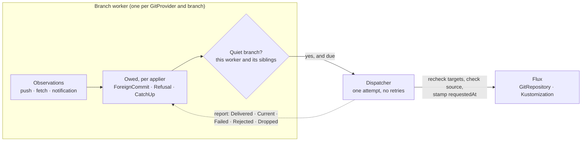

# The apply trigger

> **design**: decided 2026-10-16; the Flux applier, the push receiver and `onRefusal: Reapply` are
> built, Argo CD and the webhook applier are the aim. Index: [`../INDEX.md`](../INDEX.md).
> How to use it: [`../flux.md`](../flux.md) and [`../bi-directional.md`](../bi-directional.md).
> Fields: [`../configuration.md`](../configuration.md#who-applies-this-folder-specapplier).

**GitOps Reverser decides when Git is applied to the cluster.** Flux and Argo CD keep fetching,
rendering, applying, pruning and reporting health. They stop applying at their own will: their
short timers, webhooks and automated sync are switched off, and GitOps Reverser asks them to apply
at moments it has checked.

This page is why, what we learned building it, and what is still open.

## The problem

Two API edits to one field, a few seconds apart, are enough. GitOps Reverser pushes the first
commit. Flux fetches it, the second edit lands, and Flux applies the first commit over it. GitOps
Reverser faithfully mirrors that revert as Flux's commit, Flux applies the second commit, and the
branch ping-pongs until a fetch happens to land on the tip. There was no conflict to decide: both
edits came from the API side. gitops-api hit exactly this in production (two saves, then four
reconciler-authored commits).

The cause is not a bug in either tool. Each apply was correct; it ran at the wrong moment.

## The principle

**An apply is safe only when nothing live is missing from the commit being applied.** Between an
edit and its push, the edit is live and absent from Git: in an open commit window, or in the
writes waiting to be pushed. Only the branch worker can see those. So only it can say when an apply
is safe, and every trigger the applier runs by itself fires without that knowledge.

A request is sent only on a **quiet branch**: no open commit window and no pending writes. Three
things owe one:

| Reason | When | Asked |
| --- | --- | --- |
| `ForeignCommit` | The branch gained a commit GitOps Reverser did not push. Open windows are closed early and pending writes replayed onto it and pushed first, so the applied commit carries the API side's answer | Every applier on the branch |
| `Refusal` | An edit had no legal destination in Git and the target opted in with `onRefusal: Reapply` | The refusing target's applier |
| `CatchUp` | The branch has been quiet for `quietPeriod` after GitOps Reverser's own pushes, or since it started | Every Flux applier on the branch |

## What we learned

Each of these changed the design, and each is the reason for a rule the code now follows.

**Filtering webhooks is not enough; every timer is a trigger.** The first ask was to forward only
foreign pushes to the applier. But Argo CD's timed refresh syncs every new tip two to three minutes
after each push, with `selfHeal: false` too, and Flux applies on every interval. Neither can be
filtered from outside, so the applier's own triggers go, and GitOps Reverser makes the requests.

**Flux has no fetch-only mode.** A new `GitRepository` artifact makes every `Kustomization` reading
it apply at once, and `suspend: true` also blocks the requests. So a source that fetches on its own,
on a short interval or a webhook into a Flux `Receiver`, is a `Kustomization` that applies on its
own. The source stays on a long backstop interval, and `CatchUp` keeps its artifact current, because
Flux still applies on a restart from whatever artifact it holds, and a stale one would revert edits
already in Git.

**Not every commit GitOps Reverser authors is a no-op to apply.** A replayed `F + W` carries
somebody else's `F`, and a refusal needs an apply to be reverted. So the decision is state on the
worker ("this applier is owed an apply"), set by observations and cleared by a delivered request,
not a verdict on each push notification. A notification is a hint: the worker reads the remote and
judges from that, which gets late, duplicate and rolled-back deliveries right.

**A decision has to hold when the patch is sent, not only when it is made.** The first review found
that a request decided once was attempted for minutes against whatever the cluster had become: a
target its `ClusterProvider` no longer admitted still drove the applier, and a source that followed
another branch was still stamped. Every attempt now reads each target again, and the Flux client
checks that the source fetches this repository and branch before it stamps anything.

**A retry is a decision too, so only the worker may make one.** The second review found every
remaining problem in the hand-off between the worker's decisions and the deliverer's retries: a
retry skipped the quiet check, outlived a refusal that had recovered, ran for a recreated target, or
waited on another applier's backoff. The fix was structural rather than four patches. The worker
owns every obligation until an attempt delivers it. The deliverer carries out one attempt and
reports back; it never retries, and never asks for something weaker than it was told. A retry is
decided like a first attempt: on a quiet branch, at the tip as it is then, from what still stands.

**Three relations, three units.** One branch worker serves many `GitTarget`s, many `GitTarget`s can
name one `Kustomization`, and one `GitRepository` can feed many `Kustomization`s. Keeping each
concern on the right unit is what makes the 1:n cases fall out:

| Unit | Owns | Why |
| --- | --- | --- |
| The **branch** (repository and branch) | Quietness | A `Kustomization` applies the tip whichever folder an edit is in. Two `GitProvider`s naming one repository give one branch two workers, so a worker is quiet only when its siblings are too |
| The **applier** | Obligations and retries | One attempt out at a time, its own backoff, one attempt for every `GitTarget` naming it. A shared applier waits for the longest `quietPeriod` among them, because its apply reaches all their folders |
| The **`GitTarget`**, by uid | Configuration and consent | Consent to a `Refusal` is per target, and a target deleted and recreated under the same name inherits nothing owed to the old one |

**A shared `GitRepository` cannot be isolated, so the promise was narrowed.** When a request has to
make the source fetch, every `Kustomization` on that source applies the new revision. That is how
Flux works. The branch is quiet, so they apply a tip with nothing live missing; the guide says a
folder needing strict isolation gets its own `GitRepository`.

## The design, as built

- **Observing.** Every observation of the remote passes one point. The first after a start is a
  baseline (owes `CatchUp`, never `ForeignCommit`, because an apply on startup would revert edits
  made while the operator was down). A tip the worker pushed owes `CatchUp`; any other owes
  `ForeignCommit`. When in doubt it is foreign, which costs one apply on a quiet branch.
- **Deciding.** At the end of every wake, if the branch is quiet, each applier that is owed something,
  has no attempt out, and is past its backoff (and, for a `CatchUp`, its quiet period) gets one
  attempt. The attempt carries away what it covers; each target in it carries its uid and its own
  reason.
- **Attempting.** The dispatcher re-reads each target. It asks only for those that are still the
  same incarnation, still name this applier on this branch, are still admitted by their
  `ClusterProvider`, and for a `Refusal` still consent. If no target still holds the request's
  reason, it asks nothing (`Dropped`). Then Flux: stamp `reconcile.fluxcd.io/requestedAt` on the
  `GitRepository` when its artifact lacks the commit, else on the `Kustomization`; a `CatchUp` whose
  artifact holds the commit stamps nothing. A source on another repository or branch is `Rejected`.
- **Settling.** A delivered attempt is done. Any other outcome gives back what the attempt carried,
  a refusal only if it still stands, and starts that applier's backoff (2s doubling to 5m, at least
  15s after a rejection). `ApplyRequestFailed` is recorded for the first failure of a run.
- **Learning about pushes.** A push webhook into GitOps Reverser's receiver (seconds), a rejected
  compare-and-swap push (at the next publication), or the periodic refresh (minutes). All three
  feed the same observation point.

## The apply window: what is still racy

**A request is asynchronous, and that leaves a window.** The patch returns at once; Flux fetches and
applies a few seconds later. An API edit that lands in those seconds, to a field the
`Kustomization` applies, is reverted by the apply, and GitOps Reverser mirrors the revert as Flux's
commit. The edit survives in Git history only if its own commit was pushed first.

The quiet-branch rule confines that window to three moments: right after somebody else's push, right
after a refusal the target asked to have reverted, and right after `quietPeriod` of silence on a
branch whose artifact is behind. It does not close it, and making the request synchronous would not
either: waiting for the apply to finish does not stop a user from editing during it. Only refusing
edits would, which halts the API for everyone to protect a few seconds, so we do not.

What would make the window smaller and visible, in order of cost:

1. **Know when the window closes.** Flux copies the requested stamp into the `Kustomization`'s
   `status.lastHandledReconcileAt` once it has handled it. The dispatcher can report `Delivered`
   only then, so an attempt stays "out" for exactly the apply's duration and nothing is stacked on
   an apply still running.
2. **Name the collision.** An edit observed while an attempt is out, on an object the applier owns,
   is the case that can be reverted. Recording it (an Event on the `GitTarget`, a counter) turns a
   silent revert into a visible one.
3. **Let the API win the window.** A write by the applier's own field manager during an attempt we
   made, that undoes a field edited after that attempt was sent, is our apply arriving late, not new
   intent. Not mirroring it keeps the edit in Git, and the next request applies it back. This is the
   rule "for an object both sides changed, the API value wins", applied to the apply window. It needs
   the field manager from `managedFields` (no audit), and it is the only option that changes what
   reaches Git, so it needs its own decision.

## The aim beyond Flux

**Argo CD (`applicationRef`).** The `Application` runs with `syncPolicy.automated.enabled: false`
(Argo CD 3.1 and later), so its refresh only compares and nothing syncs it but us. A request sets
`operation.sync` exactly as Argo CD's automated sync builds it, with `prune`, `syncOptions` and
`retry` from the `Application`, and **`revision` pinned to the commit the worker checked**. Three
consequences:

- **No `CatchUp`.** With automated sync off Argo CD applies nothing on its own, so there is no stale
  artifact to catch up, and every sync runs the `Application`'s hooks.
- **The commit is pinned**, so a sync applies what the worker checked, not whatever the tip became.
- **A running operation is waited for, never replaced**, as Argo CD's own `SetAppOperation` does.

The open question that shapes its API: a hub Argo CD keeps `Application`s in a management cluster,
not the cluster they deploy to, and today an applier is looked up in the source cluster.

**A webhook applier** for any other tool: POST `{"repository", "branch", "commit", "reason"}`,
signed `X-Signature: sha256=<hex HMAC>` the way Flux's `generic-hmac` `Receiver` checks. It gets
every reason, `CatchUp` included, since nothing says the tool does not apply on its own. No
in-process plugin: it would run with every credential the operator holds.

## What it costs

- **GitOps Reverser becomes the fast path to a deployment.** While it is down, a Git-side push
  reaches the cluster through `flux reconcile`, a manual sync, or the long backstop interval.
  Bi-directional editing already stops in that state.
- **The receiver runs on the elected replica only.** A standby refuses deliveries; with more than
  one replica they need routing to the leader.
- **Every applier on the branch is asked on a `ForeignCommit`**, whether or not the push touched its
  folder. Harmless for Flux; for Argo CD it runs hooks. Narrowing it needs the applier's own source
  paths, so it waits for a measured complaint.

## What proves it

| Claim | Test |
| --- | --- |
| The decision: quiet branch, reasons, quiet period, baseline | [`apply_trigger_test.go`](../../internal/git/apply_trigger_test.go) |
| Retries are decided by the worker; recovered refusals, withdrawn consent and recreated targets are not retried; each applier keeps its own clock; one attempt for a shared applier; a busy sibling worker holds the branch | [`apply_attempt_test.go`](../../internal/git/apply_attempt_test.go) |
| Every attempt rechecks targets, never asks for something weaker, and never stamps a source on another branch | [`dispatcher_test.go`](../../internal/applier/dispatcher_test.go), [`flux_test.go`](../../internal/applier/flux_test.go) |
| The original race: two API edits end at the later value with no extra commit | [bi-directional Flux corner](../../test/e2e/flux_bi_directional_e2e_test.go) |
| `SourceMismatch` is never stamped and is delivered once fixed; a Gitea webhook and the refresh alone each get a push applied | [Manager Flux Applier](../../test/e2e/flux_applier_e2e_test.go) |
| A refused edit is reverted by its `Kustomization` | [Refusal reapply](../../test/e2e/refusal_reapply_e2e_test.go) |
| The Flux guide's example is accepted by the code | [`flux_guide_test.go`](../../internal/applier/flux_guide_test.go) |

The history of how this was decided, with the options weighed and the Git-side reference the code
cites, is in [`../finished/push-notification-and-reconcile-trigger.md`](../finished/push-notification-and-reconcile-trigger.md).
