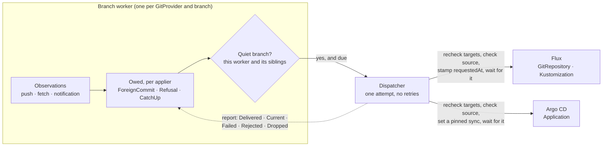

# The apply trigger

> **design**: decided 2026-10-16, extended 2026-10-17; the Flux and Argo CD appliers (in any
> cluster), the push receiver, `onRefusal: Reapply` and the apply window are built, the webhook
> applier is the aim. Index: [`../INDEX.md`](../INDEX.md).
> How to use it: [`../flux.md`](../flux.md), [`../argocd.md`](../argocd.md) and
> [`../bi-directional.md`](../bi-directional.md).
> Fields: [`../configuration.md`](../configuration.md#who-applies-this-folder-specapplier).

**GitOps Reverser decides when Git is applied to the cluster.** Flux and Argo CD keep fetching,
rendering, applying, pruning and reporting health. They stop applying at their own will: their
short timers, webhooks and automated sync are switched off, and GitOps Reverser asks them to apply
at moments it has checked.

This page is why, what we learned building it, and what is still open.

## The problem

Two API edits to one field, a few seconds apart, are enough. GitOps Reverser pushes the first
commit. Flux fetches it, the second edit lands, and Flux applies the first commit over it. GitOps
Reverser faithfully mirrors that revert as Flux's commit, Flux applies the second commit, and the
branch ping-pongs until a fetch happens to land on the tip. There was no conflict to decide: both
edits came from the API side. gitops-api hit exactly this in production (two saves, then four
reconciler-authored commits).

The cause is not a bug in either tool. Each apply was correct; it ran at the wrong moment.

## The principle

**An apply is safe only when nothing live is missing from the commit being applied.** Between an
edit and its push, the edit is live and absent from Git: in an open commit window, or in the
writes waiting to be pushed. Only the branch worker can see those. So only it can say when an apply
is safe, and every trigger the applier runs by itself fires without that knowledge.

A request is sent only on a **quiet branch**: no open commit window and no pending writes. Three
things owe one:

| Reason | When | Asked |
| --- | --- | --- |
| `ForeignCommit` | The branch gained a commit GitOps Reverser did not push. Open windows are closed early and pending writes replayed onto it and pushed first, so the applied commit carries the API side's answer | Every applier on the branch |
| `Refusal` | An edit had no legal destination in Git and the target opted in with `onRefusal: Reapply` | The refusing target's applier |
| `CatchUp` | The branch has been quiet for `quietPeriod` after GitOps Reverser's own pushes, or since it started | Every Flux applier on the branch |

## What we learned

Each of these changed the design, and each is the reason for a rule the code now follows.

**Filtering webhooks is not enough; every timer is a trigger.** The first ask was to forward only
foreign pushes to the applier. But Argo CD's timed refresh syncs every new tip two to three minutes
after each push, with `selfHeal: false` too, and Flux applies on every interval. Neither can be
filtered from outside, so the applier's own triggers go, and GitOps Reverser makes the requests.

**Flux has no fetch-only mode.** A new `GitRepository` artifact makes every `Kustomization` reading
it apply at once, and `suspend: true` also blocks the requests. So a source that fetches on its own,
on a short interval or a webhook into a Flux `Receiver`, is a `Kustomization` that applies on its
own. The source stays on a long backstop interval, and `CatchUp` keeps its artifact current, because
Flux still applies on a restart from whatever artifact it holds, and a stale one would revert edits
already in Git.

**Not every commit GitOps Reverser authors is a no-op to apply.** A replayed `F + W` carries
somebody else's `F`, and a refusal needs an apply to be reverted. So the decision is state on the
worker ("this applier is owed an apply"), set by observations and cleared by a delivered request.
A push notification decides nothing by itself; it is a hint: the worker reads the remote and
judges from that, which gets late, duplicate and rolled-back deliveries right.

**A decision has to hold when the patch is sent as well as when it is made.** The first review found
that a request decided once was attempted for minutes against whatever the cluster had become: a
target its `ClusterProvider` no longer admitted still drove the applier, and a source that followed
another branch was still stamped. Every attempt now reads each target again, and the Flux client
checks that the source fetches this repository and branch before it stamps anything.

**A retry is a decision too, so only the worker may make one.** The second review found every
remaining problem in the hand-off between the worker's decisions and the deliverer's retries: a
retry skipped the quiet check, outlived a refusal that had recovered, ran for a recreated target, or
waited on another applier's backoff. The fix was structural rather than four patches. The worker
owns every obligation until an attempt delivers it. The deliverer carries out one attempt and
reports back; it never retries, and never asks for something weaker than it was told. A retry is
decided like a first attempt: on a quiet branch, at the tip as it is then, from what still stands.

**Three relations, three units.** One branch worker serves many `GitTarget`s, many `GitTarget`s can
name one `Kustomization`, and one `GitRepository` can feed many `Kustomization`s. Keeping each
concern on the right unit is what makes the 1:n cases fall out:

| Unit | Owns | Why |
| --- | --- | --- |
| The **branch** (repository and branch) | Quietness | A `Kustomization` applies the tip whichever folder an edit is in. Two `GitProvider`s naming one repository give one branch two workers, so a worker is quiet only when its siblings are too |
| The **applier** | Obligations and retries | One attempt out at a time, its own backoff, one attempt for every `GitTarget` naming it. A shared applier waits for the longest `quietPeriod` among them, because its apply reaches all their folders |
| The **`GitTarget`**, by uid | Configuration and consent | Consent to a `Refusal` is per target, and a target deleted and recreated under the same name inherits nothing owed to the old one |

**A shared `GitRepository` cannot be isolated, so the promise was narrowed.** When a request has to
make the source fetch, every `Kustomization` on that source applies the new revision. That is how
Flux works. The branch is quiet, so they apply a tip with nothing live missing; the guide says a
folder needing strict isolation gets its own `GitRepository`.

## The design, as built

- **Observing.** Every observation of the remote passes one point. The first after a start is a
  baseline (owes `CatchUp`, never `ForeignCommit`, because an apply on startup would revert edits
  made while the operator was down). A tip the worker pushed owes `CatchUp`; any other owes
  `ForeignCommit`. When in doubt it is foreign, which costs one apply on a quiet branch.
- **Deciding.** At the end of every wake, if the branch is quiet, each applier that is owed something,
  has no attempt out, and is past its backoff (and, for a `CatchUp`, its quiet period) gets one
  attempt. The attempt carries away what it covers; each target in it carries its uid and its own
  reason.
- **Attempting.** The dispatcher re-reads each target. It asks only for those that are still the
  same incarnation, still name this applier on this branch, are still admitted by their
  `ClusterProvider`s (their own, and the applier's when `spec.applier.clusterProviderRef` names
  another), and for a `Refusal` still consent. If no target still holds the request's
  reason, it asks nothing (`Dropped`). Just before the stamp it asks the worker whether the decision
  still holds (the commit is still the tip, nothing is waiting to be published); if not, it stamps
  nothing (`Stale`, no failure). Then the applier's kind decides. Flux: stamp `reconcile.fluxcd.io/requestedAt` on the
  `GitRepository` when its artifact lacks the commit; when the artifact holds it, only a `Refusal`
  stamps the `Kustomization`, because the artifact already woke it for anything else. Argo CD: set
  the `Application`'s sync operation, pinned to the commit ([below](#the-argo-cd-applier)). A
  source on another repository or branch, or an `Application` with automated sync on, is
  `Rejected`. A delivered attempt is reported only once the applier has finished the apply, or
  after 5 minutes, so the attempt is out for exactly the apply window.
- **Settling.** A delivered attempt is done. A stale one gives back what it carried and is decided
  again at the next quiet moment. Any other outcome gives back what the attempt carried,
  a refusal only if it still stands, and starts that applier's backoff (2s doubling to 5m, at least
  15s after a rejection). `ApplyRequestFailed` is recorded for the first failure of a run.
- **Learning about pushes.** A push webhook into GitOps Reverser's receiver (seconds), a rejected
  compare-and-swap push (at the next publication), or the periodic refresh (minutes). All three
  feed the same observation point.

## The apply window

**A request is asynchronous, and that leaves a window.** Flux fetches and applies a few seconds
after the stamp. An API edit that lands in those seconds, to a field the `Kustomization` applies, is
reverted by the apply, because the commit Flux was asked for does not hold it yet. Making the
request synchronous would not help: waiting for the apply does not stop a user from editing during
it, and refusing edits would halt the API for everyone to protect a few seconds.

The quiet-branch rule confines the window to three moments: right after somebody else's push, right
after a refusal the target asked to have reverted, and after `quietPeriod` of silence on a branch
whose artifact is behind. Inside it, **the API wins**, as it does for any object both sides changed:

- **The window is known.** The dispatcher reports a delivered attempt only once the applier has
  finished the apply: for Flux, `status.lastHandledReconcileAt` carries the stamp of a stamped
  `Kustomization`, or the `Kustomization` attempted a new revision after a source stamp (or the
  source handled the stamp with no new artifact); for Argo CD, the operation state carrying the
  request's token has completed. At most 5 minutes; the worker keeps the window open 10 seconds
  more, because the applier's writes reach it through the watch.
- **The late apply is withheld.** A write whose latest `managedFields` entries are the applier's
  own managers alone (`kustomize-controller`; `argocd-controller` or
  `argocd-application-controller`), inside the window, to an object in the applier's folders that
  the API side edited after the attempt was sent, is not mirrored. Git keeps the edit; for Flux the
  `CatchUp` its push owes applies it back, for Argo CD the next sync does. The cluster runs the
  reverted value until then.
- **Only proof withholds.** `managedFields` times resolve to the second. When the applier ties
  with another manager, the write could be the edit itself, and withholding an edit loses it
  outright; it is mirrored as before. A DELETE carries nothing about its deleter and is never
  withheld. Both are logged.

Every collision is logged with the object, the applier and the requested commit, and counted in
`apply_window_collisions_total` (`withheld` or `ambiguous`). What remains: an edit reverted on the
cluster until the next apply (for Flux, up to `quietPeriod`), an ambiguous tie mirrored as the
applier's commit, and an applier's write that reaches the watch more than 10 seconds after it
reported done.

## The Argo CD applier

**GitOps Reverser takes full control of when Argo CD syncs.** The `Application` named by
`spec.applier.applicationRef` has automated sync off (`syncPolicy.automated.enabled: false`, or no
`automated` block), so its timed refresh and its webhook only compare, and every sync it runs is
one GitOps Reverser asked for, pinned to a commit the branch worker checked. This is the supported
setup for bi-directional editing with Argo CD, not an option next to automated sync: an
`Application` with automated sync on is `ApplierConfigured=False` (`AutomatedSyncEnabled`) and is
never synced. The user guide is [`../argocd.md`](../argocd.md).

Argo CD is the easier half. Flux has no fetch-only mode, so it needs a `CatchUp` to keep its
artifact from going stale. With automated sync off Argo CD applies nothing on its own, so it holds
nothing that can go stale, and **it gets no `CatchUp`**: `quietPeriod` is rejected with an
`applicationRef`, and the worker never owes an `Application` one.

Every rule the client relies on is Argo CD's own, read from its source (3.5.0):

| Fact | Consequence |
| --- | --- |
| Automated sync is on when `syncPolicy.automated` is present and its `enabled` is unset or true (`IsAutomatedSyncEnabled`) | `AutomatedSyncEnabled` is exactly this rule; `automated: {enabled: false, prune: …}` is the off switch that keeps prune |
| Automated sync builds `Operation{Sync{Revision, Prune: automated.prune, SyncOptions, Source}, InitiatedBy{Automated: true}, Retry: syncPolicy.retry or {Limit: 5}}` (`autoSync`) | A request builds the same, with `Revision` pinned to the checked commit |
| A sync starts by setting `operation`, never while one is set, in an update that also clears `status.operationState` (`SetAppOperation`; the CRD has no status subresource) | A request updates the whole `Application`, guarded by the `resourceVersion` it read, and waits out a running operation instead of replacing it |
| The controller clears `operation` when the operation completes and leaves the result in `status.operationState`; a failed operation that will be retried is `Running` again, with a `finishedAt` | An attempt's window closes when the operation state carrying its token has completed (`Succeeded`, `Failed`, `Error`); a pending retry is still running |
| A retry with `retry.refresh: true` drops the operation's revision and syncs the newest one | That one field is dropped from the copied retry: a retry stays pinned |
| Every apply writes as field manager `argocd-controller`, client-side and server-side alike; a `Replace=true` sync creates and replaces with no field manager, so the API server takes it from the user agent, `argocd-application-controller` | The apply window knows both as Argo CD's managers |
| Sync windows are checked for every operation, by `InitiatedBy.Automated` | A sync GitOps Reverser starts obeys the project's windows for automated syncs |

Three choices were decided (2026-10-17):

1. **Prune** comes from `syncPolicy.automated.prune` when `automated` is present with
   `enabled: false`. Without the block, a sync does not prune, and the guide says so. There is no
   `spec.applier.prune`.
2. **The initiator** is `InitiatedBy{Username: "gitops-reverser", Automated: true}`. GitOps Reverser
   replaces automated sync, so a sync window that blocks automated syncs blocks its syncs too.
3. **Hooks run on every sync**, so on every `ForeignCommit`, which asks every applier on the
   branch. Narrowing it by changed paths waits for a measured complaint.

A hub Argo CD keeps `Application`s in a management cluster: `spec.applier.clusterProviderRef`
reaches it as it reaches a Flux in another cluster. Out of scope: multi-source `Application`s (and
`sourceHydrator`), which are `SourceMismatch`; `ApplicationSet`s, which own the spec of the
`Application`s they generate; and Argo CD's own sharding and HA.

## The aim beyond Flux and Argo CD

**A webhook applier** for any other tool: POST `{"repository", "branch", "commit", "reason"}`,
signed `X-Signature: sha256=<hex HMAC>` the way Flux's `generic-hmac` `Receiver` checks. It gets
every reason, `CatchUp` included, since nothing says the tool does not apply on its own. No
in-process plugin: it would run with every credential the operator holds.

## What it costs

- **GitOps Reverser becomes the fast path to a deployment.** While it is down, a Git-side push
  reaches the cluster through `flux reconcile`, a manual sync, or the long backstop interval.
  Bi-directional editing already stops in that state.
- **One replica.** The receiver, the branch workers and the dispatcher run in one pod, and the chart
  refuses more than one replica. Leader election is not switched on; more than one replica needs
  ownership coordination first, and deliveries routed to the pod that owns the branch.
- **A request holds its applier while Flux applies.** The next request to that applier waits for
  the running apply (up to 5 minutes), which is the point: nothing is stacked on an apply still
  running. A Flux that never reports done costs those 5 minutes per request.
- **Every applier on the branch is asked on a `ForeignCommit`**, whether or not the push touched its
  folder. Harmless for Flux; for Argo CD it runs hooks. Narrowing it needs the applier's own source
  paths, so it waits for a measured complaint.
- **A sync somebody else started holds an Argo CD request**, for up to 5 minutes, and then fails
  it; the worker asks again after its backoff.

## Where this goes next

The Flux applier PR (#419) carries what gitops-api, the first adopter, needs before it can drop its
own gate: both reviews' findings and the customer review's three blockers (stale stamps, a late
webhook cutting a save's window, a `Kustomization` in the management cluster via
`spec.applier.clusterProviderRef`), the hardened receiver, the apply window, and the Argo CD
applier with automated sync off as the standard. After it, in order, each one pull request:

1. **The webhook applier.**
2. **More than one replica.** Leader election is not switched on, and the chart runs one replica.
   Standbys need ownership coordination first (the HA plan in `docs/future/`), and deliveries then
   need routing to the pod that owns the branch.

Test gaps to close along the way: a remote source cluster and an applier in another cluster (a hub
Argo CD among them) in e2e, `Forbidden` against real RBAC, the receiver and applier roles installed
by the Helm chart, two `GitTarget`s sharing one `Kustomization` in e2e, an apply-window collision in
e2e, a `Replace=true` Argo CD sync's field manager measured rather than read from the source, and
`-race` in CI.

**What adopting it changes for gitops-api.** Its gate shrinks to "one save, one window", which
protects commit messages and has nothing to do with Flux. Its push handler relays each push to the
`GitProvider`'s receiver instead of stamping Flux. And publications trail an editing session by at
least `quietPeriod`, since Flux now applies GitOps Reverser's own commits only after the branch has
been quiet; `quietPeriod` is the knob for that trade.

## What proves it

| Claim | Test |
| --- | --- |
| The decision: quiet branch, reasons, quiet period, baseline | [`apply_trigger_test.go`](../../internal/git/apply_trigger_test.go) |
| Retries are decided by the worker; recovered refusals, withdrawn consent and recreated targets are not retried; each applier keeps its own clock; one attempt for a shared applier; a busy sibling worker holds the branch | [`apply_attempt_test.go`](../../internal/git/apply_attempt_test.go) |
| Every attempt rechecks targets, asks for nothing weaker than it was told, and stamps no source on another branch | [`dispatcher_test.go`](../../internal/applier/dispatcher_test.go), [`flux_test.go`](../../internal/applier/flux_test.go) |
| An applier in another cluster is reached through its own `ClusterProvider`, behind that provider's `accessFrom` | [`dispatcher_test.go`](../../internal/applier/dispatcher_test.go), [`clusterprovider_admission_test.go`](../../internal/authz/clusterprovider_admission_test.go), [`gittarget_applier_test.go`](../../internal/controller/gittarget_applier_test.go) |
| An attempt stays out until Flux finished the apply; the applier's late write over a newer edit is withheld, and nothing that could be the edit is | [`flux_test.go`](../../internal/applier/flux_test.go), [`apply_window_test.go`](../../internal/git/apply_window_test.go), [`last_field_managers_test.go`](../../internal/watch/last_field_managers_test.go) |
| The receiver's path names no provider, and every miss answers the same | [`receiver_test.go`](../../internal/webhook/receiver_test.go) |
| The original race: two API edits end at the later value with no extra commit | [bi-directional Flux corner](../../test/e2e/flux_bi_directional_e2e_test.go) |
| `SourceMismatch` is never stamped and is delivered once fixed; a Gitea webhook and the refresh alone each get a push applied | [Manager Flux Applier](../../test/e2e/flux_applier_e2e_test.go) |
| A refused edit is reverted by its `Kustomization` | [Refusal reapply](../../test/e2e/refusal_reapply_e2e_test.go) |
| The Flux guide's example is accepted by the code | [`flux_guide_test.go`](../../internal/applier/flux_guide_test.go) |
| An Argo CD sync is the one automated sync builds, pinned to the commit, with a pinned retry; a running operation is waited out and never replaced; an operation set between the read and the update makes it fail; every `ApplierConfigured` reason, `AutomatedSyncEnabled` among them; when a sync counts as finished | [`argocd_test.go`](../../internal/applier/argocd_test.go), [`dispatcher_test.go`](../../internal/applier/dispatcher_test.go) |
| An `Application` is never owed a `CatchUp`; Argo CD's late write over a newer edit is withheld by its own managers | [`apply_trigger_test.go`](../../internal/git/apply_trigger_test.go), [`apply_window_test.go`](../../internal/git/apply_window_test.go) |
| Exactly one of `kustomizationRef` and `applicationRef`, and no `quietPeriod` with an `applicationRef` | [`gittarget_applier_schema_test.go`](../../internal/controller/gittarget_applier_schema_test.go) |
| With Argo CD: two API edits keep the later value with no extra commit; a Git-side push is synced by a pinned `ForeignCommit`; a refused edit is reverted by a sync; an `Application` with automated sync on is `AutomatedSyncEnabled` and never synced | [bi-directional Argo CD corner](../../test/e2e/argocd_bi_directional_e2e_test.go) |
| The Argo CD guide's example is accepted by the code | [`argocd_guide_test.go`](../../internal/applier/argocd_guide_test.go) |

The history of how this was decided, with the options weighed and the Git-side reference the code
cites, is in [`../finished/push-notification-and-reconcile-trigger.md`](../finished/push-notification-and-reconcile-trigger.md).
