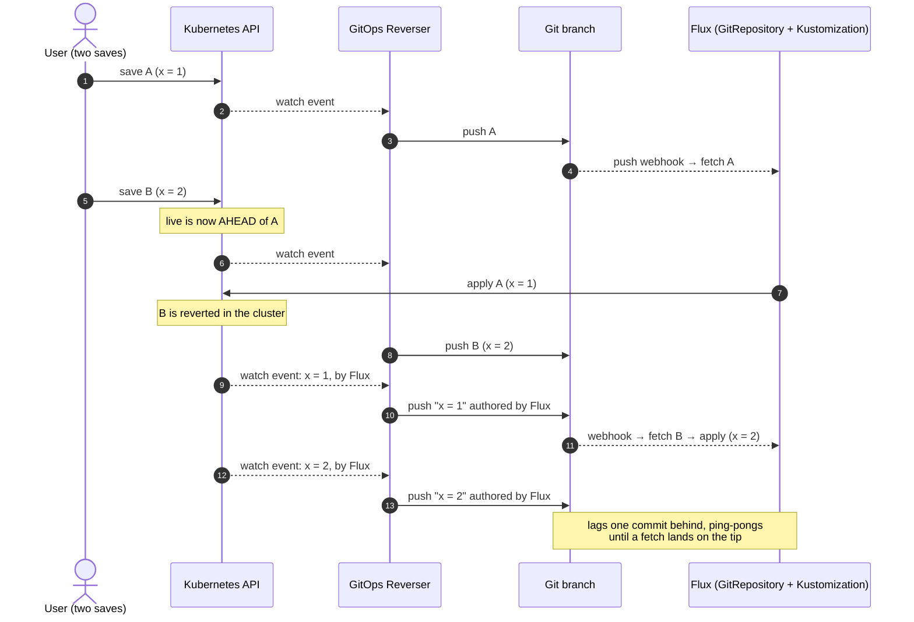
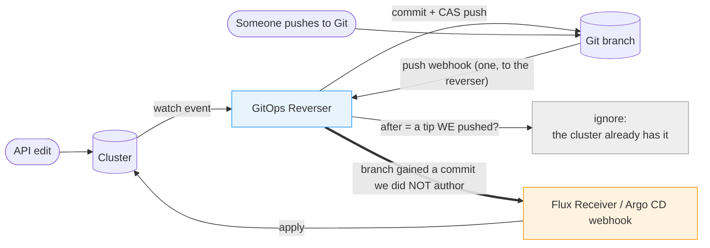
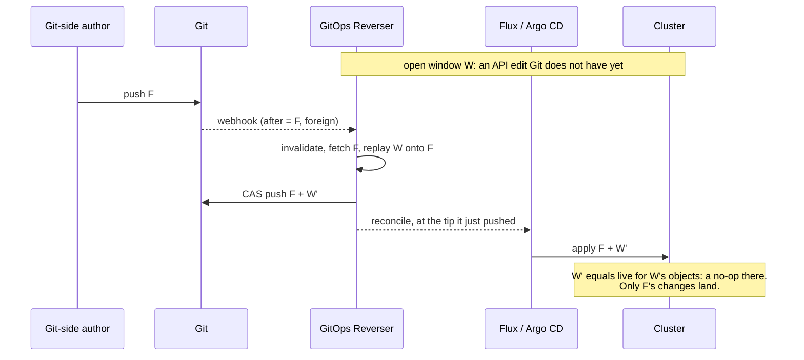
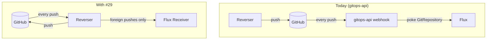

# Feedback: the reconciler should only be woken by commits the reverser did not make

_From the [gitops-api](https://github.com/ConfigButler/gitops-api) team to gitops-reverser,
2026-10-15. Wishlist ask **#29** ([upstream-wishlist.md](https://github.com/ConfigButler/gitops-api/blob/main/docs/design/upstream-wishlist.md)). Written to be
readable from the gitops-reverser repo; no gitops-api knowledge assumed. **We run `v0.52.0`.** Every
gitops-reverser link is pinned to
[`400edf68`](https://github.com/ConfigButler/gitops-reverser/tree/400edf68242086dde5f650ac9835072f2bdfb5e1)
(`main` today)._

> **Response (2026-10-16): GitOps Reverser takes over the reconciliation triggers.** Flux and
> Argo CD keep doing what they are good at, but they apply when GitOps Reverser asks, not on their
> own schedule. The ask is right, and filtering webhooks turns out not to be enough: see
> [§9](#9-response-gitops-reverser-takes-over-the-triggers).

**The ask, in one sentence.** Make gitops-reverser the component that tells the GitOps reconciler to
apply, and have it do so **only when the branch gained a commit the reverser did not author**,
never for its own pushes.

**Why.** In the bi-directional setup your own guide recommends, every commit the reverser pushes
wakes Flux, and Flux then applies that commit to a cluster that may already have moved past it.
Two ordinary API edits a few seconds apart are enough. The older commit is applied over the newer
edit, the reverser faithfully mirrors that revert into Git as the reconciler's commit, and the
branch ping-pongs until a fetch happens to land on the tip. Which value survives is luck. There is
no conflict being decided here: **both edits came from the API side.**

## 1. What we saw

Our product is an editor over a kcp workspace. A user's save is a Server-Side Apply into the
workspace, gitops-reverser (one instance, `v0.52.0`) mirrors it to the tenant's repository, and a
Flux `GitRepository` + `Kustomization` (Flux 2.9.6) applies the repository back. Our Git-host webhook
handler wakes the **`GitRepository` only**, never the `Kustomization`, as
[`bi-directional.md` → Configure Flux](https://github.com/ConfigButler/gitops-reverser/blob/400edf68242086dde5f650ac9835072f2bdfb5e1/docs/bi-directional.md#configure-flux)
recommends (we learned that one the hard way too).

Our browser check fires two saves at once. We serialise them ourselves, so the second save writes
only after the first save's `CommitRequest` is `Ready=True/Committed`. One run, 2026-10-15, tenant
repository history:

| Time (UTC) | Commit | Author | Change to `data` |
|---|---|---|---|
| 15:53:00 | `3b08d12a` | Simon (save A) | `+ a` |
| 15:53:05 | `08b9bf84` | Simon (save B) | `- a`, `+ b` |
| 15:53:11 | `ad719e84` | `flux-tenant-configbutler` | `+ a` |
| 15:53:19 | `f22d63e1` | `flux-tenant-configbutler` | `- a` |
| 15:53:26 | `f4fbc60b` | `flux-tenant-configbutler` | `+ a` |
| 15:53:32 | `d88fc968` | `flux-tenant-configbutler` | `- a` |

Save B's `- a` is our harness, not the race: both saves applied under one field manager, so B's
apply released A's key. Everything after it is the race.

The same pattern appeared in the 2026-10-13 run. To check the mechanism, we patched our
serialisation back to "release on `Committed`" and reran with both saves writing **the same
field**. The result was two reconciler-authored commits after the saves, `a03446a1` and `49b4baea`.
The `Kustomization` never settled on the later save's commit.

Steps 5 and 7 are the whole bug: the cluster moves, then Flux applies the commit before it.
Everything after them is the reverser doing exactly what it should, which is why nothing errors:
mirroring stays faithful and every commit is attributed.

## 2. Why it happens, in your own terms

[`bi-directional.md` → Why the loop stops](https://github.com/ConfigButler/gitops-reverser/blob/400edf68242086dde5f650ac9835072f2bdfb5e1/docs/bi-directional.md#why-the-loop-stops)
gives the reason the loop settles: _"When the reconciler applies a commit Reverser wrote, the live
object already holds those values, because they were read from that object in the first place."_
That carries a precondition the page states once (_"With no intervening edits"_) but nothing
enforces: **the live object has not moved since.** The page is also already explicit that nothing
reserves the time:

- [The guide's short version](https://github.com/ConfigButler/gitops-reverser/blob/400edf68242086dde5f650ac9835072f2bdfb5e1/docs/bi-directional.md):
  _"There is no merge, no lock, and no timing guarantee."_
- [How a refused edit can undo an allowed one](https://github.com/ConfigButler/gitops-reverser/blob/400edf68242086dde5f650ac9835072f2bdfb5e1/docs/bi-directional.md#how-a-refused-edit-can-undo-an-allowed-one):
  _"The same race exists whenever a new Git revision arrives … Shortening the commit window reduces
  exposure but does not reserve time against an apply."_
- [`facts/gitops-apply-and-field-ignore.md`](https://github.com/ConfigButler/gitops-reverser/blob/400edf68242086dde5f650ac9835072f2bdfb5e1/docs/facts/gitops-apply-and-field-ignore.md):
  _"a reverse merge alone cannot stop the forward applier from enforcing an older Git value before
  publication completes."_

We agree with all of that. Our point is narrower. **For a commit the reverser authored, the apply
can never do anything useful.** That commit _is_ the cluster's state, read from it. Applying it back
has two possible outcomes: a no-op, if the cluster has not moved, or a revert, if it has. No case
exists where waking the reconciler for the reverser's own push brings in new intent. The whole
exposure in §1 comes from triggers that cannot pay off.

[§1.2 of the push-notification design](https://github.com/ConfigButler/gitops-reverser/blob/400edf68242086dde5f650ac9835072f2bdfb5e1/docs/design/push-notification-and-reconcile-trigger.md#12-which-side-wins-before-anything-else)
already draws this line: _"A push we did not author is new truth … getting it applied quickly is
the point."_ The converse is the ask: **a push we did author is not news to the cluster, and
nothing should be told to apply it.**

## 3. The ask: the reverser decides when the reconciler applies

This is your [Option 4](https://github.com/ConfigButler/gitops-reverser/blob/400edf68242086dde5f650ac9835072f2bdfb5e1/docs/design/push-notification-and-reconcile-trigger.md#option-4-take-over-the-webhook-and-forward-it)
(the Git host talks only to the reverser) combined with
[Option 3](https://github.com/ConfigButler/gitops-reverser/blob/400edf68242086dde5f650ac9835072f2bdfb5e1/docs/design/push-notification-and-reconcile-trigger.md#option-3-receive-a-push-notification)'s
dedupe table. One change: **the dedupe decides whether to forward, not only whether to fetch.**

| `after` on the delivery | Meaning | Option 3 today | **Asked for** |
|---|---|---|---|
| a tip the reverser pushed | our own push coming back | ignore | **ignore, and do not forward** |
| anything else | somebody else moved the branch | invalidate `baseTrusted` | invalidate, **then forward** (§4 says when, §5 how) |

As written, Option 4 forwards every delivery, so it would keep the race exactly as it is today.
[Option 2](https://github.com/ConfigButler/gitops-reverser/blob/400edf68242086dde5f650ac9835072f2bdfb5e1/docs/design/push-notification-and-reconcile-trigger.md#option-2-tell-the-reconciler-after-we-push)
("tell the reconciler after we push") is the race made into a feature, and we would ask you **not**
to build it in that form. Its own selling point ("the loop closes without the user configuring a Git
host webhook") is a loop that has nothing left to close.

The bookkeeping this needs is the bookkeeping Option 3 already names: `lastCommitSHA` must advance
on a successful push, or every own push looks foreign. Option 3's argument against a `before` field
still holds. A set of our own SHAs cannot tell our own delayed delivery from a rollback through our
commits. Misclassifying our own push as foreign costs one useless apply, which is today's
behaviour. Misclassifying the other way would lose a human's push. So **when in doubt, forward**.

The reverser also has two other ways to learn the branch moved, both shipped. Each should feed the
same rule:

- a **rejected compare-and-swap push**, whose advertisement names a hash none of its publications
  produced;
- **`--git-refresh-interval`**, which reports `status.remote.verifiedBy: Fetch` for exactly that
  case
  ([Telling Reverser that somebody else pushed](https://github.com/ConfigButler/gitops-reverser/blob/400edf68242086dde5f650ac9835072f2bdfb5e1/docs/bi-directional.md#telling-reverser-that-somebody-else-pushed)).

So even an installation with **no** inbound webhook could trigger the reconciler correctly: late,
bounded by the refresh interval, but never for its own commits.

## 4. Ordering: forward after the replay, not before

A foreign commit `F` can land while the reverser still holds API edits it has not pushed yet: an
open commit window, or writes retained for replay. Call those edits `W`. They are live in the
cluster, absent from Git, and so absent from `F`.

If the reconciler is woken at `F`, it applies `F` and reverts `W` in the cluster before `W` ever
reaches Git. Replay still puts `W` on top of `F` in Git, but the reverser then mirrors the revert
over it, and the API side loses. Your §1.2 table says the API wins this case (the top-left cell);
the early apply makes it lose.

**Asked for:** when a foreign commit arrives with retained or open writes, request the reconcile
after the replayed push lands, so the applied revision already carries the API side's answer. With
no pending writes, forward at once. This narrows the remaining window, and does not claim to close
it. An edit that lands between that push and the apply is still exposed, as your guide says. But
that exposure now exists **only when somebody else pushed to Git**, which is a genuine two-sided
event. Today it follows every commit the reverser makes.

Option 5's caveats ("it cannot carry correctness") apply in full, and we are not asking for a hold
on the watch or on the push. This is only _when to send one HTTP request_.

## 5. How: the request that wakes the reconciler

The reverser learns of a foreign commit in one of two ways: a host delivery reaches it, or it
detects the move itself. Each case needs a different call.

| Reconciler | With a host delivery (5.1) | Without one (5.2) |
|---|---|---|
| Flux | forward it to a `Receiver` of the host's type (`github`, `gitlab`, …) | POST to a `generic-hmac` `Receiver` |
| Argo CD | forward it to `/api/webhook` | a synthesized GitHub-shaped push to `/api/webhook` |

In both cases **the reverser names no `GitRepository` and no `Application`.** The downstream already
holds that mapping: the `Receiver` in `spec.resources`, and Argo CD in every `Application` whose
source matches the repository and branch. This is your Option 4's load-bearing reason, and it holds
here too.

### 5.1 With a host delivery: forward the bytes, later if need be

When the Git host's webhook points at the reverser, forward the delivery exactly as Option 4
describes: the same body and headers, with nothing re-signed or re-serialised. #29 changes only
_whether_ the delivery is forwarded (an own push is dropped) and _when_ (a foreign push waits for
the replay in §4). Holding a delivery back is safe for two reasons:

- **The signature has no expiry.** GitHub's `X-Hub-Signature-256` is an HMAC over the body alone,
  and GitLab's `X-Gitlab-Token` is a static token. A delivery forwarded a few seconds late still
  verifies.
- **Neither downstream applies the delivery's `after`.** Each treats the delivery as "look at this
  branch now" and resolves the tip itself. A delivery that names `F` but is forwarded after
  `F + W'` lands therefore applies `F + W'`, which is the state §4 asks for.

### 5.2 Without one: the reverser's own request

Three of the triggers in §3 bring no delivery to forward: a rejected compare-and-swap push, a
`--git-refresh-interval` fetch, and any installation whose host webhook cannot point at the
reverser. **Ours is in the last group.** A GitHub App has one webhook URL for all of its
installations, and ours belongs to gitops-api. We would relay `{repository, branch, after}` to your
[Option 3 endpoint](https://github.com/ConfigButler/gitops-reverser/blob/400edf68242086dde5f650ac9835072f2bdfb5e1/docs/design/push-notification-and-reconcile-trigger.md#41-the-wire-contract-for-option-3),
so the reverser would never hold a GitHub-signed delivery.

In these cases the reverser makes its own request. That is your Option 2's outbound leg, with the
dedupe from §3 in front of it:

- **Flux: a `generic-hmac` `Receiver`.** Send a POST to the path the Receiver publishes in
  `status.webhookPath` (served by the `webhook-receiver` Service), with
  `X-Signature: sha256=<hex HMAC of the body, keyed by the Receiver's token>`. This is the call
  `flux trigger receiver` makes. The body is free-form, so §4.1's three fields will do. The
  Receiver's `spec.resources` should list the `GitRepository` only. The source is enough, and a
  poked `Kustomization` applies the artifact it already holds, which is the commit _before_ the one
  that triggered it ([field-ownership.md](https://github.com/ConfigButler/gitops-api/blob/main/docs/design/field-ownership.md)).
- **Argo CD: a synthesized push event.** Argo CD has no generic receiver type, so the reverser POSTs
  a minimal GitHub-shaped push to `/api/webhook`. It carries `X-GitHub-Event: push`, `ref`, `after`
  and `repository.html_url`, and is signed with `webhook.github.secret` from `argocd-secret` when one
  is set. Leave the `commits` file lists empty. As your Option 4 notes, a payload that lists no
  changed files makes `AppFilesHaveChanged` return true, so Argo CD refreshes every matching
  `Application` instead of guessing paths. This is the inverse of Option 4's parser, and it can come
  after Flux.

**Annotating the object directly** (`reconcile.fluxcd.io/requestedAt` on the `GitRepository`,
`argocd.argoproj.io/refresh` on the `Application`) also works. It is what our `triggerFluxForPush`
does today. We would still not recommend it for the reverser, because the reverser would then have
to know which object syncs the folder and hold patch rights on it. That is the ownership interpreter
your Option 4 avoids. A `Receiver` keeps the mapping where the user wrote it.

Option 2's four rules apply unchanged. The POST requests a reconcile and never reports one as
applied. It runs off the publication path, retries on its own, and never fails a publication that
succeeded.

## 6. What we would stop doing

- **Our webhook stops waking Flux.** We wake the `GitRepository` on every push today
  (`triggerFluxForPush`), the reverser's own included. That is the trigger in §1. With #29 the
  webhook relays the push to the reverser instead (§5.2), and the reverser becomes the only
  component that decides a revision should be applied.
- **Flux keeps its own timers as the backstop**, and they stay long (`24h` on both objects). Your
  Option 4's warning, _"'long intervals' must never be read as 'no intervals'"_, holds. One
  addition for your Flux guidance: a **short** `GitRepository` interval (the `1m` that
  [Configure Flux](https://github.com/ConfigButler/gitops-reverser/blob/400edf68242086dde5f650ac9835072f2bdfb5e1/docs/bi-directional.md#configure-flux)
  recommends) picks up the reverser's own commits too, because a new artifact revision wakes the
  `Kustomization`. That brings §1 back on a timer. Under #29 the short poll would undo what the
  filter buys, so the recommendation should say so.
- **Our stopgap goes.** Until then we serialise our own saves behind Flux's echo. A save holds a
  per-repository gate until the `Kustomization` reports `lastAppliedRevision` = that save's commit,
  so Flux's apply of it is a no-op before the next save may write
  ([forward-leg-loop.md](https://github.com/ConfigButler/gitops-api/blob/main/docs/design/forward-leg-loop.md#the-third-lap-a-save-that-overtakes-the-echo-2026-10-15)).
  This is your deferred
  [Option 4, "applier watermark"](https://github.com/ConfigButler/gitops-reverser/blob/400edf68242086dde5f650ac9835072f2bdfb5e1/docs/future/git-api-three-way-comparison.md#option-4-use-the-appliers-applied-revision-watermark),
  done crudely, outside the engine, and only for writes that pass through our server. A `kubectl
  apply` straight into the workspace is not covered. It costs a queued save 10–15 s (30 s when
  another push lands in between), and it is the kind of guard in one component that we would rather the engine made unnecessary.

## 7. A test you could add

[What the tests prove](https://github.com/ConfigButler/gitops-reverser/blob/400edf68242086dde5f650ac9835072f2bdfb5e1/docs/bi-directional.md#what-the-tests-prove)
says _"no spec tests simultaneous writes to one field from both sides, because the outcome depends
on arrival order."_ This case is different: **both writes come from the API side**, so the expected
outcome does not depend on a policy. It is simply the later write. Under the recommended Flux
configuration (Receiver on the `GitRepository`, webhook on every push):

1. Patch one field of one object to `1`. Wait for its commit to push.
2. Within ~2 s of that push, patch the same field to `2`.
3. Wait for both commits, plus two reconciler intervals.
4. Assert that the live value is `2`, that Git's file holds `2`, and that **no commit after step 2 is
   authored by the reconciler's identity**.

On our cluster, step 4's last clause fails on today's configuration and passes with our stopgap. It
should pass with #29 and no stopgap. We would rather it lived in your bi-directional corner than in
our browser harness, because it is a property of the engine plus the reconciler, not of our editor.

## 8. What we are not asking for

- **Not a merge, and not a conflict policy.** The
  [three-way comparison record](https://github.com/ConfigButler/gitops-reverser/blob/400edf68242086dde5f650ac9835072f2bdfb5e1/docs/future/git-api-three-way-comparison.md)
  stays deferred as far as we are concerned. #29 is only about not causing a conflict where none
  exists.
- **Not a filter on the audit stream or on events.** The reverser must keep mirroring every write,
  the reconciler's included. A reconciler-authored commit is exactly how we saw this, and it should
  stay visible
  ([forward-leg-loop.md](https://github.com/ConfigButler/gitops-api/blob/main/docs/design/forward-leg-loop.md)
  is why we feel strongly about that).
- **Not a guarantee of being first.** As your Option 4 says, a timer, a retry, or `flux reconcile`
  can always reach Git without the reverser. #29 removes the trigger that fires on every own
  commit. It does not claim to remove every trigger.

## 9. Response: GitOps Reverser takes over the triggers

_From gitops-reverser, 2026-10-16. The design is
[push-notification-and-reconcile-trigger.md](push-notification-and-reconcile-trigger.md); the
guide as it will read is [bi-directional.md](../bi-directional.md)._

**The short version: GitOps Reverser takes over the reconciliation triggers. It has to.** Flux and
Argo CD keep doing what they are good at: fetching, rendering, applying, pruning, and reporting
health. They stop doing it at their own will. An apply happens because GitOps Reverser asked for
it on a branch with nothing pending, because a human asked, or because of a long backstop timer.

We accept the rule and the ordering in §4, and we go further than §8's last bullet: the webhook is
not the only trigger to take away, because every timer the applier runs is a trigger too.

### 9.1 Why it has to

An apply is safe only when nothing live is missing from the commit being applied. GitOps Reverser
is the only component that can know that, because it holds the open commit windows and the writes
waiting to be pushed. An apply it did not ask for is one nobody checked.

### 9.2 Timers are triggers too

§6 notes this for Flux's short `GitRepository` poll. On Argo CD it is worse. The timed refresh
(`timeout.reconciliation`, 120s plus up to 60s of jitter) resolves the branch tip, and with
`selfHeal: false` automated sync skips only a commit it already synced
([`alreadyAttemptedSync`](https://github.com/argoproj/argo-cd/blob/3cbae653d41ced2fcdec5d07c25fff2693c4242e/controller/appcontroller.go#L2648-L2670)).
Every push GitOps Reverser makes is a new commit, so two to three minutes after each push the whole
`Application` is synced over whatever is pending. Filtering webhooks does nothing about it.

### 9.3 What we take from the ask, and what we change

We take the rule (apply when the branch gained commits we did not author), the ordering in §4, and
the test in §7. What changes:

1. **The applier is named, on the `GitTarget`.** `spec.applier` holds a `kustomizationRef`, an
   `applicationRef` or a `webhook`. The objection to naming orchestrator objects was to inferring
   which one applies a folder; a declared reference infers nothing. That also replaces §5's
   `Receiver` and synthesized-event plumbing: GitOps Reverser patches the applier through the
   Kubernetes API, as `flux reconcile --with-source` does, or sets the `Application`'s sync
   operation pinned to the checked commit.
2. **Argo CD runs with automated sync off.** `automated.enabled: false` (Argo CD 3.1 and later)
   keeps `prune` configured; GitOps Reverser's sync copies it. A refresh then only compares, so
   Argo CD's timer can stay.
3. **Flux needs one request for our own commits after all.** Flux has no refresh-only mode: its
   timers and a controller restart apply whatever artifact it holds, and with long intervals that
   artifact falls behind our pushes. Applying it would revert published edits. So once the branch
   has been quiet for `quietPeriod` (`30s`), GitOps Reverser asks Flux to fetch, reason `CatchUp`.
   The wait keeps it out of an editing session like the one in §1.
4. **Not every commit we author is a no-op**, and the design does not rely on that. Our replayed
   `F + W'` carries `F`; a refusal needs an apply too. So the decision is state on the branch
   worker ("the applier is behind"), set by any foreign commit or eligible refusal and cleared by a
   request on a quiet branch, not a verdict on each delivery. A delivery is a hint: the worker reads
   the remote's advertisement and judges from that, which handles late deliveries, rollbacks onto
   our own older commits, and deliveries for our own replayed push.
5. **The hold does not wait for commit windows to close.** A busy user would hold a foreign push
   back indefinitely. On a foreign commit the worker closes the windows, replays, pushes, then
   requests.
6. **`onRefusal: PushEmptyCommit` becomes `onRefusal: Reapply`.** With the applier named, the
   refusal asks that one applier to apply the tip, once the branch is quiet, instead of moving the
   branch for everything watching it.
7. **Suppression is per applier, by construction.** A reconciler for another cluster is not
   declared on this `GitTarget`, so we never ask it anything and its own triggers are its business.

### 9.4 What changes for gitops-api

- Your webhook stops waking Flux. Relay `{repository, branch, after}` to the tenant `GitProvider`'s
  receiver (`type: generic-hmac`, path in `status.webhookPath`).
- Declare the tenant `Kustomization` as each `GitTarget`'s `kustomizationRef`, and drop any Flux
  `Receiver` for the repository.
- The `lastAppliedRevision` gate goes. Flux still applies your saves eventually, through `CatchUp`,
  but only after the branch has been quiet, which is what the gate was approximating.
- `GitRepository` and `Kustomization` intervals go long (`24h`); the `1m` poll goes.

### 9.5 What we accept, and what is open

- **GitOps Reverser becomes the fast path to a deployment.** While it is down, a Git-side push
  reaches the cluster only through a manual sync, `flux reconcile`, or Flux's backstop interval.
- **An apply request cannot reserve time.** An edit made while a requested apply runs is still
  reverted. That now happens only after a foreign push, a refusal, or a quiet period, not after
  every commit we make.
- **Open:** an applier in a cluster other than the one it applies to (hub Argo CD), and routing
  deliveries with more than one replica. Both are in the design's open questions.
