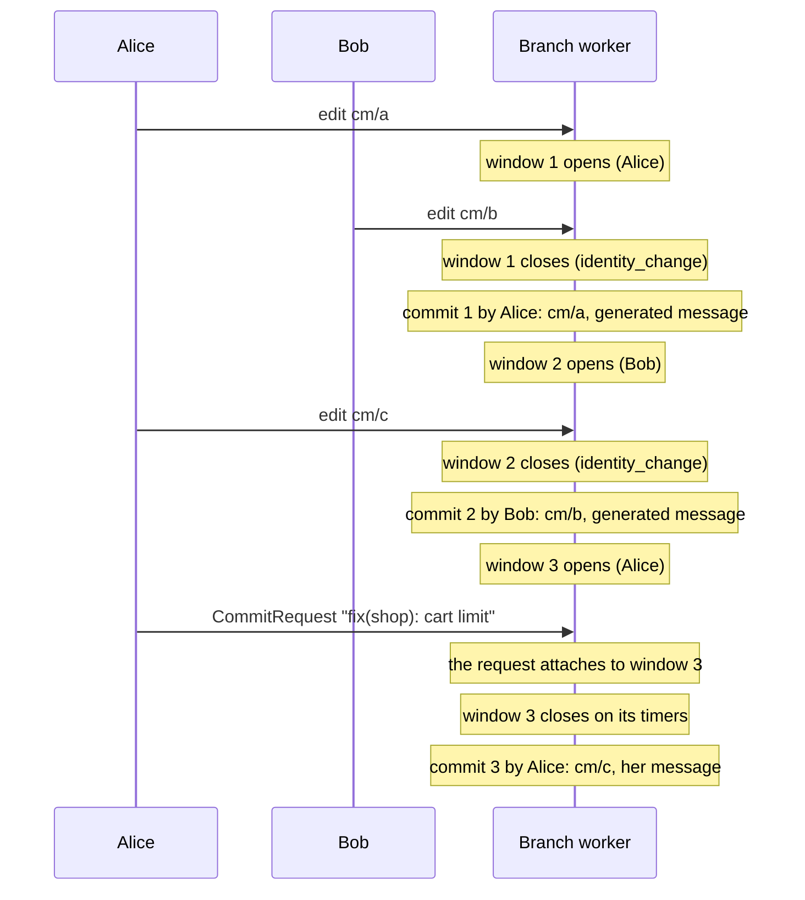
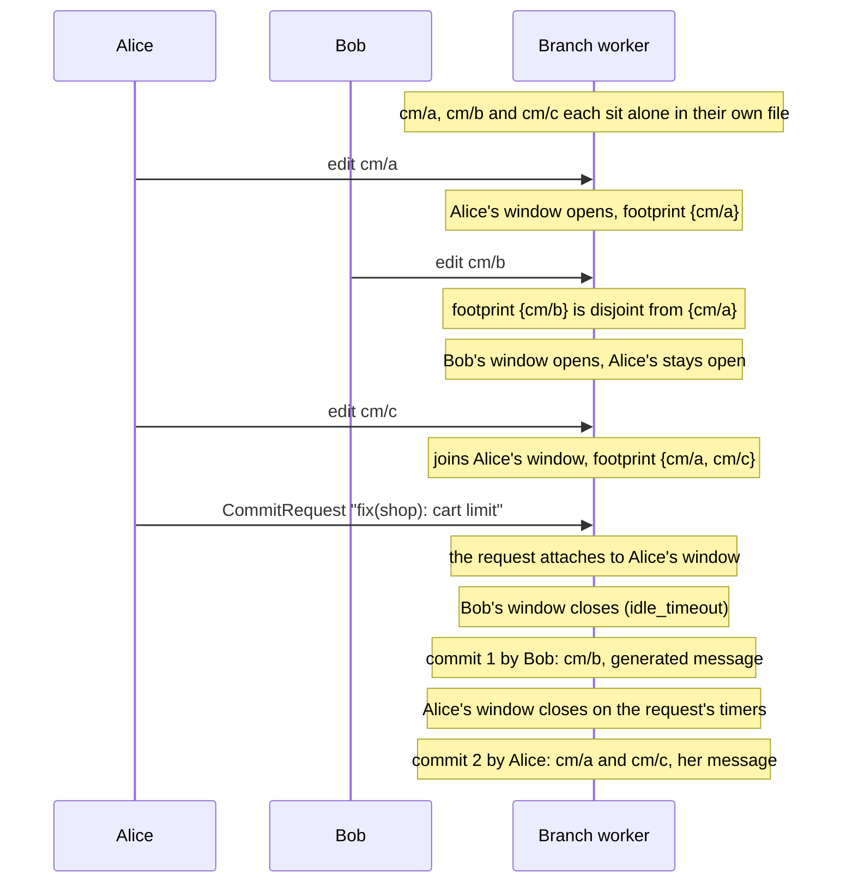

# Design: one commit window per author, open at the same time

Status: **stages 1 and 2 built** (`internal/git/window_set.go`, `footprint.go`,
`window_admission.go`; see [what stage 2 built](#what-stage-2-built)). Stage 2 ships without the
startup flag of stage 4, so stage 3 lands before the next release (`docs/TODO.md`). Raised by
gitops-api's review of the source-side save (PR #456):
with saves created straight from a browser, a second person's edit splits the first person's change
into two commits. This page sets out the change that fixes that, the rules it must keep, how to test
it, and the stages to ship it in.

It splits authors by **destination**: two people editing different objects in different files get
one commit each. Two follow-ups that go further (splitting one object by field, and letting an
incoming Git commit leave windows open) carry different correctness risks (and the first reopens the decided
[field-ownership spec](../spec/manifestedit-field-ownership-spike.md)), so they live on their own
page, [window-field-ownership-and-apply-hold.md](window-field-ownership-and-apply-hold.md).
Neither is needed for the benefit this page delivers.

## The problem

A branch worker holds **one** open commit window at a time (`branchWorkerEventLoop.openWindow`). A
window belongs to one author on one `GitTarget`, and a write that is anyone else's cannot join it
(`openWindow.canAppend`). It closes the window first, with close reason `identity_change`, and opens
its own.

Alice's change is three files and one save. Git gets two commits for her: `cm/a` under the generated
message, `cm/c` under hers. Nothing fails; the history is wrong about what belongs together.

gitops-api avoids it today by serializing every save and its edits behind one lock in its server
(`commitGate`). A client that creates `CommitRequest`s on a source cluster from the browser has no
such lock, so the split comes back.

Two saves by **one** author on one `GitTarget` are a different problem, and it is already handled.
A window carries one message, so the second save is refused with `SaveInProgress` while the first
still waits for a window or collects one. That stays true under this proposal, which changes only
how different authors interleave.

## The proposal

Keep a window per **(GitTarget, author, attribution class)** instead of one per worker. A write joins
the open window with its identity, or opens one. Writes by others no longer close it, **when the
worker can prove the two writes land in different places in Git** (see
[conflict footprint](#a-write-has-a-conflict-footprint)). Each window keeps its own timers, its own
attached request and its own message. Commits stay whole-object writes, as today.

Writes that name no author keep sharing one window, as today: they have no author to tell apart.

The loop itself does not change shape: one event-loop goroutine, and the ordered pending-write
pipeline after it. Closing a window still produces one pending write; only the number of windows
that can be open in front of the pipeline changes.

## What has to stay true

### A write has a conflict footprint

Today the single window gives a simple guarantee: commits land in the order their writes arrived,
so the last write to a file is the one Git ends with. With several open windows, that breaks unless
something keeps it:

1. Alice edits `cm/x` (her window).
2. Bob edits `cm/x` after her (his window).
3. Bob's window closes first, then Alice's: Git ends with Alice's **older** `cm/x`.

**Rule: a write whose footprint is not proven disjoint from every other open window's closes those
windows first.** Bob's edit of `cm/x` closes Alice's window, so her commit lands before his. The
close reason is new, `path_conflict`.

The footprint is **the set of Git files a write may change**. It is a different thing from the key a
window coalesces events by, and the two must stay separate:

- **The coalescing key** is `windowPathKey`: the `GitTarget`'s path joined with the file name
  `generateFilePath` would give the object (`internal/git/open_window.go`). It is a per-object key,
  and it stays exactly that. Replacing it with a physical file name would be wrong in the other
  direction: several objects in one YAML file would then replace each other in `pathToEvent`.
- **The footprint** is where the write lands, which the generated name only guesses. The write plan
  (`planEventsToWorktree`, `writeBatch`) resolves the destination when the window is committed:
  an existing document wherever it already lives, a file shared with other objects, a generator
  source such as a `configMapGenerator` literal in `kustomization.yaml`, and the files a removal
  touches.

The footprint has to be known when a write **arrives**, before any plan has run, so the first
release proves independence only where it is cheap and certain, and serializes everywhere else.
A write is **proven independent** only when all of these hold:

- the `GitTarget` folder that holds the object is governed by no kustomization, and `useKustomize`
  is off, so the write registers nothing in a `kustomization.yaml` and creates none (a new file is
  always added to the kustomization governing it, and `useKustomize` creates one on the first new
  document);
- the object's destination is the built-in path, with no `placement.byType` or `placement.default`
  template for its type: a template can bundle several objects into one file (`all.yaml`);
- the destination file holds only this object's document, or does not exist yet. The built-in
  path has no API version, so two versions of one object share a file: they count as one object.

| Write | Footprint | Can open a window beside others |
| --- | --- | --- |
| Update or delete, proven independent, of a document the index places alone in its own file | that file | yes |
| Create, proven independent, with no document for the object yet | the built-in path | yes, unless another open window's footprint holds that path |
| An object in a file with other documents | unknown | no |
| A create or delete that registers or unregisters a file in a kustomization, or creates one | unknown | no |
| A create under a placement template | unknown | no |
| An object under a kustomization, a generator source, or any layout the worker renders | unknown | no |
| An object the index cannot place | unknown | no |

"No" closes every other open window first, which is today's behavior, reported as
`identity_change` as it is now. The rule never guesses: unknown is treated as overlapping
everything. Shared files and kustomize layouts are the obvious next candidates once the base change
is measured; each needs its own proof.

### A footprint proof is tied to a revision

A proof is made against the worker's placement index, and the index changes under open windows:
the worker's own commits add and remove files, a replay onto a foreign commit brings in another
tree, and a `GitTarget` spec change (placement templates, `useKustomize`) changes where a create
goes. A proof that was true at arrival can be false when the window is committed.

So every footprint records the **revision** it was proven against: the tree the index was built
from, plus the `GitTarget` generation. The invariant:

> A write may join or open a window beside others only while every open window's footprint is
> proven against the current revision.

When the revision changes (an own commit, a replay, a fetched foreign commit, a `GitTarget`
generation change), the worker recomputes every open window's footprint against the new index
**before** the next write is admitted beside others. A footprint that is now unknown, or that now
overlaps another window's, closes the windows involved, oldest first, with `path_conflict`.

A last check runs at materialization, **before the commit**: every path the write's commit would
change must be inside the window's footprint. That is the whole batch's changed files;
`writeBatch.touched` covers one event at a time and is not enough. A write that changes more is a
footprint bug, and committing it could put an older value over a newer one, so the worker refuses
it: it undoes the worktree, fails the window's save with the paths in its message, falls back to
one window for the rest of its life, and asks a resync of the `GitTarget`, which brings Git back to
the cluster without depending on the order of the windows. The reference model treats it as a test
failure.

### Every close trigger keeps its exceptions

Today's close triggers are about the branch, not about one author. They do not all close
unconditionally, and the first release must keep each exception. In particular, a window carrying
a `CommitRequest` is protected from two of them, and a blanket "close everything" would let an
unrelated push split a save that is protected today.

| Trigger | Which windows close | Exception that stays |
| --- | --- | --- |
| `foreign_commit` (`closeWindowForPushHint`) | every window **without** an attached `CommitRequest` | a window carrying a request stays open for its save |
| `apply_due` (`flushed`) | every window, when the flush begins and takes the flush mark | the flush does not begin while any request is registered (`writeBusy`) |
| `resync_before_apply` | every window | none (as today) |
| `shutdown` | every window | none |
| `buffer_limit` | every window | none; closing only the largest is an open question |
| `path_conflict` | the windows whose footprint the new write overlaps | none |
| `footprint_fallback` | every window but the newest, when a commit outside its footprint makes the worker hold one window at a time | none |
| `identity_change` | every other window | stays for writes of another `GitTarget` and for unproven footprints |
| `idle_timeout`, `max_duration`, `attach_next` | that window only | none |

Why the first two exist matters for every later change to them:

- **`foreign_commit` is how a busy branch learns about a push.** A push notice is a hint, and with a
  window open the worker reads nothing from the remote first (the refresher skips a busy branch,
  `noteBusyPushNotice`). Closing the windows and publishing is what discovers the move: the push is
  rejected, the worker fetches and replays onto the foreign commit, and an apply becomes due. Without
  the close, the push would be found only when a window closed on its own timers.
- **`apply_due` is the flush** ([S1 in applier-echoes.md](applier-echoes.md#s1-flush-then-apply)).
  It closes the windows, takes the flush mark, and publishes every write up to the mark. An edit
  decided after the mark does not hold the apply back: the applier's apply window records it, so an
  apply that overwrites it is withheld and repaired. That replaced the old "quiet branch" wait, which
  starved the apply for as long as someone kept editing. Several windows must not bring that wait
  back.

**Order:** when one trigger closes several windows, they close in opening order, oldest first. Two
windows opened in the same wake are ordered by a sequence number taken when each opened, never by
map iteration or by time, so the order is deterministic and testable.

### Commit order is close order

Commits land in the order their windows close, not the order their first writes arrived. With Alice
open since 10:00 and Bob since 10:01, Bob's commit can come first. Together with the footprint rule
above, no file ever goes back in time, but `git log` no longer reads as one timeline of edits. That
is the point of the change, and it needs saying in `docs/configuration.md` when it ships.

### Saves

- A save attaches to the open window of its identity, by lookup instead of comparison with the one
  window. `matchesWindow` keeps its rules.
- `WindowMismatch` loses most of its meaning: it said "only another author's window was open", and
  with a window per author another author's window no longer stands in a save's way. A save that
  finds no window of its own reports `NoWindow`.
- `SaveInProgress` is unchanged: it is already per author and `GitTarget`.
- Each request settles exactly once, whichever trigger closes its window.

### The window decisions have specific names

Concurrent windows do not depend on persistence: they keep explicit identities, deadlines and
decision reasons, and leave how a restart recovers them to the
[event model](branch-worker-event-model.md#commands-facts-and-effects) and the HA plan. Each decision
gets a specific name, used in log lines, close reasons and the reference model. A log line carries
the branch with the window ID, since the ID resets with the worker; the ID is never a metric label.

| Decision | Logged with | When |
| --- | --- | --- |
| `WindowOpened` | window ID, author, `GitTarget`, footprint, revision, opening time | a write opens a window |
| `WriteJoinedWindow` | window ID, the write, the footprint after it | a write joins an open window |
| `FootprintReproved` | window ID, new revision, the footprint or unknown | the revision changes under an open window |
| `WindowClosed` | window ID, close reason, the writes it holds | a window closes |
| `SingleWindowFallback` | the paths a plan touched outside its footprint | the materialization check fails |

The window ID is the opening sequence number, unique for the life of one worker. Deadlines follow
from the opening time, the latest write and the timers.

## How to test it: a reference model

"Git equals the cluster at the end" is too weak a check for this change. A later write can repair a
temporary revert or a wrongly credited commit, so the end state looks right while the history was
wrong in between. And it is the wrong check in places: an incoming Git edit that is not applied yet
is supposed to survive in Git, and a no-op edit is supposed to produce no commit.

So the test is a **reference model**: a small, independent implementation of the rules on this page,
fed the same random sequence of inputs as the worker, with the worker's output checked against it.

**Inputs:** accepted writes (with author, `GitTarget`, object, footprint), deletes and recreates,
undos (a write that puts back an earlier value), no-op writes, saves (including `attach_next` and a
zero `maxDuration`), foreign commits, `GitTarget` spec changes, applies, resyncs, failed
publications and replays, buffer pressure, shutdown, and clock steps from a controllable clock.

**Checked on every commit the worker makes:**

- its author and message are the ones the model says the closing window has;
- the files it changes are inside that window's footprint, proven against the revision current when
  it was committed;
- **an older accepted write never lands after a newer conflicting one.** Two writes conflict when
  their footprints overlap; acceptance order is the order the worker accepted them. The check is
  about the order of writes, never about content: an undo that puts back an earlier value is a newer
  write, and it is correct for Git to end with that value;
- a save's request settles exactly once, with the outcome the model expects.

**Checked after every step, not only at the end:** the retained-byte charge equals the model's
expected charge for what is open and pending at that moment. A charge that is right at the end can
still have been too low in between, and an undercharge lets the worker pass its cap.

**Checked when the worker is drained:** Git's tree is the model's tree, and the retained-byte
charge is zero.

The model and the controllable clock come **first**, in stage 1, while the worker still has one
window, so they are proven against today's behavior before they are used to judge the new one.

## Stages

1. **Extract window management without changing behavior.** Move the window bookkeeping
   (`openWindow`, its timers, attach and finalize) behind one type that holds a set of windows, with
   one window allowed. Add the controllable clock, the opening sequence number, and the reference
   model. Every existing test passes unchanged.
2. **Allow several windows for proven-independent destinations.** Writes keep whole-object commits
   and apply behavior stays as it is. Writes of another `GitTarget` keep closing other windows
   (`identity_change`), and every layout in the footprint table's "no" rows stays serial.
3. **Test the failure boundaries.** Both close orders, conflicting writes, delete and recreate,
   `attach_next`, zero-duration windows, resync, shutdown, failed publication and replay, and buffer
   pressure, each against the reference model.
4. **Ship behind a startup flag**, off by default at first. The flag is read once, at start; changing
   it takes a restart, and the restart drains every open window through the normal shutdown path
   (opening order, close reason `shutdown`), so there is no live transition to get right. Measure concurrent-window
   counts, forced splits by reason, save outcomes, and memory before turning it on by default.
5. **Reconsider the follow-ups** in
   [window-field-ownership-and-apply-hold.md](window-field-ownership-and-apply-hold.md), using those
   measurements. Field ownership and the apply hold are separate changes, each with its own
   state-machine review.

### What stage 2 built

The rules above, with these choices where the page left room:

- **A window is proven once it has company.** A window that never sat beside another has no
  footprint ("unproven") and its commit is not checked; proving costs a scan of the folder per
  revision, and a lone window needs no proof. From the first write admitted beside it, a window's
  footprint covers every write it collects.
- **The proof also needs the folder's bootstrap files committed**, the checkout to hold every decided
  write, a whole object (not a field patch) and a type that is not encrypted. Anything else is
  unknown. The revision is the count of the worker's resets and own commits, with the generation.
- **The check before the commit uses a proof of the commit's own tree.** The windows a write's
  admission closes commit before it and can move what it changes (a delete committed first turns
  its update into a create), so the decided write is proven again once the checkout holds every
  write before it. After a reset or a `GitTarget` change the proof is of another tree, and the
  commit is not checked. A refusal fails the write as terminal: the worktree is undone, its save
  fails with the paths, the worker logs `SingleWindowFallback` and holds one window at a time until
  it restarts, and a resync of the `GitTarget` is asked for.
- **A request's own author's window stands in no one's way.** A save waiting while another author's
  window is open records a mismatch only when no window of its own author is open.
- **The window ID** (`window`) is in the open, close and finalized log lines, with the branch.

## What it costs

- **The loop's state.** The single `openWindow` becomes a set with an opening order, the close timer
  becomes the earliest of all windows' deadlines, and every path that reads `l.openWindow` today
  (attach, finalize, the apply window, resync cut-off, metrics) has to say which window, or all.
  Stage 1 does this refactor on its own, with no behavior change.
- **Footprints at arrival.** Deciding a footprint needs the worker's placement index of the
  `GitTarget` subtree when a write arrives, not only when it plans a commit.
- **Memory.** One window per active author. The byte cap stays global, so the bound does not change.
- **Tests.** The commit-window, attach and apply-window suites assume one window. Most of them keep
  their meaning with one author; the interleaving cases are new, and the reference model is new.
- **Metrics.** `git_commit_windows_total` gains `close_reason="path_conflict"`. A gauge of open
  windows shows how often authors overlap at all.

## Potential problems

Most failures here are **silent**: Git gets a plausible commit with the wrong content or the wrong
author, and nothing reports an error. That is why every unknown is treated as overlapping, and why
the reference model checks every commit.

- **P1. A footprint that is too small.** A write lands somewhere its footprint did not name (an
  existing document in an unexpected file, a generator source, a removal that edits a shared file),
  and two windows commit to one file in the wrong order. *Mitigation:* footprints are proven or
  unknown, never guessed; the table's "no" rows stay serial; the check before the commit refuses a
  write that changes more than its footprint; the reference model includes shared files and
  generator layouts.
- **P2. A close trigger loses its exception.** A push hint or an apply flush that closes a window
  carrying a save splits a save that is protected today. *Mitigation:* the trigger table above is the
  specification, and each exception has a test in stage 3.
- **P3. Nondeterministic order.** Windows that close in the same wake in map order give a different
  history run to run, and a flaky test. *Mitigation:* the opening sequence number.
- **P4. A request settles twice, or never.** With several windows, a request can be seen by two close
  paths, or by none. *Mitigation:* the reference model checks exactly-once settling on every run.
- **P5. Retained bytes drift.** Charges taken when a window opens or a message attaches, released on
  a different window's close, leave the cap wrong. *Mitigation:* the model checks the charge after
  every step, as well as once drained.
- **P6. A stale footprint proof.** A proof made against one tree is used after an own commit, a
  replay or a `GitTarget` change moved the index. *Mitigation:* proofs carry their revision, are
  recomputed before the next concurrent admission, and the check before the commit refuses a write
  that changes a file outside its footprint.
- **P7. The flush starts waiting again.** A change that makes `apply_due` wait for windows to close
  on their own reintroduces the starvation S1 removed. *Mitigation:* the flush closes every window
  at once, as today; only the save exception holds it.
- **P8. `git log` stops being a timeline.** *Mitigation:* document it with the close-order note in
  `docs/configuration.md`.

## Alternatives

1. **Keep one window, and let clients serialize.** What gitops-api does today. Correct, and costs a
   server on the save path, which is what creating `CommitRequest`s on the source cluster set out to
   remove.
2. **Per-author windows without the footprint rule.** Simpler, and wrong: a file can go back in time
   with no error.
3. **Merge concurrent windows into one commit with several authors.** Git has one author per commit;
   `Co-authored-by` trailers would blur exactly the attribution the product exists for.

## Open questions

1. Does `buffer_limit` close every window, or only the one that crossed it?
2. After stage 4, do windows of different `GitTarget`s on one branch also stay open side by side?
   The per-`GitTarget` encryption and bootstrap that made one window per target necessary are per
   window already; the first release keeps them serial anyway.
3. Is a cap on open windows needed beyond the byte cap, such as one per `GitTarget`?
4. When a save's own window is closed early by `path_conflict`, it commits with the save's message
   and less than the person meant to save. Is that acceptable, or should the save report it?
5. How much of the proof can the worker's placement index answer at arrival without a plan, and
   what does that lookup and the recomputation after each revision change cost?
