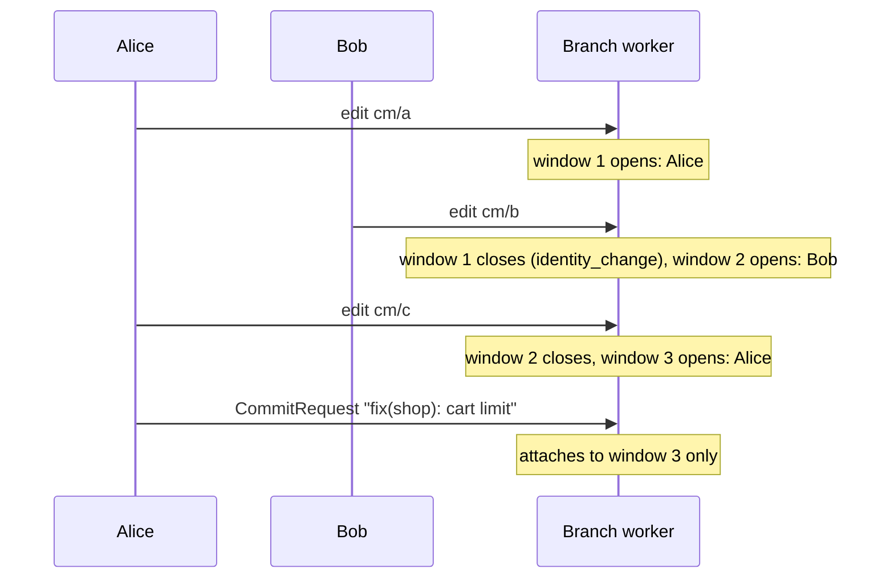

# Design: one commit window per author, open at the same time

Status: **proposal, not built.** Raised by gitops-api's review of the source-side save (PR #456):
with saves created straight from a browser, a second person's edit splits the first person's change
into two commits. This page sets out the change that would fix that, what it costs, and what is
still open.

## The problem

A branch worker holds **one** open commit window at a time (`branchWorkerEventLoop.openWindow`). A
window belongs to one author on one `GitTarget`, and a write that is anyone else's cannot join it
(`openWindow.canAppend`). It closes the window first, with close reason `identity_change`, and opens
its own.



Alice's change is three files and one save. Git gets two commits for her: `cm/a` under the generated
message, `cm/c` under hers. Nothing fails; the history is just wrong about what belongs together.

gitops-api avoids it today by serializing every save and its edits behind one lock in its server
(`commitGate`). A client that creates `RemoteSaveRequest`s from the browser has no such lock, so the
split comes back.

Two saves by **one** author on one `GitTarget` are a different problem, and it is already handled.
A window carries one message, so the second save is refused with `SaveInProgress` while the first
still waits for a window or collects one. That stays true under this proposal, which changes only
how different authors interleave.

## The proposal

Keep a window per **(GitTarget, author, attribution class)** instead of one per worker. A write joins
the open window with its identity, or opens one. Writes by others no longer close it. Each window
keeps its own timers, its own attached request and its own message.

```mermaid
sequenceDiagram
    participant A as Alice
    participant B as Bob
    participant W as Branch worker
    A->>W: edit cm/a
    Note over W: Alice's window opens
    B->>W: edit cm/b
    Note over W: Bob's window opens; Alice's stays open
    A->>W: edit cm/c
    Note over W: joins Alice's window
    A->>W: CommitRequest
    Note over W: Alice's window: cm/a + cm/c, her message
```

Writes that name no author keep sharing one window, as today: they have no author to tell apart.

## What has to stay true

### One path, one order

Today the single window gives a simple guarantee: commits land in the order their writes arrived,
so the last write to a path is the one Git ends with. With several open windows, that breaks unless
something keeps it:

1. Alice edits `cm/x` (her window).
2. Bob edits `cm/x` after her (his window).
3. Bob's window closes first, then Alice's: Git ends with Alice's **older** `cm/x`.

**Rule: a write to a path another open window holds closes that window first.** Bob's edit of `cm/x`
closes Alice's window, so her commit lands before his. The close reason is new, `path_conflict`.
The path is the window's own key (`windowPathKey`: the Git path, after placement), so a delete, a
rename to the same document, and a namespaced and a cluster-scoped object that map to one file are
all caught. Two authors editing the same object are therefore split exactly as today; two editing
different objects are not.

### Everything that closes "the window" closes all of them

The other close reasons are about the branch, not about one author, and each must close every open
window, oldest first:

| Reason | Why all of them |
| --- | --- |
| `foreign_commit` | the branch moved under every window |
| `apply_due`, `resync_before_apply` | an apply must not run with unpublished edits from anyone |
| `shutdown` | nothing survives the loop |
| `buffer_limit` | the cap is the worker's memory, not one author's |

`buffer_limit` could instead close only the largest or oldest window. Closing all is simpler and the
cap is rarely reached; this is an open question below.

### Commit order is close order

Commits land in the order their windows close, not the order their first writes arrived. With Alice
open since 10:00 and Bob since 10:01, Bob's commit can come first. Together with the path rule above,
no path ever goes back in time, but `git log` no longer reads as one timeline of edits. That is the
point of the change, and it needs saying in `docs/configuration.md` when it ships.

### Saves

- A save attaches to the open window of its identity, by lookup instead of comparison with the one
  window. `matchesWindow` keeps its rules.
- `WindowMismatch` becomes rare: it meant "only another author's window was open". With every author
  allowed a window, it remains only for the window a save may not claim: an unattributed one, without
  `SavedBy` or `TakeOver`.
- `SaveInProgress` is unchanged: it is already per author and `GitTarget`.
- The takeover (`TakeOver`, `SavedBy`) claims the unattributed window, which stays one window.

## What it costs

- **The loop's state.** `openWindow` becomes a map with an opening order, the close timer becomes the
  earliest of all windows' deadlines, and every path that reads `l.openWindow` today (attach,
  finalize, the apply window, resync cut-off, metrics) has to say which window, or all.
- **Memory.** One window per active author. The byte cap stays global, so the bound does not change.
- **Tests.** The commit-window, attach and apply-window suites assume one window. Most of them keep
  their meaning with one author; the interleaving cases need new ones, the path-conflict rule first.
- **Metrics.** `git_commit_windows_total` gains `close_reason="path_conflict"`. A gauge of open
  windows would show how often authors overlap at all.

## Alternatives

1. **Keep one window, and let clients serialize.** What gitops-api does today. Correct, and costs a
   server on the save path, which is what `RemoteSaveRequest` set out to remove.
2. **Per-author windows without the path rule.** Simpler, and wrong: a path can go back in time
   with no error.
3. **Merge concurrent windows into one commit with several authors.** Git has one author per commit;
   `Co-authored-by` trailers would blur exactly the attribution the product exists for.

## Open questions

1. Does `buffer_limit` close every window, or only the one that crossed it?
2. Should `identity_change` remain, for a write of another `GitTarget` on the same branch, or do
   windows of different `GitTarget`s also stay open side by side? The proposal says side by side;
   the per-`GitTarget` encryption and bootstrap that made one window per target necessary are per
   window already.
3. Is a cap on open windows needed beyond the byte cap, such as one per `GitTarget`?
4. When a save's own window is closed early by `path_conflict`, it commits with the save's message
   and less than the person meant to save. Is that acceptable, or should the save report it?
