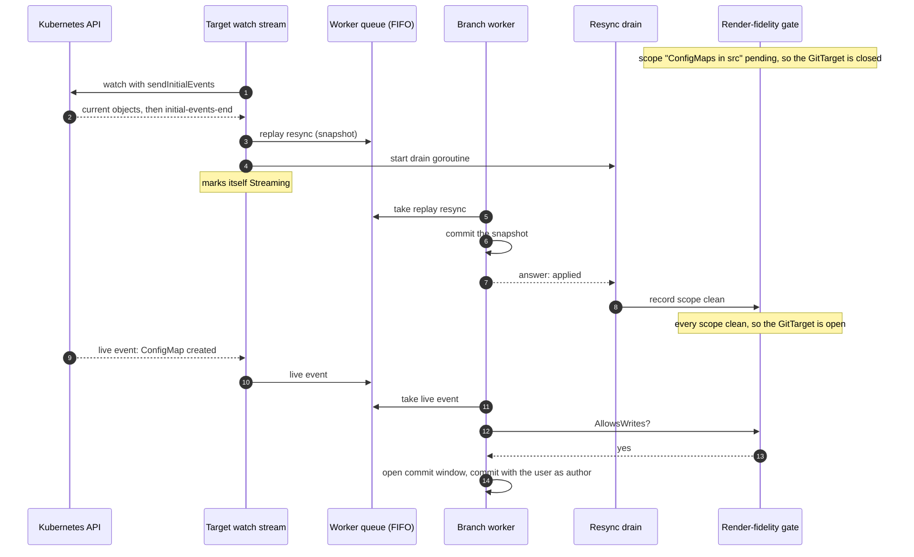
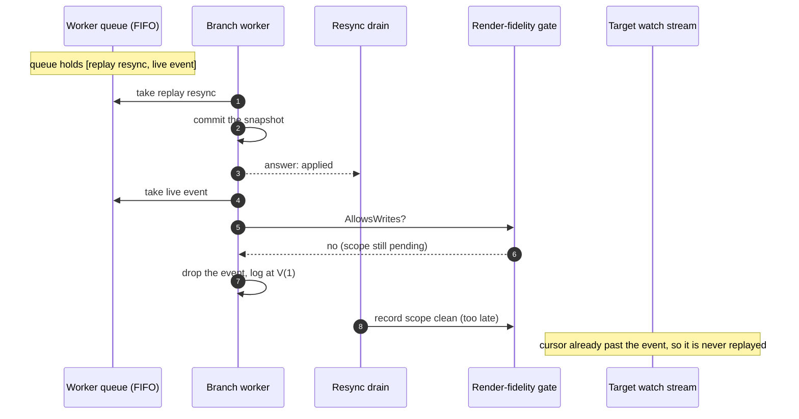
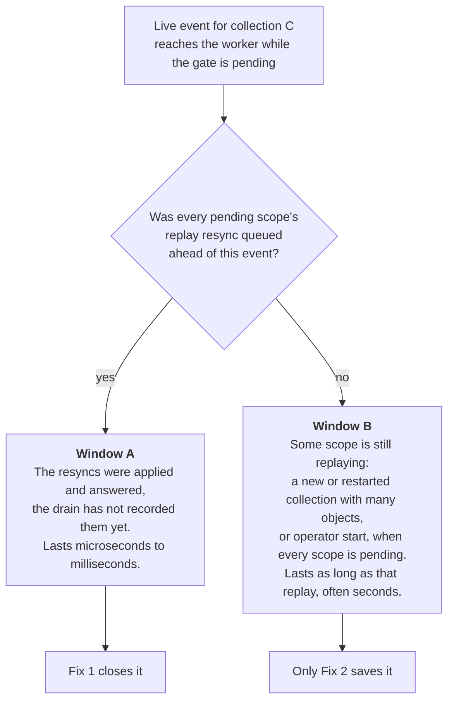
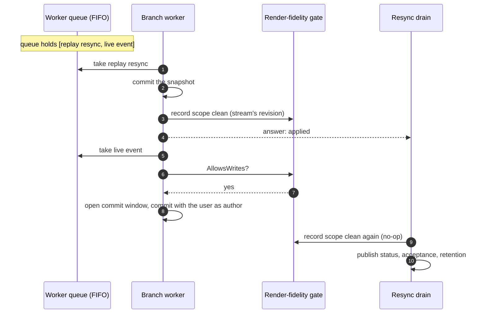
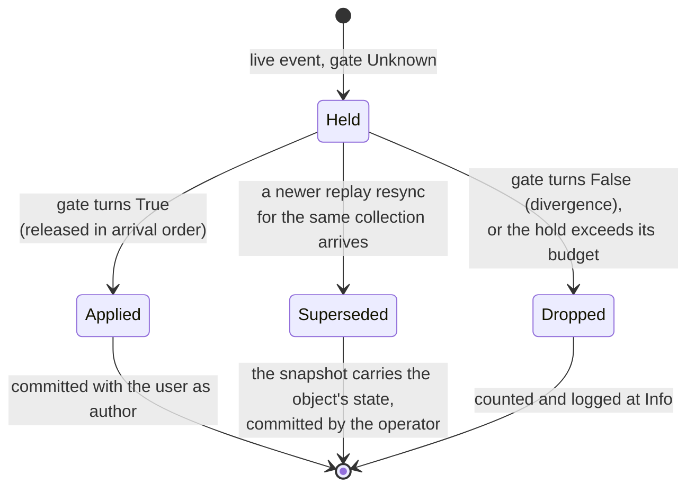
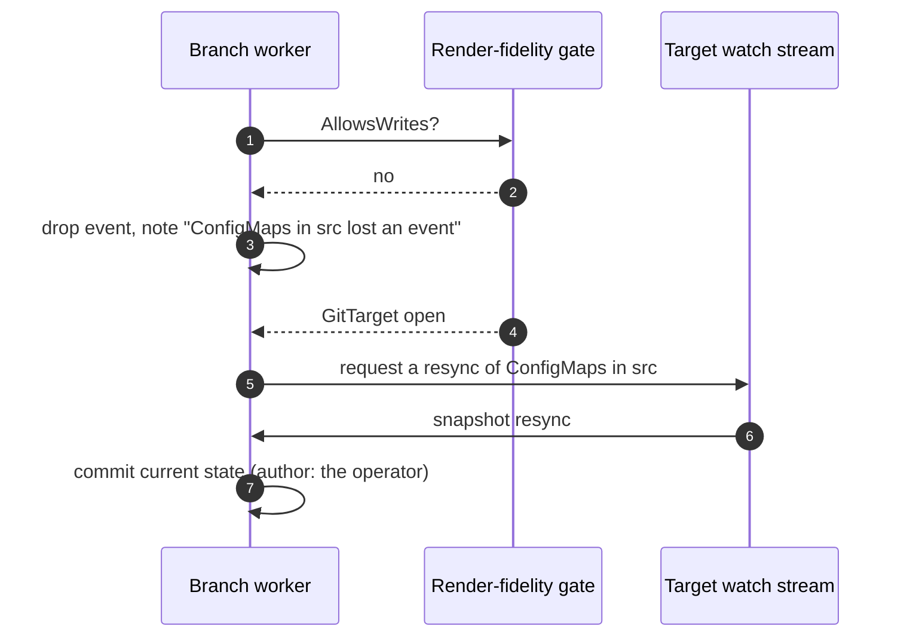

# A live edit dropped while a GitTarget's watches start

> **Status (2026-10-24): Fix 1 is built, Fix 2 needs a decision.** Fix 1 and the drop counter
> shipped with #420 (d7ce1bd4): the worker records a scope clean itself (`recordReplayClean` in
> `internal/git/render_fidelity_drops.go`), and `gitopsreverser_git_writes_dropped_total{kind,
> reason}` counts every drop, the first per gate status logged at Info. What is left is
> [Fix 2](#fix-2-stop-dropping-live-events-while-the-gate-is-pending): an edit that arrives while
> another collection of the same `GitTarget` is still replaying is still dropped.

The e2e spec `Audit route attribution` › *attributes a commit reached through a
`rules[].sourceNamespace` override* has failed 9 times in CI since 2026-09-21, and passes on a
rerun. The test is fine. It catches a product race: GitOps Reverser can **drop an API edit for
good** when the edit arrives while one of the GitTarget's watches is starting. This document
explains the race, shows it in a CI log, and lays out the two proposed fixes.

## The short version

1. Each collection a GitTarget watches has a **render-fidelity scope**. A new scope starts out
   pending, and the GitTarget stays closed to live writes until **every** scope has reported
   clean.
2. A scope reports clean when the branch worker has applied that collection's first snapshot (the
   replay resync). The worker answers the resync on its own goroutine, and a *separate* goroutine
   receives the answer and records the scope clean.
3. In the gap between those two steps the gate is still closed. The worker takes the next item off
   its queue, a live event, finds the gate closed, and **drops** the event.
4. Nothing brings it back. The watch has already moved past the event, and no replay follows. Fix 1
   made the drop visible: it is counted in `git_writes_dropped_total`, and the first drop under
   each gate status is logged at Info ([`render_fidelity_drops.go`](../../internal/git/render_fidelity_drops.go)).

**Fix 1** removes the gap: the worker records the scope clean itself, before it answers. That is
small, changes no documented behavior, and closes the race this spec hits.

**Fix 2** goes further: while the gate is pending, live events are held rather than dropped. That
also covers edits that arrive while some *other* collection of the same GitTarget is still
replaying, which Fix 1 cannot reach. It changes a drop that
[api-first-publication.md](../api-first-publication.md#what-can-stop-a-write-before-it-reaches-git)
documents as intended, so it needs your decision.

## The pieces involved

| Piece | Where | What it does here |
| --- | --- | --- |
| Target watch stream | [`internal/watch/target_watch.go`](../../internal/watch/target_watch.go) | One per collection (for example "ConfigMaps in namespace X"). Lists the current objects (the replay), hands that snapshot to the worker as a **replay resync**, then streams live events. Marks itself `Streaming` as soon as the resync is *enqueued*, without waiting for it to apply |
| Branch worker | [`internal/git/branch_worker.go`](../../internal/git/branch_worker.go) | One goroutine per repository and branch. Takes items off one FIFO queue in order: resyncs, live events, atomic writes |
| Render-fidelity gate | [`internal/git/render_fidelity_gate.go`](../../internal/git/render_fidelity_gate.go) | Holds one result per scope. `AllowsWrites` is true only when **all** of the GitTarget's scopes are clean |
| Resync drain | [`internal/watch/event_router.go`](../../internal/watch/event_router.go) `drainScopedResync` | A goroutine per replay resync. Waits for the worker's answer, then records the scope clean in the gate and publishes status |

Two properties of these pieces explain everything below:

- **The gate is per GitTarget, the scopes are per collection.** One pending scope closes live
  writes for every collection of that GitTarget (`AllowsWrites` at
  [`render_fidelity_gate.go:261`](../../internal/git/render_fidelity_gate.go#L261)).
- **The answer and the clean mark happen on different goroutines.** The worker answers in
  `settleResyncApplied` ([`pending_writes_loop.go:348`](../../internal/git/pending_writes_loop.go#L348));
  the drain marks clean later ([`event_router.go:357`](../../internal/watch/event_router.go#L357)).

## How a new collection is supposed to start

In this ordering the live event reaches the worker after the drain has recorded the scope. Nothing
in the code guarantees that ordering.

## The race

Steps 9 and 10 above run on two goroutines. If the live event is already in the queue, the
worker can take it between the answer and the clean mark:

The gap is small, often well under a millisecond, but the worker needs no time to reach the next
item: it is the same loop. The test makes the timing likely by creating its ConfigMap the moment
the new streams report `Streaming`, which they do as soon as their resyncs are queued.

### What a failing run shows

From CI run 36055043371 (job 107821494360, 2026-09-24), filtered to the GitTarget under test.
The new WatchRule starts **two** collections in the source namespace: ConfigMaps and Secrets.

| Time | Event |
| --- | --- |
| 20:43:08 | Watch plan reconciled: 1 collection kept, 2 started (ConfigMaps and Secrets in `…-src`). The gate now has 3 scopes, 2 pending |
| 20:43:08 | ConfigMaps replay complete → replay resync queued |
| 20:43:08 | Secrets replay complete → replay resync queued |
| 20:43:09 | Worker applies the ConfigMaps resync; drain records it clean. Gate: **Unknown, "Waiting for 1 of 3"** |
| 20:43:09.087 | The test creates the ConfigMap as `oidc-override-user` |
| 20:43:09 | Worker handles and applies the Secrets resync |
| 20:43:09 | Drain records Secrets clean. Gate: **True** |
| after | No `Opening commit window` for the ConfigMap, ever. The spec times out 30 seconds later |

This run shows the gate's per-GitTarget reach. The ConfigMap's own scope was already clean; the
event was dropped because the **Secrets** scope, whose resync sat ahead of it in the queue, had
been answered and not yet recorded. The drop log itself is at `V(1)`, which CI does not enable, so
the drop is inferred from the missing commit window. The agent that surveyed CI found the same
shape in all 9 failures: the gate opens in the same second the ConfigMap is created, and the
worker never logs the ConfigMap.

## Why the edit is gone for good

A dropped event is not retried anywhere:

- The stream records its watch cursor right after it routes a live event
  ([`target_watch.go:955`](../../internal/watch/target_watch.go#L955)), so a reconnect resumes
  *after* the event.
- A replay happens only when a stream (re)starts: operator restart, an expired cursor, or a plan
  change for that collection. The 30-second periodic plan pass keeps running streams as they are.
- Before Fix 1 the drop was logged only at `V(1)` and counted nowhere. It is now counted in
  `git_writes_dropped_total`, with the first drop under each gate status logged at Info.

So the edit stays missing from Git until the object changes again or the collection replays.
Raising the spec's timeout would not help, because the event no longer exists anywhere to wait
for.

## Two windows, not one

Fix 1 and Fix 2 differ in which events they save. There are two ways a live event can meet a
pending gate:

- **Window A** is the e2e failure. Both resyncs were in the queue before the ConfigMap existed,
  because the test waited for `Streaming`.
- **Window B** reaches users the test does not cover. While a GitTarget adds a collection with a
  thousand objects, an edit to any of its *other* collections is dropped until that replay
  finishes. On operator start every scope is pending, so edits to a collection whose replay
  finished early are dropped while the slower ones are still listing. Window B is the documented
  behavior today: "Live events and atomic writes are dropped while the gate is closed."

## Fix 1: record the scope clean on the worker's goroutine

The worker already holds the gate (`w.renderFidelityGate`) and is the one that knows the resync
applied. If it records the scope clean itself, before it answers and before it takes the next
item, the gap disappears.

What changes:

1. `ResyncRequest` gains the stream's render-fidelity revision (`stream.revision`, already passed to
   the drain), set by `enqueueReplayResync`.
2. `settleResyncApplied` calls `RecordScopeClean(target, revision, collection)` before
   `answerResync`, when the request carries a revision.
3. The drain keeps its call. A second clean report under the same revision is accepted unchanged
   (`recordScope` at [`render_fidelity_gate.go:188`](../../internal/git/render_fidelity_gate.go#L188)),
   so it costs nothing. The drain still publishes the condition, `GitPathAccepted` and retention,
   which stay where they are.
4. Divergence stays on the drain. A divergent scope keeps the gate closed, and so does a pending
   one, so recording it later loses nothing.

What it guarantees: **a live event queued behind every pending scope's replay resync sees the gate
those resyncs produced.** That covers Window A completely.

What it does not cover: Window B. An event that enters the queue before a slower scope has even
finished listing still meets a pending gate.

Size: a field, two call sites, and a unit test in `internal/git` that queues a replay resync and
a live event back to back and asserts the event is committed with its author. It runs the same
code path the e2e spec does, with no timing in it. No user-facing doc changes.

## Fix 2: stop dropping live events while the gate is pending

The gate exists so that GitOps Reverser does not write an edit to Git while it cannot yet tell
whether the folder's rendered values match the live objects. Holding an event back serves that
purpose as well as dropping it does. The difference is what happens once the gate opens.

There are two ways to build it, and they trade completeness against attribution.

### 2a: hold the events, release them when the gate opens

- The worker keeps a per-GitTarget list of held live events instead of discarding them. Held
  events count against the intake budget, like pending writes do.
- The gate tells the worker when a GitTarget's state changes (a channel or callback), so the
  worker releases held events on the next wake instead of polling.
- **Ordering rule.** A replay resync for collection C that arrives while events of C are held
  replaces those events: its snapshot is newer and already includes their effect. Releasing them
  after it would write older state over newer. Events of other collections stay held.
- When the gate turns **False** (a divergence), held events are dropped, as today. That is the
  gate doing its job. The difference is that the drop is counted.
- A budget (bytes and time) bounds the hold, because a scope can stay pending for a long time. The
  watch-plane failures in
  [watch-plane-status-convergence-failures.md](watch-plane-status-convergence-failures.md)
  show one waiting indefinitely. Past the budget the worker falls back to 2b for that collection.

Keeps: the user as commit author, which is what this e2e spec asserts and what the audit-route
work exists for. Costs: the most code of the three options. A new hold structure, a gate
notification and the supersede rule all need tests.

### 2b: drop, then re-derive with a resync

The worker keeps dropping, but remembers which collections lost an event while the gate was
pending. When the gate opens it asks the watch layer for a resync of those collections, and the
snapshot puts the current state in Git.

Keeps: the "dropped while closed" rule, with the loss repaired afterwards. This is how a failed
window finalize is already handled ("gone until the next resync re-derives them"). Costs: the
commit carries the **operator** as author, not the user, because a snapshot has no audit fact
behind it. This e2e spec would still fail, since it asserts the author.

### Either way: a drop is visible

Built with Fix 1: `gitopsreverser_git_writes_dropped_total{reason="render_fidelity_pending"}`
counts each drop, and the first drop per gate status is logged at Info. Read it before choosing
between 2a and 2b: it says how often window B happens.

## Side by side

| | Fix 1 | Fix 2a: hold | Fix 2b: re-derive |
| --- | --- | --- | --- |
| Closes the e2e flake | Yes | Yes | No: right state, wrong author |
| Window A (answered, not recorded) | Closed | Closed | Repaired later |
| Window B (another scope replaying, operator start) | Still dropped | Held, then committed | Dropped, then re-derived |
| Commit author for a saved edit | The user | The user | The operator |
| Changes documented behavior | No | Yes: "dropped" becomes "held" | Partly: the drop is repaired |
| Size | Small | Large | Medium |
| Needs a decision | No | Yes | Yes |

## Recommendation

1. **Fix 1 and the drop counter are built.**
2. **Decide Fix 2.** If an API edit must never vanish while a GitTarget changes its
   watches, which is what "API-first" promises, choose **2a**, with 2b as its fallback past the
   budget. If dropping during a watch change stays acceptable, keep today's rule and let the new
   counter show how often it happens. Measuring first is a reasonable step before building 2a.

## A separate, smaller test bug

The spec's `Describe` body calls `SetDefaultEventuallyTimeout(3 * time.Minute)`
([`audit_route_attribution_e2e_test.go:121`](../../test/e2e/audit_route_attribution_e2e_test.go#L121)).
That setting is global, and Ginkgo runs every `Describe` body while it builds the tree, so the last
file to set it wins. Seventeen e2e files set it, so this spec runs with whatever value the last of
them sets (30 seconds in the failing runs). This did not cause the flake, because a dropped event
never arrives however long the test waits. A per-spec timeout (`Eventually(...).WithTimeout`) or a
`BeforeEach` would make the value mean what it says.

## How sure this is

- **Read in the code:** the separate goroutines, the per-GitTarget gate, the drop at `V(1)`, the
  cursor recorded past a routed event, the drain's idempotent clean record, and `Streaming` being
  marked before the resync applies.
- **Seen in one CI log** (above): the timeline matches Window A on a sibling scope, and no commit
  window ever opened for the ConfigMap.
- **Not seen directly:** the drop log line itself, which CI's log level hides. An e2e run with
  `-v=1` on the manager, or the Info log from "make a drop visible", would show it.
- **Agent survey, not re-checked line by line:** the claim that all 9 failures have the same shape.
