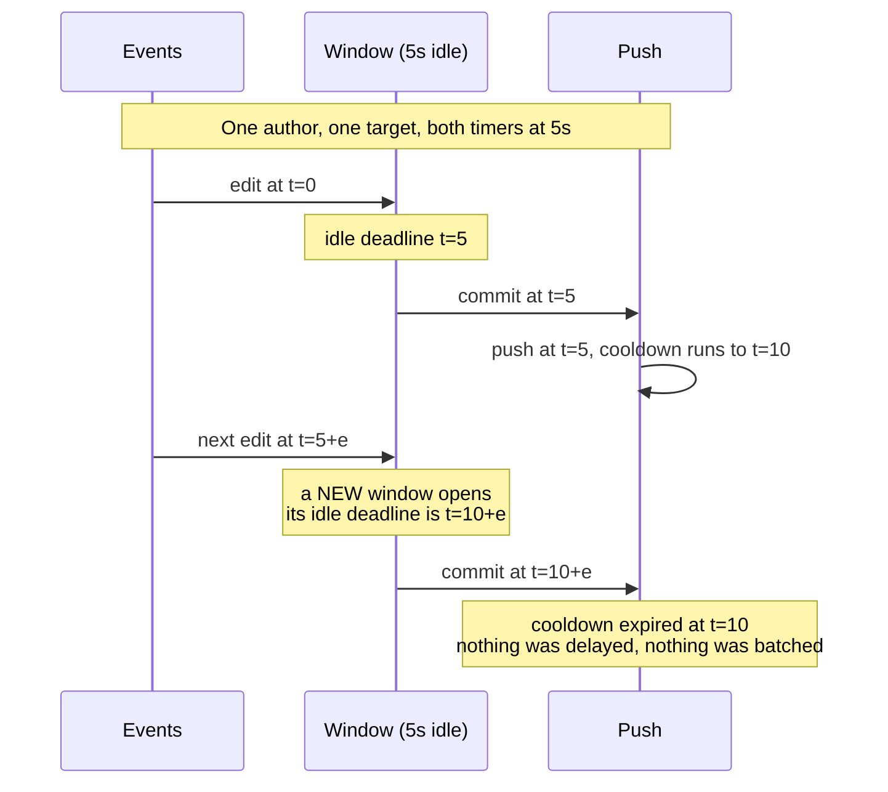
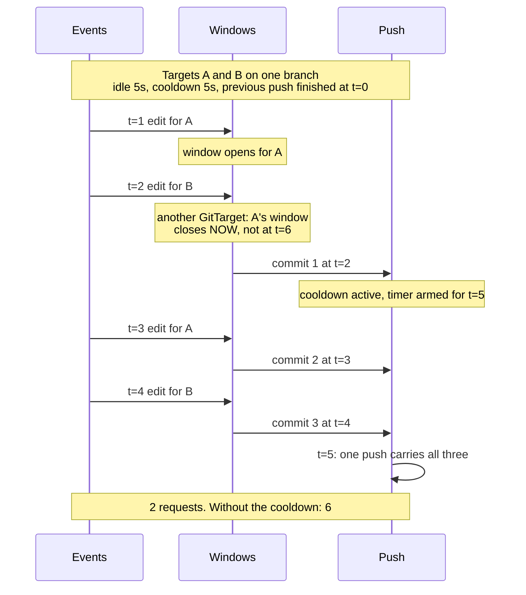
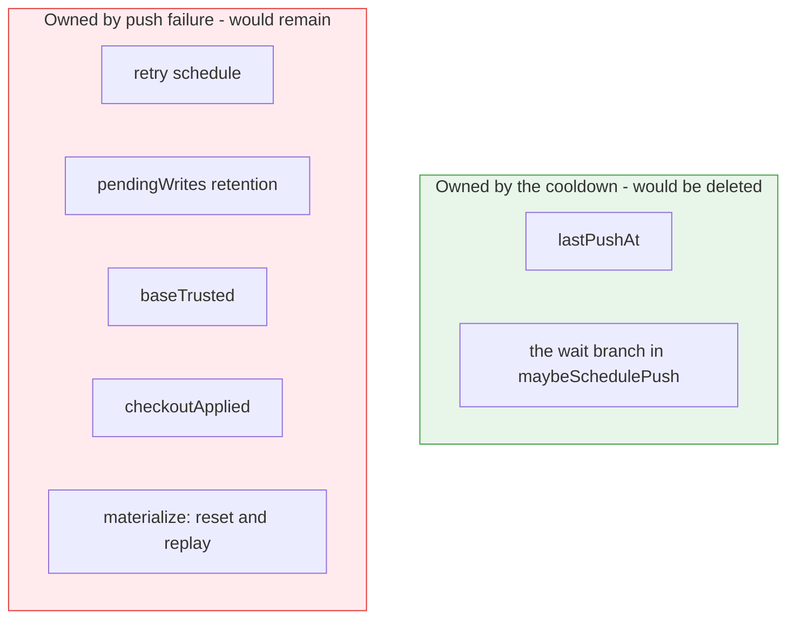
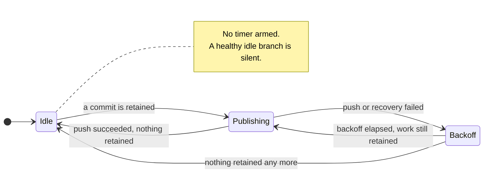

# The push cooldown: what it still buys, and what removing it would cost

> **design**: open. Option C (§7), the failure backoff, is built in
> [`retry.go`](../../internal/git/retry.go) (#412), one schedule with parent recovery's probe since
> #413. The success cooldown is unchanged. Concurrent commit windows (#467, #476) changed where it
> engages (§3). Option D needs the measurements in §9; option E stays rejected without them.
> Index: [`../INDEX.md`](../INDEX.md). Reviewed at `11b8b4e0` on 2026-11-10.
> Related: [`../api-first-publication.md`](../api-first-publication.md),
> [`concurrent-author-windows.md`](concurrent-author-windows.md),
> [`../spec/commit-window-refactor.md`](../spec/commit-window-refactor.md)

**The question.** `PushCooldown` predates the commit window. The window groups an editing burst into
one commit, which is most of what the cooldown was invented to do. Is the cooldown still earning its
place, and would removing it simplify the worker?

**The short answer.** One window closing on its own idle timer is already spaced past the cooldown
(§2). The cooldown batches the commits that land close together anyway: windows closed early (a
write of another `GitTarget`, an overlapping or unproven footprint, the buffer limit,
`idleTimeout: 0s`), and windows open side by side whose idle timers run out within seconds of each
other (§3). Removing the success wait would remove `lastPushAt`, `pushTimer` and their scheduling
branch; the retry timer and the retained-write machinery stay. Whether that is worth the extra
publications is the measured decision in §9.

## Outage handling is not the cooldown's job

Failure backoff paces attempts at Git (`retry.go`); capacity admission pauses intake for the
affected worker and resumes producers once the accepted backlog settles
([recovery contract](gittarget-branch-worker-pending-writes.md#recovery-contract)). Both are built.
Neither needed the success cooldown, and removing it would close none of their gaps. Neither one
supplies storage durability: that is the HA plan's.

## 1. What it is today

`PushCooldown` is a fixed `5s` per worker. `maybeSchedulePush`
([`branch_worker.go`](../../internal/git/branch_worker.go)) runs after every local commit:

```go
if len(l.pendingWrites) == 0 || l.awaitingRetry() { return } // a failed attempt has its own deadline
if l.lastPushAt.IsZero() || (l.flushing && l.pendingUpTo(l.flushMark)) {
    l.pushPending(); return                                   // never pushed, or an apply waits: go now
}
if !l.cooldownHoldsSaves && l.pendingCarriesCommitRequest() {
    l.pushPending(); return                                   // a save waits: go now
}
if elapsed := now - l.lastPushAt; elapsed >= PushCooldown { l.pushPending(); return }
if l.pushTimer == nil { l.pushTimer = time.NewTimer(PushCooldown - elapsed) } // wait out the rest
```

`lastPushAt` advances **only on a successful push**, so the cooldown paces successful publication
and never retries; the retry schedule does that. Two pushes skip it:

- **An apply flush.** The writes up to the flush mark go at once, because the apply waits for them
  ([the apply trigger](apply-trigger.md#flush-then-apply)).
- **A save.** A person waits for a `CommitRequest`, and an author has one save in progress at a time,
  so saves cannot make the burst the cooldown exists to batch. `cooldownHoldsSaves` is a test seam
  that keeps a save behind the cooldown.

Plain writes keep it.

## 2. One window closing on its own timer is already spaced

A window is per `(author, GitTarget)` and closes after `spec.commit.window.idleTimeout` of silence
(default `5s`, `DefaultCommitWindow`) or at `maxDuration` (default `1m`). With no early closure, a
writer's next window opens only after the previous commit, so its idle deadline already falls
outside the cooldown:



When `idleTimeout >= PushCooldown`, the cooldown has always expired for that writer before there is
anything to hold. A shorter `idleTimeout`, an early closure, or other writers on the branch can make
it engage.

## 3. Where it still batches

Since #467 a worker holds a window per author side by side, as long as every footprint is proven and
none overlaps ([`window_admission.go`](../../internal/git/window_admission.go),
[concurrent-author-windows.md](concurrent-author-windows.md)). Two authors on one `GitTarget`
editing different files no longer close each other's windows. Before #467 they did, on every
alternation, and the cooldown was then the only batching left. That case is gone; these remain.

**Early closes.** A write still closes other windows first, so their commits land before its own,
when it cannot sit beside them:

| Source | Close reason |
| --- | --- |
| A write of another `GitTarget` on the same branch (per-target encryption and bootstrap stay serial) | `author-or-target-change` |
| A write, or an open window, whose footprint cannot be proven | `author-or-target-change` |
| A worker that fell back to one window at a time | `author-or-target-change`, after `footprint-fallback` |
| Overlapping footprints | `path-conflict` |
| The retained-byte budget | `buffer-limit` |
| `commit.window.idleTimeout: 0s` | every event commits on arrival |
| Resync snapshots and request records | they commit outside the windows |

Several `GitTarget`s sharing a branch is the multi-tenant shape, and there every switch between
targets is a close:



**Side-by-side windows closing together.** Concurrent windows add a case of their own. Three
authors who stop editing at about the same time have three idle deadlines a second or two apart, so
three commits. Commit order is close order. The first push goes at once, and the cooldown carries
the other two in one push.

Ledger row 4 prices the batching: three commits published together cost **2** HTTP requests; three
separate publications cost **6**.

## 4. What removing the success cooldown would simplify

The hope ("it would clean up a lot of state") is half right.

**Goes away:**

| Item | Size |
| --- | --- |
| `lastPushAt` | 1 field |
| The elapsed-time branch in `maybeSchedulePush` | a few lines |
| `pushTimer`, `pushTimerAt` and their select arm | success-cooldown scheduling only |
| `PushCooldown` and its documentation | 1 constant, several doc paragraphs |
| `cooldownHoldsSaves` | a test seam |

**Stays exactly as it is:**

| Item | Why it is not the cooldown's |
| --- | --- |
| The retry schedule (`retry.go`) | A failed publication still needs a scheduled attempt |
| `pendingWrites` retention | A push can fail or be rejected; the writes must survive to be replayed |
| `baseTrusted` | The head-of-cycle fetch decision, unrelated to push cadence |
| `checkoutApplied` | A write that failed part-way, or a reset that discarded local commits |
| `materialize`, `refreshRemoteAndRebuildPendingWrites`, the replay path | Contention recovery |



**The complexity that makes this worker hard to reason about is in the red box, and removing the
cooldown does not touch it.** Every defect found in PR #382 lived there.

## 5. The one thing it does change

Today "committed locally but not yet pushed" is a **normal** state: any burst of closes passes
through it. Without the cooldown it becomes an **exceptional** state, reached only when a push fails
or is rejected. That cuts both ways:

- **For removal.** A narrower window in which the retained-write paths can bite in production.
- **Against removal.** Those paths do not disappear; they run less, so their bugs are found later.
  The five defects PR #382 fixed were all in paths the cooldown makes routine.

Tests set `loop.lastPushAt` to hold a push back and inspect retained state. Removing the cooldown
needs another way to reach that state without changing the failure path each test exercises.

## 6. Serialization limits concurrency, but does not batch queued commits

The branch worker is one goroutine, and Git operations run on it synchronously. While a push is in
flight, arriving events wait in the queue. After it returns, each dequeued item runs its handler,
which can close a window and call `maybeSchedulePush` before the next item is read. Without the
success wait, a backlog of early closes drained after a slow push would each cause a push.
Serialization keeps Git work to one operation at a time; it does not combine queued commits.

## 7. Options

| Option | What it is | Complexity | Verdict |
| --- | --- | --- | --- |
| **A. Keep the success cooldown** | Preserve successful-push spacing | Unchanged | Current default alongside C |
| **B. Delete the success cooldown** | Push after every commit unless the retry schedule applies | Removes `lastPushAt` and `pushTimer` | §3 becomes one push per early close |
| **C. Add a failure backoff, keep the cooldown** | Schedule failed publications independently of new writes | One retry timer shared with parent recovery | Built in #412; unified with parent recovery in #413 |
| **D. C, then shorten or drop the success cooldown** | Reduce the `5s` wait once §9 has priced it | Depends on the outcome | The measured follow-up to C |
| **E. Make it conditional or configurable** | Engage only with several windows or targets, or expose it on `GitProvider` | **+complexity, +API surface** | Rejected unless D measurably fails |

C came first because the retry gap was a defect. Before #412, `pushPending` stopped its timer on
failure and armed no replacement outside parent recovery, so a quiet branch kept its work
indefinitely, while continued arrivals each provoked a failed push. Dropping the success wait was
never the fix for that, and it is not an obvious simplification either: §3 is where it is
load-bearing.



## 8. Risks of removing it

Ordered by how much they should worry you.

1. **Request amplification on shared branches.** Several `GitTarget`s per branch is supported, and
   that is where the cooldown is load-bearing. Option B turns row 4's `2` into `6`.
2. **Hosted Git rate limits.** With serialization the bound is one push per push duration, several
   per second on a fast remote. Measure throttling on the supported hosts first.
3. **`commit.window.idleTimeout: 0s` becomes a push per event.** Someone who set `0s` for prompt
   commits did not necessarily ask for prompt *pushes*.
4. **Losing a well-exercised path.** §5.
5. **Test migration.** Tests use `lastPushAt` to reach retained state; a careless replacement (for
   example, stubbing `pushAtomicFn` to fail) changes what is tested.
6. **A latency expectation.** Plain writes would publish up to five seconds sooner. Saves and apply
   flushes already skip the cooldown, so the visible change is smaller than it was.

## 9. What to measure before deciding

Extend the event-loop ledger from PR #382, which counts connections per scheduled workload:

| # | Workload | What it settles |
| --- | --- | --- |
| 1 | One author, one target, a burst at the default window, no early close | Confirms §2 |
| 2 | Three authors on one target, disjoint files, stopping together | Prices side-by-side windows closing together |
| 3 | Three `GitTarget`s on one branch, edited together | The multi-tenant bill for option B |
| 4 | Two authors on overlapping files (`path-conflict`) | Prices the early closes that remain on one target |
| 5 | `commit.window.idleTimeout: 0s`, ten events | Risk 3, as a number |
| 6 | A failing remote with continued arrivals, across a parent-recovery handoff | Confirms retry pacing |

## 10. Recommendation

1. **Keep the success cooldown** until the §9 rows exist. Changing publication cadence is its own
   change with its own validation.
2. **Then consider option D.** If the numbers show early closes and clustered closes are rare or
   cheap, shortening or dropping the wait is defensible. If they show what §3 predicts, keep it, and
   the question is settled with evidence.
