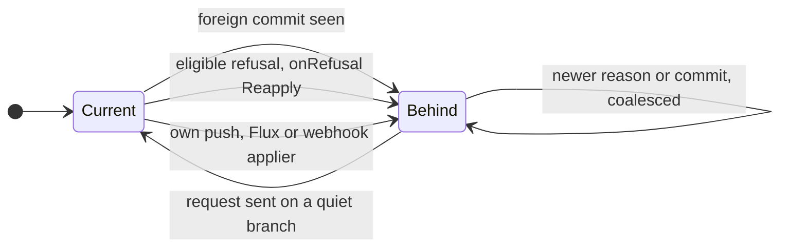

# Push notification and the apply trigger

> **built, and superseded** on 2026-10-16 by [`apply-trigger.md`](apply-trigger.md), which is the
> current design and what is still open. This page is the record of how the apply trigger was
> decided. It stays in `design/` because its Part 1 (how the branch worker reads the remote) is
> still cited from the Git code by its section numbers, which predate the last restructuring of
> this page. Parts 2 to 4 are the design as it was decided then, and much of it has changed since:
> no apply waits for a quiet branch (an apply comes after a flush), `quietPeriod` is gone, an
> Argo CD `Application` gets `CatchUp` too, and a push of the worker's own asks for no apply. Read
> [`apply-trigger.md`](apply-trigger.md) for current behavior.

GitOps Reverser and the applier (Flux or Argo CD) share a branch. This page is how they talk:
how GitOps Reverser learns that somebody else pushed, and how it decides when the applier applies.

**The decision: GitOps Reverser owns the apply trigger.** The applier keeps fetching, rendering,
applying and pruning. It stops applying at its own will: its timers, webhooks and automated sync
are switched off, and GitOps Reverser sends apply requests at moments it has checked.

**Part 1** is the Git side as built, because the trigger rests on it. **Part 2** is why the trigger
has to move. **Part 3** is the design. **Part 4** is the reference: wire contracts, status, metrics,
tests.

---

## Part 1: how the branch worker reads the remote

### 1.1 Which side wins

Everything else depends on this, so it goes first.

- **Cluster to Git.** The Kubernetes API is where edits are made. A write captured from it is
  intent, and it wins over what Git holds. Replay re-plans the captured object onto the new tip and
  writes it.
- **Git to cluster.** A push GitOps Reverser did not author is new truth. It is not overruled, and
  getting it applied promptly is the point.

They meet in one cell:

| | A captured write is pending for the object | Nothing is pending |
| --- | --- | --- |
| **A push changed it** | API wins, silently | **The hazard.** Never publish here |
| **A push did not** | Ordinary publication | Nothing to do |

The top-left cell is the only real conflict, and it is decided: the API value wins, with no extra
signal. The top-right cell is where danger lives. Nothing is pending, so anything published for
that object is a stale reading, and publishing it reverts a push for no reason.

**So a notification that the branch moved never triggers a cluster snapshot.** The cluster still
holds the values from before the push; a snapshot would publish them over it. A push says something
about Git and nothing about the cluster.

### 1.2 The push is the read

A publication cycle does not fetch before it plans. It plans on the checkout it has, and the push
reads the branch: [`validatePushState`](../../internal/git/git_atomic_push.go) opens the push
session, reads the remote's ref advertisement, and compares it with the commit the cycle's writes
were based on. A mismatch is refused before any object is uploaded, and the `packp.Command` carries
`Old` so the server enforces the same condition. A cycle that commits nothing still reaches the
push, so the advertisement is read either way.

That rests on one invariant:

> **The worktree sits at the remote tip of the target branch, or the worker knows it does not.**

`baseTrusted` says whether the worker is at the remote tip. A reset onto a fetched tip sets it, and
so does a push the server accepted, which is the stronger proof: the server has just moved the
branch on the worker's authority. Any push error or rejection clears it. `checkoutApplied` counts
how many pending writes the checkout holds on top of its root; unknown means a failed write left
the tree dirty, and a count below the pending writes means a reset discarded their commits and they
must be replayed. The loop's `materialize` is the one place that acts on it
([`gittarget-branch-worker-pending-writes.md`](../design/gittarget-branch-worker-pending-writes.md)).

A cycle plans straight onto the worktree only when the base is trusted and the tree is clean;
otherwise it fetches, resets and replays first.

### 1.3 What it costs

Every row comes from [`git-roundtrip-ledger.golden`](../../internal/git/testdata/git-roundtrip-ledger.golden),
measured against canonical git's `http-backend`. The unit is HTTP requests to the Git host.

| Situation | Requests |
| --- | --- |
| Idle target | 0 |
| Uncontended publication | 2 |
| Publication that commits nothing | 1 |
| Contended publication, one rejection | 6 |
| Contended publication, two rejections | 10 |
| Resync snapshot | 4 |
| Forced recheck | 2 |
| Publication onto a branch the remote does not have | 2 |

An idle target also spends one ref advertisement per `--git-refresh-interval` to re-prove where its
branch is, and a fetch only when the branch moved. A receiver delivery costs the same as that
refresh (§3.3).

`gitopsreverser_git_fetches_total{reason}` counts every call that runs a `SmartFetch`. On a healthy
publishing target `reason="publication"` stays at zero; see
[interpreting-metrics.md](../interpreting-metrics.md#reading-git_fetches_total).

---

## Part 2: why the trigger has to move

An apply is safe only when nothing live is missing from the commit being applied. Between an edit
and its push, the edit is live and absent from Git: in an open commit window or in the pending
writes. An apply then writes Git's older value over it, GitOps Reverser mirrors that revert as the
applier's commit, and the edit is lost.

Only the branch worker can see those edits. Every trigger the applier runs by itself fires without
that knowledge:

- **A Git-host webhook into the applier** fires on every push, GitOps Reverser's own included. Two
  API edits a few seconds apart are enough: the first commit is fetched, the second edit lands, and
  the first commit is applied over it.
- **Argo CD's timed refresh** resolves the branch tip every `timeout.reconciliation` (120s plus up
  to 60s of jitter). Automated sync then runs whenever the tip is a commit it has not synced; with
  `selfHeal: false` it skips only one it already synced
  ([`alreadyAttemptedSync`](https://github.com/argoproj/argo-cd/blob/3cbae653d41ced2fcdec5d07c25fff2693c4242e/controller/appcontroller.go#L2648-L2670)).
  Every push GitOps Reverser makes is a new commit, so two to three minutes after each push the
  whole `Application` is synced over whatever is pending.
- **Flux's intervals** apply on every reconcile. kustomize-controller corrects drift each time it
  runs, and a new `GitRepository` artifact wakes every `Kustomization` that reads it.

Filtering which webhook deliveries reach the applier removes the first trigger only. The timers
remain, and they cannot be filtered from outside. So the applier's own triggers are switched off,
and GitOps Reverser, which can see the pending edits, makes the requests.

That costs something real: **GitOps Reverser becomes the fast path to a deployment.** While it is
down, a Git-side push reaches the cluster only through a human or a long backstop timer. That is
accepted. Bi-directional editing already stops in that state.

---

## Part 3: the design

### 3.1 The applier

`GitTarget.spec.applier` names the applier:

| Field | Applier | Built |
| --- | --- | --- |
| `kustomizationRef` | a Flux `Kustomization` whose `sourceRef` is a `GitRepository` | yes |
| `applicationRef` | an Argo CD `Application` | next |
| `webhook` (`url`, `secretRef`) | anything else, through a signed POST | after that |

plus `quietPeriod` (default `30s`, a Go duration string), used for `CatchUp` (§3.5). Once a second
kind exists, a CEL rule requires exactly one.

The reference is a declaration, not an inference. The earlier objection to naming an orchestrator
object was to **deriving** which object applies a folder: neither Flux nor Argo CD derives that
mapping, and a guess here would drive a write. A reference the user declares claims nothing we have
to guess.

It is looked up in the **source cluster**, the cluster the applier applies to, through the source
context the watches already use and with the `ClusterProvider`'s identity. An applier living in
another cluster (a hub Argo CD with its `Application` in a management cluster) is out of scope;
see §4.6.

### 3.2 The worker state

The branch worker gains one piece of state per applier it serves: **the applier is behind**,
holding the commit and the reason it is owed. Three signals set it, and one action clears it:



The worker serves every applier declared by a `GitTarget` on its branch, keyed by the applier
object, so two targets naming one `Application` share one entry and one request.

**A quiet branch** has no open commit window and no pending writes. It is the only moment a request
may go out, because it is the only moment nothing live is missing from the tip. The worker knows it
on its own goroutine, since every write and every window passes through its queue.

### 3.3 Learning that somebody else pushed

| Signal | How it reaches the worker |
| --- | --- |
| A receiver delivery (§4.1) | Enqueued as an immediate refresh of that branch |
| A rejected compare-and-swap push | Already on the worker; the replay that follows is the response |
| The periodic refresh | Already on the worker, every `--git-refresh-interval` on an idle branch |

All three end in the same comparison: the remote's tip against the last tip the worker observed,
by a push or a fetch. Unchanged is nothing new; a change proved by the worker's own push is its own
work; a change any fetch found is foreign. A worker's first observation is a baseline (§3.5).

**A delivery is a hint, never a fact.** The worker does not trust the commit a delivery names. On
an idle branch it reads the advertisement (one request), compares, and fetches only when the tip is
foreign, exactly as the refresh does. With work pending it does not read anything first: it closes
the open windows and publishes, and the compare-and-swap discovers the move. That makes the hard
cases come out right without bookkeeping:

- **A late delivery for an earlier push of the worker's own.** The advertisement shows the current
  tip, the worker's latest push, so it is own work.
- **A rollback onto one of the worker's older commits.** The tip is not the last push, so it is
  foreign, and the rollback is applied.
- **A delivery that arrives while a push is in flight.** It waits on the worker's queue behind the
  push, which has recorded its commit by the time the delivery is read.
- **The delivery for the replayed push `F + W`.** It names the worker's own push and is dropped,
  which is correct: the foreign commit `F` already set the applier behind, and the request is
  owed whether or not this delivery arrives.

A set of SHAs the worker has pushed is deliberately not kept. It cannot tell a late delivery from a
rollback, because the distinction needs order, and the advertisement already supplies order for
one request.

### 3.4 Foreign commits with work pending

When the applier falls behind on a foreign commit while windows are open or writes are pending, the
worker does not wait for the windows' timers. A window closes on silence, so a user who keeps
editing would hold a Git-side change back indefinitely. Instead:

1. Close every open window on the branch, as a resync boundary already does.
2. Publish. The push is rejected, the worker fetches the foreign commit, replays the pending writes
   onto it, and pushes `F + W`.
3. The branch is quiet. Request the apply of `F + W`.

The applied commit carries the API side's answer, so for `W`'s objects the apply is a no-op and
only `F`'s changes land: §1.1's top-left cell, enforced in the cluster as well as in Git.

If publishing fails, the request waits with the pending writes. It is never sent past them:
applying `F` would revert `W` live, the worker would capture that revert as a newer write, and `W`
would be lost even after the push recovers. The usual cause is an unreachable Git host, which the
applier could not fetch from either.

### 3.5 The three reasons

| `reason` | Set by | Requested commit | Sent to |
| --- | --- | --- | --- |
| `ForeignCommit` | §3.3 | The tip once the branch is quiet, after any replay | Every applier on the branch |
| `Refusal` | An eligible refusal (§3.7) on a target with `onRefusal: Reapply` | The tip once the branch is quiet | That target's applier |
| `CatchUp` | An accepted push of the worker's own, or its first observation of the branch | The tip once the branch has been quiet for `quietPeriod` | `kustomizationRef` and `webhook` appliers |

**Why Flux gets `CatchUp` and Argo CD does not.** With automated sync disabled Argo CD applies
nothing on its own, so an `Application` that has not seen GitOps Reverser's own commits has nothing
stale to apply; and every sync runs the `Application`'s hooks, so syncing for no change would run
them for no reason. Flux has no refresh-only mode: its timers and a controller restart apply
whatever artifact the `GitRepository` holds, and with a long interval that artifact falls behind.
Applying a stale artifact reverts **published** edits, not only pending ones, which is far worse.
`CatchUp` keeps the artifact at the tip, so any apply Flux starts on its own applies values the
cluster already holds.

A worker's first observation is a baseline, never a `ForeignCommit`: nothing says what the applier
last applied, and asking for the tip on a restart, before the watches have captured the edits made
while the operator was down, would revert them. It owes a `CatchUp`, which waits for a quiet branch
like any other.

`quietPeriod` exists because a quiet branch is a moment, not a guarantee. An editor who saves twice
a few seconds apart produces a quiet instant between the first push and the second write; a catch-up
sent then is exactly the race of Part 2. Waiting `quietPeriod`, restarted by every write, keeps the
catch-up out of an editing session. `ForeignCommit` and `Refusal` do not wait it out, since a
Git-side change should land promptly and §3.4 already published everything pending.

**Never sent:** a request for the worker's own commits to an `applicationRef`; any request while
windows are open or writes are pending; a `Refusal` for a suspended target.

A suspended target's applier still receives `ForeignCommit`. Suspend stops writes; with the
applier's own triggers off, withholding the request would stall Git-side deployments too.

### 3.6 What a request does

**Flux (`kustomizationRef`).** The request `flux reconcile kustomization --with-source` makes:
when the `GitRepository` named by the `Kustomization`'s `sourceRef` does not hold the requested
commit yet, stamp `reconcile.fluxcd.io/requestedAt` on it, and the new artifact wakes the
`Kustomization` by itself; when it already holds the commit, stamp the `Kustomization` instead, which
is what a `Refusal` at an unchanged commit needs. A `CatchUp` whose artifact already holds the commit
stamps nothing. Permissions: `get` and `patch` on `gitrepositories` and `kustomizations`.

**Argo CD (`applicationRef`).** Set `operation` on the `Application` as Argo CD's own automated
sync builds it ([`appcontroller.go`](https://github.com/argoproj/argo-cd/blob/3cbae653d41ced2fcdec5d07c25fff2693c4242e/controller/appcontroller.go#L2628-L2641)),
pinned to one commit:

```yaml
operation:
  initiatedBy:
    username: gitops-reverser
  sync:
    revision: <the requested commit>
    prune: <spec.syncPolicy.automated.prune>
    syncOptions: <spec.syncPolicy.syncOptions>
    source: <spec.source>   # or sources and revisions, for a multi-source Application
  retry: <spec.syncPolicy.retry, else {limit: 5}>
```

Pinning the commit means the sync applies exactly what the worker checked, not whatever the tip has
become by the time Argo CD runs it. An operation already in progress is waited for, never replaced,
which is the rule Argo CD's own `SetAppOperation` enforces. `automated.enabled: false` (Argo CD 3.1
and later) is what keeps `prune` configured while automated sync is off; without it the operation
does not prune. Permissions: `get` and `update` on `applications`.

**Webhook.** POST `{"repository", "branch", "commit", "reason"}` with
`X-Signature: sha256=<hex HMAC-SHA256 of the body>`, keyed by the Secret's `token`. That is the
header Flux's `generic-hmac` `Receiver` checks, so a webhook applier can also point straight at
one. A third-party tool needs a small adapter that maps the request to its own trigger. There is no
in-process plugin, because it would run with every credential the operator holds.

**For all three:**

- A request asks and never reports. Nothing GitOps Reverser publishes claims the apply happened;
  the applier's own status says that.
- It runs off the worker's queue, in `internal/applier`, so a slow applier never holds the branch.
- Every attempt reads its targets again: one that no longer names the applier on this branch, or
  that its `ClusterProvider` no longer admits, is dropped, and a `Refusal` needs consent at the
  attempt, not only when it was decided. The request checks the source binding before it stamps.
- It retries briefly, for about one `quietPeriod`, because a retry is the worker's decision
  replayed without the quiet check. Then it is handed back to the worker, which owes it again and
  sends it on a quiet branch, with a backoff of its own. A newer request for the same applier
  supersedes one not yet sent.
- A failed request never fails the publication that caused it.
- Each request records an `ApplyRequested` Event and updates `status.applier`. A request that
  could not be delivered records `ApplyRequestFailed` once.

### 3.7 Refusals: `onRefusal: Reapply`

A refused edit has no legal destination in Git, so it stays live until something applies Git over
it. `Reapply` asks the target's applier to apply the current tip, which reverts it. It replaces the
earlier `PushEmptyCommit`, which moved the branch with an empty commit so that appliers nobody named
would notice a new commit. With the applier named, that indirection only added blast radius: an
empty commit woke everything watching the branch, while a request wakes one applier.

The eligibility guards carry over unchanged, because they are about what reapplying does, not about
how it is asked for:

- Only a write-boundary refusal of an edit to a document the folder already holds. Never a
  folder-level refusal, which only a human can fix.
- Never when the same flush removes a document anywhere: reapplying would put back an object
  somebody deliberately deleted, or prune one somebody else is deleting. Eligibility is per
  document.
- A standing refusal is requested once. The digest of the refused objects and issues is kept, an
  identical observation is dropped, and the memory clears when a write of that type is accepted.
- Requests are coalesced per target, not rate-limited away: a refusal arriving while one is
  outstanding rides the next request.
- A target that cannot be read is treated as `Ignore`.

Waiting for a quiet branch is the improvement over the empty commit: an allowed edit still in a
commit window is published before the apply, so it is not reverted with the refused one.

### 3.8 Validating the applier

The `GitTarget` controller reads the applier on its reconcile tick and sets `ApplierConfigured`, a
gate:

| Reason | Check |
| --- | --- |
| `ApplierNotFound` | The object exists in the source cluster, and its kind is served there |
| `SourceMismatch` | The `GitRepository` URL or the `Application`'s `repoURL` matches `GitProvider.spec.url` after normalization, and its branch or `targetRevision` is `spec.branch` |
| `AutomatedSyncEnabled` | The `Application` has automated sync off |
| `Forbidden` | The identity can patch it (a `SelfSubjectAccessReview` in the source cluster) |

It is read, not watched, so a cluster without the Flux or Argo CD CRDs needs no informer for them.
`AutomatedSyncEnabled` still sends requests: they are correct, only the guarantee is missing.
Intervals are not checked; a short Flux interval is legal, and the guide says what it costs.

URL normalization is the receiver's (§4.1): case-insensitive host and path, no trailing `.git`,
`git@host:org/repo` equal to `https://host/org/repo`, default ports ignored.

---

## Part 4: reference

### 4.1 The receiver

`GitProvider.spec.receiver` (`type`, `secretRef`), named after Flux's `Receiver`, served on its own
listener (`--receiver-bind-address`, Helm `servers.receiver`, off by default), on the elected
replica only. It cannot share
the audit listener, which requires a client certificate signed by the audit CA that no Git host can
present.

```text
POST /git-push/<GitProvider namespace>/<GitProvider name>
```

`GitProvider.status.webhookPath` publishes the path.

| `type` | Verifies | Body read for |
| --- | --- | --- |
| `github` | `X-Hub-Signature-256`, HMAC-SHA256 of the raw body | `ref`, `after` |
| `gitlab` | `X-Gitlab-Token` equals the token | `ref`, `after` |
| `gitea` | `X-Gitea-Signature`, HMAC-SHA256 of the raw body | `ref`, `after` |
| `generic-hmac` | `X-Signature: sha256=<hex>`, HMAC-SHA256 of the raw body | `repository`, `branch`, `after` |

The token is the Secret's `token` key, the key a Flux `Receiver` Secret uses.

**Authentication comes first.** The signature is verified over the raw bytes before the body is
parsed for anything, in constant time. An unsigned or wrongly signed request is refused and nothing
about it is acted on, so the endpoint cannot be used to make a target do work on demand or to probe
which branches are tracked. A route whose `GitProvider` has no `spec.receiver` does not serve.

| Status | When |
| --- | --- |
| `202 Accepted` | Verified, including when it named a branch no `GitTarget` writes, a tag, or another repository's events on a shared hook |
| `400` | Verified but not parseable, or a required field missing |
| `401` | Signature absent or wrong |
| `404` | No such route |
| `413` | The body is over 25 MiB, GitHub's own limit |
| `503` | The route's token Secret, or its `token` key, cannot be read |

A verified delivery that matches nothing is a success, because it is not the host's fault and an
error teaches a host to disable the hook. A `generic-hmac` body naming a repository other than
`spec.url` is ignored, not refused.

**Delivery is unreliable, and correctness does not depend on it.** Deliveries arrive late, twice,
out of order or never. Each one is only a request to look (§3.3), so a duplicate is one more
advertisement, and a missed one costs latency until the refresh or the next push finds the move.

### 4.2 Status

```yaml
status:
  conditions:
    - type: ApplierConfigured
      status: "True"
      reason: Succeeded
  applier:
    requestedCommit: 4f2c1ab9...
    requestedAt: "2026-10-20T10:14:03Z"
    reason: ForeignCommit   # ForeignCommit | Refusal | CatchUp
  remote:
    commit: 4f2c1ab9...
    lastVerifiedAt: "2026-10-20T10:14:02Z"
    verifiedBy: Push        # Push | Fetch
```

`status.applier` is an observation of what was requested, sampled on the target's reconcile like
`status.remote`. It never says what was applied.

### 4.3 Metrics

| Family | Labels | Reads as |
| --- | --- | --- |
| `gitopsreverser_apply_requests_total` | `applier_kind`, `reason`, `outcome` | Requests decided. `outcome`: `sent`, `failed`, `superseded`, `dropped` |
| `gitopsreverser_receiver_deliveries_total` | `type`, `outcome` | Deliveries. `outcome`: `notified`, `unmatched`, `ignored`, `rejected`, `invalid`. Foreign or own is the worker's call, not the receiver's |
| `gitopsreverser_git_fetches_total` | `reason` | Unchanged. A delivery that finds a foreign tip on an idle branch fetches under `refresh` |

Both are in [interpreting-metrics.md](../interpreting-metrics.md#apply-requests-and-the-push-receiver).

### 4.4 Chart

- `servers.receiver` and a `gitops-reverser-receiver` Service when it is enabled. Exposing it is the
  installer's Ingress or Gateway route.
- RBAC for the operator's own cluster: `get` and `patch` on `kustomize.toolkit.fluxcd.io`
  `kustomizations` and `source.toolkit.fluxcd.io` `gitrepositories`; `get` and `update` on
  `argoproj.io` `applications`. Off unless asked for, since most installs run one of the two.

### 4.5 What has to be proven

In the bi-directional corner, against real Flux and Argo CD configured as the guide says:

1. **The original race.** Patch one field to `1`, then to `2` within two seconds of the first push.
   After both commits and two applier intervals, the live value and Git hold `2`, and no commit
   after the second patch is authored by the applier. Run for both appliers.
2. **Argo CD's timer does nothing.** With `timeout.reconciliation` at 10 seconds and edits in
   flight, the `Application`'s operation history holds only GitOps Reverser's syncs.
3. **A foreign push with an edit pending.** Both land, and the applier applies the replayed commit.
4. **Catch-up.** After `quietPeriod` the `GitRepository` artifact holds the tip, and a forced
   `Kustomization` reconcile changes nothing and produces no commit.
5. **Refusal.** An eligible refused edit is reverted by `Reapply`, only its own applier is asked,
   and an allowed edit made just before it reaches Git. A `Kustomization` sharing that applier's
   `GitRepository` applies too when the source has to fetch, which is Flux's behavior and not a
   failure of the request.
6. **No receiver.** A foreign push with no delivery at all is still applied once the refresh finds
   it. This is the guarantee that a missing webhook degrades to latency, never to loss, and it must
   stay green for the life of the feature.

In `internal/git` over a real Git server (not `file://`, whose in-process receive-pack never
compares `Old`): the delivery cases of §3.3, the window-closing of §3.4, coalescing and
superseding, and that no request leaves a branch with pending writes.

### 4.6 Open questions

1. **An applier in another cluster.** Hub Argo CD keeps `Application`s in a management cluster.
   Supporting it means a second identity, the control cluster's or a kubeconfig, on
   `spec.applier`. Deferred until someone runs that topology.
2. **High availability.** The decision lives on the replica that owns the branch worker, so the
   listener runs on the elected replica only and a standby refuses the connection. With multiple
   replicas, deliveries need routing to the owner, or a shared queue in Redis.
3. **Path scoping for `ForeignCommit`.** Every applier on the branch is asked, whether or not the
   foreign commit touched its folder. That is safe, since the branch is quiet, but it runs every
   `Application`'s hooks. Narrowing it needs the applier's own source paths, which are not ours to
   interpret; revisit only with a measured complaint.

### 4.7 Build order

1. Worker state, the quiet-branch rule and `status.applier`, with the Flux client. Built.
2. The receiver, on its own listener. Built.
3. `onRefusal: Reapply` in place of `PushEmptyCommit`, with the upgrade note. Built.
4. The Argo CD client, and the guide's Argo CD configuration. Next.
5. The webhook applier.
