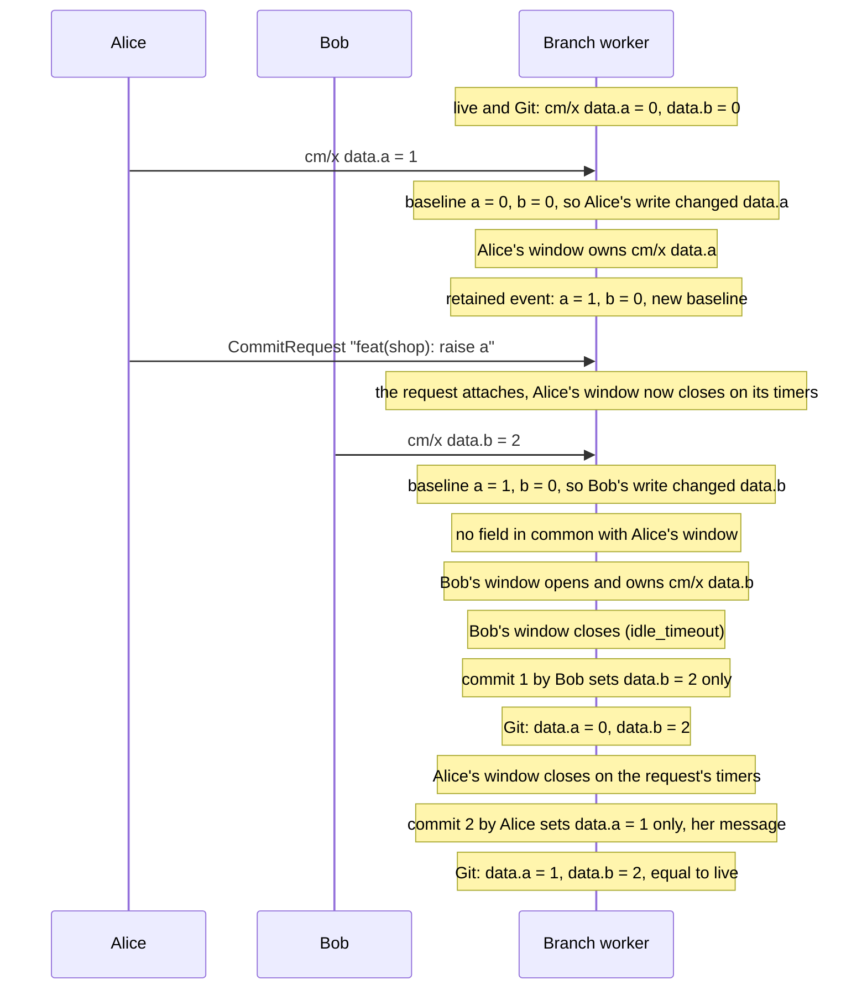
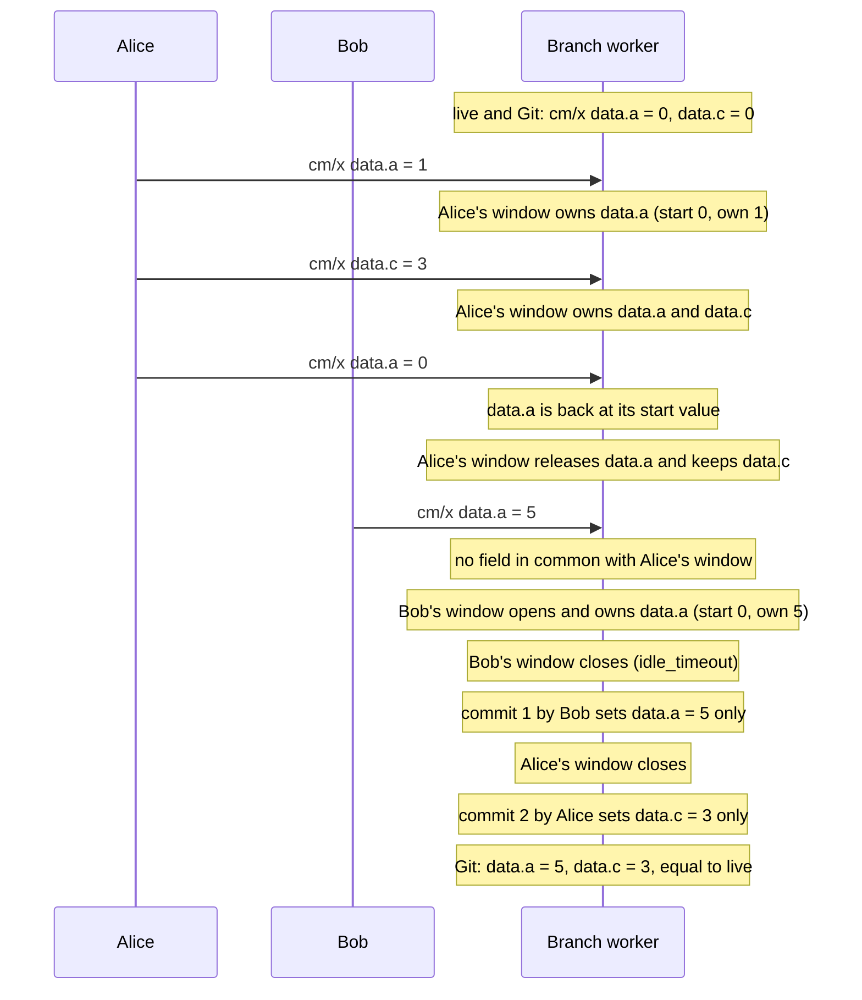

# Design: field-owned windows, and holding an apply for an incoming commit

Status: **proposal, not built.** [concurrent-author-windows.md](concurrent-author-windows.md) lets
two authors' windows stay open side by side when they write different files. This page sets out two
follow-ups that would reduce conflicts further, in this order:

1. **Part 2, the apply hold, is the next candidate**, if the base change's measurements show forced
   splits by incoming commits are common enough to pay for the latency it adds. It needs only that
   page's stage 1 (the reference model and the controllable clock).
2. **Part 1, field ownership, stays experimental** until the repair's interaction with withheld
   applies is worked through ([the gate](#convergence-is-a-separate-operation)), and it reopens a
   decided spec.

- [Field ownership](#part-1-a-window-owns-fields): two authors editing **one object** get one commit
  each, when they changed different fields.
- [The apply hold](#part-2-an-incoming-commit-holds-the-apply): an incoming Git commit that touches
  nothing an open window holds delays the apply, instead of closing the windows.

They are **two separate changes**. Neither needs the other, and each needs its own state-machine
review. The apply hold does not even need concurrent windows: it works with today's single window.
Both carry correctness risks the base proposal does not, which is why they are kept apart from it.

## Part 1: a window owns fields

### Why destinations are coarse

A window keeps the **whole latest object** for each object (`openWindow.pathToEvent`), and its
commit merges that whole object into the file. That is why the base proposal closes Alice's window
when Bob writes the same file: Bob's live snapshot of `cm/x` already contains Alice's edit.
Committed first, it would put her edit in Git under his name, and her later commit would write her
older copy back.

Server-side apply solves the same problem inside the API server: each field manager owns a set of
fields, an apply sets only the fields its manager owns, and two managers conflict only on a field
both claim. A window can be a field manager over Git.

### It reopens a decided spec

[Field ownership: the API wins](../spec/manifestedit-field-ownership-spike.md) is decided, and it
lists partial ownership under "Explicitly rejected (do not build)". It says a comeback needs its own
proposal with a worked use case that bi-directional GitOps cannot serve. Part 1 is that proposal, and
it has to be accepted against the spec before anything is built:

- **The use case:** two people editing one object at the same time get one commit each, under their
  own names. Bi-directional GitOps cannot serve it, because it is about the history Git records.
  The state Git ends with is the same either way.
- **What the spec rejected, and how part 1 differs.** The spec rejected a **declared** subset of
  owned fields (a configured, permanent list) and ownership **driven by `managedFields`**. Part 1 has
  neither: ownership lives only as long as one open window, is computed from the change itself, and
  has no configuration surface.
- **What part 1 relaxes:** "documents are whole-object truth" no longer holds for **each commit**.
  It still holds for the tree once the windows on an object have closed and the
  [repair](#convergence-is-a-separate-operation) has run. That is the guarantee the spec's
  convergence tests check, and part 1 keeps it, one repair later.

If the spec's decision stands, part 1 is not built, and the base proposal's footprint rule stays the
answer for two authors on one object.

### The rule

- **A window owns the fields its writes changed**, per object, next to the latest event, until a
  write of its own sets one back ([a field set back is released](#a-field-set-back-is-released)).
  A write's changes come from comparing its object with the object's **baseline**: the last
  live object the worker saw for it, across every window (see
  [the baseline lifecycle](#the-baseline-lifecycle)). It must not be compared with Git, which lacks
  the other windows' unpublished edits, so the comparison would credit them to this write.
  `managedFields` does not provide the set either. Its managers are clients (`kubectl`,
  `gitops-api`) rather than people, and it records who owns a field, which says nothing about what
  one write changed.
- **Every commit of a field-owned window sets only the fields that window owns**, and leaves every
  other field of the document as Git holds it, including when it is the last window to close on that
  object. The values are the ones the window's own writes set
  ([what a window stores](#what-a-window-stores)), not read back from its latest event. The editing
  primitive exists:
  `manifestedit.PartialDesired` and `manifestedit.OwnsAssignedPaths`
  (`internal/git/manifestedit/fieldpatch.go`) do this for subresource audit patches, and keep the
  drift guard and the formatting preservation of the whole-object merge.
- **`path_conflict` becomes `field_conflict` for field-owned writes.** A write closes another open
  window only when it changes a field that window owns, or a parent or child of one. A removed field
  counts as owned.

A last whole-object write would be wrong here. Alice's retained event is her snapshot,
`data.a = 1, data.b = 0`: written whole after Bob's commit, it restores `data.b = 0` and undoes his
work. Writing the latest live snapshot instead fixes that case but overwrites any field an incoming
Git commit changed meanwhile. So no field-owned commit ever writes a field it does not own.

### What a window stores

A window keeps no log of its writes. For each object it holds:

| Kept | What it is | Used for |
| --- | --- | --- |
| **The latest event** | the whole object at the window's last write, as today (`openWindow.pathToEvent`) | the cases that [stay whole-object](#what-stays-whole-object) |
| **The owned fields** | for each field the window owns, its **start value** (the baseline's value when the window took the field) and its **own value** (what the window's latest write to that field set; a removal counts as a value) | the commit, `field_conflict`, and [releasing a field set back](#a-field-set-back-is-released) |

A log of every write would add nothing. While a window owns a field, `field_conflict` keeps every
other write off it, so the window's last value for each field is all its commit needs. A window
commit records where the window ended, never the steps, as it does today. A log would only matter
for merging two windows' edits to one field, and part 1 never does that: it closes one of them.

The own value is kept per field, rather than read back from the latest event, because the latest
event is the whole live object at the window's last write, and it can hold a value nobody in the
window chose:

1. Alice sets `data.a = 1`. Her window owns `data.a`, start value `0`, own value `1`.
2. A late apply sets the live `data.a` back to `0`. The apply window withholds it, and the observed
   baseline becomes `data.a = 0`.
3. Alice edits `data.b`. Her latest event holds `data.a = 0`, but compared with the baseline her
   write changed only `data.b`, so `data.a` keeps its own value `1`.
4. Her commit sets `data.a = 1` and `data.b`. Read from the latest event, it would have set
   `data.a = 0` under her name.

The commit carries the owned fields as a field patch: an `Event` already holds either a whole
`Object` or a `FieldPatch`, and `manifestedit.PartialDesired` builds the patch from the
assignments. So the pending write holds the window's **change**, not the whole object, which is what
lets a replay onto a newer tip leave the newer tip's fields alone
([replays stop reverting Git](#side-effect-replays-stop-reverting-git)).

### A field set back is released

A window owns a field for the change it made, not for having touched it. When a window's write sets
an owned field back to its start value, the window **releases** the field: it no longer owns it, its
commit does not write it, and another author's later write to it is not a `field_conflict`.

If a window owned every field it ever changed, Bob's write would close Alice's window
(`field_conflict`): a forced split for a change that no longer exists, and her commit would set
`data.a = 0`, a value Git already holds.

Releasing is safe because it leaves the field exactly as if the window had never written it. While
Alice owned `data.a`, no other write changed it, so the start value is still the value the field
held before her window, and her commit writing nothing for it keeps that value.

Two rules keep the release honest:

- **Only the window's own write releases a field**, and only a field that write changed compared
  with the baseline. Comparing the latest event with the start value instead would read the withheld
  apply in [the example above](#what-a-window-stores) as Alice undoing her edit.
- **The release is per owned path.** Adding a label (`kubectl label cm/x tmp=1`, start value
  absent) and removing it again (`kubectl label cm/x tmp-`) releases `metadata.labels.tmp`. An
  object whose owned fields are all released leaves the window; a window left with nothing commits
  nothing, and a save attached to it settles as a save with nothing to commit does today
  (`whenNothingToCommit`).

A whole-object entry (a create, a delete, a write with no baseline) has no start value per field and
is never released.

### Convergence is a separate operation

A whole-object write today also repairs whatever else differs between the live object and Git (a
field an earlier write left wrong, a stray `resourceVersion`). Field-owned commits do not, so Git can
drift from the live object in fields nobody owns.

That repair becomes an operation of its own, with an explicit attribution (the operator's identity
and a message that says it is a repair), so no person is credited with it. It is a pending write like
any other, so it is ordered behind the commits before it.

**The repair must not compare Git with the live object.** The live object is what the cluster runs,
and the cluster can run a value nobody wants: a late apply the apply window withheld leaves its
reverted value live until a `Repair` puts the edit back. Copying that into Git undoes the edit:

1. Alice sets `data.a = 1`; her window owns `data.a`.
2. A late apply writes `data.a = 0`. The apply window withholds it (it is not mirrored), and a
   `Repair` is pending for the applier.
3. Alice's window closes: her commit sets `data.a = 1`.
4. A repair that compares Git (`1`) with the live object (`0`) commits `data.a = 0`, and Alice's
   edit is gone from Git as well as from the cluster.

So the worker keeps two views of every object it tracks, and they serve different purposes:

| View | What it is | Used for |
| --- | --- | --- |
| **Observed** | the last live object the worker saw, withheld writes included | the baseline: deciding which fields a write changed |
| **Desired** | the observed object, with every field a withheld write reverted set back to the last accepted value | what Git should hold, and what the repair compares Git with |

The repair's policy, against the desired view:

- it does not run for an object while its applier has a `Repair` pending that covers the object.
  The `Repair` puts the cluster back first, and then the two views agree;
- a field an incoming Git commit changed since the applier's last applied revision is left alone:
  Git's change is pending an apply, and the repair must not revert it;
- every other field that differs takes the desired value, as the API-wins rule says today.

**This is a gate on part 1:** the two views and this policy have to be accepted, and covered by the
reference model, before field ownership is built.

### The baseline lifecycle

The field set is only as right as the baseline it was compared with. Each kind of event has to say
what it does to the baseline:

| Event | Field set | Baseline afterwards |
| --- | --- | --- |
| Accepted write, baseline known | the fields that differ from the baseline | the event's object |
| Accepted write, no baseline (first sight, after a restart) | none: the write owns the whole object | the event's object |
| No-op write | empty, no window entry | unchanged |
| Write after a watch restart or relist of its type | none: whole object (two people's changes may have arrived as one) | the event's object |
| Recreate (same name, new UID) | none: whole object | the new object |
| Delete | whole object | cleared |
| Applier write withheld by the apply window | none, it is not mirrored | observed: the event's object, so the next author's write is compared with what the cluster runs. Desired: unchanged for the fields the write reverted |

`resourceVersion` cannot detect a missed event: it is opaque, so the worker cannot tell whether one
value directly follows another. Restarts and relists are what the worker can see, so they reset.

### What stays whole-object

Field ownership is an optimization over the base proposal's footprint rule, and every case it cannot
decide falls back to that rule:

- creates, deletes, recreates, and writes with no baseline (the table above);
- an encrypted document (field patches refuse them), so SOPS Secrets gain nothing;
- a list without a schema that says how it merges: until the worker reads schemas, a list is one
  field, so two edits to different containers conflict;
- a field whose Git destination is not the object's own document (a `configMapGenerator` literal in
  `kustomization.yaml`, next to the literals of other ConfigMaps).

### Side effect: replays stop reverting Git

When both sides changed one object, the API value wins today for the **whole** object
(`internal/git/apply_window.go`). A pending whole-object write replayed onto a newer tip sets every
field back to the live value, including the ones the newer commit changed. A field-owned write
replays onto that tip without touching the fields it does not own. A Git edit to `spec.replicas`
and an API edit to a label of the same Deployment both survive; today one of them loses. This holds
only because no field-owned commit writes an unowned field.

## Part 2: an incoming commit holds the apply

### Why windows close for an incoming commit today

Two close triggers fire when commits arrive in Git:

- **`foreign_commit`** (`closeWindowForPushHint`, `internal/git/applier_claim.go`) is how a busy
  branch **learns** about a push. A push notice is a hint, and with a window open the worker reads
  nothing from the remote first (the refresher skips a busy branch, `noteBusyPushNotice`). Closing
  the window and publishing is what discovers the move: the push is rejected, the worker fetches,
  replays its writes onto the foreign commit, and an apply becomes due. Without the close, the push
  would be found only when the window closed on its own timers. A window carrying a
  `CommitRequest` is left open.
- **`apply_due`** (`branchWorkerEventLoop.flushed`) is the flush
  ([S1 in applier-echoes.md](applier-echoes.md#s1-flush-then-apply)). It closes the window, takes
  the flush mark, and publishes every write up to the mark, so the apply includes them. An edit
  decided after the mark does not hold the apply back: the applier's apply window records it, and an
  apply that overwrites it is withheld and repaired. The flush does not begin while a request is
  registered (`writeBusy`).

No edit is lost by either today. What the incoming commit costs is a **forced split**: every open
window is closed by a commit the windows had nothing to do with, so a person's change lands in two
commits. That split is the only thing part 2 can remove.

### Part 2 brings back a bounded wait

The flush replaced the old "quiet branch" rule, under which an apply went out only when no window
was open and no write was pending. That rule starved: a person who kept editing held a Git-side
change back for as long as they typed. Holding the apply until windows close is the same wait.
Part 2 is acceptable only with [its own deadline](#the-hold-has-its-own-deadline), and the trade
has to be argued with measurements: forced splits removed against apply latency added.

### The worker has to read the incoming commit first

The overlap check compares the incoming commit with the open windows **while they are still open**.
Today a busy branch does not have that commit until it publishes (see `foreign_commit` above), and
that is deliberate: [push-notification-and-reconcile-trigger.md, section 3.3](push-notification-and-reconcile-trigger.md#33-learning-that-somebody-else-pushed)
makes a delivery a hint that is never trusted, and reading nothing first is what makes late
deliveries and rollbacks come out right without bookkeeping.

So part 2 needs a **fetch on a busy branch**: on a push notice with windows open, the worker reads
the advertisement and fetches the new tip into its object store, without touching the worktree, the
pending writes or the windows. The tip it fetched is the one the check uses; the publication that
follows still finds the move by compare-and-swap, as today, so the hint stays a hint. It costs one
fetch per notice on a busy branch, counted in `git_fetches_total` under a reason of its own.

### The rule

| Incoming commit vs. open windows | Action |
| --- | --- |
| Disjoint: no object in common (or, with part 1, no field in common) | **Hold the apply.** The windows keep collecting; the apply runs when they have closed, or when the hold's deadline passes, through today's flush. |
| Overlapping, not provably disjoint, or not fetched | Today's behavior: the windows close now. |

The hold is possible because the operator decides when an applier applies: the `FluxClaim` keeps
its Kustomization suspended and the `ArgoCDClaim` keeps automated sync off.

### The hold has its own deadline

Window timers cannot bound the hold. A window's `max_duration` is not fixed: attaching a
`CommitRequest` replaces the window's timers with the request's, running from the attach
(`attachToWindow`, `internal/git/commit_request_attach_loop.go`). A hold that waited for the
windows' own deadlines could be extended by every attach.

So the hold has an **absolute deadline, measured from when it began**. It ends at the first of:

- every window open when the hold began has closed;
- the deadline passes.

Either way it ends by entering today's flush (`flushed`), which then sends the apply, so the
flush mark and the late-apply bookkeeping (withheld writes, repairs) see the same sequence as today.
A window opened during the hold does not extend it; the flush closes it as today.

The hold's deadline bounds **only the delay the hold adds**. Two existing delays stay on top of it,
unchanged, and must not be described as part of the hold's bound:

- **save protection:** the flush still does not begin while a request is registered (`writeBusy`),
  so a save in progress delays the apply exactly as it does today;
- **publication retries:** a flush that cannot publish retries as it does today.

A request that attaches during the hold does not move the hold's deadline. Whether the apply waits
for that request is decided by `writeBusy`, as it is today.

### Computing the overlap

**In process (first):** compare the **rendered** tree at the fetched tip with the rendered tree at
the applier's **last applied revision**, map the changed documents to objects (and, with part 1, to
fields), and intersect with the open windows' footprints or fields. Rendered, because a change to a
`kustomization.yaml`, a base, a component, a generator or a values file changes objects whose own
files the commit did not touch. Against the last applied revision, because after a withheld or
failed apply, or several pushes, the applier applies everything since then. A tip that does not
descend from the last applied revision (a force push) counts as overlapping. No API calls and no
extra permissions.

**As a server-side apply dry-run (later, only if the in-process check is too coarse on lists):**
apply the changed objects with `dryRun=All`, as the applier's field manager, without force. The API
server's conflict errors name the fields and their current managers, using the type's own schema.
The costs are problems H8 to H10.

## How to test it

Both parts extend the reference model of
[concurrent-author-windows.md](concurrent-author-windows.md#how-to-test-it-a-reference-model), which
must already exist.

- **Part 1** adds field sets, the baseline table, the observed and desired views, and the repair
  operation to the model. On every commit: a field-owned commit changes only fields its window owns,
  every changed field is credited to the window that owns it, an older accepted write to a field
  never lands after a newer one to the same field, and a field a window set back to its start value
  is released: no commit of that window writes it, and Git holds the value from before the window.
  A field-owned commit writes the window's own values, never a value from its latest event that its
  writes did not set. The repair is checked
  as its own commit, with its own attribution: it never writes a value only a withheld write
  produced, never runs while a covering `Repair` is pending, and never touches a field an unapplied
  incoming commit changed.
- **Part 2** adds busy-branch fetches, incoming commits with rendered diffs, and the hold's deadline
  to the model. On every apply the worker requests, the checks are the flush's own guarantee:
  **every edit decided up to the flush mark is published** in the commit the apply names, and
  **every edit decided after it, to an object the applier manages, is recorded** by the apply
  window, so an apply that overwrites it is withheld and repaired. A check that demanded no
  unpublished edit at all would forbid what keeps continuous editing from starving the apply. On top
  of that: no apply was delayed past the hold's deadline for a reason other than `writeBusy` or a
  publication retry.

## Potential problems

Most failures here are **silent**: Git gets a plausible commit with the wrong content or the wrong
author, and nothing reports an error.

### Part 1: field ownership

- **F1. A wrong baseline gives the wrong field set.** *Mitigation:* the baseline table; every case
  without a trusted baseline owns the whole object.
- **F2. Lists without a schema.** For Deployments, where most edits are in lists, part 1 gains little
  until the worker reads schemas (`x-kubernetes-list-type` and merge keys from `/openapi/v3`, with
  structured-merge-diff). That adds discovery traffic and schema version skew. *Mitigation:* ship
  with lists as one field; add schemas only if measurements show it pays.
- **F3. Git shows states the cluster never had.** With Bob's window closing first, Git's first commit
  holds Bob's `data.b` next to Alice's **old** `data.a`, a combination that never ran. Fields that
  only work together (an image and the environment it reads, two ConfigMap keys read as a pair)
  make that commit a broken state for anyone who checks it out, bisects onto it, or reverts the
  other commit. *Mitigation:* document it; an open question asks whether a `GitTarget` can opt out.
- **F4. The repair is noise, or reverts.** A repair after every close clutters history. A repair that
  compares with the live object copies a withheld apply's reverted value into Git and undoes an
  author's committed edit; one that ignores the last applied revision reverts an unapplied Git edit.
  *Mitigation:* the repair compares with the desired view, waits while a covering `Repair` is
  pending, leaves fields changed since the last applied revision alone, and runs only when
  something differs. This is the gate on part 1.
- **F5. Removals and parent fields.** Field patches today only assign values; a removal needs a
  "remove" assignment. Removing a map conflicts with a key another window added inside it.
  *Mitigation:* a removal owns its path, and owning a path conflicts with owning any parent or child.
- **F6. Sanitized fields create phantom ownership.** Compared before sanitizing, `managedFields`,
  `resourceVersion` or a stripped tool label would show up as changed fields. *Mitigation:* compare
  sanitized objects only.

### Part 2: the apply hold

- **H1. The overlap is judged on files.** *Mitigation:* compare rendered trees; anything the renderer
  cannot render counts as overlapping.
- **H2. The overlap is judged against the wrong revision.** *Mitigation:* the applier's last applied
  revision, and a non-descendant tip counts as overlapping.
- **H3. A bound that is not a bound.** Described as "the windows' `max_duration`", the hold's delay can
  grow with every attach. *Mitigation:* the hold's own absolute deadline, and status and docs that
  name save protection and publication retries as separate delays.
- **H4. Visible apply latency.** Someone who pushed to Git waits for the cluster with no sign of why.
  *Mitigation:* a held reason on the applier claim's status, and a histogram of held time.
- **H5. A window counted against the wrong applier.** Windows are per `GitTarget`; applies are per
  applier and its folders. *Mitigation:* a window counts for every applier whose folders contain one
  of its footprint's files.
- **H6. The busy-branch fetch changes a deliberate rule.** Reading the remote before publishing is
  what section 3.3 of the push-notification design avoided. A fetched tip that is already stale, or
  a notice for the worker's own push, must not change what the publication does. *Mitigation:* the
  fetched tip feeds only the overlap check; publication still finds the move by compare-and-swap,
  and a notice naming the tip the worker last observed fetches nothing (as `noteBusyPushNotice`
  already decides).
- **H7. The starvation S1 removed comes back.** *Mitigation:* the absolute deadline, the rule that
  a window opened during the hold does not extend it, and the held-time histogram to show the cost.
- **H8. Dry-run permissions.** A dry-run apply needs `patch` on every kind it applies; the operator's
  identity on a source cluster may only read.
- **H9. Dry-run admission.** Dry-run requests go through admission, and a webhook that does not
  declare `sideEffects: None` rejects them.
- **H10. Ownership is not an open window.** A dry-run conflict means another manager owns the field,
  which can be an edit from months ago. Flux applies with force, and Argo CD applies client-side
  unless the Application syncs with `ServerSideApply=true`, so a conflict-free dry-run does not model
  what Argo CD does. Every conflict has to be checked against the open windows anyway.

## Alternatives

1. **A text merge of the files (`git merge-file`) instead of field ownership.** Line-based, so it
   knows nothing about YAML structure, list keys or the formatting `manifestedit` preserves. A
   conflict-free text merge can still produce a wrong object.
2. **A log of every write instead of the owned fields.** Adds nothing while `field_conflict` keeps
   one window per field ([what a window stores](#what-a-window-stores)); it would only be needed to
   merge two windows' edits to one field.
3. **A last whole-object write instead of a separate repair.** Undoes another author's work or an
   unapplied Git edit, as [the rule](#the-rule) shows.
4. **Holding the apply until the windows' own timers end.** Unbounded under attaches (H3).

## Open questions

1. Can a `GitTarget` opt out of field-level splitting, for repositories where fields of one object
   only make sense together (F3)?
2. What is the hold's deadline: a fixed default, or a `GitTarget` setting next to the commit-window
   timers?
3. Is the repair commit's author the operator, or the last author whose window closed on the object,
   with a trailer that marks it as a repair?
4. Is a fetch per push notice on a busy branch (H6) acceptable, or should the overlap check run only
   for notices that arrive while a window has collected for longer than some threshold?
