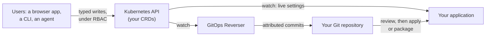

# Offer your users an API, with every change in Git

This page is for a software team whose application has settings or objects that people outside the
team change: a customer's settings in a SaaS product, a menu, limits, the integrations a tenant has
turned on. It shows how to serve those through the Kubernetes API, and how GitOps Reverser keeps a
reviewable, attributed record of every change in your own Git repository.

It explains the shape and where each piece comes from. The steps live in the guides it links.

## The problem

Settings that people change at runtime usually end up in one of these places:

- **A file in the application image:** every change is a release.
- **An admin backend and a database you build:** you write validation, permissions, an audit log, a
  history view, and an export, and you operate all of it.
- **A feature-flag or configuration service:** fast to adopt, but the data, its history, and its
  schema live in somebody else's system.
- **A values file in a GitOps repository:** history and review, but every change is a pull request
  that someone has to know how to write.

## The idea: the Kubernetes API as the backend

Kubernetes already provides most of what a settings backend needs. Describe each kind of setting as
a custom resource, and the API server serves it:

| What a settings backend needs | Where it comes from |
| --- | --- |
| A schema, enforced on every write | The CRD's OpenAPI schema and CEL validation rules |
| Who may read and who may write, per kind and per namespace | Kubernetes RBAC |
| Rules that span fields or objects | Admission policies, or a controller that reports in `status` |
| Live updates for the application and for open browser pages | The watch API |
| History, the author of each change, and the reason for it | **GitOps Reverser**: a commit per change, in your repository |
| Review before a change goes live | A Git branch and a pull request |
| Rollback | A Git revert |

GitOps Reverser fills the rows Kubernetes leaves empty. It mirrors your custom resources into a
folder of your repository. With author attribution, each commit names the person the API server
authenticated for that change. With a `CommitRequest`, the application can pass on the user's own
explanation as the commit message. The data, its history, and its schema stay in your repository,
readable without any of this software.

## An example: the coffee bar menu

The [k8s-trail](https://github.com/ConfigButler/k8s-trail) repository is the record of a live demo
where a room full of people changed a cluster from their phones. One of its kinds is a
`CoffeeConfig`, the coffee bar's menu:

1. A person signs in to the app and edits the menu. The app writes the `CoffeeConfig` through the
   Kubernetes API with that person's own token, so RBAC and validation answer the request.
2. When the person saves, the app asks for a reason and passes it on with the change.
3. GitOps Reverser commits the change to the branch `coffee-change`. The commit's author is the
   person who made the edit, and its message is the reason they typed.
4. Someone opens a pull request from `coffee-change` to `main` and merges it with a merge commit,
   which keeps every person's authorship.
5. Flux applies `main`'s `configs/coffee/` folder to the production cluster.

Every other kind in that demo is written straight to `main`. The coffee menu shows the choice you
make per kind: record the change, or record it and review it before it goes live.

## What you build, and what GitOps Reverser does

**You build:**

- The CRDs for your settings, with their schema and validation rules.
- The Roles that decide who may read and change each kind.
- Any controller or admission policy your domain needs.
- The user interface, and how the application reads its settings.

**GitOps Reverser does:**

- Writes each selected object's `spec` and trimmed `metadata` as YAML into a folder you choose. It
  never writes `status`. Each change becomes a commit within seconds, and
  [commit windows](../README.md#commit-windows) group a burst of edits into one.
- Names the author of each change, with [author attribution](attribution-setup-guide.md).
- Uses the user's own reason as the commit message, through a
  [`CommitRequest`](demo/commit-window.md).
- Holds a branch with a [`GitBranch`](configuration.md#one-tenant-end-to-end), so changes can wait
  on a branch for review.
- Coordinates with Flux or Argo CD when they apply the same folder back: GitOps Reverser then
  decides when the applier applies. See [bi-directional GitOps](bi-directional.md).

## Pieces GitOps Reverser leaves to others

GitOps Reverser does not serve your API, host a user interface, or deliver settings to your
workloads. These open-source projects from the same authors cover those parts. Check each project's
status before you depend on it.

- **Browser access:** [krm-foyer](https://github.com/ConfigButler/krm-foyer) signs users in through
  OIDC and proxies their Kubernetes requests with their own credential, so a browser app needs no
  backend of its own. It is a working prototype.
- **Live views in the browser:** [krm-stream](https://github.com/ConfigButler/krm-stream) keeps a
  live, recoverable view of resources in a page, and merges incoming changes with a user's local
  edits.
- **Settings for a workload:** an application can watch its settings live through the API. Or
  [settings-image](https://github.com/ConfigButler/settings-image) builds the Git folder into a small
  OCI image that a pod mounts by digest, so a settings change rolls out, and rolls back, like any
  image change.

## One API per customer: why kcp

When each customer changes their own settings, each customer needs their own space in the API.
There are two ways to give them one:

- **A namespace per customer, on one cluster.** This is enough when every customer uses the same
  CRDs, at the same version, and namespace-level RBAC is the isolation you need. CRDs are
  cluster-wide, so a schema change reaches every customer at once.
- **A [kcp](https://www.kcp.io) workspace per customer.** A workspace is a customer's own Kubernetes
  API, with its own namespaces, RBAC, and CRDs, but without a cluster of its own to run. It suits a
  product with many customers, where each one should see only their own API.

GitOps Reverser runs once, in an ordinary cluster beside kcp. It reaches each workspace through its
own `KubeProvider`, and writes each one to its own folder or repository. kcp sends the audit events
of all its workspaces in one shared stream, and GitOps Reverser can tell from each event which
workspace it came from, so every commit still names the right author.
[Mirror kcp workspaces](kcp-workspaces.md) has the steps.

## Before you choose this

- **Git is the record; the API serves the live state.** A change is in effect as soon as the API
  accepts it, and reaches Git within seconds. When a change needs review first, record it on its
  own branch and apply it only after the merge, as in the coffee example.
- **Author attribution needs the API server's audit settings.** Managed control planes that hide
  them cannot name authors, and commits then carry the configured committer. On kcp, you set them
  on each shard.
- **Your application depends on the API server being reachable**, unless it reads settings that
  were already delivered, such as a mounted settings image.

## Next steps

1. Install GitOps Reverser and see a first commit: the [quick start](quickstart.md).
2. Mirror your custom resources: a `WatchRule` selects them like any other type. See
   [start mirroring a team's resources](team-onboarding.md) for the objects involved.
3. Name the author of each change: [the attribution guide](attribution-setup-guide.md).
4. Serve one API per customer: [mirror kcp workspaces](kcp-workspaces.md).
5. When Flux or Argo CD applies the folder: [bi-directional GitOps](bi-directional.md).
