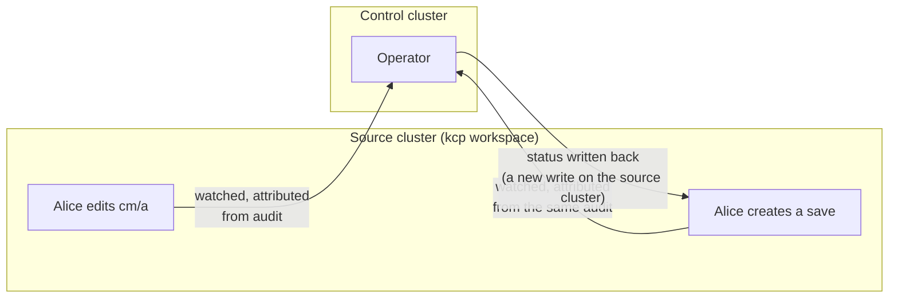
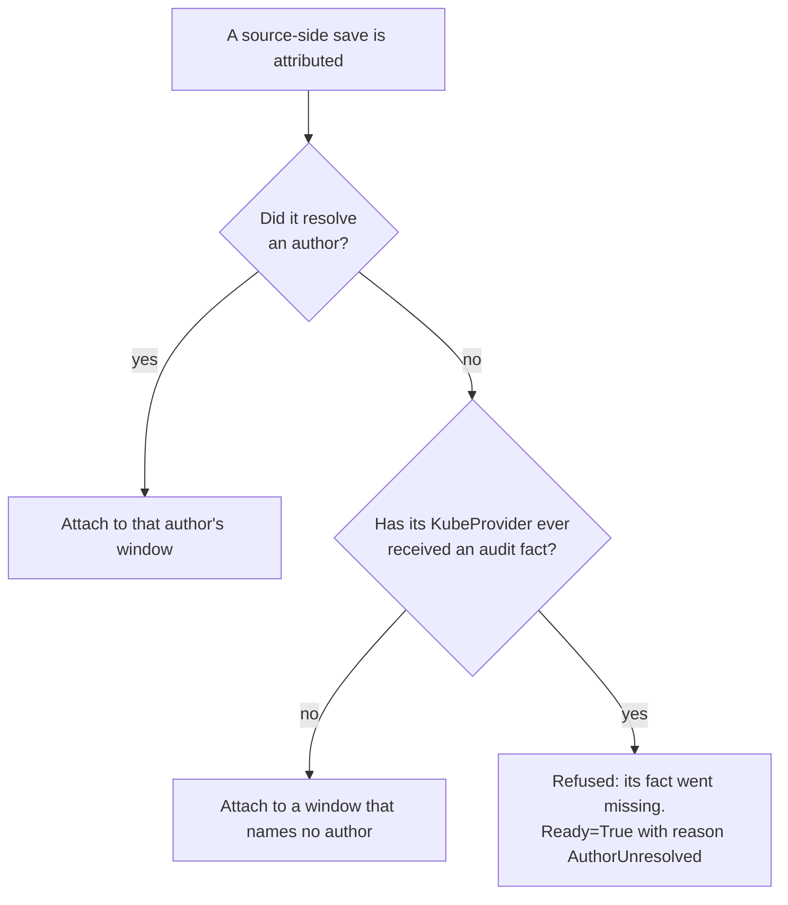
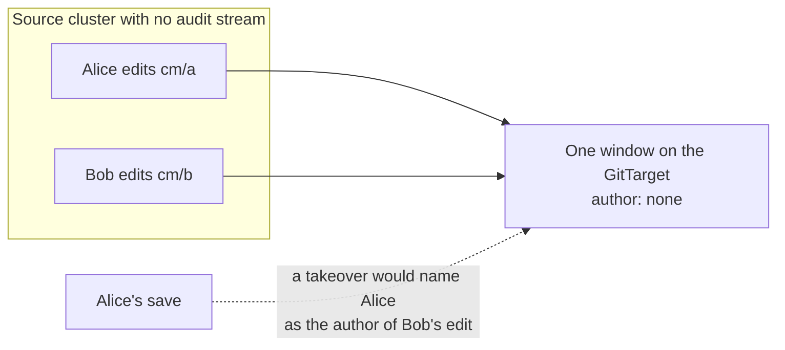
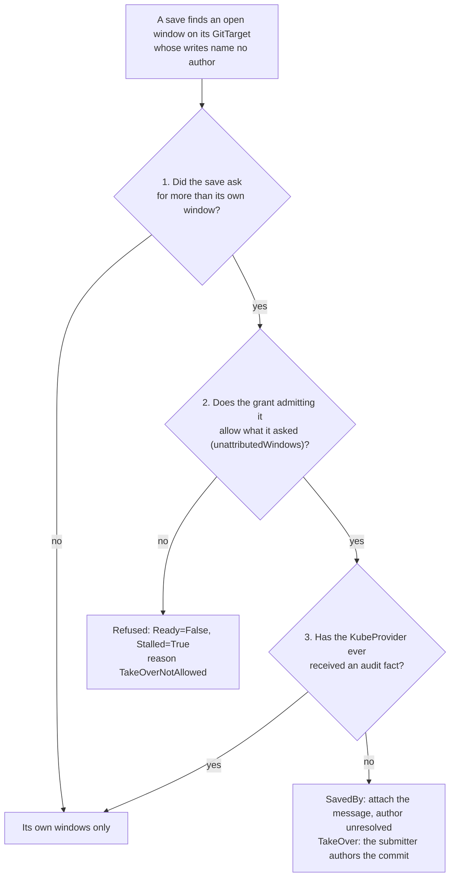

# Plan: saving from the source cluster

A `CommitRequest` saves the writes in its author's open commit window. It lives in the control
cluster, where the operator runs, while the edits it saves happen on the source cluster. This plan
adds a second way to save: a small request created **on the source cluster**, next to the edits,
attributed from that cluster's audit stream like the edits are.

It also plans the second step: letting a save take over a window whose writes name no author, as an
opt-in, for a source cluster that cannot send audit events at all. There it is the only way a save can
put its author's name on the commit.

Status: implemented on `feat/gitops-api-asks-converge-root-ca`. The two request kinds are a pair:
`CommitRequest` (`configbutler.ai/v1alpha3`, formerly `CommitRequest`) on the control cluster, and
`RemoteSaveRequest` (`source.configbutler.ai/v1alpha1`, `internal/watch/remote_save_requests.go`) on
the source cluster. Each names its GitTarget, which admits it in a grant list:
`spec.allowedCommitRequests` (by control-cluster namespace; omitted, its own namespace) and
`spec.allowedRemoteSaveRequests` (by source namespace and labels; omitted, none). A KubeProvider
also serves its cluster's remote requests only with `spec.remoteSaveRequests: Enabled`, and the
GitTarget must mirror that cluster. The takeover is opt-in, as described below, bounded per grant.
The open questions are answered: its own group, a default `attachTimeout` of `5s`, the reason
`AuthorUnresolved`, and a second save of one author on one GitTarget is refused while the first is in
progress (`SaveInProgress`).

This revision takes in gitops-api's review of the first draft, and a later API review of the
implementation: see [After the API review](#after-the-api-review).

## Decisions

1. **Build the source-side save first.** It gives the right author wherever the source cluster has
   audit, and an honestly unresolved one where it does not.
2. **It is a new kind, defined by GitOps Reverser.** A `CommitRequest` with another schema, or a
   kind gitops-api defines and translates, were both considered. See
   [Why a new kind](#why-a-new-kind).
3. **The takeover is the second step.** Some people cannot configure their API server's audit, so
   for them it is the only way to get their name on a commit. It is opt-in on the GitTarget, which
   chooses how much a save may claim; a request that asks without permission fails loudly. See
   [The takeover](#the-takeover).
4. **`cf3b97be` does not merge as it is.** Its automatic takeover becomes the opt-in, or comes out.

## Why: two identity domains

Today the save and the edits are attributed in two places: the `CommitRequest`'s author comes from
the control cluster's admission webhook, the edits' authors from the source cluster's audit events.
They match only when one person has the same username in both.

gitops-api makes them match. Its server impersonates the human when it creates the `CommitRequest`,
so the admission webhook records the same Dex email that kcp's audit records for the edits, and the
ordinary author rule attaches. gitops-api does not need a takeover. What it pays for that is
elsewhere:

- **A grant into the control cluster.** Every tenant's identity may `create commitrequests` in its
  `tenant-<account>` namespace there. It is the one place a tenant reaches outside its kcp
  workspace.
- **A server on the save path.** The browser cannot reach that namespace, so every save goes through
  gitops-api's `/editor/commit`, which impersonates and creates the request.

A save created in the workspace removes both. "A customer's only API surface is their kcp workspace"
then holds with no exceptions, and the browser creates the save itself. That is the production
benefit this plan is for. It also helps any setup where people can reach only the source cluster.



## The source-side save

### What it does

The operator watches the new kind on each source cluster through its KubeProvider. It attributes
each request exactly as it attributes the edits, from the source cluster's audit facts. It then
attaches the request to the matching commit window, and writes the request's status back where its
author can read it.

- **On a source with audit**, Alice's save and Alice's edits resolve to the same user, so the save
  attaches under the ordinary author rule. No takeover and no trust are involved, and Git names the
  person who made the edits.
- **On a source with no audit**, the save names nobody, like the edits. A request that names no actor
  may attach to a window that names none, which is today's rule
  (`TestPendingCommitRequest_UnresolvedRequestAttachesToUnresolvedWindow`). The save gets its message
  and its timers, and the author in Git stays unresolved. The window still holds everyone's
  unattributed writes, but nobody is named as their author.

### Why a new kind

gitops-api could define its own kind and translate it into a `CommitRequest`, but it cannot learn who
created the object: watching the workspace shows the object and nothing about its creator. Only the audit stream
says that, and GitOps Reverser is what reads it. A translation would also spend part of the attach
wait on an extra hop, and add a second status to keep in step.

Reusing `CommitRequest` with a different schema would be worse than a separate kind:

- **Another shape.** It names a GitTarget on another cluster than the one it is created on.
- **Another trust model.** Its author comes from audit; a `CommitRequest`'s comes from admission.
- **One name for two things** invites the confusion that `tenant-<account>` already costs gitops-api.
- **Installed alone.** A workspace gets one small CRD instead of the whole `configbutler.ai` set, so
  nobody is offered GitTargets that nothing reads. gitops-api installs CRDs into workspaces through its
  `workspaceCRDs` list, so no `APIExport` is needed there.
- **Easy to never mirror.** In its own API group, or at least as its own kind, keeping it out of Git
  whatever a `WatchRule` selects is one check, like `kube-root-ca.crt`.

### Which GitTarget it saves

It names one, in a required `spec.gitTargetRef` of `namespace` and `name` on the control cluster.
The people creating it need no access to GitTargets: their tooling supplies the address. This draft
had it name none and save every GitTarget mirroring its namespace; review showed that an unchanged
request then does more whenever another GitTarget is added, and that its caller cannot say "this one
only". See [After the API review](#after-the-api-review).

### When its wait starts

On a source with audit, a request is attributed only once its audit fact has joined its watch event,
and the edits it saves wait in the same audit pipeline (kcp batches audit with a `batchMaxWait` of
1s). The request's wait for a window starts when the branch worker registers it, which is after the
request itself was attributed. That is how a `CommitRequest`'s `attachTimeout` is anchored today
(`handleAttachCommitRequest` in `internal/git/commit_request_attach_loop.go`). The timeout then covers
only the spread between the request's stream and the edits' streams. Its
default can still be set for a source with audit, rather than copied from `CommitRequest`'s `2s`.

### An unresolved save on a source that has audit

On a provider whose `AuditFactsReceived` latch is `True`, a save that resolves no author means its
audit fact went missing. Attaching it to a window that names no author would claim exactly the
window that should stay unattributed. So the latch applies here too:



Refusing rather than waiting keeps the outcome visible, and the person saves again.

### What it writes on the source cluster

This is GitOps Reverser's first write on a source cluster. Today a source credential only lists and
watches the mirrored types ([rbac.md](../rbac.md)). The new access is scoped to the new kind: list,
watch, status update, and delete (for the finished-request TTL). It is off unless the KubeProvider
turns it on, and the KubeProvider's docs say what it adds.

### Notes for clients

- **Create it as JSON.** gitops-api found that kcp drops audit events whose request body is YAML. A
  save sent as YAML would lose its author without any error. A browser sends JSON anyway; the docs
  must say it for everyone else.
- **One save at a time per GitTarget and author.** gitops-api queues saves in its server
  (`commitGate`). If the browser creates them directly, that queue is gone. A window carries one
  message, so a second save of the same author on the same GitTarget, made while the first still
  waits for a window or collects one, is refused at once with `SaveInProgress`, rather than losing
  its message to the first in silence. The client saves again once the first resolved. A second
  person's edit that lands while a window is open still closes that window early: windows are one at
  a time per branch worker, whoever writes. That is
  [a design question of its own](../design/concurrent-author-windows.md).

## The takeover

### Who needs it

A source-side save names its author only when the source cluster sends audit events. Many people
cannot make it: a managed Kubernetes service usually does not let the customer point the API
server's audit at a webhook. On such a cluster no write and no save can name who made it, and Git
records every save as attribution-unresolved. A takeover is the only way to put a name on those
commits, and that name is a claim on trust by definition: the cluster cannot confirm it.

### The risk

On a cluster with no audit, every write names no author, so all of them share one window on the
GitTarget, whoever made them. A save that takes the window over names its submitter as the author of
everyone's writes.



That is harmless when one person edits the GitTarget's namespaces at a time, and wrong as soon as two
do. Only the GitTarget's owner knows which it is, so the GitTarget decides.

### What the GitTarget allows

An enum, because there are two levels of trust worth offering: `unattributedWindows`, on each grant
in the GitTarget's `spec.allowedCommitRequests`. A request claims only what the grant admitting its
namespace allows; admitted by several, it may claim the most any of them allows. (The first version
was one field, `spec.commit.unattributedWindows`, for requests in the GitTarget's own namespace;
it moved into the grants when a `CommitRequest` could name a GitTarget in another namespace.)

- **`"Keep"`** (the default): a save attaches only to its author's window, as today. On a cluster
  with no audit, a save from the control cluster finds no window of its own.
- **`"SavedBy"`**: a save may attach its message to a window whose writes name no author, without
  claiming them. The author stays unresolved, and the commit records who saved it:

  ```text
  Saved-By: alice@example.com
  ```

  The message may still describe Bob's edit, but nobody is named as the author of something they
  did not write. A misleading message is a much smaller harm than a false author.
- **`"TakeOver"`**: a save may take such a window over. Its submitter authors the commit, and the
  message ends with a trailer that says the name was taken on trust:

  ```text
  Author-Source: CommitRequest team-a/save-1; no audit record names who made these changes
  ```

A grant on the KubeProvider was considered and set aside: the provider's owner usually does not know
who edits which namespace. The GitTarget's owner does, and grants it per consuming namespace.

### Three conditions, all required



1. **The save asks for it.** An enum under `spec.window` beside `attach`, matching the GitTarget's:
   `spec.window.author`, `"Own"` (the default), `"SavedBy"` or `"TakeOver"`. A save asks for what it
   wants each time, and the grant bounds it: `"TakeOver"` allows a save that asks for `"SavedBy"`,
   and not the other way round.
2. **The GitTarget's grant allows it.** A save that asks for more than the grants admitting it allow
   fails at once,
   when it is first reconciled: `Ready=False`, `Stalled=True`, reason `TakeOverNotAllowed`. The spec
   is immutable, so it cannot recover by itself.
3. **The KubeProvider has never received an audit fact** (`AuditFactsReceived` is not `True`). On a
   cluster that has sent audit, a write that names no author means its fact went missing, so no
   save claims it, whatever 1 and 2 say. The save then attaches to its own windows only.

### How it relates to the source-side save

The two cover different clusters:

| Source cluster | Source-side save | Control-cluster save with `"TakeOver"` |
| --- | --- | --- |
| Sends audit | The saver's name, from audit | Not needed; the latch blocks it |
| Cannot send audit | Message only, author unresolved | The saver's name, on trust |

A source-side save cannot offer `"TakeOver"`: on a cluster with no audit, nothing records who created
it either, so it has no name to give. The name has to come from the control cluster's admission
webhook, which is why a takeover is always made by a control-cluster `CommitRequest`.

## What happens to `cf3b97be`

It takes over automatically. Most of it is the worker side of `"TakeOver"`: matching a window whose
writes name no author, authoring the commit as the submitter, and the `Author-Source` trailer. Two
ways forward before the branch merges:

- **Turn it into the opt-in here.** Add `spec.commit.unattributedWindows` on the GitTarget and
  `spec.window.author` on the `CommitRequest`, the controller's check and refusal, `"SavedBy"`, and
  tests for each row above. The source-cluster e2e's save spec then sets both.
- **Take it out here**, and build the takeover in its own PR after the source-side save.

## Open questions

1. The source-side kind's name and API group. Proposed: `RemoteSaveRequest` in
   `source.configbutler.ai/v1alpha1`. "Save" is the word its user means and the one the project
   already uses for what a request asks; `SimpleCommitRequest` was considered and set aside, since
   it is a different kind with another trust model, not a simpler `CommitRequest`. Its spec carries
   no Git terms (a message, a wait, a catch-up), and its status still reports each GitTarget's
   commit, so a save stays traceable. Its own group makes "never mirror it" and "install it alone"
   one check each.
2. The default of its attach wait on a source with audit.
3. The reason name for an unresolved save on a source that has audit (`AuthorUnresolved` above).
4. Whether the operator should hold a second save on a GitTarget until the first has resolved.
5. Names for the takeover: `spec.commit.unattributedWindows` on the GitTarget and
   `spec.window.author` on the `CommitRequest`, each `"Keep"`/`"Own"`, `"SavedBy"`, `"TakeOver"`.
6. `cf3b97be`: turn it into the opt-in on this branch, or take it out and build the takeover later?

## After the API review

A review of the implementation found three things:

1. **A remote save is not confined to its namespace.** A window groups by GitTarget and author, not by
   namespace, so a save from `shop` commits the same author's edits in `billing` too, or, with no
   audit, anyone's. The review offered two answers: confine the save, or let the GitTarget's grant
   authorize the whole window. The grant is the answer: an admitted `RemoteSaveRequest` saves its
   creator's whole window on that GitTarget, and the docs say so. Confining it was built and taken out
   again: a namespace-shaped exception to windows that are not namespace-shaped, with an outcome of its
   own (`WindowOutsideNamespace`) that the person saving could do nothing about.
2. **A cluster-scoped watch matched every namespace.** A collection with no namespace is either
   cluster-scoped or every namespace, and the match did not tell them apart. It now reads the
   GitTarget's watched types and counts only namespaced ones.
3. **The GitTarget's owner could not consent.** Enabling the requests on a KubeProvider made every
   GitTarget mirroring the namespace eligible, and a request steers a window's message, its timers
   and an apply. The provider's switch still makes them reachable; `GitTarget.spec.allowedRemoteSaveRequests`
   admits them, by source namespace (names or `"*"`; no `Same`, since the namespaces are another
   cluster's) and an optional `requestSelector`. Omitted, it admits none: `NotAllowed`. Labels pick
   requests and prove nothing about who made them.

A second review then found that implicit target selection still made a save broader than its caller
may intend: a request reached every admitting GitTarget mirroring its namespace, so adding a
GitTarget changed what an unchanged request did. A `RemoteSaveRequest` now names its GitTarget in a
required `spec.gitTargetRef`, saves that one, and reports a flat status (`status.commit`,
`status.appliedRevision`, `Ready`, `Applied`). The request's namespace decides only admission. That
also removed a cold-start failure: with no named target, discovery that had not caught up reported
`NoGitTarget`. The same review fixed two recovery paths: a request served again after a restart
keeps the author found when it was first served (its status writes moved its resourceVersion, so its
audit fact no longer matches), and keeps an outcome already decided, following only its apply.

A `CommitRequest` gained a cross-namespace `spec.gitTargetRef`, and with it
`GitTarget.spec.allowedCommitRequests`: a grant list like the others, defaulting to one `from: Same`
grant, whose grants also carry the `unattributedWindows` bound. The GitTarget that admitted a request
is recorded by UID (`status.gitTargetUID`), so a GitTarget created after the request under the same
name must admit it before anything is attached.
