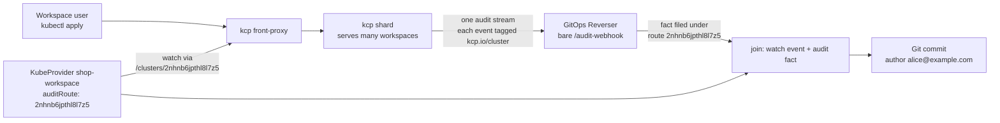

# Mirror kcp workspaces

This guide mirrors the resources of one or more [kcp](https://www.kcp.io) workspaces into Git, and
optionally names the workspace user who made each change as the commit author. It is for a
platform administrator who runs kcp and installs GitOps Reverser beside it.

The guide has two parts, and you can stop after the first:

- **Mirror a workspace** ([step 1](#1-connect-each-workspace)). Each workspace is reached through
  its own `KubeProvider`, like any other remote cluster. Nothing about it is kcp-specific, and every
  commit is authored by the configured committer.
- **Name each change's author** ([steps 2–4](#2-turn-on-the-bare-endpoint)). This is where
  kcp differs from an ordinary cluster: one kcp shard sends the audit events of all its workspaces
  in a single stream, so GitOps Reverser has to tell from each event which workspace it came from.

## Before you start

- GitOps Reverser runs in an ordinary Kubernetes cluster, installed following the
  [quick start](quickstart.md). This guide calls it the **control cluster**. All GitOps Reverser
  objects (`GitTarget`, `KubeProvider`, `WatchRule`, and the rest) live there, so a workspace needs
  none of its CRDs.
- For each workspace you mirror, you have a credential whose RBAC in that workspace can read the
  namespaces and types you want in Git.

For commit authors you also need:

- Author attribution enabled, with a place to keep author facts until the matching change arrives:
  Redis/Valkey, or `memory` for a single replica. See
  [step 1 of the attribution guide](attribution-setup-guide.md#1-enable-the-receiver).
- Access to the audit configuration of every kcp shard: the kcp-operator's `RootShard` and `Shard`
  objects, or the shard's own flags.

## Words this guide uses

- **Workspace:** a kcp tenant's own Kubernetes API, with its own namespaces, objects, and CRDs.
  Every workspace is backed by a **logical cluster**.
- **Logical cluster name:** the short, opaque identifier of a workspace, such as
  `2nhnb6jpthl8l7z5`. It is distinct from the workspace **path**, such as `root:shop`, which is
  readable and is what `kubectl ws` navigates. This guide uses the logical cluster name everywhere.
- **Audit route:** the label GitOps Reverser files each author fact under. A `KubeProvider` reads
  the facts of exactly one route, its `spec.attribution.auditRoute`.
- **Bare endpoint:** `/audit-webhook` with no route in the path. It reads each event's route from
  an annotation on the event, so one shared audit stream can carry many workspaces. The ordinary,
  **named** endpoint `/audit-webhook/<route>` files every event it receives under that one route.

## How the pieces fit



GitOps Reverser names an author by joining two streams that arrive separately:

1. The **watch event**: the change itself, read from the workspace through its `KubeProvider`.
2. The **audit fact**: who made the change, built from the shard's audit event.

The kcp shard tags every audit event with the logical cluster name of the workspace it served, in
the `kcp.io/cluster` annotation. The bare endpoint files each event under that name as its
route. So the join works exactly when a workspace's `KubeProvider` carries that workspace's
logical cluster name as its `spec.attribution.auditRoute`.

When the two differ, nothing fails. Mirroring stays complete, and every commit through that
provider is authored `unknown (attribution unresolved)`. Most of the steps below exist to keep the
two values equal, and [the troubleshooting table](#when-commits-are-authored-unknown-attribution-unresolved)
shows how to compare them.

## Find the workspace's logical cluster name

kcp stores it in the `Workspace` object's `spec.cluster`, which you read from the parent workspace:

```bash
kubectl ws :root
kubectl get workspace shop -o jsonpath='{.spec.cluster}{"\n"}'
```

The examples below use `2nhnb6jpthl8l7z5` for the `root:shop` workspace. Repeat the steps for each
workspace you mirror.

## 1. Connect each workspace

Create a kubeconfig whose `server` is the front-proxy address with `/clusters/<logical cluster
name>` appended. Store it in a Secret in the control cluster, and create a `KubeProvider` beside it:

```yaml
apiVersion: v1
kind: Secret
metadata:
  name: shop-workspace-kubeconfig
  namespace: team-shop
stringData:
  value: |
    apiVersion: v1
    kind: Config
    clusters:
      - name: shop
        cluster:
          server: https://kcp-front-proxy.example.com:6443/clusters/2nhnb6jpthl8l7z5
          certificate-authority-data: <base64 CA of the front-proxy>
    users:
      - name: gitops-reverser
        user:
          token: <a token with read RBAC in the workspace>
    contexts:
      - name: shop
        context: {cluster: shop, user: gitops-reverser}
    current-context: shop
---
apiVersion: configbutler.ai/v1alpha3
kind: KubeProvider
metadata:
  name: shop-workspace
  namespace: team-shop
spec:
  secretRef:
    name: shop-workspace-kubeconfig
  attribution:
    auditRoute: 2nhnb6jpthl8l7z5   # the workspace's logical cluster name
  allowedGitTargets:
    - consumerNamespaces:
        from: Same
      sourceNamespaces: [storefront]
```

`allowedGitTargets` is the provider's grant: `GitTarget`s in its own namespace (`team-shop`) may
mirror the `storefront` namespace of the workspace through it. The
[grants section of the configuration reference](configuration.md#the-grants) explains the other
shapes.

kcp also accepts the path in the URL (`/clusters/root:shop`), and mirroring works either way. Using
the logical cluster name in both the URL and `auditRoute` leaves one value to check. Setting
`auditRoute` now costs nothing while author attribution is off, and saves a second edit later.

The kubeconfig must embed its credentials. One that runs an exec plugin, skips TLS verification, or
names a file is refused, as described under [`KubeProvider`](configuration.md#kubeprovider).

Then point a `GitTarget` at the provider and select what to mirror with a `WatchRule`. Both live in
the control cluster. The `GitBranch` named here is one you created as in the
[quick start](quickstart.md) or [`config/samples/`](../config/samples/):

```yaml
apiVersion: configbutler.ai/v1alpha3
kind: GitTarget
metadata:
  name: shop
  namespace: team-shop
spec:
  gitBranchRef:
    name: shop-main
  kubeProviderRef:
    name: shop-workspace
  path: workspaces/shop
---
apiVersion: configbutler.ai/v1alpha3
kind: WatchRule
metadata:
  name: shop-configmaps
  namespace: team-shop
spec:
  gitTargetRef:
    name: shop
  rules:
    - apiGroups: [""]
      apiVersions: ["v1"]
      resources: ["configmaps"]
      sourceNamespace: storefront   # a namespace inside the workspace
```

Three things differ from a cluster with its own API server:

- **Namespaces are on two sides.** The `GitTarget` and `WatchRule` live in `team-shop` in the
  control cluster. The namespace they mirror, `storefront`, lives in the workspace. That is why the
  rule names it with [`rules[].sourceNamespace`](configuration.md#watching-a-different-source-namespace),
  and why the grant lists it.
- **Each workspace is its own API.** Two workspaces can serve different versions of a CRD with the
  same name, and each `KubeProvider` discovers its own. Nothing is shared between providers.
- **Keep all providers of one workspace in one namespace.** An audit route belongs to one
  namespace of the control cluster: the namespace of the oldest provider carrying it. A provider in
  another namespace carrying the same logical cluster name reports `Stalled=True` with reason
  `AuditRouteConflict`. See
  [audit route and `AuditFactsReceived`](configuration.md#audit-route-and-auditfactsreceived).

Mirroring works at this point, and every commit is authored by the configured committer. If that is
all you need, you are done. The next steps add the commit author.

## 2. Turn on the bare endpoint

Set the annotation key in the chart values, together with author attribution:

```yaml
attribution:
  enabled: true
  auditRouteAnnotationKey: kcp.io/cluster
```

The chart passes it to the operator as
`--author-attribution-audit-route-annotation-key=kcp.io/cluster`. That turns on the bare
`/audit-webhook` endpoint, which reads each event's route from its `kcp.io/cluster` annotation. One
batch from a shard can therefore hold events for many workspaces, and each is filed under its own
route.

If you also attribute changes made in the control cluster itself, keep its API server on its named
route, `/audit-webhook/<release namespace>.local`, as in the
[attribution guide](attribution-setup-guide.md#2-configure-delivery-on-every-api-server). Its
events carry no `kcp.io/cluster` annotation, and the bare endpoint drops an event without one
instead of guessing a route.

## 3. Deliver every shard's audit stream

Every shard sends its own stream, so configure each one: the `RootShard` and every `Shard`.

Build the webhook kubeconfig as in the
[attribution guide](attribution-setup-guide.md#2-configure-delivery-on-every-api-server), with
mutual TLS, `tls-server-name`, and an address the shard can reach. The Service name below works
when the shard runs in the control cluster. End the `server` URL at the bare endpoint, with no
route after it:

```yaml
server: https://gitops-reverser-audit.gitops-reverser.svc:9444/audit-webhook
tls-server-name: gitops-reverser-audit.gitops-reverser.svc
```

Appending a route would file every event of the stream under that one route, whichever workspace
it came from.

With the kcp-operator, store that kubeconfig in a Secret in the shard's namespace under the key
`kubeconfig`, store the audit policy in a ConfigMap, and reference both from `spec.audit`:

```yaml
apiVersion: operator.kcp.io/v1alpha1
kind: RootShard   # and the same block on every Shard
metadata:
  name: root
  namespace: kcp
spec:
  audit:
    policy:
      configMap:
        name: kcp-audit-policy
        key: policy.yaml
    webhook:
      configSecretName: kcp-audit-webhook
      mode: batch
      batchMaxWait: 1s
      batchMaxSize: 400
```

A shard run without the kcp-operator takes the kube-apiserver audit flags that the attribution
guide lists.

Two settings matter more than on an ordinary API server:

- **Keep `batchMaxWait` below `--author-attribution-grace`** (default `3s`). A watch event waits at
  most that long for its fact. A batch held longer than the grace delivers facts after their watch
  events have already been committed without an author.
- **The policy covers every workspace on the shard.** Start from the
  [tuned policy](../test/e2e/cluster/audit/policy.yaml) and its notes under
  [choose the audit policy](attribution-setup-guide.md#choose-the-audit-policy). A type the policy
  excludes can never be attributed in any workspace.

## 4. Verify

Check that the provider's route is the workspace's logical cluster name. `-o wide` adds the `ROUTE`
column:

```bash
kubectl -n team-shop get kubeprovider shop-workspace -o wide
```

Then, inside the workspace and with an ordinary user's credentials, change an object the
`WatchRule` selects:

```bash
kubectl ws :root:shop
kubectl -n storefront create configmap attribution-check --from-literal=check=first
```

The commit lands once the target's commit window closes, about 5 seconds after the last change by
default. Pull the branch and check that the author is that user and the committer is unchanged:

```bash
git pull
git log -1 --format=fuller
```

The provider's `FACTSRECEIVED` column turns `True` once the first fact on its route arrives. It is
a latch: it records that the route has delivered at least once, not that it still does. Delete the
test ConfigMap afterward.

## When commits are authored `unknown (attribution unresolved)`

Start from the provider's `AuditFactsReceived` reason, then the audit metrics described in
[interpreting metrics](interpreting-metrics.md):

| What you see | Cause | Fix |
|---|---|---|
| `AuditFactsReceived=Unknown`, reason `RouteUnused` | Audit arrives, and none of it names this provider's route. Usually `spec.attribution.auditRoute` differs from the workspace's `spec.cluster` | Compare the `ROUTE` column with `kubectl get workspace <name> -o jsonpath='{.spec.cluster}'` in the parent workspace |
| `AuditFactsReceived=Unknown`, reason `NoAuditDelivery` | No audit request has reached the operator on any route | Check the shard's `spec.audit.webhook`, its Secret, and network reach to port 9444 |
| A steady rate of `audit_events_total{audit_route="unrecognized"}` | Events name a logical cluster no `KubeProvider` carries | Harmless for a workspace you do not mirror. Otherwise a mistyped `auditRoute` |
| A rising rate of `audit_events_total{outcome="missing_cluster_annotation"}` | Something posts to the bare endpoint without the annotation | Usually the control cluster's API server pointed at `/audit-webhook`. Give it its named route |
| The shard's webhook gets HTTP 400 | The bare endpoint is off: `attribution.auditRouteAnnotationKey` is unset | Set it ([step 2](#2-turn-on-the-bare-endpoint)) |
| `Stalled=True`, reason `AuditRouteConflict` | A provider in another namespace already holds this logical cluster name | Keep one workspace's providers in one namespace |

## How kcp tags the shared audit stream

You do not need this section to set things up. It explains why routing on `kcp.io/cluster` is
reliable, for readers who want to check.

A kcp shard is one API server process that serves many workspaces. Like any API server it has one
audit backend, so it sends one audit stream holding the events of every workspace it serves. To
make that stream separable, the shard adds three audit annotations to every event whose request it
resolved to a logical cluster:

| Annotation | Value |
|---|---|
| `kcp.io/cluster` | the logical cluster name |
| `tenancy.kcp.io/workspace` | the logical cluster name as well |
| `kcp.io/path` | the canonical workspace path, or empty when the shard could not read it |

A request filter on the shard adds them after it has resolved the `/clusters/<...>` part of the
URL to a logical cluster (`WithAuditEventClusterAnnotation` in kcp's
`pkg/server/filters/filters.go`). An event as the webhook receives it looks like this (trimmed):

```json
{
  "apiVersion": "audit.k8s.io/v1",
  "kind": "Event",
  "stage": "ResponseComplete",
  "verb": "update",
  "user": { "username": "alice@example.com" },
  "objectRef": { "resource": "configmaps", "namespace": "storefront", "name": "checkout-limits" },
  "annotations": {
    "authorization.k8s.io/decision": "allow",
    "kcp.io/cluster": "2nhnb6jpthl8l7z5",
    "tenancy.kcp.io/workspace": "2nhnb6jpthl8l7z5",
    "kcp.io/path": "root:shop"
  }
}
```

These are the event's own `annotations`: the map where every API server also records annotations
such as `authorization.k8s.io/decision`, beside `user` and `objectRef`. They describe the request,
so they are present whatever the request touched, including a `delete` that carries no object
body. They never appear inside `requestObject` or `responseObject`.

GitOps Reverser routes on `kcp.io/cluster` for three reasons:

- It is set on every event of a workspace request, while `kcp.io/path` can be empty.
- An audit route must be a lowercase, DNS-subdomain-shaped value, which the schema of
  `spec.attribution.auditRoute` checks. A logical cluster name fits; a path such as `root:shop`
  has a colon, and the API server refuses it.
- It is the same value the kubeconfig URL uses, so one string identifies the workspace across the
  whole `KubeProvider`.

### The same key on objects is a different thing

kcp also writes `kcp.io/cluster` into the `metadata.annotations` of every object it returns. That is
the copy you see in `kubectl get -o yaml` inside a workspace, and it records which logical cluster
the object was read from.

GitOps Reverser never routes on that copy. It strips the annotation, by exact key, before writing
an object to Git: it is an address, and a manifest carrying it would point at one workspace
wherever it was applied later. Other `kcp.io/` keys on an object are kept, because they are not
known to be bookkeeping.

## The trust boundary

The bare endpoint trusts the shard. Audit ingress checks the client certificate against the
shared audit CA, and any sender holding that credential can submit facts under any route. That is
the [shared audit-ingress trust model](../SECURITY.md#shared-audit-ingress-trust-model): suitable
when one privileged control plane, here kcp, serves every participating source and protects the
credential.

A workspace user cannot cross that boundary from inside a workspace. A client cannot set an audit
annotation: the shard writes the route from the logical cluster it served the request in. Whoever
holds the shard's client credential can submit any route, so protect it like the shard's own keys.
Run a separate GitOps Reverser when one tenant must not be able to influence another tenant's
commit authors, even through that credential.

## Saving from inside a workspace

A workspace user can save their open commit window with a `CommitRequest` created in the workspace
itself, once the `CommitRequest` CRD is installed there and the provider serves it. See
[serving the `CommitRequest`s of a source cluster](configuration.md#serving-the-commitrequests-of-a-source-cluster).
The request is authored from its own audit event, so it reaches GitOps Reverser through the same
shard stream and the same route as the user's other changes.

## Reference

- [`KubeProvider`](configuration.md#kubeprovider): credentials, grants, and the audit route.
- [Route a shared audit stream by event annotation](configuration.md#route-a-shared-audit-stream-by-event-annotation):
  the rejection rules of the bare endpoint.
- [Attribute commits to Kubernetes users](attribution-setup-guide.md): the receiver, the webhook
  kubeconfig, and the audit policy.
- [Interpreting metrics](interpreting-metrics.md): `audit_events_total` and its `audit_route` label.
