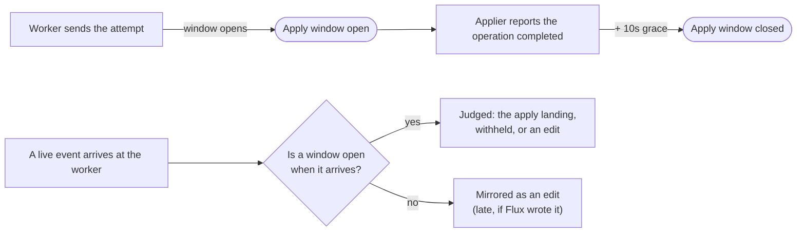
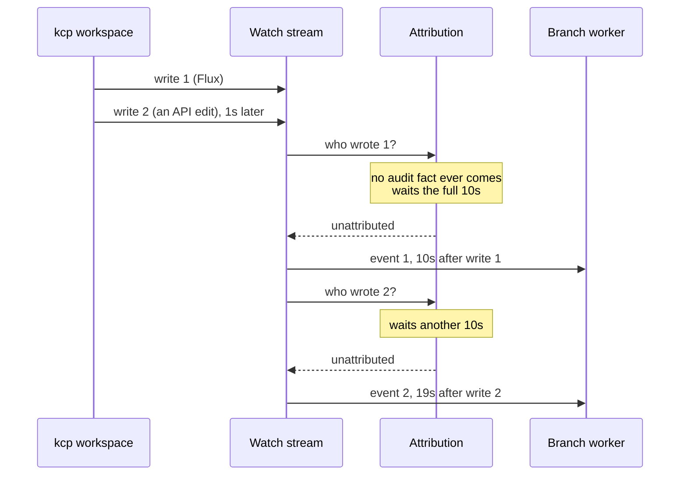
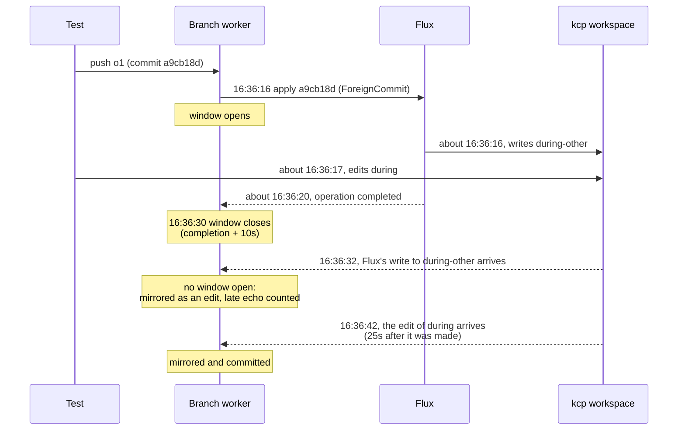
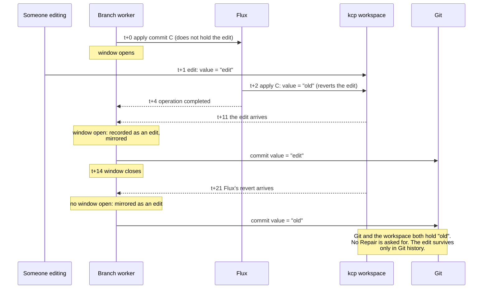
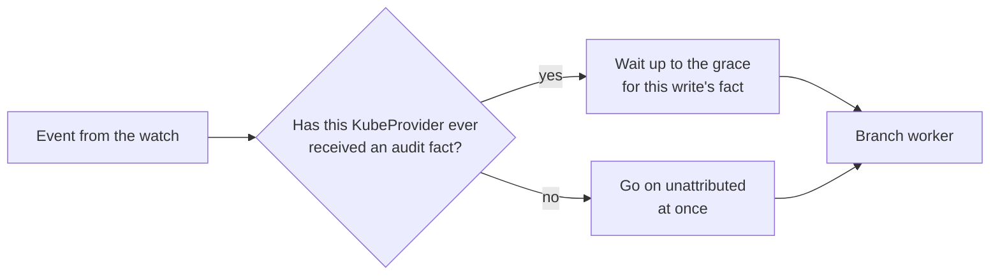
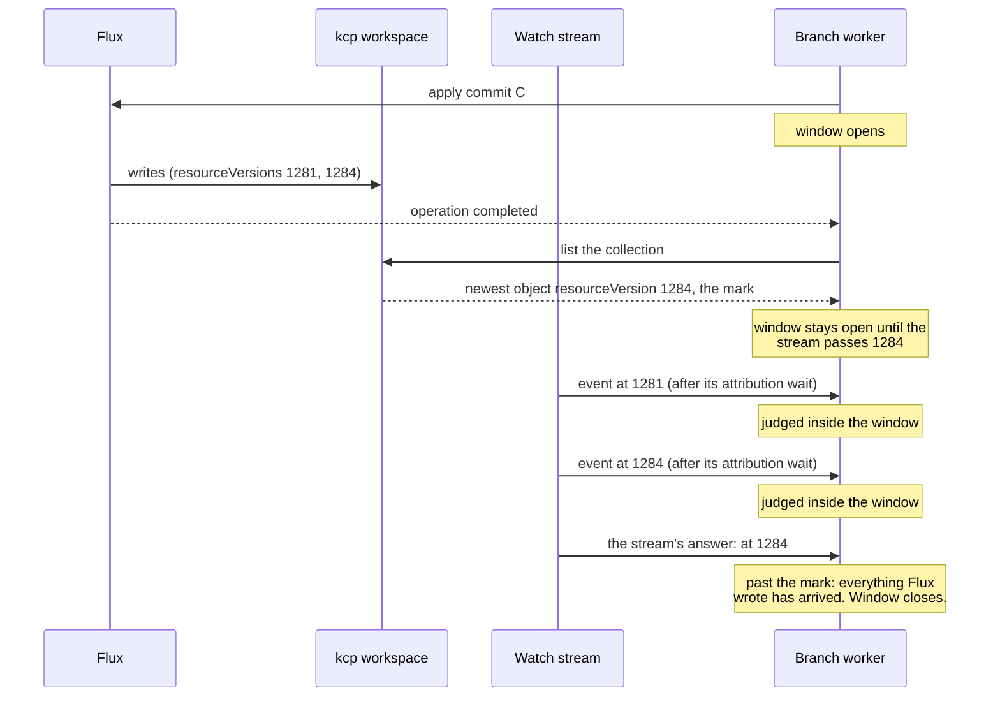
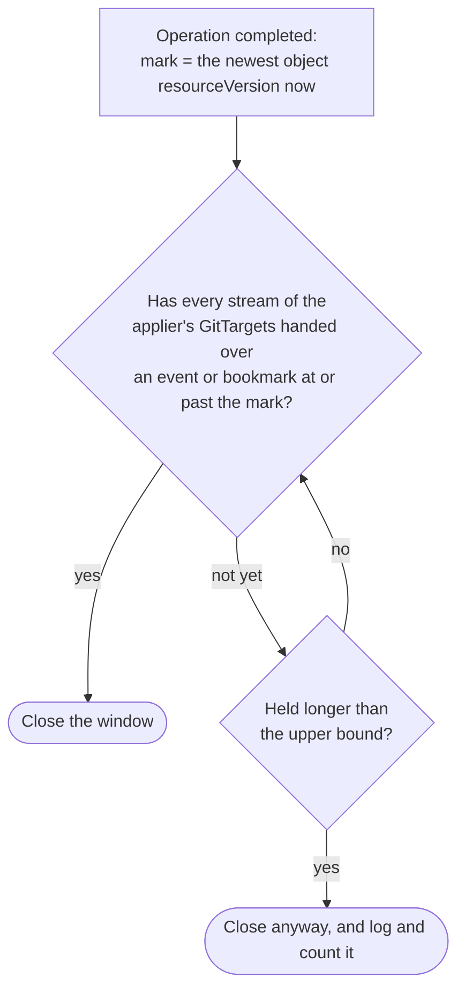

# The apply window misses late events from a cluster with no audit stream

On a source cluster that sends no audit facts, every event the watch delivers waits the full
attribution grace (10s in e2e) before it reaches the branch worker. The stream resolves events one at
a time, so the waits add up. The apply window closes on a wall clock, 10s after the applier reports
the apply finished, so the applier's own writes can reach the worker after the window has closed.
A write that arrives then is mirrored as an edit. If that write was an apply reverting a newer API
edit, the revert lands in Git and the edit is lost.

This was found by the source-cluster e2e for gitops-api's production topology (ask #34): Flux in the
operator's cluster applies into a kcp workspace, and the GitTarget mirrors that workspace through a
`secretRef` KubeProvider. The e2e kcp has no audit stream. The run is at commit `cf3b97be`.

Status: fix 2 below is implemented (`internal/git/apply_barrier.go`, `internal/watch/apply_barrier.go`),
with one change from the first draft: the mark is the newest resourceVersion among the collection's
objects, not the list's own, so a quiet stream does not wait for a bookmark.

## The apply window, in short

When the branch worker asks an applier to apply a commit, it opens an **apply window** for that
applier. Every live event for a GitTarget the applier covers is judged against it:

- A write by the applier's field manager alone, to an object nobody edited since the window opened,
  is **the apply landing**. Its content is the commit's, which Git already holds, so it is not
  mirrored (`apply_echoes_total{outcome="not_mirrored"}`).
- A write by the applier's field manager alone, to an object the API side edited after the window
  opened, is **the apply arriving late over that edit**. It is withheld, and a Repair puts the edit
  back on the cluster (`apply_window_collisions_total{outcome="withheld"}`).
- Any other write is an edit, and is mirrored as usual.

The window opens when the attempt is sent (`internal/git/applier_claim.go`, `openApplyWindow`) and
closes `applyWindowGrace` (10s) after the operation completed (`settleApplyWindow`). With no window
open, a write by the applier's manager alone is mirrored as an edit, and counted as
`apply_echoes_total{outcome="late"}`.

The window is judged by **when the event arrives at the worker**, not by when the write happened on
the cluster. That gap is the whole problem.

## Why events from the workspace arrive late

Between the watch and the worker, each event waits for its author: an audit fact that names who made
the write. On a cluster with audit, the fact usually arrives within a second or two. On a cluster
with no audit stream, no fact ever arrives, so every event waits the full grace
(`--author-attribution-grace`, 10s in e2e) and then goes on unattributed. In this run, the median of
`attribution_resolution_wait_seconds` was 10s.

A watch stream handles its events in order, one at a time (`internal/watch/target_watch.go`,
`attachAuthor` is called inline). So an event queued behind others waits for their waits as well.

## What this run observed

The collision spec pushed a Git-side change (`o1` to `during-other`), waited until the FluxClaim
showed the apply had been asked for, and then edited `during` through the workspace's API. These
are the worker's log lines, with the times the writes happened inferred from the spec's log.

Two things happened here:

- **Flux was faster than the edit.** It wrote before the spec's edit landed, so it never reverted the
  edit. There was nothing to withhold, the edit reached Git and stayed on the workspace, and
  `apply_window_collisions_total` stayed at 0. That is why the spec failed: it asserts that one
  collision is counted. Waiting for the operation token and then editing does not guarantee that
  the edit lands before the applier writes. The local E5 spec uses the same technique and passes
  whichever side wins, which is why it never asserts the counter.
- **One of Flux's writes arrived after the window closed.** `apply_echoes_total{outcome="late"}` is 1
  on this branch. Here it was harmless, because the write held what Git already held.

## What goes wrong when Flux does revert an edit

Had the edit landed before Flux's write, Flux would have applied the commit it was asked for, which
does not hold the edit yet, and so reverted it on the workspace. The window exists to catch that
write. With the delays above, the write reaches the worker after the window has closed:

This is the loss the apply window was built to prevent (#29), and from such a cluster nothing in the
window can catch it.

A longer grace does not fix it. Events wait in a queue, so the delay grows with the number of events
ahead: the edit in this run waited 25s, more than twice the grace, because it queued behind Flux's
write. No fixed grace covers every burst.

## Fix 1: do not wait for audit facts that never come

The KubeProvider's `AuditFactsReceived` condition says whether an audit fact has ever arrived on its
route. When it is not `True`, waiting for one is pointless, so attribution could skip the wait for
events from that provider. Events would then reach the worker within moments of the write, inside
the window.

It is small, and it also removes the 10s or more of delay on every edit mirrored from such a cluster.
It has two limits:

- On a newly added audited provider, writes made before its first fact arrives are recorded with no
  author. With the CommitRequest takeover (`cf3b97be`), a request could then take over their window.
- It does nothing for a cluster that does send audit facts but sends them slowly. The window still
  closes on the clock.

## Fix 2: close the window by how far the watch has got

The idea in one sentence: instead of closing the window "10 seconds after Flux said it was done", close
it "once the watch has delivered everything that happened on the cluster up to the moment Flux said it
was done".

Every write to a Kubernetes object gets a **resourceVersion**, a position in the cluster's log of
changes, and a watch delivers events in that order. So the worker can mark a position and wait until
the watch has passed it:

1. **Take a mark when the apply completes.** The worker lists the watched collection and takes the
   newest resourceVersion among its objects, say `1284`: the position of the latest write to anything
   in it. Every write Flux made for this apply happened before the apply completed, so each has a
   resourceVersion of at most `1284`.
2. **Keep the window open until the watch passes the mark.** The stream records how far it has got
   each time it records its cursor: after every event it handled, routed or not, and every
   **bookmark**, a progress-only event in which the API server says "you have everything up to
   resourceVersion X". Once it is at or past `1284`, it puts an answer on the worker's queue.
3. **Then close.** The answer rides the worker's queue behind every event the stream routed before
   it, so once every stream has answered, every write Flux made has reached the worker, however long
   attribution held each one. The window then closes at the end of its grace, or at once if that has
   passed.

The list's own resourceVersion would be the cluster's current position, which a quiet stream passes
only on a bookmark, and a bookmark can be a minute away. An object's resourceVersion is a write the
stream has seen or will see.

The decision the worker makes, for each window:

What it costs:

- **resourceVersions are opaque in the API contract.** Clients are not promised that they compare as
  numbers, though the API server's own watch cache compares them that way on etcd. A source whose
  resourceVersions do not parse as a number fails the barrier, and its window closes after its grace
  alone, as before.
- **A write Flux deleted is not in the list**, so its event can still arrive after the window. A
  DELETE is never withheld anyway, and the object it removes is one Git no longer holds.
- **A list per stream per apply.** It is paged, and made once when the operation completes.
- **A GitTarget can have several streams**, one per watched collection, and the applier can cover
  several GitTargets. The window waits for all of them.
- **An upper bound** keeps a stream that is disconnected or stuck from holding the window open
  forever. It is two minutes. Past it the window closes, and the close is logged and counted
  (`apply_window_barriers_total{outcome="timed_out"}`), so the miss is visible.
- **A window held open longer** judges more writes. A write by Flux alone to an object nobody edited
  is treated as the apply landing and not mirrored. That is still correct for an apply nobody asked
  for, because its content is what Git holds.

Fix 2 is the general fix: it covers a cluster with no audit stream, a cluster with slow audit, and a
burst of events of any size, because it waits for the watch itself rather than guessing a delay.
Fix 1 can come on top of it, to cut the delay on every mirrored edit from a cluster with no audit
stream.

## The spec, separately

Neither fix makes E5's way of provoking a collision deterministic: it edits once the apply was asked
for, and Flux often writes within a second of the resume, before the edit lands. The source-cluster
spec uses the delay this document is about instead. It edits first and pushes a Git-side change
right after. The edit's event waits out the attribution grace, so the push is heard, its apply asked
for and applied before the edit reaches the worker. The applied commit does not hold the edit, so
Flux reverts it, and with fix 2 the window still judges that write when it arrives, and withholds
it. That holds while the attribution grace (10s in e2e) outlasts the time from the push to the
apply request.
