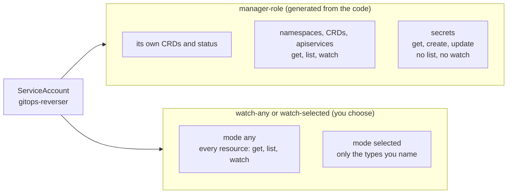
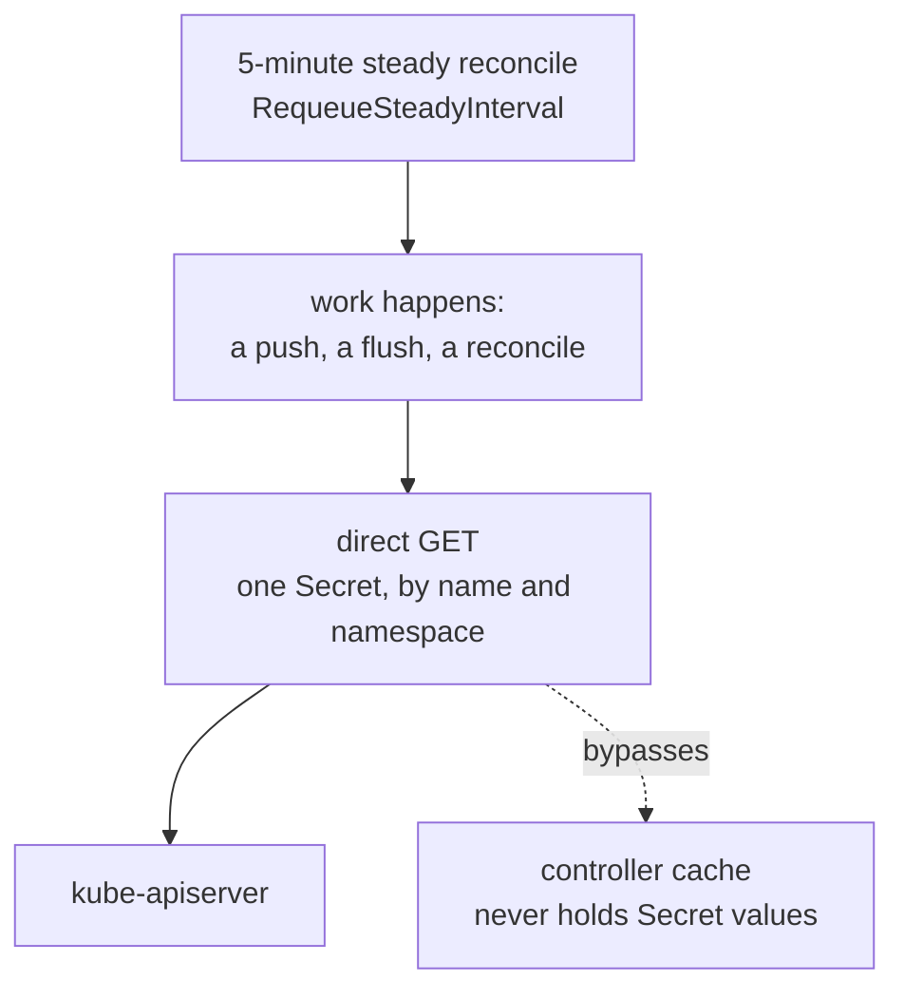

# Security Model

What GitOps Reverser can access, why, and which pieces are sensitive. Read this before installing.

## What the controller is allowed to read

The ServiceAccount is bound to **two** ClusterRoles, and keeping them apart is the whole point:
Kubernetes RBAC is additive, so a wildcard read folded in beside a narrow Secret rule silently
widens it.

To mirror live state into Git the controller must:

- **Read the watched types.** `WatchRule`/`ClusterWatchRule` pick them; the controller needs
  `get,list,watch` on each. `rbac.watchTypes.mode: any` grants that for every type at once —
  convenient, and it means the reverser can enumerate **every Secret in the cluster**. `mode:
  selected` grants only the types you name. See [`rbac.md`](rbac.md).
- **Read referenced Secrets.** The git-creds Secret, and the SOPS/age key Secret when encryption
  is configured, both named by a `GitProvider`/`GitTarget`; a remote cluster's kubeconfig Secret,
  named by a `KubeProvider` in its own namespace; and a webhook token Secret, named by a
  `GitReceiver` in its own namespace. So the controller reads Secrets in every namespace that holds
  one of those objects. This is a `get` by name, never a `list` or a `watch`.
- **Receive audit events.** The kube-apiserver audit webhook posts events to the audit ingress.
  Those carry object metadata and, for some resources, request/response bodies.
- **Drive an applier, only with an applier claim.** Holding a Flux `Kustomization` takes `get` and
  `patch` on it and its `GitRepository`, plus `list` on `Kustomization`s, `HelmRelease`s and
  `HelmChart`s; holding an Argo CD `Application` takes `get` and `update` on it. For the operator's
  own cluster the chart grants these in ClusterRoles of their own, only with `applierAccess.flux`
  or `applierAccess.argocd`.

Apart from the applier an applier claim holds, the controller never writes to a watched type. Its
write targets are Git, that applier, and the Secrets it generates itself (the signing key, and the
age key under `generateWhenMissing`).

### Which namespaces a rule may read from

RBAC above is the hard maximum; *within* it, scope is carried by the rule **kind**:

- A **`WatchRule`** selects namespaced resources. Each `spec.rules[]` item watches the rule's own
  namespace by default. Naming any other source namespace — including `sourceNamespace: "*"` —
  requires `KubeProvider.spec.allowCrossNamespace.sources`, a delegation by the provider's owner that
  is false by default. That flag is the only namespace policy in this direction: what may actually be
  read is bounded by the provider credential's own Kubernetes RBAC, and a `"*"` reaches every
  namespace that credential can read, as one cluster-wide watch.

  On an **`inCluster`** provider that delegation deliberately bypasses live namespace RBAC: the owner
  of an admitted `GitTarget` can then mirror another namespace's objects — read through the
  operator's own cluster-wide credential — into a Git destination they control. That is legitimate to
  grant on purpose, and it is why the flag exists and defaults to false.
- A **`ClusterWatchRule`** selects cluster-scoped resources only. Cluster-scoped objects have no
  namespace, so no namespace policy bounds it: it is intentionally cluster-global. Isolating
  cluster-scoped objects between tenants therefore takes a separate `KubeProvider` and credential
  per tenant, so that credential's RBAC is the boundary.

The audit question is one per kind: read a `WatchRule`'s items and the delegation flag on its
target's `KubeProvider`, or recognize a `ClusterWatchRule` as cluster-global. In both cases the
provider credential's RBAC in the source cluster is the outer bound, and it is the only one.

## The controller does not hold Secret values

There is **no Secret informer**. The manager is built with `Client.Cache.DisableFor:
corev1.Secret` ([`cmd/main.go`](../cmd/main.go)), so a typed Secret read bypasses the cache and
goes straight to the API server. No control-plane Secret watch exists; the `GitTarget` one was
removed.

The trade is deliberate: no instant reaction to a rotated credential, in exchange for a process
that cannot leak Secret values it was never asked to hold. A rotated git credential or age key is
picked up by the next direct read when work happens, and at the latest by the 5-minute reconcile.

This is why the manager role asks for `secrets: get, create, update` and nothing more — the
runtime genuinely does not need `list` or `watch`. What it does **not** do is scope those verbs to
a namespace: a `GitProvider` or `KubeProvider` reads its Secret in its own namespace, and either may
live in any namespace, so the grant is cluster-scoped. A
`selected` install therefore cannot *discover* a Secret, but can still read one whose name and
namespace it already knows. Narrowing that further is
[remaining work](future/least-privilege-remaining-work.md).

## Sensitive trust boundaries

| Boundary | Why it matters |
|---|---|
| Git credentials Secret | Grants push access to your repository. |
| SOPS/age key material | Decrypts (and the public key encrypts) Secret data written to Git. |
| Redis/Valkey queue | Buffers decoded audit events in transit; not an audit archive. |
| Audit ingress (`/audit-webhook/<route>`, such as `/audit-webhook/gitops-reverser.local` for the chart's provider) | Accepts audit traffic; protected by mutual TLS via cert-manager. A route is held by one namespace: a `KubeProvider` elsewhere that carries it is `Stalled` (`AuditRouteConflict`) and reads none of its facts. |
| Push receiver (`--receiver-bind-address`, off by default) | Plain HTTP for Git hosts' push webhooks. Each `GitReceiver` route is a path derived from its token, whose Secret lives in the receiver's own namespace, and a delivery must carry a valid signature or token for it before its body is read. A delivery is only a hint: it wakes the branch worker of every `GitProvider`, in any namespace, whose `spec.url` names the repository it reports, and that worker reads the remote with its own provider's credential. The payload's repository URL is only compared with `spec.url`, never fetched, so a delivery cannot choose a URL, a credential or a commit. A worker holds at most one pending look however many deliveries arrive, so deliveries never queue up behind its writes; but they are not rate-limited, so a token holder, in whatever namespace, who keeps delivering can keep a matching worker reading its remote continuously. That availability cost is accepted: there is no per-worker cooldown. The `202` carries no body, so it does not say whether another namespace tracks a repository. |
| Generated Secret material | Signing keys and generated age keys live in cluster Secrets. |
| `accessFrom` label selectors on `GitProvider` and `KubeProvider` | A selector admits every control-cluster namespace whose labels match, so it is only as strong as the right to set those labels. Whoever can label a namespace can admit it, including a tenant allowed to edit its own namespace. Select on labels only the platform can set, or list namespaces by `names`. |
| `KubeProvider.spec.inCluster` and `--in-cluster-kube-providers` | `inCluster` wields the operator's own identity in the cluster it runs in. It is honored only for a `KubeProvider` the flag lists by exact `namespace/name` (no wildcards, empty by default); any other is `Stalled` (`InClusterNotAuthorized`) and never used. Anyone who can create a `KubeProvider` under a listed name wields that identity through it, so list only names in namespaces you control. |
| `KubeProvider.spec.allowCrossNamespace.appliers` | Lets every namespace the provider admits suspend and apply a `Kustomization` or `Application` in another namespace, such as `flux-system`, through the provider's identity. A delegation, not owner consent: it does not prove the namespace owns the applier or its repository. An applier claim only acts while an eligible `GitTarget` names it, and the binding check compares the `GitProvider` URL, not write access. |

## Secret data the controller writes to Git

Without encryption, a watched `Secret` is committed as-is (its data is plain in the repository). With
SOPS + age (`GitTarget.spec.encryption`), Secret values are encrypted before commit using the age
recipients, and the private key never leaves the cluster.

The write path **only encrypts** — nothing in the operator decrypts Git content — so it needs
**public age recipients only**. Concretely: no private identity is written to disk, `SOPS_AGE_KEY_FILE`
is never set, and Secret `data` is never handed to the `sops` process as environment. That holds even
when the recipient is derived from a cluster age-key Secret, which the controller reads once to take
the public half.

So: only watch `Secret` types you intend to commit, and prefer encryption. Secret-shaped custom
resource types can opt into the same encryption path at controller startup. See
[`sops-age-guide.md`](sops-age-guide.md).

## Git credentials Secret shape

`GitProvider.spec.secretRef` points to a Secret in the provider's own namespace. A `GitTarget` in
another namespace that writes through the provider, which its `spec.accessFrom` must admit, uses
that Secret without being able to read it. The controller picks the auth
method from the keys present, preferring an SSH key, then HTTP basic auth, then a bearer token. The
examples below use the Kubernetes-native key names; the reader also accepts the Flux and Argo CD key
names so an existing GitOps Secret works unchanged (see
[`design/git-credentials-interop.md`](finished/git-credentials-interop.md)).

### HTTPS (basic auth)

| Key | Required | Notes |
|---|---|---|
| `username` | no | Git username. Omit it for Azure DevOps, which ignores the username and reads the PAT from `password`. |
| `password` | yes | Token or password. It is what selects basic auth: a `username` with no `password` is an error. |

### HTTPS (bearer token)

| Key | Required | Notes |
|---|---|---|
| `bearerToken` | yes | OAuth/PAT bearer token; sent without a username (GitHub fine-grained PAT, GitLab access token). |

### SSH

| Key | Required | Notes |
|---|---|---|
| `ssh-privatekey` | yes | PEM-encoded private key (also read from Flux `identity` / Argo `sshPrivateKey`). |
| `ssh-password` | no | Passphrase for the private key, if any (also read from `password`). |
| `known_hosts` | conditional | Host key(s) for the Git server. SSH fails closed unless host keys are supplied by some source. |

Host key verification is enforced by default and fails closed. Host keys are resolved in priority
order: the Secret's own `known_hosts`, then `GitProvider.spec.knownHostsRef` (a namespace-local
ConfigMap/Secret), then an install-level default known-hosts ConfigMap in the controller's namespace
(`--default-known-hosts-configmap`). A `known_hosts` that is present but unparseable is always a hard
error. The controller flag `--insecure-allow-missing-known-hosts` disables verification **only** when
no source provided any host keys at all, and is for throwaway/development clusters only.
